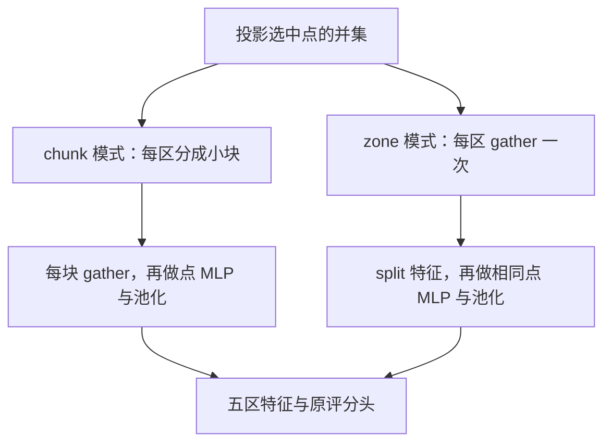

# batch 扫描后的取舍与最后一轮接触头优化

日期：2026-11-13（北京时间）。依据最新[完整显存/batch扫描报告](performance/CD010_GEOMETRY_MEMORY_RESULTS.md)，该报告对应测试源码 `a07659a`、结果提交 `d6a9328`。

**本页方案已执行。** [九档实测](performance/CD010_FINAL_OPTIMIZATION_RESULTS.md)均完成：H20 B4A2/zone128较同机有效batch8原路径提高17.79%，L20 B1A8/zone128提高29.40%，六组新正式训练已启动。用户随后要求补齐未测的完整batch组合，新入口为[batch/累积补测](BATCH_ACCUMULATION_SUPPLEMENT.md)的`--suite batch-combo`，每机六档全部固定zone128。以下保留当时`final`的有效batch8方案，不把它视为已测试B4A6/zone128，也不重复正式启动命令。

## 1. 扫描已经回答的问题

12档均已尝试，9档完成、3档CUDA OOM。以下为已完成的历史性能对照；最终训练已选有效batch8，因此最后一轮会在该正式条件下比较H20的B2/B4和L20的B1，不能把下表速度直接沿用为有效batch8的实测值。

| 主机 / 实验 | 采用的性能对照 | 有效batch | 帧/s | allocated / reserved 峰值 GiB | 选择依据 |
|---|---|---:|---:|---:|---|
| H20 / E5 | B4A6 / depth2 | 24 | 2.259727 | 89.08 / 138.55 | 比同轮B1快24.76%、B2快7.59%、B3快2.33%；本次完成候选中最快 |
| L20 / E3 | B1A12 / depth2 | 12 | 3.038967 | 11.56 / 25.54 | B2只快0.17%，allocated却升至22.43 GiB；B3更慢 |

H20的更大microbatch在几何重叠之后确实有收益，说明原先“加batch不提速”的结论有实现版本边界。但B3→B4只增加2.33%，收益已经趋缓。L20虽然能运行B3，却没有获得更高吞吐；这里的限制不能用“显存还没用满”解释。L20原始数值排名仍保留B2第一，不把0.17%的单次差异写成已经证实的收益。[原始结果](performance/CD010_GEOMETRY_MEMORY_RESULTS.md#2-完整吞吐和容量结果)

两机都继续保留depth2。H20/B8单图只有1.643636帧/s，比B4双图低27.26%；L20/B4单图只有2.107138帧/s，比B1双图低30.66%。这是整组配置的实测差异，因microbatch也不同，不能把全部差异都分配给流水线开关。

## 2. 显存上限已取消，三个 OOM 的含义不同

本轮`gpu_memory_limit_gib=null`，H20/B4的reserved达到138.55 GiB，L20/B2达到43.66 GiB，已没有原112/36 GiB人为配额。allocated、reserved、设备物理容量使用不同口径；尤其不能用各自独立记录的峰值相减，断言某个失败瞬间有多少连续可用空间。[容量记录](performance/CD010_GEOMETRY_MEMORY_RESULTS.md#4-三个oom档位)

| 失败设置 | 已记录的失败点 | 可以得到的结论 |
|---|---|---|
| H20/B8/depth2 | `encode_scene`的dense分块输出`torch.cat`；allocated133.53 GiB，新增请求6.39 GiB | 二者合计约139.92 GiB，已超过当时报错可见的139.80 GiB。仅再次取消配额或假定回收缓存，不能解决这次活跃张量与新增输出的容量需求 |
| H20/B6/depth2 | 反向；allocated127.38 GiB，新增请求4.84 GiB；设备空闲2.36 GiB、reserved中未allocated9.53 GiB | 分配器碎片或不可释放的分块可能参与失败，但快照不能证明唯一原因，更不能证明改一个allocator选项就能完整跑完B6 |
| L20/B4/depth2 | 反向；allocated38.84 GiB，新增请求3.23 GiB；设备空闲1.16 GiB、reserved中未allocated4.02 GiB | 当前实现及分配器状态下无法完成该设置；小一档B3已经没有吞吐收益，因此不把继续挤入B4作为下一优先级 |

H20/B8若要放入两份图，需要减少活跃/临时张量峰值或改变图的生命周期。这里先采用已完成且最快的B4，而不继续添加allocator组合、B5/B6重试或更大batch扫描。后面的接触头改动不宣称解决这些dense/反向OOM。

## 3. 当前暴露的等待已经很小，继续优化前向与反向

| 采用配置 | 更新中位数 | forward host | backward host | 几何future等待 | loader等待 |
|---|---:|---:|---:|---:|---:|
| H20/B4A6/depth2 | 10.625 s | 4.222 s | 5.470 s | 0.223 s | 3.019 ms |
| L20/B1A12/depth2 | 3.920 s | 1.938 s | 1.695 s | 0.073 s | 3.323 ms |

几何future等待与更新中位数之比约为2.1%和1.9%，loader等待只有约0.03%和0.08%。这是用已记录中位数说明量级，**不是GPU空闲率，也不是本轮加速的严格上限**。这些host区间含同步影响，不能机械相加，也不能据此判定某个CUDA kernel已达到算力或带宽上限。[阶段数据](performance/CD010_GEOMETRY_MEMORY_RESULTS.md#3-已有阶段日志揭示的限制)

CPU几何仍有实际工作量：采用配置的后台job中位数分别为6.110秒和2.661秒，只是大部分与GPU工作重叠。GPU部分变快后，CPU等待可能重新显现，因此后续继续读取已有future等待即可；当前不增加worker、几何线程或CPU亲和性扫描。

L20 B1→B3的反向host减少0.218秒，但前向增加0.200秒、future等待增加0.057秒，解释了为什么容量增加没有转成端到端收益。H20 B1→B4的主要可见变化也包括前向/反向缩短，不能把全部收益只归因于少等CPU。

## 4. 源码里可以直接减少的工作：按区域 gather

[ContactGrouping.encode_query](../models/contact_grouping.py)先投影被五区选中的点集，再按区域、按pose chunk执行点MLP和池化。现有`chunk`路径在每个小块内部执行`projected[rows]`，每次都建立一个可微索引分支，反向把梯度累加回同一个投影点集。

新`zone`路径把这一索引移到每个区域的分块之前，再使用已有`split`模式切分区域特征：



相应执行顺序为：

```python
# 原路径：每个 pose chunk 内索引。
def encode_zone(rows, mask, geometry, count):
    point_features = projected[rows]
    return encode_and_pool(point_features, mask, geometry, count)

# 可选新路径：每区只索引一次，再把可微特征交给 chunk_apply。
zone_features = projected[zone_indices]
features = chunk_apply(
    encode_and_pool, zone_features, mask, geometry, count,
    chunk_size=pose_chunk_size, input_mode="split",
)
```

上面是执行示意，实际MLP、池化、mask和count逻辑保留在模块内。若一份microbatch有`M`个候选，原路径建立`5 × ceil(M / pose_chunk_size)`次区域特征索引；新路径为每区一次，共5次。

| 标准每帧512候选 | 原chunk32 | 原chunk64 | 原chunk128 | 新zone模式，任意这三档chunk |
|---|---:|---:|---:|---:|
| H20，microbatch4，M=2,048 | 320 | 160 | 80 | 5 |
| L20，microbatch1，M=512 | 80 | 40 | 20 | 5 |

这是**源码操作数量的减少，不是已经测到的kernel热点占比或速度倍数**。按区gather减少重复索引及其反向分支；pose chunk再增至64/128，主要进一步减少小MLP、LayerNorm和池化调用次数。已有dense chunk65,536不控制这一循环，因此dense64k→128k收益小，并不否定独立的pose chunk优化。

按标准五区采样数32/64/32/32/32、投影维度64估算，全部区域gather输出元素量为`M × 192 × 64`：H20/B4的FP16规模约48 MiB、L20/B1约12 MiB，FP32为两倍。这只是张量规模估算，不是新增显存峰值或GPU测量结果。

## 5. 配置与实现边界

v4性能sidecar新增可选字段：

```json
{
  "contact_feature_gather_mode": "zone"
}
```

允许值为`chunk`和`zone`。缺省与配置生成器默认仍为`chunk`，保留已测执行方式；新候选通过`--contact-feature-gather-mode zone`显式启用。字段进入模型执行记录，便于对照实际使用的路径。[配置生成器](../scripts/prepare_from_scratch.py) · [v4字段校验](../suction20/performance.py) · [模型接线](../models/suction20net.py)

区域查询、原始点索引、FPS、几何描述、MLP权重、mask、计数、池化与输出定义沿用原实现。改变的是特征索引和梯度累加的组织方式；允许正常浮点归约差异，不增加历史checkpoint的AMP/RNG逐项对齐。代码检查只需要正常样本的输出和梯度检查及已有套件，不追加完整验证或新的恢复流程。

## 6. 最后一轮在正式有效 batch 8 下比较九档

入口为`benchmark_geometry_overlap.py --suite final`。H20在有效batch8下，B4只有两份microbatch，而已测B4A6有六份；因此最后保留B2A4和B4A2两个原路径对照，直接选正式条件下较快的一项。L20继续B1A8/depth2。

| 主机 / 实验 | Microbatch × 累积 | gather模式 | pose chunk | 用途 |
|---|---|---|---:|---|
| H20 / E5 | B2A4 / depth2 | chunk | 32 | 正式batch8的原路径对照之一 |
| H20 / E5 | B4A2 / depth2 | chunk | 32 | 正式batch8的另一原路径对照 |
| H20 / E5 | B4A2 / depth2 | zone | 32 | 单独减少重复gather |
| H20 / E5 | B4A2 / depth2 | zone | 64 | 按区gather与中等pose chunk |
| H20 / E5 | B4A2 / depth2 | zone | 128 | 按区gather与较大pose chunk |
| L20 / E3 | B1A8 / depth2 | chunk | 32 | 原路径对照 |
| L20 / E3 | B1A8 / depth2 | zone | 32 | 单独减少重复gather |
| L20 / E3 | B1A8 / depth2 | zone | 64 | 按区gather与中等pose chunk |
| L20 / E3 | B1A8 / depth2 | zone | 128 | 按区gather与较大pose chunk |

其余固定dense65,536、geometry8、affinity16、Torch8、workers4、FP16与FP32几何、fused AdamW、无人工显存上限、原冻结数据和512候选。每档48帧预热、240帧计时，即step6结束到step36结束；两机每档都是30次计时更新，共288个有效样本。

不再添加batch、worker、allocator、CUDA trace或其他优化矩阵。旧`--suite contact-head`的E24/E12四档方案只保留历史入口，本次使用`final`，不先跑旧方案再跑正式batch方案。

### 选择规则及开训动作

1. 在同机完整计时且正常结束的原路径候选中选最快一项；H20在B2A4/B4A2中选择，L20原路径为B1A8。
2. 只有新头候选比这个原路径至少快3%时才采用新头；否则保留原路径。3%是用于结束本轮的工程选择阈值，不是统计置信区间。
3. 选择结束后立即生成新的正式配置并从step0启动训练，无收益也开训。用户已经授权这个动作，不需要再等待确认、补一轮验收或进行额外恢复检查。

用以下入口在训练机执行最后测试与后续启动；GPU、CPU和数据路径取实际分配值：

```bash
export PYTHONPATH="$PWD"
export CUDA_VISIBLE_DEVICES="$GPU"
export OMP_NUM_THREADS=1 MKL_NUM_THREADS=1 OPENBLAS_NUM_THREADS=1

taskset --cpu-list "$TRAIN_CPUS" python scripts/benchmark_geometry_overlap.py \
  --suite final --hardware H20 \
  --no-gpu-memory-limit \
  --out-dir "$BENCH_ROOT/H20-E5-final" \
  --source-root "$DATA_ROOT/input_raw" \
  --label-root "$DATA_ROOT/output" \
  --backbone-root "$BACKBONE_ROOT" \
  --run --start-training --training-root "$FINAL_ROOT"
```

L20改为`--hardware L20`与新的`L20-E3-final`输出目录。多卡放置可通过`--resource-map`指定实际GPU/CPU映射，格式和各机启动范围见[最终执行文档](FINAL_OPTIMIZATION_AND_TRAINING.md)。默认只生成计划；`--run --start-training`才会完成最后测试并实际启动训练。

启动器直接调用原`train_pretrain.py`，保留原生checkpoint、日志和原定验证，不恢复旧协调器或旧训练，也不附加备份daemon。当前聊天环境没有真实H20/L20执行通道；已提供入口不等于训练已经启动，实际进程与启动记录以训练机执行结果为准。

## 7. 六组正式训练统一有效 batch 8

每组仍使用230,400个有效训练样本，换算为28,800次成功更新；warmup11,520样本即1,440次更新；每23,040样本即2,880次更新做一次原定验证，共10个节点。学习率峰值、Adam参数、loss和冻结数据不因有效batch8自动缩放。

| 实验 | 设备 | 正式microbatch / depth | workers | 精度与接触头选择 |
|---|---|---|---:|---|
| E0 / E1 | L20 | B1A8 / depth1 | 6 | FP16；无接触分组 |
| E2 | L20 | B1A8 / depth1 | 4 | BF16 dense / FP32 sparse；无接触分组 |
| E3 | L20 | B1A8 / depth2 | 4 | FP16；采用本机最后比较的选择 |
| E4 | L20 | B1A8 / depth2 | 4 | FP16；沿用L20/E3所选接触头，不加E4短测 |
| E5 | H20 | 所选B2A4或B4A2 / depth2 | 4 | FP16；采用H20最后比较的选择 |

正式任务均从头初始化，不把短测的288帧、优化器状态或checkpoint接入正式预算。历史B4A6的2.259727帧/s属于有效batch24；本轮将在正式batch8条件下做最后比较，之后直接开训并通过原训练日志记录长期吞吐，不再追加性能测试轮次。
