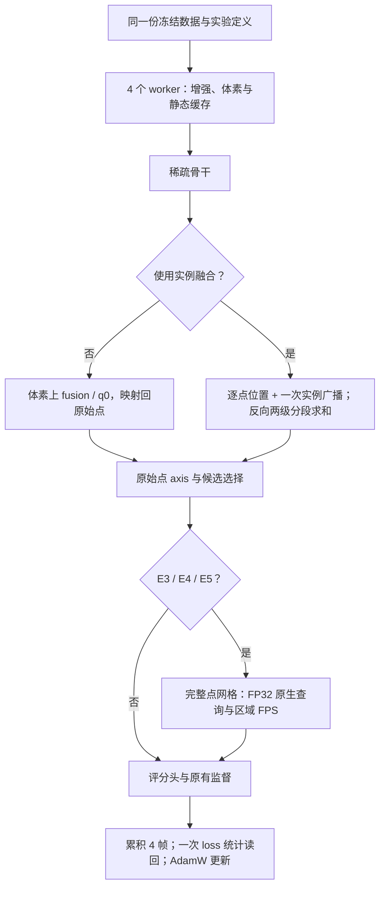

# CD-010：从头预训练的性能实现与使用方案

更新：2026-11-13，北京时间。实现基于合并后的 `main@ed2fa7a0`，对应此前的 P1/P2/P3。本文描述独立新训练的代码和候选执行配置；H20/L20 新路径的真实吞吐尚未测量。

**结论：从头训练可以启用共享体素头、重新选择 dense chunk、改变广播梯度归约和几何精度，不再把旧 checkpoint 的四帧 AMP 梯度/RNG 对齐作为准入条件。已实现配置生成器、两级分段广播反向、FP32 原生几何、可调线程与 worker、静态缓存、显式精度、融合 AdamW、按更新读回 loss，以及可选的局部编译。** CUDA 全点接触查询/FPS 和 GPU 数据增强本轮没有实现，理由与后续接口见第 8 节。

生成器按主机选择**未测资源候选**：H20 使用 **128k dense、8 个几何线程、16 个逻辑核 affinity**；L20 使用 **64k dense、4 个几何线程、8 个逻辑核 affinity**。两边先保留 B1A4、PyTorch CPU线程8、数据worker4、FP16、FP32几何和segment广播；无实例的E0/E1/E3自动开启共享体素头。具体候选表和少量定向测试见下文，尚未宣称这些数值是各主机最优值。

BF16已实现为显式选项：当前spconv 2.3.6下密集层使用BF16、稀疏骨干使用FP32，不能直接称为更快的全模型BF16。E2可优先使用这个选项处理已有的FP16投影溢出。

代码发布不改变现有 CD-009 训练。新配置、新 run 目录和新管理器账本分别使用 CD-010 命名；已有数据、标签和冻结物理定义继续复用。

## 1. 先校正原方案的依据

| 原提议或数字 | 对照最新仓库后的结论 | 本轮决定 |
|---|---|---|
| L20 64k 提升 28.40%，反向 4.8328→2.4779 秒 | 数字来自 **P2 的旧 slice 路径、L20/E5 零更新短测**。P3 已用 `split` 消除了大量切片反向开销，不能把 28.40% 叠加到现在的 P3 上 | 新训练启用 64k 候选；不承诺当前 split 路径还能获得相同收益 |
| E0/E1/E3 体素头可减少 70%–85% 的计算 | 共享的对象是 fusion MLP 与 q0；axis 仍依赖每个原始点的观测法向，接触分组仍需点特征。压缩比例取决于当前帧原始点数 P 与体素数 V | 开启共享；损失仍在全部原始点上按原规则计算，不把局部 MLP 压缩率当作整网加速率 |
| H20 64% 的反向时间来自实例广播 | P2 报告中是 `indexing_backward_kernel<float,4>` 占 **GPU kernel 区间并集**约 64%，不是端到端训练时间；具体表达式归属是源码支持的推断 | 重写最匹配的密集实例特征广播，但不宣称所有 indexing 开销都会消失 |
| BF16 能彻底解决 E2，并直接更快 | BF16 增大有限数值范围，但不能修复所有 NaN/Inf；固定 spconv 2.3.6 不支持 BF16 输入，稀疏层必须另选精度 | 提供 BF16 密集层 + FP32 稀疏层；FP16 仍是一般性能配置默认值，E2 显式选 BF16 |
| 扩大 worker 必须放弃旧 RNG 顺序 | P1 ticket 已由主进程确定样本和增强种子，worker 完成顺序不决定消费顺序。旧 sidecar 的 0/2 限制是当时选定配置的约束 | v4 放开 worker 配置；继续使用既有有序预取，不删采样器或恢复机制 |
| E2/E3/E4/E5 都能获得接触查询收益 | E2 含实例融合，**没有接触分组**；完整接触查询用于 E3/E4/E5 | 几何线程/四球五区优化只计入 E3/E4/E5；候选 FPS 的 FP32 路径可在其他实验使用 |
| FP32 + 编译标志使缓存、SIMD 性能翻倍 | FP32 坐标和距离缓冲字节数减半；物理缓存容量不变，整段程序也不会自动获得两倍吞吐 | 提供原生 FP32；保留现有可移植编译选项，不承诺 SIMD 倍数 |
| 2 秒几何移到 CUDA 后必然 5–10 ms，E3/E5 追平 E0/E1 | 2.3214/2.9139 秒是四帧更新窗口的 **forward host**，还含网络与同步；完整可变长度邻域、FPS 的顺序轮次和编码也有成本 | 不能作为实现或收益承诺；先落地有代码与可运行检查支撑的路径 |
| 编译“双分支力矩/异方差不确定性损失” | 当前训练实际使用质量 Smooth L1、法向项和可选 seal/wrench/collision 辅助项，没有所述异方差训练项 | 编译现有独立 MLP；保留当前损失定义与实例→帧→batch 归约 |

历史数据来源：[L20 P2 诊断](performance/L20_P2_BATCH_DIAGNOSIS.md)、[H20 P2 诊断](performance/H20_P2_BATCH_DIAGNOSIS.md)、[P3 应用及正常窗口](performance/P3_INTEGRATED_RESULTS.md)、[模型实现](../models/suction20net.py)、[当前损失](../suction20/losses.py)。这些记录提供优化方向，不提供新实现的测量结果。

## 2. 从旧执行路径到新执行路径



这张图描述新的执行方式。20 mm 物理定义、2 mm 网络体素、512 候选、五区的样本数、增强规则、监督有效掩码和原训练预算都沿用原配置。精度和归约顺序可以改变，所以不要求新运行重现旧 checkpoint 的梯度。

### 实验适用范围

| 实验 | 实例融合 | 接触分组 | 共享 fusion/q0 | segment 广播 | FP32 原生接触 |
|---|---|---|---|---|---|
| E0 | 无 | 无 | 开启 | 无相应模块 | 无相应模块 |
| E1 | 无 | 无 | 开启 | 无相应模块 | 无相应模块 |
| E2 | 有 | 无 | 关闭 | 开启 | 无相应模块 |
| E3 | 无 | 有 | 开启 | 无相应模块 | 开启 |
| E4 | 有 | 有 | 关闭 | 开启 | 开启 |
| E5 | 有 | 有 | 关闭 | 开启 | 开启 |

E5 继续带原辅助头。B1A4 表示 microbatch=1、累积4次、有效 batch=4；沿用它是已有吞吐结果支持的起点，显存空闲本身不足以选择更大 batch。新算子投入后可以重新判断 B2，但本次没有增加 batch/线程/worker 交叉测试矩阵。

### H20 / L20 分开选择资源

| 参数 | H20候选 | L20候选 | 选择依据 |
|---|---:|---:|---|
| dense chunk | 131,072 | 65,536 | H20有更宽裕的显存，可尝试更大的单次密集计算；实际收益由吞吐决定 |
| 原生几何线程 | 8 | 4 | H20为当前重接触/实例的E5提供更多候选并行能力 |
| CPU affinity数量 | 16 | 8 | H20为几何与后台生产留出更多并行资源；具体CPU ID来自实际分配 |
| PyTorch CPU线程 | 8 | 8 | 与affinity解耦，不因扩大资源池同时扩大Torch线程 |
| 数据worker | 4 | 4 | 是否增加到6看暴露的loader等待，不按显存大小决定 |
| allocator上限 | 112 GiB | 36 GiB | 沿用当前两台设备的资源上限口径，不等同于实际占用或整卡容量 |
| microbatch × accumulation | 1×4 | 1×4 | 先评估算子与资源组合，再决定是否重测H20的B2A2 |
| scene/object缓存 | 90/88 | 90/88 | 对应现有静态场景/物体范围，无需因H20内存更多而再加倍 |

以上是可生成、待测的起点，`selection_status`仍是`from_scratch`。没有接触模块的实验不会创建8个无用几何工作线程。用户显式CLI参数优先于preset，`--hardware-preset reference`保留原共同的64k/geometry4/affinity8起点供比较；其GPU内存上限继承源profile。

资源差异不改变实验定义。H20显存较多适合更大的chunk或以后重新评估microbatch，但不会使CPU几何自然并行，也不会自动提高loader吞吐。

## 3. GPU 密集路径的实现

### 3.1 按主机选择 chunk 与共享体素头

配置生成器将选定值同时写入`model.dense_chunk_size`和sidecar的`dense_chunk_size_override`：H20候选为131072，L20为65536，继续使用`chunk_input_mode="split"`。生成器支持`--dense-chunk-size`覆盖；H20的128k须与相同几何配置的64k比较，更大数值不自动代表更快。

E0/E1/E3 的 backbone 特征与场景重力在同一网络体素内相同，且不存在逐点实例相对位置输入，因此既有体素头实现可以复用。执行顺序为：

1. 在 V 个体素上运行 fusion 和 q0。
2. 通过 `inverse_map` 把 q0 映射回 P 个原始点；点标签、有效掩码、各实例的权重照旧。
3. 每个原始点仍使用自己的观测法向生成 axis；候选/接触分组继续使用原始点。

若 V/P=0.15，则这两段 MLP 的行数下降85%；这不等于整网 FLOPs、显存或更新时间下降85%。现有日志的 `point_count` / `voxel_count` 已可给出实际比例，无需增加新的计数系统。

实现：[Suction20Net](../models/suction20net.py)、[共享体素头测试](../tests/test_voxel_heads.py)。旧 AMP 四帧的失败记录保留在历史文档中，不用于阻止这次独立初始化。

### 3.2 实例广播：先完整广播一次，再两级分段归约

原密集融合的每个 chunk 都通过 `instance_features[slots]` 取得实例特征，反向会把大量点的贡献归约到少数实例。新 `instance_broadcast_mode="segment"` 的实现位于 [instance_fusion.py](../models/instance_fusion.py)：

1. 按 `(frame, input_instance)` 建立槽位，背景为槽位0。不同帧的同号实例保持分离。
2. 对点的槽位做一次稳定排序，得到实例连续布局；该布局也复用于原有 mean/max pooling 的行选择，省去每实例一次 `where`。
3. 自定义 autograd 前向用一次 `index_select` 生成整帧 P×128 实例特征，再用 `split` 将其交给各 fusion chunk。
4. 反向按照已排序布局读取点梯度，每段最多1024点，先求部分和，再按实例求和。FP16/BF16 输入的贡献在 **FP32** 中累加，最后转换为输入特征的 dtype。

为什么要两级归约：PyTorch 2.5.1 的 CUDA segment-reduce 内核中，每个 `(segment, channel)` 线程会遍历该段的点。若直接让一个拥有几十万点的大实例对应一个段，会限制并行度。1024点分段增加独立部分和的数量，再做很小的第二次归约。依据见 [PyTorch v2.5.1 官方实现](https://github.com/pytorch/pytorch/blob/v2.5.1/aten/src/ATen/native/cuda/SegmentReduce.cu)。这里没有用 `index_add_` 简单替换后就宣称热点消失。

代价是稳定排序、P×128 广播张量和反向排序工作区；这是以更多规则读写换取更合理的归约组织。它的真实净收益必须看 H20/E5 运行，不能直接扣除 P2 报告中的1.513秒。

**没有把有实例的整段 fusion MLP 移到体素尺度。** 该 MLP 还接收每个原始点相对于实例中心的位置；同体素内 xyz 不完全相同，也可能有多个实例。直接合并会改变输入与模型定义。新实现保留这些逐点特征，只改变实例128维特征的广播与梯度求和。

`instance_broadcast_mode="indexed"` 保留原实现，供选择另一条执行路径；新模型参数和 state_dict 键没有为此改名。

### 3.3 精度：FP16 默认，BF16 是有明确边界的选项

新增 [precision.py](../suction20/precision.py) 统一训练和独立评价的显式精度，配置键为 `training.precision`。

| 取值 | 稀疏骨干 | 密集层 autocast | 参数与损失 | GradScaler |
|---|---|---|---|---|
| `fp16` | 沿用旧 FP16 autocast 路径 | FP16 | FP32 参数、FP32 loss | CUDA 开启 |
| `bf16` | **FP32**，局部禁用 autocast | BF16 | FP32 参数、FP32 loss | 禁用 |
| `fp32` | FP32 | 关闭 | FP32 | 禁用 |

固定依赖 spconv 2.3.6 的 [torch→tensorview dtype 映射](https://github.com/traveller59/spconv/blob/v2.3.6/spconv/pytorch/cppcore.py) 不包含 BF16，其 [自定义 AMP 入口](https://github.com/traveller59/spconv/blob/v2.3.6/spconv/pytorch/functional.py) 使用 FP16。把外层 autocast 改为 BF16 并不能让它自然成为 BF16 稀疏网络。因此 [backbone wrapper](../models/backbones/spconv_resunet14.py) 在 BF16 模式下对 SparseConvTensor 和稀疏网络建立 FP32 区域，后续投影进入 BF16 密集区域。

这会绕开该路径中的 FP16 有限数值范围限制，适合作为 E2 已知投影溢出的新起点；也可能因 FP32 sparse 变慢。没有实测前不把它设为全系加速默认。BF16 不能保证所有计算有限，训练仍沿用原有非有限 loss/梯度处理。PyTorch 的 AMP 将 autocast 与 GradScaler 分开，参考 [AMP 文档](https://docs.pytorch.org/docs/stable/amp.html)。

禁用 scaler 时保留一个 disabled scaler 对象以复用原 checkpoint 接口，`state_dict` 为空，不做 scale/unscale 或动态 scale 更新。梯度裁剪和更新前的梯度范数处理仍存在，因此不能说“全部同步被移除”。旧配置没有 `training.precision` 时维持历史行为。

### 3.4 融合 AdamW、统计读回与可选编译

项目本来就使用 AdamW，本轮只在 `optimizer.fused=true` 且设备为 CUDA 时选择 fused 实现。学习率、betas、eps、weight decay 分组与梯度裁剪继续来自原配置；CPU 测试使用普通 AdamW。

v4 的 `UpdateLossAccumulator` 将每个 microbatch 的 detached loss 标量组成 FP32 向量，在 GPU 上累加，每次更新读回一次。它不保留 loss 计算图。日志仍记录各项平均 loss，异常总 loss 不进入 optimizer 更新。候选数量统计、几何 GPU→CPU 和其他现有诊断仍可能同步；这项改动只减少 loss 统计回读。

`compile_dense_heads=true` 是已实现但默认关闭的独立选项。它原地对 fusion、axis 内部 MLP、q0、pose/q、实例投影、接触编码 MLP 以及存在的辅助头执行：

```python
module.compile(dynamic=True, mode="default")
```

只编译规则子模块，不覆盖 spconv、CPU 几何和动态实例循环。使用 `default` 模式，不强制将可变 chunk 的整条路径捕获为 CUDA graph；参数名和 state_dict 键保持。首次编译时间应单列，不能把 CPU AOT smoke 当作 CUDA Inductor 的吞吐结论。现有 loss 有动态掩码和实例分层归约，本轮没有把整个 loss 强行编译。

## 4. CPU 几何：FP32、完整点网格与可调线程

实现文件：[C FPS](../models/csrc/fps_cpu.c)、[C++ 网格/接触查询](../models/csrc/spatial_index_cpu.cpp)、[Python FPS 接口](../models/geometry_ops.py)、[空间索引](../models/spatial_index.py)、[接触模块](../models/contact_grouping.py)。

### 4.1 新参数

| 参数 | 旧默认 | 新配置默认 | 含义 |
|---|---|---|---|
| `geometry_precision` | `float64` | `float32` | 网格坐标、查询距离、局部投影、区域 FPS 及距离缓冲的精度；候选 FPS 也使用相同精度 |
| `geometry_threads` | 2 | H20=8，L20=4 | 原生候选并行数，受可用CPU affinity和有效候选数约束，可显式覆盖 |
| `query_workers` | 1 | 1 | 历史 NumPy/SciPy 路径的设置；不是原生候选线程数 |
| `spatial_index.cell_size_m` | 0.02 | 0.02 | 全点均匀网格单元边长，**不是网络体素或几何下采样尺度** |

新 FP32 路径直接引用 `CpuGeometry` 的 Float32 XYZ，不再为原生网格构造惰性 FP64 全点副本。C/C++ 核心以不同标量类型实例化，FP64 原入口继续存在。FP32 模式可能改变接近边界或距离并列时的离散选择，这正是本次独立训练允许的数值变化。

### 4.2 保留的几何定义

- 使用完整原始点云建网格，四球查询覆盖既有五个区域；没有先用2 mm体素稀疏化接触几何。
- 五区完整计数与统计发生在 FPS 限额之前；不增加固定 K 邻域截断。
- 20 mm半径、区域边界、候选轴的含义和各区既有采样数保持。
- 随机旋转与增强仍按当前样本计算，邻域依赖本次预测轴，不能跨训练轮次缓存一套固定邻域。

线程继续使用现有`std::thread`分配候选任务。L20候选为4几何线程、4个数据worker共用8核亲和性；H20候选为8几何线程、4个数据worker共用16核亲和性。`torch.set_num_threads(8)`不会替代这些参数。新增`runtime.cpu_affinity_count`只控制管理器从已分配CPU pool中选取多少个逻辑核，`runtime.cpu_threads`仍独立控制Torch线程；旧配置无新字段时保留原有行为。

编译保持 `-O3 -fno-fast-math -ffp-contract=off`，C++ 继续带 `-pthread`。现有实现已使用 O3，不需要额外引入 OpenMP。没有用 `-march=native` 强制绑定某台 CPU 的指令集，也没有把 `fast-math` 混入本次数值策略。

原生扩展增加 FP32 能力版本标记，v4 的执行身份记录实际精度、线程、源码及二进制身份。需在新 checkout 重新构建；不用修改旧 live checkout。

## 5. 数据路径：4 worker、90/88 缓存与去重读取

默认数据 worker 从2改为4，继续 `spawn`、`prefetch_factor=2`、persistent worker 和 pin memory。可用 `--workers 6` 选择六 worker，但不默认同时扩大所有 CPU 参数。

P3 正常窗口中 E0/E1 的 loader 等待中位数分别为0.64262/0.56827秒/更新，说明计算变快后数据生产重新可见；E3 当时仍约0.001秒。四 worker 是针对这一新瓶颈的实现，不应把旧 P1 的“更多 worker 无收益”结论永久套用。来源见 [P3 正常窗口](performance/P3_INTEGRATED_RESULTS.md)。

新训练配置将 `data.scene_cache_size` / `data.object_cache_size` 设为90/88，并由 `make_source_dataset` 真正传到 dataset：

- 缓存对象为未增强的场景标定、相机位姿、实例记录与物体候选资料；不是84万点帧、增强结果或固定邻域。
- 缓存仍有界、进程独立、按需填充，不一次性载入整个数据集。多个 worker 各持有一份，因此内存会随 worker 数与已访问物体增长。
- `_scene()` 首次需要 frame0 实例记录时，将已读入的 table/poses 传给 `scene_frame0()`，避免再次读取同一组 NPY。
- 保留选择性 NPZ 读取、现有体素整理和 ticket 机制；更换 worker 数不需要重制数据或换增强方案。

实现：[datasets.py](../suction20/datasets.py)、[full_data.py](../suction20/full_data.py)、[runner.py](../suction20/runner.py)、[既有预取器](../suction20/prefetch.py)。`prefetch.py` 本身无需另写队列；新 v4 schema 允许传入4或6 worker，旧 sidecar 继续按旧字段解释。

## 6. 新配置与运行命令

### 6.1 构建与生成

在独立 checkout / 工作目录中构建扩展，沿用已有训练环境与外部骨干：

```bash
export PYTHONPATH="$PWD"
python setup.py build_ext --inplace
```

上述命令在新 checkout 根目录执行，后续命令继承这个 shell 的 `PYTHONPATH`。它让复用旧 venv 时优先导入当前源码，不用改动旧 live checkout 的 editable 安装。需要指定系统编译器的环境可用 `CC=gcc CXX=g++ python setup.py build_ext --inplace`。这里只构建小型 CPU 扩展，不需要 CUDA 编译器。

生成 L20/E3 新训练配置的例子：

```bash
python scripts/prepare_from_scratch.py \
  --base-config configs/runtime_profiles/cd009-v3/L20-E3.json \
  --out-dir /srv/cd010/configs/L20-E3 \
  --run-dir /srv/cd010/runs/E3_seed42 \
  --source-root /path/to/full-20261110/input_raw \
  --label-root /path/to/full-20261110/output \
  --backbone-root /path/to/graspness_modern
```

生成器只写`train.json`和`performance.json`，打印训练命令、`resource_request`和supervisor映射，不启动训练。默认`--hardware-preset auto`从源profile的host选择H20或L20候选；E5使用`configs/runtime_profiles/cd009-v3/H20-E5.json`即可自动生成128k/geometry8/affinity16。原profile提供实验定义与B1A4，其历史吞吐值不复制为新配置证据。

E2 的 BF16 候选例子：

```bash
python scripts/prepare_from_scratch.py \
  --base-config configs/runtime_profiles/cd009-v3/L20-E2.json \
  --out-dir /srv/cd010/configs/L20-E2-bf16 \
  --run-dir /srv/cd010/runs/E2_seed42 \
  --precision bf16 \
  --source-root /path/to/full-20261110/input_raw \
  --label-root /path/to/full-20261110/output \
  --backbone-root /path/to/graspness_modern
```

此例选择L20资源候选。若在H20跑E2，仍用E2的base config，并增加`--hardware-preset H20`，同时选择新的H20配置/run目录；生成器会设置H20资源与host字段，保持E2模型/损失/预算。不要把H20/E5直接当成E2的实验配置。

支持的调节项：`--hardware-preset`、`--dense-chunk-size`、`--workers`、`--geometry-threads`、`--cpu-affinity-count`、`--cpu-threads`、`--gpu-memory-limit-gib`、`--geometry-precision`、`--precision`、`--scene-cache-size`、`--object-cache-size`、`--instance-broadcast-mode`。显式数值覆盖对应preset。`--compile-dense-heads`显式开启局部编译；`--no-voxel-heads`、`--no-fused-optimizer`关闭相应项。

### 6.2 v4 性能配置示例

L20/E3 生成的 `performance.json`：

```json
{
  "schema_version": "suction20.performance.v4",
  "fps_backend": "compiled",
  "spatial_index": {"backend": "uniform_grid_cpu", "cell_size_m": 0.02},
  "contact_query_backend": "native_cpu",
  "no_instance_voxel_heads": true,
  "backbone_coordinate_fastpath": true,
  "dense_chunk_size_override": 65536,
  "chunk_input_mode": "split",
  "geometry_threads": 4,
  "geometry_precision": "float32",
  "instance_broadcast_mode": "segment",
  "compile_dense_heads": false,
  "query_chunk_size": null,
  "query_workers": 1,
  "loader": {
    "num_workers": 4,
    "prefetch_factor": 2,
    "persistent_workers": true,
    "pin_memory": true,
    "multiprocessing_context": "spawn"
  },
  "detailed_cpu_timing": false
}
```

`train.json` 同时包含显式 `training.precision="fp16"`、`optimizer.fused=true`、90/88 缓存，以及 `selection_status="from_scratch"` 的独立 runtime profile。这个状态表示代码生成的候选配置，不能解读为已经测量并选优。

性能 schema v4 与样本预算 contract v3 是两个不同概念。仍然执行每组230,400有效样本、B1A4时57,600次成功更新、原 warmup 和验证节点；不是把 v3 预算降级或重新计数。

### 6.3 启动、恢复、评价

单组直接运行使用生成器打印的命令，例如：

```bash
export CUDA_VISIBLE_DEVICES=1
export OMP_NUM_THREADS=1
export MKL_NUM_THREADS=1
export OPENBLAS_NUM_THREADS=1

python scripts/train_pretrain.py \
  --config /srv/cd010/configs/L20-E3/train.json \
  --performance-config /srv/cd010/configs/L20-E3/performance.json \
  --run-dir /srv/cd010/runs/E3_seed42
```

选择当前任务实际分配的GPU；本例的1只是命令示意。直接启动时，在该命令前加`taskset --cpu-list "$TRAIN_CPUS"`，其中`TRAIN_CPUS`填写实际分配的CPU ID：L20候选8个、H20候选16个。生成器不猜测0–15是否空闲。`cpu_affinity_count`声明资源数量，由supervisor或taskset落实；配置中的`cpu_threads=8`只控制PyTorch线程数。

正常暂停后的恢复仍使用**最初生成的两个配置**：

```bash
python scripts/train_pretrain.py \
  --config /srv/cd010/configs/L20-E3/train.json \
  --performance-config /srv/cd010/configs/L20-E3/performance.json \
  --run-dir /srv/cd010/runs/E3_seed42 \
  --resume /srv/cd010/runs/E3_seed42/last.pt
```

不要在恢复时把 `--config` 换成 `resolved_config.json`：现有恢复机制会比较原配置字节摘要。新运行可以恢复自己的 checkpoint；没有提供旧 CD-009 checkpoint→v4 的迁移，也不运行历史四帧 AMP 接续验收。

单独运行评价/推理则使用 **run 中的 `resolved_config.json`**，因为这两个脚本没有 `--performance-config` 参数；它包含训练时实际嵌入的 v4 几何和模型执行选项：

```bash
python scripts/evaluate.py \
  --config /srv/cd010/runs/E3_seed42/resolved_config.json \
  --checkpoint /srv/cd010/runs/E3_seed42/last.pt \
  --split val \
  --output /srv/cd010/runs/E3_seed42/metrics.json
```

内置训练验证已复用显式精度配置。以上独立评价是使用方法，不要求现在额外执行一次全验证；继续按原实验节点评价。

### 6.4 接现有多机 supervisor

`selected_profile()` 已允许 `selection_status="from_scratch"` 与 v4 sidecar 配对，仍使用现有启动、暂停、备份和自身恢复入口。生成器输出 `supervisor_entries`，包含：

- `profiles[host][experiment]`：新 train.json 的绝对路径和原字节 SHA256。
- `performance_configs[host][experiment]`：新 performance.json 的绝对路径和原字节 SHA256。

把这些项填入 **CD-010 的独立控制配置**，并使用新的 root/run/ledger 路径。v4 worker会把 trainer 的 `PYTHONPATH` 指向新 root 下的 `repo/`，避免复用venv时从旧editable安装导入模型。若已经确认相同机器的基础环境，不需要为了该实现再设计一套机器检查、19项连续性审计或故障演练。原管理器正常运行所需字段照现有 [运行指南](MODEL_USAGE.md) 提供即可。CD-009 的账本和 live checkout 继续按原身份运行。

H20配置中的`hosts.H20.gpus[GPU].cpus`须包含实际为该任务分配的16个逻辑CPU；旧示例只有8个，需要填入新分配的CPU列表。管理器按`cpu_affinity_count`选核，启动trainer时仍传`--cpu-threads 8`。多组实验的CPU pool继续互不重叠，不能把扩大一个任务资源写成占用另一个任务的核。

## 7. 验证范围与测量方式

### 已完成的代码检查

本轮只增加与新计算路径直接相关的正常输入检查：

- FP32 FPS 和完整网格邻域、正常区域边界、1/4/8线程选择的一致性。
- 两级广播的 FP32/BF16 梯度求和、保留逐点位置与多实例的模型接线。
- BF16 稀疏 FP32 区域、disabled scaler、融合优化器 CPU 路径及按更新 loss 统计。
- E3/E5 各一次真实小模型 forward、原 loss、backward、AdamW 更新，联合覆盖 BF16、native FP32、segment、split 和 E3 共享体素头。
- 配置生成、已有缓存读取、正式预算、supervisor 接入和自身恢复；复用原测试套件。

初次实现的本地C/C++扩展构建成功，完整[GitHub CI](https://github.com/chichu-lv/suctionnet_modern_20mm/actions/runs/43390906646)为 **381 passed / 1 skipped**，包括本地沙箱不支持的Unix socket预取测试。1项既有跳过需要真实release路径。主机preset/CPU解耦补充使用现有配置与supervisor正常路径检查。这些是CPU小模型/接线检查，不构成真实spconv CUDA/BF16/Inductor/fused AdamW的硬件性能证明。本环境无H20/L20、CUDA编译器或真实冻结数据，因此没有执行正式训练或产生新速度数字。

### 少量顺序比较，分别确定主机参数

使用生产`train_pretrain.py`的独立候选运行：每候选以相同seed42和样本计划从头运行到第30次成功更新，前10次用于预热，比较第11–30次。它实际执行当前精度、fused AdamW、v4 loss读回和持续预取。被选中的候选可从自己的30步checkpoint继续原预算；其他候选只作为参数比较，不把它们的样本计入最终运行。

不使用旧`benchmark_batch_cpu.py`作为v4端到端测量：它硬编码FP16 scaler/autocast、不做Adam更新、每microbatch读回loss，且16帧有限队列可能掩盖数据饥饿。无需再写一套性能框架或扩展旧脚本的历史含义。

**H20/E5：先做下面3个顺序候选，不交叉扫描。**

| 候选 | dense chunk | geometry线程 | affinity / Torch线程 | worker | 目的 |
|---|---:|---:|---|---:|---|
| H0 | 65,536 | 4 | 16 / 8 | 4 | 同一资源池中的参照 |
| H1 | 65,536 | 8 | 16 / 8 | 4 | 单独评估几何候选并行 |
| H2 | 131,072 | 采用H0/H1较快值 | 16 / 8 | 4 | 单独评估更大dense chunk |

两次比较分别只改变几何线程和chunk。默认H20 preset对应H2且geometry8；若H0更快，用`--geometry-threads 4`生成H2。这里的16核是H20候选资源安排，不需要再为“8→16”单开一项纯Torch线程测试。

H0/H1的生成参数分别为`--hardware-preset H20 --dense-chunk-size 65536 --geometry-threads 4`和`--hardware-preset H20 --dense-chunk-size 65536 --geometry-threads 8`；H2使用H20默认chunk。每个候选使用不同out/run目录，并传入同一实际数据与骨干路径。执行命令沿用第6节，并增加：

```bash
--pause-at-step 30
```

这是正常暂停，CLI退出码75，保存自己的checkpoint，不执行额外完整验证。之后用既有工具导出日志：

```bash
python scripts/export_training_logs.py \
  --run-dir /srv/cd010/candidates/H20-E5-H0 \
  --output-dir /srv/cd010/reports/H20-E5-H0
```

**L20按瓶颈增加一个对照即可：**

- E0或E1先用L20默认配置；若正常窗口仍明显等数据，再单独比较worker4和6。先在其中一组判断，不要求两组重复扫描。
- E3或E4先用L20默认配置；若几何仍主导，再比较`--geometry-threads 8 --cpu-affinity-count 16`这个额外资源组合，Torch仍8。它是组合资源收益，不能拆成纯线程效应；没有可分配的额外核时保留原8核方案。
- H20的128k胜出后，只有仍有明确密集分块开销时才考虑256k。H20的B2A2也只在上述执行路径确定后做一个可选对照；B4/B8不列为本轮任务。B2A2在新配置中设microbatch2/accumulation2，保持有效batch4，不假定BN与损失归约数值等价。

这些候选都不要求与旧checkpoint做四帧梯度、RNG或归约顺序对齐。优先读取以下已有字段：

| 关注点 | 现有记录 | 判断用途 |
|---|---|---|
| 总速度 | 成功更新数、有效帧数、窗口墙钟 | 含数据等待与正常日志/保存的真实吞吐 |
| 几何 | `frame_stats[].grouping_timings`，前向 host 区间 | 判断 FP32/线程后的几何是否仍主导；host 计时不是独立 GPU kernel 时间 |
| 数据生产 | `loader_wait_s`、`production_timing` | 判断4 worker能否覆盖主进程需求，二者不可相加 |
| GPU 路径 | backward/optimizer host、峰值 allocated/reserved | 判断 segment 和精度是否值得保留；不把利用率采样当吞吐 |
| 实际配置 | `execution.model_execution`、`precision`、`optimizer_execution` | 确认实际走的分支与精度 |
| 普通训练状态 | loss、有效监督、梯度范数、成功步 | 确认模型正在正常学习；后续指标沿用原开发验证节点 |

以同一主机/同一实验的第11–30步窗口墙钟计算有效帧吞吐，同时看loader等待、几何和峰值显存；不比较H20/E5与L20/E0来断言硬件快慢。如果只有约1%–2%且不稳定的差别，保留较少资源的设置即可，不为确定微小差异安排多轮重复。精度和compile开关在本轮资源比较中固定。所有候选执行配置在各自启动前固定，不在同一run中切换配置；最终选择写入该主机的配置及测量记录。

## 8. 本轮没有实现的部分，以及真正需要的后续工作

### 8.1 全 CUDA 接触查询/FPS

方向可行，但“一个 block/候选、全部邻域塞入 shared memory”不是对当前完整点语义的充分实现。各候选邻域长度可变，正常完整深度图的局部点数也可能超过适合的固定共享内存容量。不能为凑进 shared memory 隐式截断前K个点。

后续应沿现有接口实现 GPU 的全点网格键排序与 CSR 索引、完整邻域计数/写入、区域统计和按区域 FPS。较长邻域应使用全局内存工作区、分块统计与归约；FPS 仍需要顺序选择轮次。候选选择本身目前也有 CPU 部分，单独把接触算子移到 CUDA 不会自动消灭全部 GPU↔CPU 同步。

本轮未提供未编译的 CUDA 代码，也没有5–10ms性能承诺。需要可用的目标 GPU/CUDA 构建环境来实现与测量这一步；不是要求先完成额外训练或严格旧梯度对齐。当前已交付的原生 FP32 路径可以独立使用。

### 8.2 GPU 增强、法向重算与体素整理

这些张量操作可以迁到 GPU，但必须同时处理原像素索引、丢点后的各字段对齐、法向有效掩码和点→体素逆映射。当前原生 CPU 几何还需要增强后的点坐标；只迁增强会新增坐标回传，未必缩短端到端时间。

本轮先启用更多 worker 与缓存，保持已有增强/体素逻辑。如果 E0/E1 的普通运行仍暴露显著等待，再实现 GPU 数据入口；届时把是否需要 CPU 几何副本一并考虑。没有依据把84万点的排序、去重、聚合与传输统称为“几毫秒”。

### 8.3 体素级实例融合和全模型编译

前者会丢失现有逐点相对位置，必须重新设计融合因子并作为模型变化评估；本轮以两级广播解决同一热点。后者涉及 spconv 动态拓扑、CPU 控制流和不同长度邻域；已经提供独立 MLP 编译选项，没有将编译失败处理或全图捕获作为新工程项目。

## 9. 文件索引与交付边界

| 文件 | 本轮职责 |
|---|---|
| [from_scratch.py](../suction20/from_scratch.py) / [prepare_from_scratch.py](../scripts/prepare_from_scratch.py) | 独立配置生成，保留实验定义与预算，输出运行/管理器入口 |
| [performance.py](../suction20/performance.py) / [run_supervisor.py](../suction20/run_supervisor.py) | v4字段与from_scratch profile接入，不扩展旧迁移白名单 |
| [instance_fusion.py](../models/instance_fusion.py) / [suction20net.py](../models/suction20net.py) | 一次广播、两级归约、共享头与新执行参数 |
| [heads.py](../models/heads.py) | 可选局部编译 |
| [precision.py](../suction20/precision.py) / [training.py](../suction20/training.py) | 精度策略、optimizer与每更新统计 |
| [train_pretrain.py](../scripts/train_pretrain.py) / [validation.py](../suction20/validation.py) | 预训练、恢复与验证使用相同显式精度 |
| [spconv_resunet14.py](../models/backbones/spconv_resunet14.py) | BF16模式下的FP32稀疏区域 |
| [spatial_index_cpu.cpp](../models/csrc/spatial_index_cpu.cpp) / [fps_cpu.c](../models/csrc/fps_cpu.c) | FP32原生几何与可调候选并行 |
| [datasets.py](../suction20/datasets.py) / [full_data.py](../suction20/full_data.py) / [runner.py](../suction20/runner.py) | 缓存配置下传与场景重复读取去除 |

这份交付是可运行的新执行路径及其配置/说明。真实 H20/L20 加速幅度、E2新精度下的完整训练表现、CUDA几何和GPU增强均没有被记为已完成。
