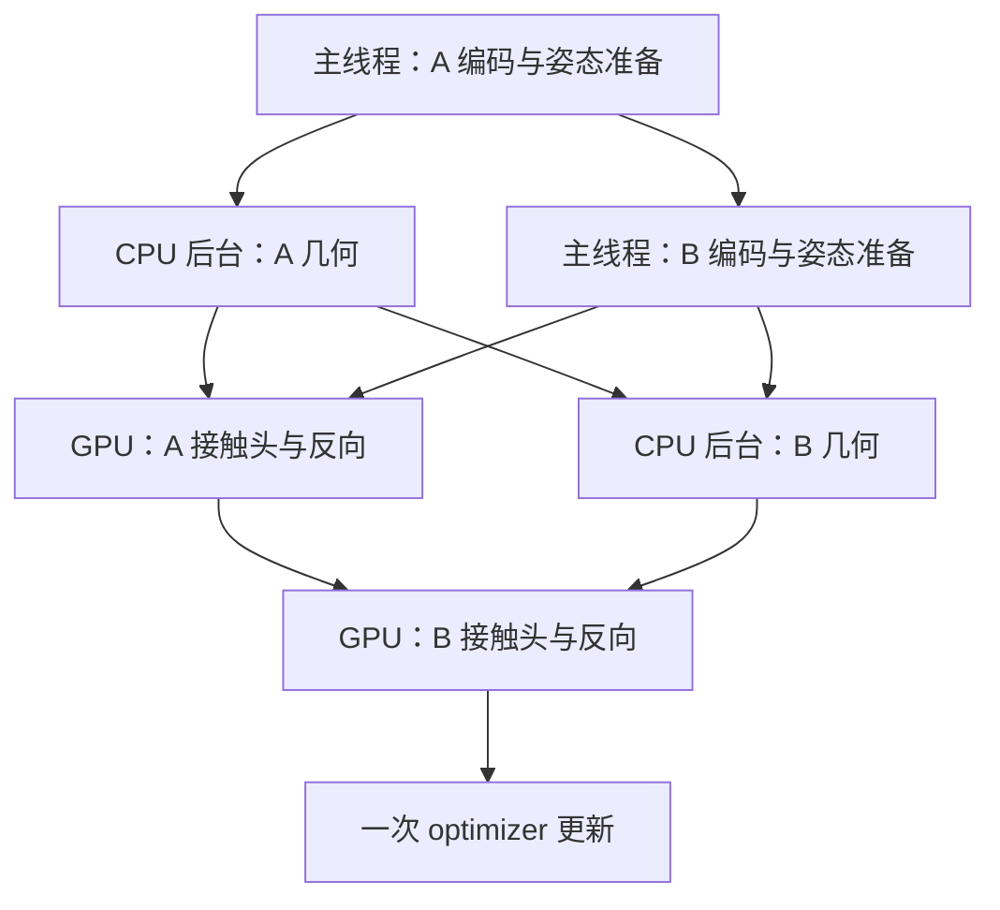

# CPU 接触几何与 GPU 计算重叠：实现与两机短测

日期：2026-11-13（北京时间）。适用于独立从头训练的 CD-010 v4 路径。

**实测更新（2026-11-13）：** 本文四个30步测试已完成，H20/E5吞吐+19.90%、L20/E3 +33.82%，详见[实测报告](performance/CD010_GEOMETRY_OVERLAP_RESULTS.md)。后续batch扫描、接触头比较及固定zone128/depth2的[十二档batch/累积补测](performance/CD010_BATCH_ACCUMULATION_RESULTS.md)均已完成。当前正式选择**H20 B4A12 / 有效batch48、L20 B1A12 / 有效batch12，六组全部从头训练**，采用决定和启动方式见[最终预训练配方](SELECTED_PRETRAINING_RECIPE.md)。下文保存原实现与当时的测试方案，不要求重复串行对照或重新补测。

**结论：剩余的 CPU/GPU 串行依赖可以通过调度重构缓解，本次已经实现同一次参数更新内的两份 microbatch 流水线。** 它把空闲显存用于保留两份尚未完成反向的中间结果，让 CPU 几何与另一份样本的 GPU 工作重叠。下面两组硬件对照已完成，净吞吐收益以上方实测为准，不把CPU功能测试算作GPU提速证据。

本轮只用 **H20/E5 和 L20/E3 各一个实验**。每台机器比较串行、流水线两个设置；不要求跑 E0–E5 六组，不增加完整验证、历史 checkpoint 梯度对齐或恢复审计。

## 1. 已知结果与尚待回答的问题

最新已测数据来自 [CD010_FROM_SCRATCH_RESULTS.md](performance/CD010_FROM_SCRATCH_RESULTS.md)，源版本 `84cae54` 中收录的真实训练窗口：

| H20/E5 设置 | 有效帧/s | 更新耗时中位数 | allocated / reserved 峰值 GiB |
|---|---:|---:|---:|
| B1A4，64k，geometry8 | 1.275904 | 3.1340 s | 11.13 / 22.26 |
| B1A4，128k，geometry8 | 1.282252 | 3.1173 s | 11.13 / 23.07 |
| B2A2，64k，geometry8，清理修复版 | 1.545357 | 2.6008 s | 21.60 / 44.54 |

因此，“增大 batch 已经没有收益”不符合最新记录。同版本的原版 B2 相对 B1 提高 **20.29%**，但该原版在计时窗口后的 worker 清理失败；清理修复后的 B2 正常结束，其相对旧 B1 的观测差约 **21.12%**，是跨版本的一次短窗口比较。B4/B8 在这条最新路径上的收益尚未测得。

随后`16e7c04`收录的[正式运行记录](performance/CD010_RUN_STATUS.md)确认六组CD-010已启动，旧CD-009停止。正式H20/E5仍为B2A2，成功step10结束至step100结束的窗口为 **1.535042帧/s**，allocated/reserved峰值 **21.65/59.71 GiB**。这是更长的实际运行观察，不是新的参数对照；也说明30步窗口的44.54 GiB reserved不应当作未来固定占用。新流水线未应用到这些正式部署。

CPU/GPU 串行是代码中明确存在的限制，却不能解释所有 batch 性能变化。更大 batch 同时影响稀疏卷积、实例归约、接触头分块和显存工作区。需要回答的是：**让几何与 GPU 工作实际重叠后，同样四帧能否更快完成？** 新入口直接做这项比较。

## 2. 为什么 dense chunk 翻倍只有约 0.5% 收益

`dense_chunk_size` 只被 [Suction20Net._chunks](../models/suction20net.py) 使用，不是整网的并行规模开关。

| 部分 | 是否受 dense chunk 控制 | 实际控制项 |
|---|---|---|
| fusion、q0、axis 的逐点 MLP | 是 | `dense_chunk_size` |
| 稀疏卷积骨干 | 否 | 活跃体素及 spconv 实现 |
| 实例 mean/max、分段广播反向 | 否 | 实例布局及分段归约 |
| CPU 候选采样、网格查询、筛选和 FPS | 否 | 几何实现及 `geometry_threads` |
| 接触特征 local projection | 否 | `chunk_apply` 默认 16,384 行 |
| 五个区域的 point MLP、pooling、zone projection | 否 | **`model.pose_chunk_size`，默认 32 个候选** |
| 损失与优化器 | 否 | 原训练实现 |

对于约 84 万行的逐点头，64k 和 128k 大约是 13 块和 7 块。翻倍 chunk 减少 Python/kernel 调用次数及尾块，但不减少 MLP 的总行数、乘加次数、特征读写或 CPU 几何工作。`split` 已经解决过的一部分切片反向开销也不会再次因翻倍 chunk 被消除。64k→128k 的实测只有 0.50%，说明这次放大没有显著缩短总路径；**还不能据此断言某个 GEMM 已经带宽饱和或算力饱和**，那需要具体 kernel 证据。

512 个候选在默认 `pose_chunk_size=32` 下，五区约有 `5 × ceil(512/32) = 80` 个区域编码块/帧。增大 batch 只增加候选总数，默认每块仍是 32；增大 dense chunk 不会改变它。`--pose-chunk-size 128` 已可独立指定，适合作为 GPU 接触头仍显著耗时时的下一项单独比较。本轮两个默认设置仍都用 32，先回答几何重叠有没有净收益。

当前 CD-010 和已有 runtime profile 已经 `checkpoint_dense=false`，不是仍在通过 activation checkpoint 节省显存；不要重复安排“关闭 checkpoint”的优化。

## 3. 串行依赖如何修改

### 原执行方式

每个 microbatch 都完整走完：GPU 编码与 dense 预测 → CPU 候选选择 → 预测姿态回读 → CPU 建索引/查询/筛选/FPS → GPU 接触头 → loss/backward，才开始下一份 microbatch。C++ 中的几何线程只是并行处理候选，返回前仍须全部结束。

### 新执行方式

把同一次更新的两个 microbatch 记为 A、B。主线程先完成 A 的编码与姿态准备，将已脱离计算图的 CPU 几何任务交给一个后台 executor；同时开始 B 的编码。A 的结果可用后，GPU 完成 A 的接触头与反向，CPU 继续 B 的几何。



图中的独立分支可以重叠，不表示它们等长或 CPU 时间已全部隐藏。所有 GPU/autograd 操作仍由主线程顺序提交；无需多个 GPU 计算流。PyTorch GPU 调用通常异步排队，CPU 后台原生几何释放 Python GIL 后可同时推进，依据见 [PyTorch CUDA 执行说明](https://docs.pytorch.org/docs/stable/notes/cuda.html#asynchronous-execution)。

### 实现接口

| 文件 / 接口 | 职责 |
|---|---|
| `models/suction20net.py::prepare_forward` | 在主线程运行编码、dense 预测、候选采样和姿态准备；保留 autograd 图，生成 CPU job |
| `models/contact_grouping.py::prepare_query` | 在主线程完成所需 D2H 和随机 roll 抽样，形成 CPU 请求 |
| `ContactGrouping.run_query` | 后台建立 CPU 索引，查询、区域筛选、FPS、描述量及索引重映射；每个 job 自带结果和计时 |
| `ContactGrouping.encode_query` / `Suction20Net.finish_forward` | 回到主线程做可微特征 gather、接触头及最终预测 |
| `suction20/geometry_pipeline.py` | 同一次更新内最多保留两份 microbatch，使用一个后台 executor，按原顺序消费 |
| `scripts/train_pretrain.py` | 共用原数据/损失/反向/optimizer 流程，写出几何工作与暴露等待指标 |

后台只处理 CPU 请求，不使用 CUDA，不调用 autograd，不抽取新的随机数，也不写共享的 `last_timings`。几何候选内部仍用已有 8 线程实现；不同时启两个各有 8 线程的几何任务，避免靠线程争抢掩盖问题。

流水线不会越过 optimizer 边界。两份样本均使用本次更新的参数，所有累积反向结束后才更新权重。没有用旧权重预先计算下一次更新。候选数、原始点、20mm 区域、FPS 样本数、监督和有效 batch 预算保持既有定义。

## 4. H20 的显存该怎么利用

显存容量使我们能同时保留更多有效工作，但不会自动提高 SM 计算速度。新方案的用途是存放两份尚未完成反向的编码结果、实例特征和中间激活，填补原来 GPU 等 CPU 的时段。

H20 以 **B2A2 + depth2** 为第一候选：一份 microbatch 有两帧，保留两份在途图，同一次更新仍是四帧。L20 先 **B1A4 + depth2**，减少并存激活的规模。显存峰值必须实测，不能拿原来的 reserved 数字机械乘二；参数、梯度和部分工作区共享，分配器保留内存又与活跃激活不同。

**B4A1 不适用这版跨 microbatch 流水线**：一次更新只有一份 microbatch，没有第二份可调度的工作，配置会明确拒绝 depth2 + accumulation1。这不表示 B4 本身永远不能更快。若要保留单个 B4 的 BatchNorm 行为并在内部重叠，需要再拆分 batch 内帧的后段处理；它不属于本轮为验证净收益所需的工作。

这轮已完成的测试当时使用 allocator 上限 H20 **112 GiB**、L20 **36 GiB**。后续[batch扫描](GEOMETRY_MEMORY_SCALING.md)已经取消人工上限；这里保留历史测量条件。性能目标是更多有效帧/秒，下一轮实际比较更大工作批次能否带来收益。

## 5. 已完成的历史硬件比较：每机一个实验

| 设置 | H20 | L20 |
|---|---|---|
| 唯一代表实验 | E5 | E3 |
| microbatch × accumulation | 2 × 2 | 1 × 4 |
| dense / pose chunk | 65,536 / 32 | 65,536 / 32 |
| geometry / affinity / Torch threads | 8 / 16 / 8 | 8 / 16 / 8 |
| loader workers | 4 | 4 |
| 当轮 allocator 上限 | 112 GiB | 36 GiB |
| 对照 | 串行 depth1 → 流水线 depth2 | 串行 depth1 → 流水线 depth2 |

H20/E5 覆盖实例融合与接触几何，L20/E3 覆盖同一接触路径且有较小显存占用。比较均在各自主机内部完成，不用两组不同实验的吞吐断言 H20/L20 硬件性能高低。L20 使用 16 核 affinity、geometry8 来自其已测 E3 更快的资源组合，而不是为了把两机参数凑成一致。

每个设置独立初始化 seed42，运行 **30 次真实成功更新**，前 10 次预热，计时窗口为成功 step10 结束至成功 step30 结束，共 80 个有效训练帧。执行真实损失、backward 和 AdamW；不要求再恢复第 31 步，不跑完整验证，不做历史 checkpoint/AMP/RNG 对齐。沿用训练器已有的 loss/梯度有限性处理即可。

记录仅关注：

1. `80 / 窗口 wall` 的有效帧/秒及更新耗时。
2. allocated/reserved 显存峰值。
3. 后台几何实际工作时间，以及主线程等 future 的暴露时间。
4. loader 等待和成功/skip 计数。

几何工作时长包含已经被覆盖的部分，不能与 GPU/forward host 时间直接相加。future 等待只表示主线程没有拿到结果，不自动等于同长的 GPU 空闲；若需确认 GPU 是否也在空转，使用一条 CUDA trace。

### 运行入口

使用 [benchmark_geometry_overlap.py](../scripts/benchmark_geometry_overlap.py) 生成本机两个独立候选及可执行命令。默认只生成；增加 `--run` 执行短测。实际 GPU 由现有 `CUDA_VISIBLE_DEVICES` 选择，CPU ID 由实际分配确定，脚本不自动挑选或接管另一张卡。

```bash
export PYTHONPATH="$PWD"
export CUDA_VISIBLE_DEVICES="$GPU"
export OMP_NUM_THREADS=1 MKL_NUM_THREADS=1 OPENBLAS_NUM_THREADS=1

taskset --cpu-list "$TRAIN_CPUS" python scripts/benchmark_geometry_overlap.py \
  --hardware H20 \
  --out-dir "$BENCH_ROOT/H20-E5-overlap" \
  --source-root "$DATA_ROOT/input_raw" \
  --label-root "$DATA_ROOT/output" \
  --backbone-root "$BACKBONE_ROOT" \
  --run
```

L20 只把 `--hardware` 改为 `L20`、输出目录改为新的 `L20-E3-overlap`，选择对应 GPU/CPU。两机均需实际已分配的 16 个逻辑 CPU；扩大 affinity 不等于扩大 PyTorch 线程。

独立生成生产配置也可用：

```bash
python scripts/prepare_from_scratch.py \
  --base-config configs/runtime_profiles/cd009-v3/H20-E5.json \
  --hardware-preset H20 \
  --microbatch-size 2 --geometry-pipeline-depth 2 \
  --dense-chunk-size 65536 --pose-chunk-size 32 \
  --geometry-threads 8 --cpu-affinity-count 16 --workers 4 \
  --out-dir "$CONFIG_ROOT/H20-E5-pipeline" \
  --run-dir "$RUN_ROOT/H20-E5-pipeline" \
  --source-root "$DATA_ROOT/input_raw" --label-root "$DATA_ROOT/output" \
  --backbone-root "$BACKBONE_ROOT"
```

`--microbatch-size` 自动从既有效 batch 派生 accumulation，不改变四帧样本预算。depth 默认 1；只有显式设置 2 才启用新调度。已有配置和运行不会因拉取代码自动切换。

## 6. 如何作出“能优化 / 当前实现不值得用”的决定

### 吞吐明显提高

采用该机的流水线设置，继续原计划训练/验证即可。只在仍有明显 GPU 分块开销时，追加一次同实验的 `pose_chunk_size=128` 对照；不再扩大 dense chunk/worker/线程/batch 的交叉矩阵。

### 吞吐差不多或下降

本轮先判定这版调度没有净收益，而不是继续堆显存。使用新增 `--profile-update N` 在独立诊断短跑中仅捕获一次更新；分析以下一个实际原因，选择对应修改：

| 测量现象 | 问题位置 | 对应动作 |
|---|---|---|
| 后台 job 与另一份编码/反向重叠，但几何仍有大量暴露等待 | CPU 几何的生产速度低于 GPU 消耗，或每更新填充/排空占比高 | 把候选选择及接触几何逐步搬到 GPU；不靠继续放大 dense chunk 解决 |
| job 已提交却到另一份 GPU 工作之后才开始 | 主线程同步/GIL/任务启动时序 | 根据一次时间线修正调度位置 |
| 暴露几何等待降低，但 GPU 工作或数据等待等量增加 | GPU 内核/分块或资源竞争抵消收益 | 只改实际变慢模块；接触小块多时比较 pose chunk128 |
| 两份图超过该机分配显存 | 在途激活容量 | 该机维持较小 microbatch；H20/L20可选择不同设置 |

诊断 trace 会干扰耗时，不作为上述吞吐窗口。`--profile-update N`记录对应成功步边界的第一次尝试；如果该次AMP跳步，也不额外捕获后续尝试。主线程prepare/finish/backward有标签；已经启动的后台线程不保证出现在Torch CPU trace中，几何job起止单调时间戳会独立写入`frame_stats`。若只出现1%–2%的微小差异，可继续使用原设置，无需为了证明微小提升安排多轮训练。

## 7. 能解决到什么程度

理想连续流水线中，每份工作的时间下界接近 `max(CPU 几何时间, GPU 工作时间)`，原串行则接近两者之和。实际每次更新只有 2 或 4 个 microbatch，存在填充/排空、候选采样 D2H、主线程 CPU 工作和资源竞争，不能直接承诺这个理想下界。

本次解决的是**有其他 microbatch 可做时，主线程仍原地等待接触几何**的调度问题。完整 `q0` 的候选采样仍在 CPU，接触计算也仍使用 CPU；因此不是已经消灭整个 GPU→CPU→GPU 往返。

若实测显示几何生产速度仍是限制，完整 GPU 化仍是可实现的下一步：GPU 候选选择、20mm 全点网格/CSR、完整区域统计、FPS 和描述量，使用全局工作区容纳正常的可变邻域。不能隐式截断前 K 个邻域点，也不能仅移动 contact 而遗漏 CPU candidate sampler。没有当前 GPU 代码/测量支持“2 秒直接变成 5–10ms”或“E5 一定追平 E0”的承诺。

这次只需上述两张卡各一组来判断实际加速。没有把全量训练、六组消融或历史严格数值一致性当作性能优化的前置条件。
