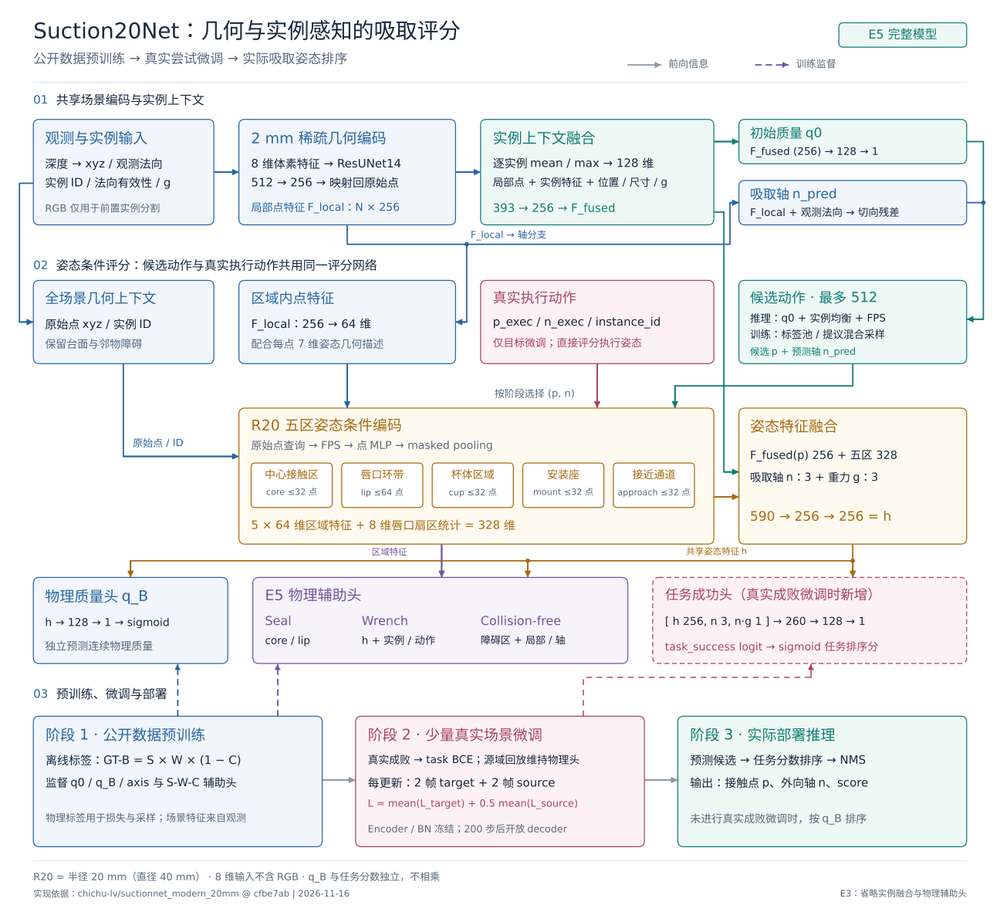

# Suction20Net 方法架构图

日期：2026-11-16（北京时间）。实现依据：`cfbe7abc07a0521a3daa39fe354f18582539d874`。

下图以 **E5 完整模型**展示共享场景编码、实例融合、五区姿态条件评分，以及公开数据预训练、真实尝试微调和部署推理的关系。微调部分采用已经实现的 **`attempt_success` + source replay** 路线；E3 保留接触分组，省略实例上下文与物理辅助头。



## 下载与编辑

| 文件 | 用途 |
|---|---|
| [高清 PNG](figures/method-architecture.png) | 3240 × 2934，直接插入汇报、文档或消息 |
| [矢量 SVG](figures/method-architecture.svg) | 放大查看、编辑模块与文字 |
| [矢量 PDF](figures/method-architecture.pdf) | 论文、打印与排版；嵌入字体 |
| [绘图源代码](figures/render_method_architecture.py) | 修改布局、标签和配色后重新生成全部格式 |

## 1. 从上到下阅读

**第一层是场景编码。** 深度生成相机系点云与观测法向，前置实例分割给出 `instance_id`，相机系重力 `g` 作为附加几何条件。2 mm 体素特征进入稀疏 ResUNet14，输出经过 512→256 投影并映射回原始点，得到 `F_local`。实例内 mean/max 池化、实例相对位置及尺寸与局部特征融合，形成 `F_fused`。[输入实现](../suction20/batching.py) · [骨干](../models/backbones/spconv_resunet14.py) · [实例融合](../models/instance_fusion.py)

**第二层是姿态条件评分。** 对给定接触中心 `p` 和外向吸取轴 `n`，在原始场景点上查询 core、lip、cup、mount、approach 五区。每区编码为 64 维，再附加 8 维唇口扇区统计，得到 328 维接触描述。与中心处 `F_fused`、吸取轴和重力拼接后形成 590 维输入，经 MLP 得到 256 维共享姿态特征 `h`。[接触分组](../models/contact_grouping.py) · [评分模型](../models/suction20net.py)

**第三层是监督与使用阶段。** 公开数据训练物理质量、轴与辅助头；真实尝试训练独立任务成功头，同时回放源数据维持原物理目标；部署时用候选生成与 NMS 输出接触点、外向轴和排序分。[微调实现](../suction20/finetuning.py) · [损失](../suction20/losses.py) · [推理入口](../scripts/infer.py)

实线表示前向信息，虚线箭头表示监督关系。图中辅助头采用合并画法，额外的实例、局部与动作条件写在框内；下表给出完整维度。该图描述模型与训练关系，运行时 CPU/GPU 重叠、chunk、microbatch 等实现参数见[性能文档](GEOMETRY_GPU_OVERLAP.md)。

## 2. 关键维度与代码对应

| 模块 | 输入与输出 | 说明 |
|---|---|---|
| 体素输入 | 8 维 | 中心化坐标 3 + 观测法向 3 + 前景标记 1 + 法向有效性 1；RGB 可用于前置分割，不进入这 8 维 |
| 稀疏几何编码 | ResUNet14 输出 512→256 | inverse map 恢复原始点级 `F_local` |
| 实例特征 | mean/max：256+256→256→128 | 按同帧实例聚合 |
| 实例融合 | 256+128+3+3+3=393→256→256 | 局部特征、实例特征、相对位置、实例尺寸、重力 |
| 初始质量 `q0` | `F_fused` 256→128→1 | sigmoid 后用于提议与质量监督 |
| 吸取轴 | `F_local` 256+观测法向 3→128→2 | 预测切平面残差并生成单位轴；轴头读取局部特征 |
| 单区点编码 | 256→64，再拼 7 维几何；71→64→64 | masked mean/max 加 count/nonempty 后 130→64 |
| 五区描述 | 5×64+8=328 | core/lip/cup/mount/approach 的 FPS 上限分别为 32/64/32/32/32 |
| 姿态融合 | 256+328+3+3=590→256→256 | 得到 `h`；执行姿态路径的中心特征由对应 anchor 提供 |
| 物理质量头 `q_B` | `h` 256→128→1 | 独立 sigmoid 质量预测；代码输出字段为 `q` |
| Seal 辅助头 | core 64+lip 64+唇口统计 8=136→128→1 | 接触贴合相关特征 |
| Wrench 辅助头 | `h` 256+实例 128+位置 3+尺寸 3+轴 3+重力 3=396→128→1 | 全物体与动作条件 |
| Collision-free 辅助头 | cup/mount/approach 3×64+局部中心 256+轴 3=451→128→1 | 障碍区域与局部几何 |
| 任务成功头 | `h` 256+轴 3+轴与重力点积 1=260→128→1 | `attempt_success` 微调新增，输出 logit；sigmoid 后用于排序 |

网络维度与头部连接依据：[模型](../models/suction20net.py)、[预测头](../models/heads.py)、[实例融合](../models/instance_fusion.py)、[接触编码](../models/contact_grouping.py)。

## 3. 两种姿态来源，共用评分网络

### 公开预训练与普通推理

`predict_dense()` 产生逐点 `q0` 与预测轴。候选采样按实例分配名额，每帧最多 512 个候选，然后在选定点及其预测轴上调用姿态评分。

**训练与推理的候选来源有区别：** 推理使用 q0 排序池与 FPS；公开预训练按训练阶段混合 `gt_A / quality_valid` 标签池与模型提议。因此物理标签用于损失和训练采样，场景特征仍来自观测。标签轴不替代输入观测法向。[候选采样实现](../models/candidate_sampler.py)

### 真实尝试微调

目标记录直接走 `encode_scene()` → `score_at_pose(p_exec, n_exec, instance_id)`。这里的动作是原链路实际执行的接触中心和外向轴，绕过候选采样与预测轴选择。

模型通过可靠的 `source_index`，或同帧同实例内 5 mm 范围的观测点取得中心特征；**特征 anchor 不会替换真实动作中心**。单次成败对应一次实际动作的任务 BCE，未执行的邻近候选不自动获得这次标签。详细字段和数据准备见[自有数据评估](TARGET_FINETUNING_DATA_REVIEW.md)与[微调规格](implementation/FINETUNING.md)。

## 4. 物理质量与任务成败的关系

公开数据中 `GT-B = S × W × (1 − C)` 是离线物理目标的定义。模型的 `q_B`、Seal、Wrench 和 Collision-free 是各自预测的输出；`q_B` 由独立质量头产生。

真实成功/失败只直接监督 `task_success_logit`。首轮微调使用每次更新 2 个 target 样本与 2 个 source 样本，目标为：

```text
L = mean(L_target_task) + 0.5 × mean(L_source_physics)
```

默认前 200 次更新训练头部，随后开放 decoder、融合层及接触编码 MLP；encoder 与 BatchNorm 参数和统计保持冻结。这是**目标域微调配方**，公开预训练的硬件 batch 设置另见[选定正式配方](SELECTED_PRETRAINING_RECIPE.md)。源域回放、参数冻结及阶段细节以[微调规格](implementation/FINETUNING.md)、[微调入口](../scripts/finetune.py)为准。

部署时，未进行真实成败微调的模型按 `q_B` 排序；完成 `attempt_success` 微调的模型按 `sigmoid(task_success_logit)` 排序。两个分数不相乘。真实执行记录只用于目标训练，实际部署由模型生成候选。[推理逻辑](../suction20/validation.py)

## 5. 图中的几何约定

- **R20 表示半径 20 mm，直径 40 mm。** 五区对应接触面、唇口、杯体、安装座与接近空间，包含沿轴向展开的空间体积。
- 查询保留原始点级几何。2 mm 体素用于网络编码，不把原始接触几何替换为体素中心。
- 台面和邻物保留为场景障碍。背景实例 ID 为 0，输入前景标记来自实例身份；当前没有另一个可学习 objectness 预测头。
- 32/64 等是各区采样容量上限；点数不足由掩码处理。
- 网络使用 **8 维**唇口统计。离线 Seal 标签计算的 72 扇区属于标签生成算法，与这个维度不同。

依据：[冻结接触几何](../models/contact_grouping.py)、[输入体素特征](../suction20/batching.py)、[模型规格](implementation/MODEL.md)。

## 6. 重新生成图

绘图依赖 `matplotlib` 和 Noto Sans CJK 字体，不需要模型权重、训练数据或 GPU。在仓库根目录运行：

```bash
python docs/figures/render_method_architecture.py
```

脚本同时生成 SVG、PNG 和 PDF。字体默认读取 `/usr/share/fonts/opentype/noto/`；其他环境可通过 `--font-regular`、`--font-bold` 指定本机中文字体，`--output-dir` 可指定输出目录。图中文字与连接关系都保存在源代码中，后续模型调整时可一并更新。
