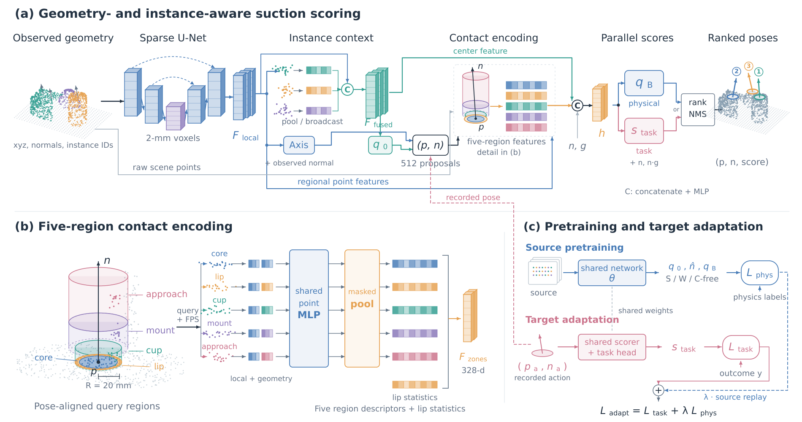

# Suction20Net 论文式方法架构图

更新：2026-11-17（北京时间）。本图按照 `cd010/from-scratch-performance` 在 `23a3f0284f23d635cefa1a77e42f070f322d42a7` 的模型与实验资料整理，以 **E5 完整结构 + attempt_success 目标适配** 为主体。

单物体 v3 方案另有对应的方法图：[路线 A：稀疏 3D + RGB](instance_routes/METHOD_ARCHITECTURE_A.md) · [路线 B：共享二维编码与投影环带](instance_routes/METHOD_ARCHITECTURE_B.md)。两页均提供 SVG、PDF、高清 PNG、双语图注和关键维度表；本页继续描述既有 E5 结构。



图中只展示模型信息流、核心空间几何和学习关系。硬件配置、训练步数、逐层通道规格移到正文。点云及输出吸取姿态为**确定性生成的结构示意**，不是实验输入截图或实际预测结果。

## 下载与编辑

| 文件 | 用途 |
|---|---|
| [矢量 PDF](figures/paper-architecture.pdf) | 论文排版、打印；190 × 100 mm |
| [矢量 SVG](figures/paper-architecture.svg) | 可编辑文字、模块、点云与连线 |
| [高清 PNG](figures/paper-architecture.png) | 3800 × 2000，汇报与文档预览 |
| [绘图源代码](figures/render_paper_architecture.py) | 重新生成确定性的矢量图 |

## 1. 三个子图与推荐图注

### (a) 方法主线

观测点云进入稀疏 U-Net，生成点级局部特征；实例池化与广播提供物体上下文。初始质量 `q0` 与预测吸取轴形成候选，原始点几何和区域内局部特征进入五区接触编码。中心融合特征、接触描述、吸取轴与重力通过姿态融合 MLP 得到共享姿态特征 `h`。物理质量和目标任务评分分支并行输出，部署按训练阶段选择对应分数排序和 NMS。

圆圈 **C** 表示“拼接并经 MLP 融合”；不表示逐元素相加。图中 Axis 读取 `F_local + observed normal`，`q0` 读取 `F_fused`；区域逐点编码使用 `F_local`，姿态中心使用 `F_fused(p)`。实例融合另用相对位置、实例尺寸和重力，详见下方维度表。

### (b) 核心接触几何

接触面上的 core 圆盘和 lip 环带，与沿外向轴展开的 cup、mount、approach 查询体，共同刻画贴合与障碍上下文。每区查询/FPS 后，逐点局部特征和几何量经过共享 MLP、掩码池化，得到五个区域描述；加上唇口统计形成 `F_zones`。台面与邻物仍参与障碍查询。

### (c) 预训练与目标适配

源数据物理标签监督公开预训练。目标适配将记录动作直接输入相同姿态评分器，结果标签监督独立任务头，并加入源数据回放。粉色跨面板虚线明确表示：记录动作绕过候选与预测轴选择，直接作为评分条件。微调阶段共享参数，任务损失与加权源物理损失相加。

### 中文图注

**Suction20Net 方法概览。** (a) 稀疏几何编码与实例上下文融合生成场景表示，候选接触点及吸取轴驱动姿态条件评分。中心特征、五区接触描述及轴向/重力条件共同生成物理质量与目标任务分数，随后按阶段选用相应分数进行排序与 NMS。(b) 五区编码在原始观测点上查询 core、lip、cup、mount 和 approach，通过共享点 MLP 与掩码池化提取接触和障碍上下文，再附加唇口统计。(c) 物理监督用于源域预训练；记录动作及其结果用于目标任务适配，源域回放保留原物理目标。圆圈 C 表示拼接后经 MLP 融合。点云、查询包络和输出姿态均为结构示意。

### English caption

**Overview of Suction20Net.** (a) A sparse geometric backbone and instance-context fusion encode the observed scene. Proposed contact points and suction axes condition pose scoring, which combines the center feature, a five-region contact descriptor, and axis/gravity conditions. The physical-quality head and the target-task head produce separate scores; the stage-appropriate score is used for ranking and non-maximum suppression. (b) Pose-aligned queries on the original observed points define core, lip, cup, mount, and approach regions. Shared point encoding and masked pooling produce regional descriptors, augmented with lip statistics. (c) Source physics supervision trains the model before adaptation. Recorded actions bypass proposal selection and condition the same pose scorer; their outcomes supervise the task head, with source replay retaining the physical objectives. Circled C denotes concatenation followed by an MLP. Point clouds, query envelopes, and output poses are schematic.

**候选说明：** (a) 以普通推理路径为主。公开预训练还会按阶段混合标签采样池与模型提议，见[候选采样](../models/candidate_sampler.py)。辅助 S/W/C-free 头在 (c) 合并展示；它们分别读取相关区域、实例、局部及动作特征，并非全部只读取 `h`。

## 2. 关键维度与代码对应

| 模块 | 输入与输出 | 说明 |
|---|---|---|
| 体素输入 | 8 维 | 中心化坐标 3 + 观测法向 3 + 前景标记 1 + 法向有效性 1；RGB 可用于前置分割，不进入这 8 维 |
| 稀疏几何编码 | ResUNet14 输出 512→256 | inverse map 恢复原始点级 `F_local` |
| 实例特征 | mean/max：256+256→256→128 | 按同帧实例聚合 |
| 实例融合 | 256+128+3+3+3=393→256→256 | 局部特征、实例特征、相对位置、实例尺寸、重力 |
| 初始质量 `q0` | `F_fused` 256→128→1 | sigmoid 后用于提议与质量监督 |
| 吸取轴 | `F_local` 256+观测法向 3→128→2 | 预测切平面残差并生成单位轴；轴头读取局部特征 |
| 单区点编码 | 256→64，再拼 7 维几何；71→64→64 | masked mean/max 加 count/nonempty 后 130→64 |
| 五区描述 | 5×64+8=328 | core/lip/cup/mount/approach 的 FPS 上限分别为 32/64/32/32/32 |
| 姿态融合 | 256+328+3+3=590→256→256 | 得到 `h`；执行姿态路径的中心特征由对应 anchor 提供 |
| 物理质量头 `q_B` | `h` 256→128→1 | 独立 sigmoid 质量预测；代码输出字段为 `q` |
| Seal 辅助头 | core 64+lip 64+唇口统计 8=136→128→1 | 接触贴合相关特征 |
| Wrench 辅助头 | `h` 256+实例 128+位置 3+尺寸 3+轴 3+重力 3=396→128→1 | 全物体与动作条件 |
| Collision-free 辅助头 | cup/mount/approach 3×64+局部中心 256+轴 3=451→128→1 | 障碍区域与局部几何 |
| 任务成功头 | `h` 256+轴 3+轴与重力点积 1=260→128→1 | `attempt_success` 微调新增，输出 logit；sigmoid 后用于排序 |

网络维度与头部连接依据：[模型](../models/suction20net.py)、[预测头](../models/heads.py)、[实例融合](../models/instance_fusion.py)、[接触编码](../models/contact_grouping.py)。

## 3. 两种姿态来源，共用评分网络

### 公开预训练与普通推理

`predict_dense()` 产生逐点 `q0` 与预测轴。候选采样按实例分配名额，每帧最多 512 个候选，然后在选定点及其预测轴上调用姿态评分。

**训练与推理的候选来源有区别：** 推理使用 q0 排序池与 FPS；公开预训练按训练阶段混合 `gt_A / quality_valid` 标签池与模型提议。因此物理标签用于损失和训练采样，场景特征仍来自观测。标签轴不替代输入观测法向。[候选采样实现](../models/candidate_sampler.py)

### 目标动作记录微调

目标记录直接走 `encode_scene()` → `score_at_pose(p_exec, n_exec, instance_id)`。动作记录直接提供接触中心和外向轴，绕过候选采样与预测轴选择。图中统一写为 Recorded action `(p_a, n_a)`。本轮已发布目标资料的 `pose_source=planned_pipeline_contact`、`actual_execution_verified=false`，因此应描述为**历史规划动作与人工结果标签**，不能称为已经核验的实际末端执行轨迹。方法也可接入以后获得的实际执行位姿。[当前目标资料](experiments/CD010-20261117/finetuning/README.md) · [实验分析](experiments/CD010-20261117/analysis/RESULTS_ANALYSIS.md)

模型通过可靠的 `source_index`，或同帧同实例内 5 mm 范围的观测点取得中心特征；**特征 anchor 不会替换记录中的动作中心**。一次记录的结果只直接监督该动作的任务 BCE，邻近候选不自动获得这次标签。详细字段和数据准备见[自有数据评估](TARGET_FINETUNING_DATA_REVIEW.md)与[微调规格](implementation/FINETUNING.md)。

## 4. 物理质量与任务成败的关系

公开数据中 `GT-B = S × W × (1 − C)` 是离线物理目标的定义。模型的 `q_B`、Seal、Wrench 和 Collision-free 是各自预测的输出；`q_B` 由独立质量头产生。

真实成功/失败只直接监督 `task_success_logit`。首轮微调使用每次更新 2 个 target 样本与 2 个 source 样本，目标为：

```text
L = mean(L_target_task) + 0.5 × mean(L_source_physics)
```

默认前 200 次更新训练头部，随后开放 decoder、融合层及接触编码 MLP；encoder 与 BatchNorm 参数和统计保持冻结。这是**目标域微调配方**，公开预训练的硬件 batch 设置另见[选定正式配方](SELECTED_PRETRAINING_RECIPE.md)。源域回放、参数冻结及阶段细节以[微调规格](implementation/FINETUNING.md)、[微调入口](../scripts/finetune.py)为准。

部署时，未进行真实成败微调的模型按 `q_B` 排序；完成 `attempt_success` 微调的模型按 `sigmoid(task_success_logit)` 排序。两个分数不相乘。动作记录用于目标训练，实际部署由模型生成候选。[推理逻辑](../suction20/validation.py)

## 5. 图中的几何约定

以接触点 \(p\) 为原点，轴向 \(z\) 沿外向吸取轴 \(n\)，径向距离为 \(\rho\)。图中透明圆柱表示**查询包络**，不是吸盘机械外形；为便于排版，径向与轴向绘制比例不同。

| 区域 | 径向范围 | 轴向范围 | 查询点来源 |
|---|---|---|---|
| core | ρ ≤ 18 mm | −8 ≤ z ≤ 8 mm | 被吸实例 |
| lip | 18 < ρ ≤ 22 mm | −8 ≤ z ≤ 8 mm | 被吸实例 |
| cup | ρ ≤ 22 mm | −2 ≤ z ≤ 25 mm | 全场景，带自体表面忽略 |
| mount | ρ ≤ 28 mm | 25 < z ≤ 70 mm | 全场景，带自体表面忽略 |
| approach | ρ ≤ 28 mm | 70 < z ≤ 150 mm | 全场景，带自体表面忽略 |

后三个包络内，同一被吸实例只保留 z > 4 mm 的突出点；邻物和背景保留完整区域条件。core/lip 与 cup 在空间上可重叠，五区不是互斥空间分割。

- **R20 表示半径 20 mm、直径 40 mm。** core/lip 画为接触面圆盘与唇口环带，图注和上表给出其轴向厚度。
- 查询保留原始点级几何。2 mm 体素只用于网络编码。
- 台面和邻物保留为障碍上下文；当前没有独立可学习的 objectness 预测头。
- FPS 容量上限依次为 32/64/32/32/32，点不足时用掩码处理。
- 网络描述采用 8 维唇口统计；离线 Seal 标签的 72 扇区不等同于该维度。

依据：[冻结接触几何](../models/contact_grouping.py)、[物理配置](../configs/suction20.json)、[输入体素特征](../suction20/batching.py)。

## 6. 重新生成图

依赖 Python 的 `numpy`、`svgwrite` 和 Inkscape CLI。无需训练数据、模型权重或 GPU。在仓库根目录执行：

```bash
python docs/figures/render_paper_architecture.py

inkscape docs/figures/paper-architecture.svg \
  --export-type=png \
  --export-filename=docs/figures/paper-architecture.png \
  --export-width=3800

inkscape docs/figures/paper-architecture.svg \
  --export-type=pdf \
  --export-filename=docs/figures/paper-architecture.pdf
```

SVG 使用 DejaVu Sans，并保留可编辑文字和矢量点云。脚本的 `--output` 参数可以指定另一个 SVG 路径。旧版 `method-architecture.*` 与其绘图代码保留为历史实现图；本文和 README 的主要入口均指向新的论文式图。
