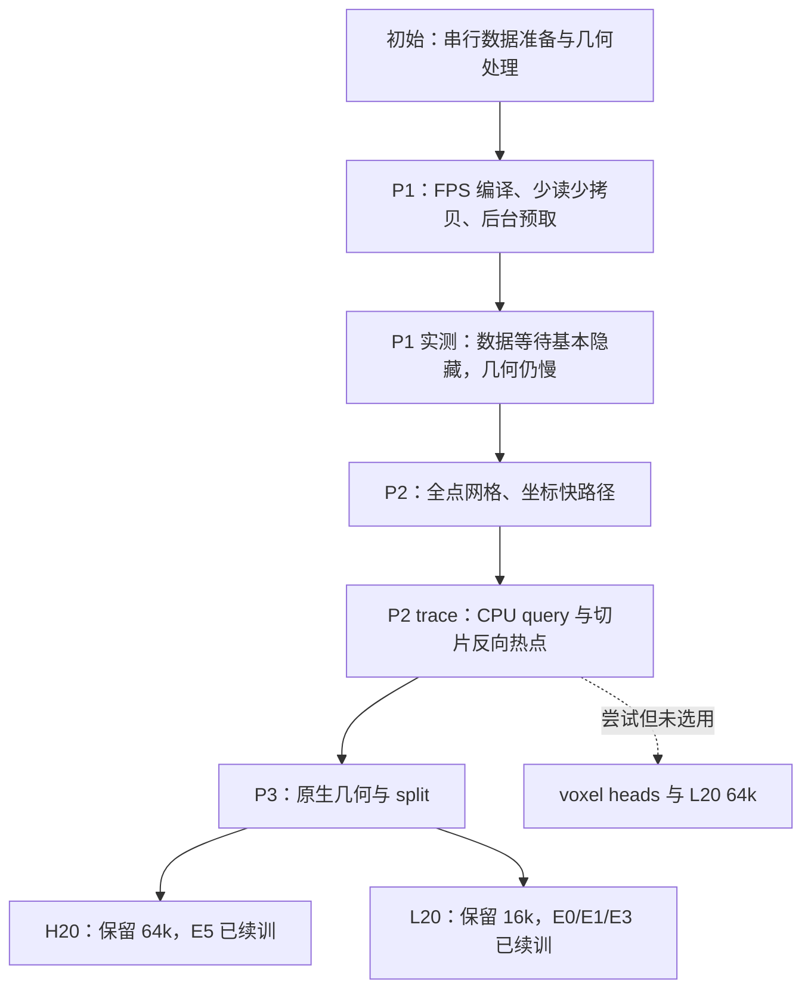
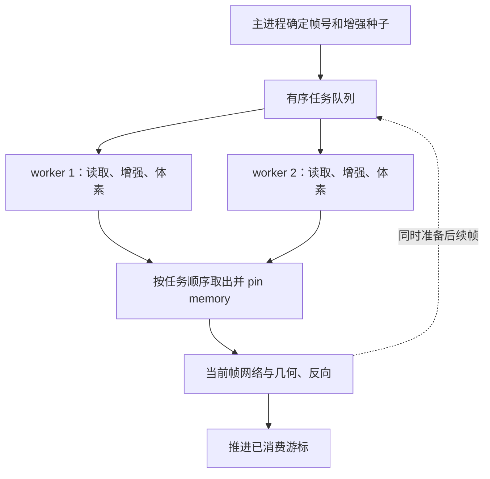

# CD-009 预训练性能优化全程：从串行执行到当前 P3

**梳理日期：2026-11-13，全文时间按北京时间（UTC+8）表达。** 本文核对 `cd009/full-pretraining` 分支截至 [`d03dfaa37db07e3f6dc5e847d16c8ff68a7d682c`](https://github.com/chichu-lv/suctionnet_modern_20mm/commit/d03dfaa37db07e3f6dc5e847d16c8ff68a7d682c) 的代码、配置与已发布实测记录，说明每项优化的原问题、实现、取舍、证据和当前应用状态。它是一份回顾，不增加测试矩阵或训练前置任务。

## 1. 先确认我们现在到了哪里

**目前已经实际应用的组合是：P1 数据与 FPS 优化 + P2 全点网格/坐标快路径 + P3 原生接触查询/`split` 分块。H20/E5 保持 64k dense chunk，L20/E0、E1、E3 保持 16k。** 较早概述中的“P2 仅测试、P3 尚未测试”已被后续真实 checkpoint、迁移和正常训练日志更新。

最新 [P3 实际记录](performance/P3_INTEGRATED_RESULTS.md) 已确认：本轮源 checkpoint 来自 P2；H20/E5 的 64k 组合和 L20/E3 的 16k 组合通过原四帧配对；H20/E5、L20/E0/E1/E3 各自完成迁移并记录了首 25 次正常更新。L20 原 64k 候选未通过原梯度门槛，保留失败结果，当前采用 16k。E0/E1 没有接触分组，它们的提速不能归给接触查询。

| 项目 | H20/E5 | L20/E0、E1 | L20/E3 |
| --- | --- | --- | --- |
| 每次 forward 的帧数 × 累积 | 1 × 4 | 1 × 4 | 1 × 4 |
| CPU affinity / 主进程 Torch 线程 | 8 个逻辑核 / 8 | 同左 | 同左 |
| 数据 worker | 2 | 2 | 2 |
| 实际 dense chunk | 65,536 | 16,384 | 16,384 |
| 输入分块模式 | `split` | `split` | `split` |
| 接触路径 | 全点 grid + 原生 CPU 查询 | 不启用接触分组 | 全点 grid + 原生 CPU 查询 |
| 其他已选开关 | compiled FPS、坐标快路径 | 坐标快路径；未用功能不产生收益 | compiled FPS、坐标快路径 |
| `no_instance_voxel_heads` | `false` | `false` | `false` |
| 显存分配上限 | 112 GiB | 36 GiB | 36 GiB |
| 已记录正常更新窗口 | 8,331–8,355 | E0：17,076–17,100；E1：2,722–2,746 | 7,602–7,626 |

配置分别为 [H20 64k sidecar](../configs/performance/cd009-p3-integrated.json) 和 [L20 16k sidecar](../configs/performance/cd009-p3-l20-16k.json)。sidecar 是独立的性能执行配置；原硬件 profile、模型参数和训练预算仍沿用。

这里必须区分两种代码身份：**本文查阅的仓库是 `d03dfaa`，上述正常训练窗口实际执行的版本是 `f4f7f0d`**，worktree 摘要为 `0d44b123…`。后来的配置、文档和 supervisor 提交不能替换实际运行身份。最新报告的后续状态观察截止 **11 月 13 日 14:03**：E0 到达原计划的第 17,280 步验证，E1/E3/E5 继续训练；这不是本文生成时的实时监控，也不是六组训练完成。

## 2. 优化目标与一直保留的训练定义

训练对象是半径 20 mm 单吸盘模型。典型完整观测每帧约 84 万原始点，网络使用 2 mm 体素，保留每帧 512 个候选；B1A4 表示每个 microbatch 一帧、累计四帧后进行一次优化器更新。每个实验的目标仍为 **230,400 个有效训练帧、57,600 次成功更新**。这些数值来自 [CD-009 固定策略](CD009_PRETRAINING.md) 与 [冻结 profile](../configs/runtime_profiles/cd009-v3/manifest.json)。

已有 `dc4ad6b00535` 方法制作的数据继续经只读 adapter 使用，物理标签与监督定义沿用。性能优化集中于执行组织：少读不使用的字段、减少重复数组与传输、并行准备数据、更换索引实现、编译几何循环、改善自动微分图。没有以少取点、少取候选、增大网络体素或削减训练轮数来取得这里记录的速度。

实验差异会决定优化是否起作用：E0/E1 无实例融合和接触分组；E2 有实例融合；E3 有接触分组；E4 两者都有；E5 再包含辅助头。因此，不能用 E0 的结果解释接触几何，也不能把 H20/E5 与 L20/E0 的帧率差当作 GPU 硬件对比。模型定义见 [模型规格](implementation/MODEL.md) 和 [实验方案](implementation/EXPERIMENTS.md)。

### 2.1 不是所有当前机制都是这几轮新加的

优化前已经有单帧编码结果与索引复用、局部点特征按实际用到的原始点并集投影、dense/pose 分块和可选 activation checkpoint。**core/lip 原本就共享一个覆盖球，每候选共四次球查询；P1 新做的是共享球内局部坐标与中间几何计算。** 不能将原有的“四球覆盖五区”重新算成 P1 的查询次数优化。

原实现可对照 [`9d8ecc0` 的接触分组](https://github.com/chichu-lv/suctionnet_modern_20mm/blob/9d8ecc016c011d5b8d295e5e4220bd5e89fc5d97/models/contact_grouping.py)；完整 P1 演进见 [第一轮方案](PERFORMANCE_OPTIMIZATION.md)。

## 3. 总体演进：瓶颈逐轮移动



| 阶段 | 当时的问题 | 主要完成项 | 结论如何推动下一步 |
| --- | --- | --- | --- |
| 初始 profile 与计时 | 不清楚显存配置与阶段耗时 | 确定 B1A4、chunk/checkpoint 配置；细分 CPU 阶段 | 主要成本不是 batch 装不下 |
| P1 | FPS Python 循环、重复解压/排序/搬运、训练串行等数据 | 精确 C FPS、core/lip 复用、selective NPZ、一维 voxel key、CPU context、2 worker 预取、状态接续 | 接触实验约 34 秒降到约 11–12 秒/更新，仍有几何热点 |
| P1 后参数复测 | 希望用更多 batch/CPU 换吞吐 | 11 组 batch/CPU 测量 | 保留 B1A4、CPU8、workers2，转向执行路径 |
| P2 | KD-tree、Python 索引对象及重复坐标映射 | 全点原生 grid、backbone 坐标快路径；试验 voxel heads | E3/E5 继续下降；voxel heads 未过 AMP 梯度标准 |
| P2 后 kernel 诊断 | H20 显存空余、L20 B2 退化原因不明 | CPU/CUDA trace；L20 chunk 定向短测 | CPU query、SliceBackward 和实例广播成为具体目标 |
| P3 | 查询内部仍大量 Python/NumPy 往返；独立 slice 反向重复清零累加 | 两线程原生接触查询、`torch.split`、执行 sidecar 和迁移整合 | H20 64k、L20 16k 通过并应用；各实验出现新的阶段分布 |

## 4. 初始 profile 与计时：先识别真正在等什么

### 4.1 先完成已有实现的运行配置选择

第一轮硬件选择共 **17 次独立 profile、216 次物理帧呈现，其中 72 帧预热、144 帧计时，零 optimizer 更新**。当时选择 H20/E5 的 B1A4、dense chunk 65,536、关闭 dense activation checkpoint、112 GiB cap；L20 对应 dense chunk 16,384、36 GiB cap，CPU affinity 与主进程 Torch 线程为 8。H20 选中配置约 0.11115 帧/秒，比所测 B2/B4/B8 配置更合适。

这一轮解决的是已有代码的配置选择。chunk 和 activation checkpoint 等有同时变化的比较，不能将总收益全部归给其中一个参数。后面 P1 的 11 组 batch/CPU 复测是另一轮试验，输入数量、代码和速度都不同。证据见 [固定 profile 与历史选择](CD009_PRETRAINING.md#固定版本与可复现配置)。

### 4.2 最初 E5 的约 33.6 秒更新耗在哪里

| 阶段 | 早期每次更新约耗时 | 约占比 |
| --- | ---: | ---: |
| 接触分组：球查询、筛选、FPS | 22.0 s | 65% |
| 读数据、增强、体素整理 | 7.0 s | 21% |
| 其他前向及建树等 | 1.9 s | 6% |
| 反向、优化器及其他 | 2.7 s | 8% |

当时主循环直接调用 `dataset.get_sample()` 与 `collate_public()`，做完数据才前向，完成反向后才准备下一批。E0 没有接触查询，约 11.1 秒/更新中仍有约 6.9 秒数据准备。增加显存或 Torch 线程并不会自动并行这些 Python/NumPy 工作。[早期定位与实现范围](PERFORMANCE_OPTIMIZATION.md)

因此计时也跟着细化：数据读取/法向轴恢复/增强，voxel 去重/聚合，生产者准备与消费者等待，候选采样/D2H，建索引、球查询、区域筛选、FPS、打包。**生产者耗时与主线程实际等待分开记录**，才看得出预取到底隐藏了多少时间。host 区间含同步等待，query 已包含在 forward 中，不能把嵌套区间再次累加。

## 5. P1：把最重的循环编译，并让数据准备与训练重叠

### 5.1 精确 C FPS：减少反复进入 NumPy 的成本

FPS 每选一个点，都要更新当前各点到已选集合的最小距离，再找最大值。原 Python 循环会反复构造数组、执行多个 NumPy 操作。P1 将整个迭代放进 C 扩展，复用最小距离缓冲区，在计算期间释放 GIL。

保留的是原算法：FP64 距离、原运算顺序、原起点规则、原始点行号排序和距离并列选择规则；编译禁用 fast-math 与 FMA contraction，不引入新随机数。候选采样与接触区域 FPS 的首点规则不同，两者分别保留。实现见 [geometry_ops.py](../models/geometry_ops.py)、[fps_cpu.c](../models/csrc/fps_cpu.c)。

早期 84 万点/512 候选的合成 CPU 原型中，FPS 累计时间 **3.0851→0.2605 秒，约 11.84×**，对应完整 query **4.3243→1.3765 秒，约 3.14×**。这是早期 ctypes 原型及特定高度场，不是正式 C 扩展在真实 GPU 训练上的独立倍率；其 mount 多为空、approach 全为空，不能把局部比例外推到全部几何场景。[原型结果](performance/CPU_PROTOTYPE_RESULTS.json)

### 5.2 core/lip 共用局部几何；批量查询测过但未选

core 与 lip 原本共用覆盖球，P1 进一步共用球内点的局部 x/y/z、径向距离、实例关系等，再各自应用区域条件。完整区域计数和 lip 扇区统计仍在 FPS 截取前形成，随机 roll 仍按原调用顺序生成。

同时实现过最多 64 候选一块的球查询和 SciPy workers 对照，真实帧结果却是：

| 查询组织 | 两次查询耗时 |
| --- | --- |
| 逐候选，共享局部计算 | 1.728 / 1.850 s |
| batch 64，workers=1 | 2.034 / 2.037 s |
| batch 64，workers=4 | 3.146 / 3.221 s |

因此 P1 选择 `query_chunk_size=null, query_workers=1`，保留批查询为对照。减少 Python API 调用不保证减少整段时间，大量返回对象和组织成本也可能更高。[P1 选择记录](performance/P1_REAL_RESULTS.json)

### 5.3 Selective NPZ：不再解压马上就会丢弃的字段

旧读取逻辑会物化整份 NPZ。新 `read_view_payload()` 先读取字段清单，再按训练实际需要解压。旧 `objectness`、五类派生质量字段和旧 `gt_normal` 共七个逐点字段不再在这条路径无条件读取；候选轴由 adapter 按原物体/候选索引恢复，原物理标签和有效掩码保留。开启噪声/丢点、需要重算观测法向时，也不先解压旧 `normals_raw` 再丢弃。

这七个字段合计约 **33 bytes/点，84 万点约 27.7 MB 未压缩数组**。这不是 NPZ 文件体积，更不是已单独测出的磁盘吞吐收益。实现改变的是“读取哪些现有字段”，无需转换已制训练数据。[datasets.py](../suction20/datasets.py) · [P1 字段清单](PERFORMANCE_OPTIMIZATION.md)

### 5.4 小缓存和 B1 少拷贝

物体候选轴恢复缓存只保留需要的归一化法向/索引，场景信息沿用已有小型 cache；单帧拼接时，只有一个数组就直接返回，省去没有意义的 concatenate 副本。

实际默认仍为 **scene cache 2、object cache 16**；早期方案里讨论过的 90/88 扩容没有实施。`scene_frame0()` 首次构造 records 时仍会再次读取 table/poses，原方案里消除这次重复读取的提议也未落地。每个 worker 有自己的小缓存，没有默认增加大规模帧缓存、增强结果缓存或离线 sidecar 转换。应将“对象缓存内容精简、B1 少拷贝已实现”与这些提议分开。[datasets.py](../suction20/datasets.py) · [full_data.py](../suction20/full_data.py) · [batching.py](../suction20/batching.py)

### 5.5 体素去重：三列排序换成保序一维整数 key

原来对整数 xyz 网格执行 `np.unique(..., axis=0)`；新代码先按同样 2 mm 体素量化、平移到非负网格，再编码：

```text
key = (x * ny + y) * nz + z
```

x 为最高位，key 升序就是原 xyz 字典序。对 key 做一维 unique 后恢复坐标，继续输出原 `(batch,z,y,x)` 格式，保留原始点顺序、voxel 行顺序与 inverse map。8 通道特征的 mean、精度及 `np.bincount` 聚合没有同时替换。

84 万点、147,847 个 voxel 的 CPU 原型，去重 **0.6902→0.09535 秒，约 7.24×**；后面的聚合约 0.02376 秒，因而没有继续扩展为另一项聚合工程。这是 collate 内局部结果，不是整步收益。[batching.py](../suction20/batching.py) · [CPU 原型](performance/CPU_PROTOTYPE_RESULTS.json)

### 5.6 CPU geometry context：保留增强后几何，减少 GPU 往返

旧流程把完整数据上传 GPU，候选与接触查询又通过 `.cpu().numpy()` 取回。现在在增强、collate 与 pinning 后建立 CPU tensor 的 NumPy view；候选和建索引直接复用它们，FP64 xyz 每帧按需转换一次。候选监督的 CPU 信息单独传递，不进入模型特征。

训练输入仅上传实际 GPU 消费者需要的 9 类 tensor；追踪字段等继续留在 CPU。**目标 tensor 这一版仍按原方式整体上传**，不能声称已经消除了所有传输。q0 和预测轴由网络产生，仍然需要从 GPU 返回 CPU。实现见 [cpu_geometry.py](../suction20/cpu_geometry.py)、[training.py](../suction20/training.py)、[candidate_sampler.py](../models/candidate_sampler.py)。

### 5.7 有序双 worker 预取：从串行准备改成生产消费重叠

主进程为样本确定 sequence、dataset index、frame key、augmentation seed 和采样 epoch；两个 worker 依据任务读取、增强、体素整理。配置为 `spawn`、`prefetch_factor=2`、`persistent_workers=True`、`pin_memory=True`，约有四个待消费 microbatch。worker 的 Torch/BLAS 线程限制为 1，主进程 Torch 线程为 8。



预取可以让“已派发游标”领先训练，checkpoint 保存的是**实际完成消费的游标**。恢复时丢弃旧进程未消费预取任务，从已消费位置重新生成，因此不会因为 worker 提前读了数据而跳帧。数据 loader 使用独立 generator，增强按任务种子执行，不消耗模型自身 RNG；物理消费帧与成功更新预算仍各自推进。[prefetch.py](../suction20/prefetch.py) · [train_pretrain.py](../scripts/train_pretrain.py)

### 5.8 保留学习状态切换优化版本

已经训练到一半的任务通过显式性能迁移切换代码和扩展身份，保留模型权重、Adam moments/step、AMP scaler、RNG、已消费采样器、LR、成功步、有效帧预算、best 与验证计划。P1 的实际迁移源包括 H20/E5 第 380 步、L20/E0 第 833 步、L20/E3 第 441 步。

这是为了让优化能够接入正在进行的训练，不是新的训练算法；不重新 warmup、不用“只加载模型权重”替代续训。后续 P2/P3 继续使用这套机制，没有每轮再建一套恢复系统。[迁移入口](../scripts/migrate_performance_checkpoint.py) · [P1 实际记录](performance/P1_REAL_RESULTS.json)

### 5.9 P1 正常训练已经观察到什么

| 实验 | 优化前更新中位数 | P1 更新中位数 | P1 观察更新数 |
| --- | ---: | ---: | ---: |
| H20/E5 | 33.8347 s | 10.9273 s | 30 |
| L20/E0 | 11.3492 s | 4.2078 s | 30 |
| L20/E3 | 34.1903 s | 12.1837 s | 20 |

数据生产本身每四帧仍需约 3.8–4.1 秒，但主进程暴露的等待只剩约 **1–2 ms/更新**。因此预取的主要贡献是把准备时间与训练重叠，而不只是让读取更快。接触 query 仍约 6.3–6.5 秒/更新，说明下一轮应继续处理几何。

这些前后窗口使用不同自然训练帧，E3 还更换了 GPU 放置；可以说明实际训练明显加快，不能把每项 P1 改动的独立百分比分出来。数值对照也遇到过独立 CUDA 骨干运行自身的差异，最终复用同一真实骨干图比较两条后缀与实际 VJP，保留原 AMP 门槛；这与声称独立进程逐 bit 确定性是两回事。[P1_REAL_RESULTS.json](performance/P1_REAL_RESULTS.json)

## 6. P1 后：batch 和 CPU 复测使我们停止盲目加资源

2026-11-12 的 11 个配置中，10 个成功、1 个 L20/E0 B4 在预热 OOM。每个成功配置采用相同 16 帧，4 帧预热、12 帧计时，fresh seed 42，包含真实前向、loss 和反向，**没有 optimizer 更新**。这不是正式训练持续吞吐。

| 设备/实验 | B1A4、CPU8 | B2A2、CPU8 | B4A1、CPU8 | B1A4、CPU16 |
| --- | ---: | ---: | ---: | ---: |
| L20/E0，帧/s | 0.9435 | 0.5495（−41.8%） | 预热 OOM | 0.9530（+1.01%） |
| L20/E3，帧/s | 0.3096 | 0.2516（−18.7%） | 未测 | 0.3101（+0.16%） |
| H20/E5，帧/s | 0.3386 | 0.3436（+1.48%） | 0.3380（−0.20%） | 0.3397（+0.31%） |

所有配置仍用两个数据 worker。H20 的 reserved 随 B1/B2/B4 约为 17.07/34.46/64.87 GiB，吞吐却没有相应增加；L20 B2 的 reserved 接近 36 GiB cap，速度更慢。CPU8→16 也没有明确改善。

当时决定保留 **B1A4、8 核、2 worker**，不再扩展 batch/worker/cap 全矩阵。CPU 核数是允许的资源，Torch 线程是库内并行，loader workers 是生产者进程；它们都不等于逐候选几何循环已经并行。[P1_BATCH_CPU_RESULTS.json](performance/P1_BATCH_CPU_RESULTS.json)

这一阶段“数据等待已接近零”的结论是当时成立的。P3 后 E0/E1 的消费速度变快，新的 loader 等待已经显现，不能把旧结论永久套到所有实验。

## 7. P2：改变空间索引，去掉重复坐标匹配

### 7.1 全点原生 uniform grid 替换 KD-tree

P2 将增强后的全部原始点组织进 **20 mm cell 的 CPU 网格**。每个 cell 保存点行号；球查询定位可能相交的 cell，再逐点执行原 FP64 距离条件（包括原边界余量），最终按原始行号返回。扁平 cell/point 存储与原生查询避免了大量 Python 整数列表、临时对象和映射。

**20 mm 是索引单元大小，不是点云降采样分辨率。** cell 内的点不合并、不平均、不截断，网络仍为 2 mm voxel；区域筛选、FPS 和监督继续使用完整原始点。实现见 [spatial_index.py](../models/spatial_index.py) 与 [spatial_index_cpu.cpp](../models/csrc/spatial_index_cpu.cpp)。

同一合成高度场、84 万点、512 候选、2,048 个球的 CPU 原型：

| 范围 | KD-tree | grid | 含义 |
| --- | ---: | ---: | --- |
| 建索引，含相同 CPU 几何准备 | 0.270 s | 0.026 s | 建索引明显缩短 |
| 完整 query | 1.510 s | 0.941 s | 局部约 1.61× |
| 两者合计 | 1.781 s | 0.967 s | 局部约 1.84×，耗时减少约 45.7% |

P2 此时仍由 NumPy 完成后续筛选、FPS 衔接和描述量打包。索引变快并不会自动消除所有接触几何成本。[P2_CPU_PROTOTYPES.json](performance/P2_CPU_PROTOTYPES.json)

### 7.2 Backbone 坐标快路径

旧封装每帧运行坐标匹配，包含 `torch.unique`、同步和 feature gather。当前骨干通常沿用输入坐标，P2 检查输出与输入坐标是否同一存储且 shape/stride 等匹配；命中时直接使用特征，否则保留原坐标映射。

这省掉的是正常路径的重复匹配，不是无条件假定任意稀疏骨干都保持坐标顺序。grid 与该快路径组合通过真实同四帧原门槛比较，没有单独测出快路径的训练速度倍率。[spconv_resunet14.py](../models/backbones/spconv_resunet14.py) · [P2 方案与结果](PERFORMANCE_PHASE2.md)

### 7.3 尝试过但关闭：无实例 voxel heads

E0/E1/E3 中，同 voxel 原始点的 fusion/q0 输入相同，逐行 `Linear → LayerNorm → ReLU` 从实数数学上可以先按 voxel 计算，再映射回原始点监督。这一试验试图省掉重复 dense MLP，而非改变逐点标签权重。

真实 AMP 对照中，几何、随机状态、输出和 loss 通过，但后缀梯度、骨干边界和 VJP 等累计 **374 项梯度比较失败**。共享计算改变了 Jacobian/cotangent 汇总位置、参数梯度归约行数和有限精度舍入。因此最终选择 **`no_instance_voxel_heads=false`**，没有通过改 FP32、改门槛或另造 autograd 系统强行接受。

这个结果表示候选不满足本项目原数值接续标准，不能推导为已证明抓取效果或收敛变差。代码保留可选实现，正式选中配置关闭。[P2 真实失败与选择](PERFORMANCE_PHASE2.md)

### 7.4 P2 正常训练窗口

| 实验 | P1/P2 各 30 步的更新中位数 | 中位耗时变化 | 完整窗口墙钟，P1→P2 |
| --- | ---: | ---: | ---: |
| L20/E0 | 4.2764→4.2853 s | +0.21%，基本不变 | 127.4038→135.0550 s |
| L20/E3 | 11.8913→9.5895 s | −19.36% | 358.4500→295.3271 s |
| H20/E5 | 10.8795→8.5904 s | −21.04% | 328.9214→272.8871 s |

这与作用范围一致：接触模型改善，E0 没有接触路径且 voxel heads 未选，变化很小。前后不同自然帧，P2 首步冷启动保留、新旧细计时开关不同，不能当同帧纯算法消融。早期结果截取时部分窗口是 live 日志；最新 P3 报告另从实际源 checkpoint 确认 P2 已应用，两类证据不要混写。[P2_REAL_RESULTS.json](performance/P2_REAL_RESULTS.json) · [最新来源确认](performance/P3_INTEGRATED_RESULTS.md)

## 8. P2 后的诊断：为什么 H20 显存空余仍不能靠 batch 提速

### 8.1 H20/E5：B2 能装下，串行 query 仍要做

64k dense chunk 下，B1/B2 同四帧块测量：

| 指标 | B1A4 | B2A2 |
| --- | ---: | ---: |
| 四帧块平均墙钟 | 8.8660 s | 8.6752 s |
| 吞吐 | 0.451160 帧/s | 0.461086 帧/s（+2.20%） |
| query host 区间 | 5.1443 s | 5.1388 s |
| backward + loss 回读 | 2.5543 s | 2.5537 s |
| allocated 峰值 | 11.5317 GiB | 22.4130 GiB |

B2 基本翻倍活跃 tensor 显存，却没有减少四帧总几何工作。独立 trace 中 query 为 **5.139426 秒**，与 CUDA 的重叠仅 **0.0000495 秒**；其中筛选约 2.220 秒、FPS 及衔接约 1.474 秒、球查询约 1.204 秒、打包约 0.215 秒。因此本轮优先推进原生接触查询有直接证据。[H20_P2_BATCH_DIAGNOSIS.md](performance/H20_P2_BATCH_DIAGNOSIS.md)

H20 另有实例广播反向热点：`indexing_backward_kernel<float,4>` 约 1.513 秒，占 GPU kernel 区间并集约 64%。长调用关联到 `encode_scene/fuse`，结合源码指向 `stats['instance_features'][slots]`。这是表达式级推断，没有 Python stack 的直接定位；64% 是 GPU kernel 区间占比，不是整步墙钟占比。它尚未作为生产优化完成，P3 split 也不等于已经解决它。

### 8.2 L20/E5：B2 的退化定位到切片反向

16k dense chunk 下，B1→B2 四帧块 **11.3407→14.5683 秒**，吞吐下降 22.15%；backward **4.8328→8.1228 秒**，而 query **5.4491→5.4304 秒**几乎不变。

trace 显示独立 `tensor[start:end]` 形成的 `SliceBackward0`，需要在输入大小的梯度中恢复局部切片，再通过加法合并。固定四帧预算下 B2 的单次输入更大，相关清零和累加合计 **3.180685→6.364260 秒**；调用数量接近，但每次处理更大的完整输入。实例广播的约 0.733 秒基本未变。

捕获块内 allocator retry、OOM、缓存段释放均为零。因此本次退化有具体的自动微分路径证据，不能笼统归因于“CPU 搬运跟不上”或“显存 cap 导致抖动”，也没有必要先断言显存带宽已经饱和。[L20_P2_BATCH_DIAGNOSIS.md](performance/L20_P2_BATCH_DIAGNOSIS.md)

### 8.3 为什么试 64k，以及为什么最后仍选 L20 16k

同一 L20/E5 fresh-model 短测只改 dense chunk，B1 从 16k 到 64k 后吞吐 **0.352710→0.452896 帧/s，+28.40%**，backward **4.8328→2.4779 秒**，query 不变；对应块耗时下降约 22.1%。64k 的 B2 仍比 64k B1 慢 9.33%。因此 64k 曾成为合理的性能候选。

随后对 **L20/E3 实际 checkpoint** 做 16k→64k 的 AMP 配对，出现 148 项失败；保留原 16k、采用 split 和修复后的 native 后通过。前者是 E5 新初始化模型的速度测量，后者是 E3 实际 checkpoint 的数值接续比较，结论不矛盾。当前只采用通过的 16k 组合，具体差异见下一节。

### 8.4 显存、batch、chunk 和 split 是不同控制量

| 项目 | 控制什么 | 为什么不能互相替代 |
| --- | --- | --- |
| 显存容量 / cap | 能容纳多少 tensor、工作区和缓存 | 空余显存不等于 GPU 计算单元等比例空闲，也不会缩短 CPU query |
| microbatch | 一次 forward 放几帧 | 改变帧组、骨干 BN 统计/更新次数、归约与 RNG 交错；同有效 batch 不等于逐输出相同 |
| 梯度累积 | 几次 forward/backward 后更新 | 维持有效帧数，不减少这些帧本来要做的计算 |
| dense chunk | 同一批逐点 MLP 每块处理多少行 | 影响 GEMM 形状与梯度归约；不等于帧 batch，heads 的 LayerNorm 仍逐行 |
| `split` | 输入如何形成多个块的自动微分图 | 保留块大小，减少独立切片反向重复构造与累加 |

一帧约 84 万点本身已是很大的逐点工作量；固定 chunk 时，增加 batch 往往是增加块数，而不是让每个 MLP 块都变大。PyTorch allocated、reserved 和 NVML 显存口径也不同，不能拿其中一个除以 140G 来估算“还剩多少训练吞吐”。[batch 分析](H20_BATCHSIZE_ANALYSIS.md)

## 9. P3：合并原生几何，并修正分块反向组织

### 9.1 一次原生调用完成四球、五区、FPS 与描述量

P2 的球查询已经是原生 grid，但 Python 仍逐候选组织筛选、调用 FPS、转换和打包。P3 把这些连起来放进同一次 C++ `contact_query`：四球查询、五区精确筛选、完整计数/lip 扇区、首点与 FPS、几何描述量输出。

两个原生线程共享只读索引，每个线程独立持有 scratch、写不同候选行；计算释放 GIL，返回前 join。线程数为 `min(2, CPU affinity)`，没有增加可搜索的线程矩阵。Python 先一次生成随机 roll，线程不消费 RNG。原始点、边界、排序、并列选择与 FP64 运算要求保留。

**这一版仍是 CPU 几何，不是 GPU 查询/FPS。** GPU 负责后面的局部投影、区域 MLP、pooling、评分和反向。当前增强会改变几何，接触方向依赖本轮预测轴，所以仍需逐帧建索引、按当前预测查询，不能跨训练轮次复用固定邻域。[contact_ops.py](../models/contact_ops.py) · [contact_grouping.py](../models/contact_grouping.py) · [原生实现](../models/csrc/spatial_index_cpu.cpp)

合成 CPU 原型中，P2 query **0.901812→0.295082 秒，约 3.06×**。它不含建索引，是同一合成输入的局部结果，不能拿这个 0.295 秒与 H20 真实四帧块的 5.14 秒直接相减。[P3_CPU_RESULTS.json](performance/P3_CPU_RESULTS.json)

### 9.2 `torch.split`：保持 16k/64k 大小，改变输入视图的反向图

旧 `chunk_apply` 每次循环创建 `tensor[start:end]`；新模式对每个输入只调用一次 `torch.split(tensor, chunk_size, dim=0)`，再按原块顺序运行相同回调、checkpoint 逻辑和 concat。

反向因而可通过一个多输出 split 节点组织各块梯度，减少多个独立 slice 对完整输入反复清零和累加。它不增加网络层、不改参数名、不改 BN、不改变 B1A4。分块模式沿 dense 与接触编码入口传递；pose chunk 仍为 32。[heads.py](../models/heads.py) · [suction20net.py](../models/suction20net.py)

CPU 子图验证使用真实维度的 393→256→256 MLP、2,049 点、9 块：SliceBackward 节点 **9→0**、完整输入清零 **9→0**、相关完整输入加法 **8→0**，相同 chunk 的 FP32/FP64 输出、输入梯度和参数梯度相同。它说明机制成立，不是独立的 GPU 整步速度测量。[P3_SPLIT_CPU_RESULTS.json](performance/P3_SPLIT_CPU_RESULTS.json)

### 9.3 执行配置与现有训练接续

v3 sidecar 增加可选顶层 `dense_chunk_size_override` 与 `chunk_input_mode`，模型记录实际执行值。旧 v1/v2/原 v3 字节继续可识别；没有将冻结硬件 profile 的历史值改写成新值。

迁移器接入批准的原始/P1/P2 到目标 v3 关系，保留原训练状态。当前实际配对源已经是 P2；直接迁移能力是为其他合法来源接续保留，不要求已有任务先再跑一遍 P2。配对工具只调整了与 chunk 实现变化相关的共享骨干依赖检查，并保留实际输出、离散选择、原 AMP 梯度与 VJP 比较。[performance.py](../suction20/performance.py) · [迁移入口](../scripts/migrate_performance_checkpoint.py) · [P3 实施文档](PERFORMANCE_PHASE3.md)

## 10. 真机反馈怎样修正了 P3 的最终选择

### 10.1 正负零：修复参考运算顺序，没有改变几何判断

H20/E5 第 8,330 步源 checkpoint 的首次 64k P3 配对，只失败于四帧 core 描述量字节检查：存在若干 `+0.0/-0.0` 位模式差，数值差为零，其他区域与梯度通过。

原因是原生三项点积从第一项乘积开始，而参考 NumPy contraction 从正零累加。`f4f7f0d` 将局部坐标/法向点积统一从 `+0.0` 起算，保留三项乘法、非零加法顺序和原精度。修复后 H20 同四帧原门槛全部通过。这个已发生的差异已经处理完，不需要再为它扩展额外验证项目。[修复提交](https://github.com/chichu-lv/suctionnet_modern_20mm/commit/f4f7f0d6de0bd3bd27107d8be09885fed700e48b)

### 10.2 L20 64k：性能有潜力，原数值接续门槛未通过

L20/E3 第 7,559 步的 16k→64k 组合共有 148 项失败，包含前述正负零问题，也包含后缀梯度、第三帧骨干 VJP 和四帧累计梯度。loss 和离散输出相同、梯度均有限，但部分 dense fusion/axis/q0 梯度超出原门槛。

报告最大绝对差 16 对应 **GradScaler scale=262,144 的 scaled 梯度**，不能当成优化器未缩放梯度差 16。源码与隔离结果支持：改变 GEMM 行维度和分块贡献边界，使有限精度归约不同。保留 16k、应用修复后的 native 与 split，同四帧在原 `atol=2e-4, rtol=2e-3` 下通过。

最终选择是 **H20 保留原 64k；L20 保留原 16k，并获得 split/native 的收益**。没有放宽门槛、关闭 AMP、改 scaler，也没有为强推 64k 新建自定义前后向。该失败不证明所有未来 64k 实现都不可能，更不代表已测出收敛损害；它只决定当前训练的接续配置。[P3_INTEGRATED_RESULTS.md](performance/P3_INTEGRATED_RESULTS.md)

## 11. 当前 P3 的真实正常训练收益

各实验新窗口都是 **25 次 optimizer 尝试、25 次成功更新、0 AMP 跳步、100 物理帧/100 有效帧**。首个慢步完整保留；下面同时列中位数与完整窗口吞吐，不混用二者。

| 实验 | 原 P2 最后 25 步 | P3 首 25 步 | 更新中位数，P2→P3 | 中位耗时减少 | 完整窗口帧/s，P2→P3 |
| --- | --- | --- | ---: | ---: | ---: |
| H20/E5 | 8,306–8,330 | 8,331–8,355 | 8.0806→5.7462 s | 28.89% | 0.49336→0.64393 |
| L20/E0 | 17,051–17,075 | 17,076–17,100 | 4.2884→1.8446 s | 56.99% | 0.94071→1.85524 |
| L20/E1 | 2,697–2,721 | 2,722–2,746 | 4.2656→1.7423 s | 59.15% | 0.93901→2.01680 |
| L20/E3 | 7,577–7,601 | 7,602–7,626 | 9.3547→3.2120 s | 65.66% | 0.42556→1.15002 |

完整更新窗口分别由 **202.6904→155.2957、106.3028→53.9014、106.4953→49.5834、234.9852→86.9551 秒**。对应吞吐增加约 30.52%、97.22%、114.78%、170.24%，与中位耗时百分比不是同一指标。吞吐按 100 帧除以窗口秒数计算。[原始窗口与计时口径](performance/P3_INTEGRATED_RESULTS.md)

### 11.1 从阶段时间看收益来自哪里

| 实验 | forward host 中位数，旧→新 | backward host 中位数，旧→新 | loader 等待中位数，旧→新 |
| --- | ---: | ---: | ---: |
| H20/E5 | 5.2763→2.9139 s | 2.5989→2.5321 s | 0.00187→0.00194 s |
| L20/E0 | 0.4982→0.4952 s | 3.6818→0.5450 s | 0.00096→0.64262 s |
| L20/E1 | 0.4875→0.4993 s | 3.6686→0.5463 s | 0.00093→0.56827 s |
| L20/E3 | 5.4209→2.3214 s | 3.8909→0.7704 s | 0.00100→0.00101 s |

- **H20/E5：主要变化在 forward。** 反向约 2.5 秒基本不变，与本轮重点减少串行接触工作一致；实例广播仍是有历史 trace 支持的后续候选，但不能宣称已做过 P3 后的重新 kernel 定位。
- **L20/E0/E1：主要变化在 backward。** 两组没有接触查询，且仍用 16k，因此不能归因于 native 或 64k；组合结果与 split 减少切片反向成本的机制一致，但没有单独拆分每项开关的收益。
- **L20/E3：forward 与 backward 同时降低。** 它同时使用接触几何和分块执行优化。
- **E0/E1 的数据等待重新显现。** 反向缩短后，约 0.64/0.57 秒 loader 等待成为新成本；E3/E5 的等待仍约 1–2 ms。下一步判断应按实验分别看，不再沿用“一切实验都不等数据”的旧描述。

### 11.2 这些窗口说明到什么程度

前后采用不同自然训练帧，共享机器负载不同；新窗口处于已有迁移诊断期，旧窗口细计时关闭；旧 E1 窗口包含第 2,700 步正常保存。完整更新窗口从首步开始到末步结束，不含全部部署停机、后续验证与保存；日志里观察到的末步，也不表示该步当时已持久化为 checkpoint。

这些限制不改变“当前采用组合已在正常训练中观察到明显改善”的结论，但不支持把 P1/P2/P3 的不同局部倍率相乘，也不支持直接承诺完整训练的长期天数。报告未公开独立的 P3 真机 query 分项汇总，不能从 forward 总时间倒推出 query 的精确值。

### 11.3 将各阶段观察值放在一起

| 实验 | 初始窗口 | P1 窗口 | P2 早期窗口 | 当前 P3 窗口 |
| --- | ---: | ---: | ---: | ---: |
| H20/E5 | 33.8347 | 10.9273 | 8.5904 | 5.7462 |
| L20/E0 | 11.3492 | 4.2078 | 4.2853 | 1.8446 |
| L20/E1 | — | — | — | 1.7423 |
| L20/E3 | 34.1903 | 12.1837 | 9.5895 | 3.2120 |

单位均为秒/成功更新，取各报告的更新中位数；横向是历史轨迹，不是相同帧的连续控制实验。P3 的直接前窗口为上一表的 8.0806/4.2884/4.2656/9.3547 秒，不能拿本表更早的 P2 窗口替换它来计算 P3 收益。这里不将端点差异命名为所有优化的精确累计倍率。

## 12. 多卡方面做了什么

项目一直采用**单卡跑单组实验，多张卡并行推进不同实验**。`d03dfaa` 新增显式登记的 L20 GPU4 使用能力，以及独立 `control_repo`：协调器/worker 管理代码可以更新，trainer 仍从冻结运行仓库启动。每个 trainer 仍只见一个 GPU UUID，在进程内使用 `cuda:0`。

这一项改善的是实验调度和运行维护，并非 DDP，也不减少单组的每次更新时间。该提交说明新增卡可以按注册和分配使用，不证明 E4 已经启动或完成。代码见 [run_supervisor.py](../suction20/run_supervisor.py)，提交见 [`d03dfaa`](https://github.com/chichu-lv/suctionnet_modern_20mm/commit/d03dfaa37db07e3f6dc5e847d16c8ff68a7d682c)。

## 13. 所有路线的最终归类

| 路线 | 当前结论 | 原因或已知范围 |
| --- | --- | --- |
| 精确 compiled FPS | 已应用 | 减少迭代中的 Python/NumPy 临时操作 |
| core/lip 局部计算复用 | 已应用 | 共享球本来存在，本轮共享中间几何 |
| selective NPZ、小缓存内容精简、B1 少拷贝 | 已应用 | 避免读取、保留或复制未使用数组 |
| 一维 voxel key | 已应用 | 保留原 voxel/inverse 顺序的去重加速 |
| CPU geometry context 与 GPU 输入白名单 | 已应用 | 减少重复 D2H；预测值传回和目标上传仍存在 |
| 有序双 worker 预取 | 已应用 | 与训练重叠；按消费状态恢复 |
| 全点 20 mm cell 原生 grid | 已应用 | 查询索引变化，不是点云下采样 |
| Backbone 坐标快路径 | 已应用 | 同存储正常路径省去重复映射 |
| 两线程原生接触查询 | E3/E5 已有应用窗口 | E0/E1 不使用此路径；E4 没有本轮应用窗口 |
| `split` 输入分块 | H20/E5、L20/E0/E1/E3 已应用 | 不改变当前块大小与帧组批 |
| 保留学习状态的版本迁移 | 已用于 P1/P2/P3 接续 | 原预算、优化器、AMP 与采样进度继续 |
| 批量 KD-tree 查询 / SciPy workers4 | 测过、未选 | 当时比逐候选共享查询慢 |
| Python 候选线程池 | 原型评估，未选为当前主路径 | 局部约 1.19×，后续采用完整原生融合 |
| 更大 microbatch / CPU16 | 测过、维持原配置 | L20 退化，H20/CPU 差异小 |
| 无实例 voxel fusion/q0 | 实现并试验，关闭 | 原真实 AMP 梯度门槛未通过 |
| L20 dense chunk 64k | 速度短测有效，当前延后 | 实际 E3 checkpoint 接续未通过；16k 组合通过 |
| H20 实例广播只计算一次 / 分组反向归约 | 诊断和 CPU 原型，尚未进入生产 | 仍需面对完整 P×128 梯度归约；不能算已完成收益 |
| GPU 几何/FPS、异步重叠旧 KD-tree 建树 | 未作为当前实现 | 已优先做有收益证据的 CPU 路径；grid 也已缩短建索引 |
| 大 frame cache、场景/对象缓存 90/88、数据格式重制 | 未实施 | 当时不是主要暴露成本，不作为训练前置条件 |
| 多 GPU 训练同一组 / DDP | 未实施 | 当前多卡用途是并行独立实验 |
| 降低候选、放大网络体素、缩短预算 | 未纳入这些优化 | 会改变实验定义 |

H20 实例广播的 CPU 原型曾把 9 次 IndexBackward 组织为 1 次，但仍需处理 P×128 归约，并引入约 0.40 GiB 的 FP32 点级缓存；不能把“减少节点数”直接当作真机有效方案。[split/广播原型](performance/P3_SPLIT_CPU_RESULTS.json) 提供其试验范围。

## 14. 当前还剩什么，以及这份回顾不再安排什么

按已有证据，H20/E5 后续值得关注的仍是实例广播反向，L20/E0/E1 则出现新的数据等待；E3 已同时受益于两条路径。这里只记录瓶颈移动，不因此自动增加完整 batch/CPU/worker 矩阵，也不重跑已完成的配对和正常窗口。

六组完整训练、既定验证、目标域少量数据微调和最终效果比较仍在原实验计划中。E2 的 FP16 投影溢出是已有独立问题，本轮性能回顾没有宣称修复；E4 与新增 GPU4 的实际运行结果也没有包含在上述 P3 窗口。性能改进与模型效果结论应分别完成。[最新运行记录](performance/P3_INTEGRATED_RESULTS.md)

## 15. 代码与证据索引

| 想核对的内容 | 入口 |
| --- | --- |
| 冻结预算、硬件 profile、运行版本 | [CD009_PRETRAINING.md](CD009_PRETRAINING.md) |
| P1 原设计、字段、恢复语义 | [PERFORMANCE_OPTIMIZATION.md](PERFORMANCE_OPTIMIZATION.md) |
| P1 局部与真机结果 | [CPU_PROTOTYPE_RESULTS.json](performance/CPU_PROTOTYPE_RESULTS.json) · [P1_REAL_RESULTS.json](performance/P1_REAL_RESULTS.json) |
| P1 后 batch/CPU 测量 | [P1_BATCH_CPU_RESULTS.json](performance/P1_BATCH_CPU_RESULTS.json) |
| P2 实现、voxel heads 失败与选择 | [PERFORMANCE_PHASE2.md](PERFORMANCE_PHASE2.md) |
| P2 原型及正常窗口 | [P2_CPU_PROTOTYPES.json](performance/P2_CPU_PROTOTYPES.json) · [P2_REAL_RESULTS.json](performance/P2_REAL_RESULTS.json) |
| H20 / L20 的 kernel 定位 | [H20 诊断](performance/H20_P2_BATCH_DIAGNOSIS.md) · [L20 诊断](performance/L20_P2_BATCH_DIAGNOSIS.md) |
| P3 算法与接续命令 | [PERFORMANCE_PHASE3.md](PERFORMANCE_PHASE3.md) · [MODEL_USAGE.md](MODEL_USAGE.md) |
| P3 CPU 原型 | [P3_CPU_RESULTS.json](performance/P3_CPU_RESULTS.json) · [P3_SPLIT_CPU_RESULTS.json](performance/P3_SPLIT_CPU_RESULTS.json) |
| 当前配置为何是 H20 64k / L20 16k | [P3_INTEGRATED_RESULTS.md](performance/P3_INTEGRATED_RESULTS.md) |
| 数据与体素实现 | [datasets.py](../suction20/datasets.py) · [batching.py](../suction20/batching.py) · [prefetch.py](../suction20/prefetch.py) |
| 几何、索引与分块实现 | [fps_cpu.c](../models/csrc/fps_cpu.c) · [spatial_index_cpu.cpp](../models/csrc/spatial_index_cpu.cpp) · [heads.py](../models/heads.py) |

本文的百分比由所引记录直接计算或沿用报告，CPU 原型、零更新速度短测、真实 checkpoint 数值配对与正常训练窗口各自标明范围。后续新提交应在相同证据范围内更新当前状态，保留这些历史取舍。
