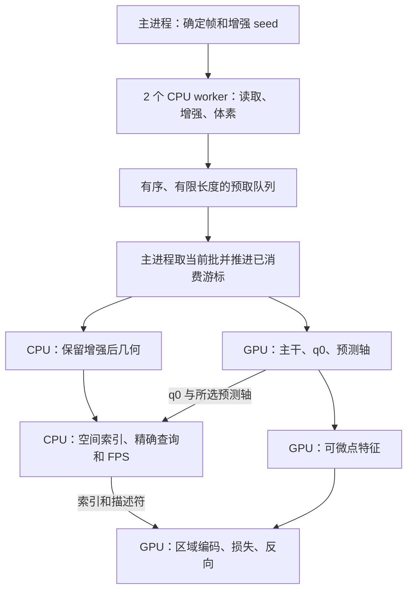
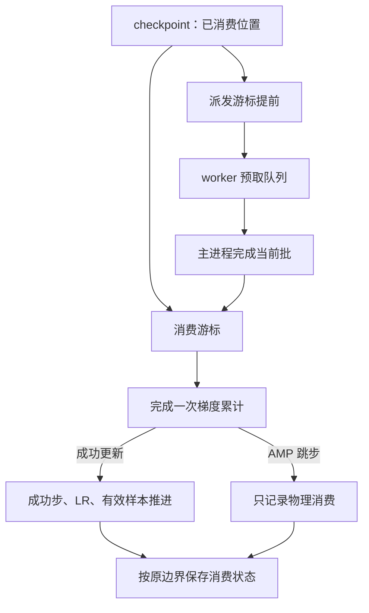

# CD-009 预训练性能优化方案

**状态：代码已实现，真实运行验收待完成。** 设计基于 `9d8ecc016c011d5b8d295e5e4220bd5e89fc5d97`，整理于 2026-11-12；本版补充实际接口与运行说明。本轮本地全套测试 **292 passed / 1 skipped**，代码复核已进行，但同批真实 CUDA 对照、一次正常迁移续训及正常日志短窗提速尚未验收。CPU 原型只用于确定开发优先级，不代表实际训练加速。

**目标：在现有数据、模型、有效样本预算和实验定义不变的条件下，缩短 E0–E5 单卡独立预训练的墙钟时间。** 第一轮采用精确 CPU 几何优化、较轻的数据整理和有序后台预取。先完成这一轮并观察剩余瓶颈，再决定是否开发 GPU 几何算子。

本文保留原设计推导和示意伪代码；实际已实现接口以第 10 节和 [运行指南](MODEL_USAGE.md#性能实现构建与既有运行迁移) 为准。没有真实证据前，不把代码实现、CPU 原型与生产验收混为一项。正式训练状态见 [CD-009 预训练说明](CD009_PRETRAINING.md)。

## 阅读导航

- 结论和现状：[实施顺序](#1-决策与实施顺序) · [当前配置](#2-当前版本与已完成工作) · [证据与时间估算](#3-性能证据与收益边界)
- 代码实现：[测量与数据流](#4-数据流与测量设计) · [精确几何](#5-精确-cpu-几何优化) · [读取与体素](#6-数据读取体素整理与静态缓存) · [CPU/GPU 分工](#7-cpugpu-数据分工与线程配置)
- 接入训练：[有序预取](#8-有序数据预取与消费进度) · [现有训练续接](#9-现有训练如何切换性能版本) · [文件与配置清单](#10-实施接口配置与交付拆分)
- 验收与边界：[只做三项正常检查](#11-精简验收只检查三个正常路径) · [可选后续](#12-第一轮之后再决定的工作) · [完成清单](#13-实施完成清单) · [来源](#14-依据与代码定位)

## 1. 决策与实施顺序

### 1.1 推荐路线

| 顺序 | 实施内容 | 原因及预期作用 | 完成判据 |
| --- | --- | --- | --- |
| P0 | 在现有计时内拆出球查询、区域筛选、FPS、数据准备和队列等待 | 确认 22 秒和 7 秒分别花在哪里；只补少量字段，不重建监控平台 | 同一批帧能分别解释主要 CPU 阶段；明确每帧、每 microbatch、每更新的口径 |
| P1-A | 精确编译 FPS；共用 core/lip 局部坐标；对比有界批量球查询 | 直接缩短接触分组。CPU 原型显示 FPS 是值得优先处理的循环，批量查询的额外收益尚不稳定 | 区域索引、顺序、掩码、计数、随机状态等价，真实帧查询时间下降 |
| P1-B | 按需解压 NPZ；一维 key 体素去重；复用增强后的 CPU 几何 | 减少数据准备和 GPU→CPU 重复搬运，E0/E1 同样受益 | 相同帧/增强 seed 产生相同输入、targets、体素和映射 |
| P1-C | 2 个 CPU worker 有序预取；只将已消费游标保存到 checkpoint | 让下一批准备与当前训练重叠，降低主进程等数据的时间 | 帧/增强序列、模型 RNG、v3 预算和恢复后下一批一致 |
| P1-D | 显式性能版本迁移，接入现有 supervisor | 允许已经运行的任务保留全部训练进度切换代码版本 | 普通恢复仍严格校验身份；迁移记录可追溯；预算和验证节点连续 |
| P2 | 只处理第一轮之后仍显著的热点 | 避免将低收益工作变成训练前置条件 | 有真实计时依据再安排 GPU 几何、额外并行或传输重叠 |

P1-A 与 P1-B 可以并行开发；有序预取依赖 P1-B 的批数据契约，接入正式训练依赖 P1-C/P1-D 的恢复检查。各项收益不能简单相乘：CPU 核、内存带宽和 I/O 会共享，必须看组合后的每次成功更新用时。

### 1.2 本轮保持的实验定义

| 项目 | 保持内容 |
| --- | --- |
| 数据 | 复用已经制作好的旧数据和现有只读 adapter；S/W/C/A/B 标签、数据划分及冻结物理配置不变 |
| 输入 | 完整观测；20 mm 吸盘；2 mm 体素；512 候选；既定深度噪声、丢点、刚体增强 |
| 模型 | E0–E5 的模块、参数形状、损失及 reduction 不变；局部特征选择仍可反向传播 |
| 优化 | AdamW、AMP、梯度裁剪、LR、microbatch=1、accumulation=4、有效 batch=4 |
| 训练预算 | 每组 230,400 有效训练帧；57,600 次成功更新；原定 10 个完整开发验证节点 |
| 资源 | 一张卡运行一组实验；H20 跑 E5，L20 跑其余实验；沿用已有 CPU affinity |
| 后续迁移 | 本轮是公开数据预训练，后续仍用少量自有场景微调；性能优化不改变目标域实验方案 |

减少候选、增加体素尺寸、裁剪整帧、缩短预算、近似邻域、替换采样算法属于实验定义变更，不放入这轮等价优化。当前也不需要重制数据、转换整套存储格式、实现 DDP 或重新做 batch/显存搜索。

## 2. 当前版本与已完成工作

### 2.1 三个版本身份要分开

| 身份 | 当前记录 | 用途 |
| --- | --- | --- |
| 本文审阅的 GitHub 快照 | `9d8ecc016c011d5b8d295e5e4220bd5e89fc5d97` | 定位本方案的源代码基线 |
| 优化前部署代码 / 唯一允许的迁移源 | `98862f4d6a133c99afa082a0755dbb888b41b38d` | 迁移入口严格核对的源代码身份 |
| 运行源码 SHA256 | `d634627b180cee10be2c42949c8d10cec21ac49424aa734f6b5acf2c5f2c30c8` | 部署源码内容记录 |

GitHub 发布是源码快照，不承诺包含部署提交的原 Git 祖先链。即使只改文档，仓库 HEAD 和 `worktree_digest()` 也会变化；**不要直接在正在训练的 checkout 上拉取本方案或未来优化代码后，以为旧 checkpoint 可以按原身份恢复。** 文档可直接阅读，优化部署按第 9 节执行。

### 2.2 正式 profile 已经选定

正式基线是 [六份选中配置及清单](../configs/runtime_profiles/cd009-v3/manifest.json)，不是 `configs/pretrain_e*.yaml` 中的 pending 模板。

| 配置组 | microbatch × accumulation | dense checkpoint | dense chunk | GPU allocator ceiling | CPU |
| --- | --- | --- | ---: | ---: | --- |
| H20 / E5 | 1 × 4 | 关闭 | 65,536 | 112 GiB | 8 核 affinity，Torch threads=8 |
| L20 / E0–E4 | 1 × 4 | 关闭 | 16,384 | 36 GiB | 每实验独立 8 核 affinity，Torch threads=8 |

此前已完成 17 个独立 profile trial、216 次物理帧呈现、零 optimizer 更新。较大 batch 没有带来更好吞吐。这些短 profile 排除了 Adam 更新、保存、完整验证等，并使用同步边界，不能与下文正式训练的每次更新时间直接互换。

以下内容已经实现，不再列为新的主要优化任务：

- 每次编码后的场景建立并复用空间索引；core/lip 已共用接触球查询。
- 仅对接触区域用到的原始点并集做局部特征投影，以及 dense/pose 的 chunk 处理。
- CPU affinity 隔离，`OPENBLAS_NUM_THREADS=1`、`MKL_NUM_THREADS=1`、`OMP_NUM_THREADS=1` 的启动环境。
- 持久日志句柄和追加式 attempt/update/event 记录；监控进程及约 60 秒的资源采样。
- checkpoint 单次序列化、last/best 别名、原子 manifest、校验和及恢复链。
- **每 100 次成功更新或 900 秒**保存，以先到者为准；验证前后和暂停等边界另行保存。

按 33.6 秒/更新估算，900 秒条件通常约 27 次更新就会触发保存；不能把现状描述成“每 100 步保存一次”。验证前后的两个保存分别对应 pending 和完成事务，也不应合并删除。源码依据见第 14 节。

## 3. 性能证据与收益边界

### 3.1 用户提供的真实训练观测

E5 最近 50 次更新约 33.6 秒/次；每次成功更新通常包含 4 个 microbatch，每个 microbatch 当前为 1 帧。

| 阶段 | 每更新耗时 | 占比约值 | 解释 |
| --- | ---: | ---: | --- |
| 接触分组查询、筛选、FPS | 22.0 秒 | 65% | 当前优先级最高；必须继续拆分 |
| 读取、增强、体素整理 | 7.0 秒 | 21% | 串行准备，可以减负并与训练重叠 |
| 其他前向、建树等 | 1.9 秒 | 6% | 不将其全部视为 GPU 计算 |
| 反向、优化器及其他 | 2.7 秒 | 8% | 仍有部分 host 同步成本 |

E0 约 11.1 秒/更新，其中数据准备约 6.9 秒，占约 62%。因此只改接触分组不能解决 E0/E1 的主要问题。CPU/GPU 利用率的稀疏采样支持“串行 CPU 路径导致等待”的判断，但不能用 0/100% 瞬时值计算精确平均利用率。

这些是用户提供的程序阶段计时，含部分同步等待；本方案审阅环境没有访问正式 H20/L20 任务或真实训练数据，未独立复测这些数值。

### 3.2 已做的 CPU 原型检查

以下实验只回答“哪个实现方向值得优先开发”。结果及来源记录在 [CPU 原型证据](performance/CPU_PROTOTYPE_RESULTS.json)。几何原型基于先前审阅的 `57bf0f7…`，其 `candidate_sampler.py`、`contact_grouping.py` 与本次 `9d8ecc0…` 内容相同；体素核心文件也相同。

| 局部计算 | 原实现中位数 | 原型中位数 | 局部比值 | 已检查内容 |
| --- | ---: | ---: | ---: | --- |
| 整个接触 query，替换为编译 FPS | 4.324 秒 | 1.377 秒 | 3.14× | 五区索引、mask、描述符、counts、lip sectors；含随机 roll 检查 |
| 上述 query 内的 FPS 累计 | 3.085 秒 | 0.260 秒 | 11.84× | 贪心选择顺序及距离并列规则 |
| 体素去重，三列 `unique` → 一维 key | 0.690 秒 | 0.095 秒 | 7.24× | origin、唯一体素顺序、inverse、bzyx、8 通道聚合逐元素相同 |

几何测试使用 840,000 点、512 候选的一个合成高度场；2048 次覆盖球查询，共返回约 596.6 万条候选邻接，1322 次 FPS 共处理约 263.9 万个区域点。baseline 2 次，编译 FPS 3 次。原型使用单线程编译 FP64 循环、关闭 fast-math/FMA 收缩；未修改产品代码。该场景的 mount 多数为空，approach 全为空，不能代表真实堆叠场景的全部分布。没有完成真实 CUDA/AMP 的输出和梯度等价验收。

“编译 FPS + 4 workers 批量查询 + core/lip 复用”的两次 query 用时为 1.147、1.578 秒，中位数 1.363 秒，与只编译 FPS 的 1.377 秒接近且波动较大。**因此先把编译 FPS 作为确定的开发重点；批量查询以真实帧组合后的收益决定是否启用，不能宣称额外稳定倍数。**

原型以 ctypes 调用 C，批查询变体一次准备全帧；当时尚无 CPython 绑定与 64 候选分块。当前二者已实现并通过 CPU 正常路径对照；原型数字仍不代表该实现的真实帧计时。

体素测试为 840,000 点、147,847 体素，5 次重复；包含 key 编码和解码。8 通道聚合本身约 0.024 秒，没有证据支持先改它。上述各项数据来自不同局部计算，不能相乘得到端到端加速。

### 3.3 时间模型

暂将用户的 E5 计时写成 `T0 = G + D + R = 22 + 7 + 4.6` 秒。设几何阶段加速为 `s`，数据生产有效并行度为 `W`：

```text
无预取：T ≈ 22 / s + D_new + 4.6
稳态预取：T ≈ max(22 / s + 4.6, D_new / W) + 队列/传输/资源竞争开销
```

这是规划用的近似关系。原计时含同步，`W` 不等于 worker 数，I/O 和 CPU 竞争也会改变 `D_new` 与 `R`。完整墙钟还要加原定验证、保存、暂停和启动成本。

| 条件假设 | 估算每更新 | 相对 33.6 秒 | 完整 57,600 更新的纯训练时间 |
| --- | ---: | ---: | ---: |
| 当前观测 | 33.60 秒 | 1.00× | 22.40 天 |
| 几何 4×，其余不变 | 17.10 秒 | 1.96× | 11.40 天 |
| 几何 8×，其余不变 | 14.35 秒 | 2.34× | 9.57 天 |
| 几何 4×，7 秒准备完全隐藏 | 10.10 秒 | 3.33× | 6.73 天 |
| 几何 8×，7 秒准备完全隐藏 | 7.35 秒 | 4.57× | 4.90 天 |

表格是条件计算，不是已实现结果或剩余 ETA，也没有计入验证/保存。剩余时间应使用 `(57600 - 当前成功步) × 新版本实测每步时间 + 剩余验证/保存成本`。

对 E0，单生产者即使能与 GPU 重叠，理想下界仍约为 `max(6.9, 4.2)=6.9` 秒，而不是 4.2 秒；只有数据减负或有效并行后，才可能接近计算侧的 4.2 秒。选择 2 workers 正是为了同时处理这一问题。

## 4. 数据流与测量设计

### 4.1 从串行处理改为有依赖的流水线

原实现由主进程顺序执行 `get_sample → collate_public → H2D → backbone/dense → CPU 采样与分组 → GPU 头/反向`。下一帧的读取在这些步骤之后才开始。



worker 在当前批前向、分组和反向期间准备后续批。图中的 CPU 几何查询仍依赖当前预测轴，不能提前固定为跨 epoch 复用的邻域；CPU 索引和 GPU 特征通过同一 packed raw index 对齐。第一轮不额外实现“当前帧 KD-tree 与 backbone 双线程重叠”，也不在 worker 间传递 KD-tree 对象。

### 4.2 对现有日志补字段

保持 `last_grouping_timings`、`frame_stats`、update/event JSONL 的既有结构；以下字段已接入模型、生产者和训练日志。所有 CPU 用 `perf_counter()` 累计，记录单位为秒；microbatch 和 update 层显式累加，不混用。

| 字段组 | 实现字段 | 计时位置与用途 |
| --- | --- | --- |
| 数据生产 | `read_npz_s`, `read_depth_meta_s`, `axis_recovery_s`, `augment_geometry_s` | worker 内 `get_sample()`；区分解压、标定/深度和重算几何 |
| 体素 | `voxel_unique_s`, `voxel_reduce_s`, `collate_total_s` | `collate_public()`；单独验证一维 key 收益 |
| 消费者等待 | `loader_wait_s` | 主进程调用 `next(loader)` 的阻塞时间；这才是预取后没有隐藏掉的准备时间 |
| CPU 采样 | `sampler_cpu_s`, `q0_d2h_host_s` | 分开全量 q0 的必要回传与 CPU 选择，避免把 GPU 等待算作 FPS |
| 接触几何 | `geometry_cpu_setup_s`, `tree_build_s`, `pose_d2h_host_s`, `ball_query_s`, `region_filter_s`, `fps_s`, `descriptor_pack_s` | 将原 query 拆开；`region_filter_s` 包括局部坐标、边界筛选及原始 counts/sectors |
| 查询规模 | `valid_candidates`, `ball_calls`, `ball_api_calls`, `ball_returned_points`, `fps_calls`, `fps_input_points` | `ball_calls` 始终表示逻辑球数：512 候选对应 2048；`ball_api_calls` 才是实际 SciPy 调用数，64 候选分块可从 2048 降至 8 |
| 训练总量 | 继续现有 `elapsed_seconds`、successful/attempt/sample ledger | 保持正式预算统计；全窗口 wall time 另从日志时间边界计算 |

注意三个口径：

1. worker 的 `prepare_total_s` 是各帧准备时间之和，`producer_total_s` 再包含该 microbatch 的 collate；并发时不能将其再加到主线程 `elapsed_seconds`。`loader_wait_s` 才是训练暴露出来的等待。
2. GPU enqueue 的 host 用时不是 GPU kernel 延迟。原有 `seed_valid.cpu()`、loss 标量读取等会发生同步；不要为了让分段数相加漂亮，在每个阶段插入 `torch.cuda.synchronize()`。
3. 正式每更新 `elapsed_seconds` 不含日志、checkpoint、完整验证。报告既给训练循环吞吐，也给含这些事件的墙钟吞吐；原 `checkpoint_published`、`validation_completed` 事件已有耗时，可直接使用。

详细的区域内部计时只在固定小样本诊断和短验收窗口打开；常规训练保留聚合计时、规模计数和原有完整样本账本。除非第一轮后仍解释不了明显等待，不要求长期运行 profiler 或增加监控服务。

## 5. 精确 CPU 几何优化

实现依据：[候选与 FPS](../models/candidate_sampler.py)、[接触分组](../models/contact_grouping.py)。先交付单线程编译 FPS；随后在同一批数据中比较分块查询的增量收益。

### 5.1 热点及修改范围

| 位置 | 当前操作 | 拟修改 |
|---|---|---|
| `models/candidate_sampler.py` | Python 循环执行贪心 FPS；每轮构造差值、平方、归约等数组 | 编译为单个 FP64 CPU 循环；保留 NumPy 参考实现 |
| `models/contact_grouping.py` | 选择区域中点最近点，再调用 FPS | 起点选择公式不变；调用新后端 |
| `models/contact_grouping.py` | core/lip 分别计算同一批点的局部坐标和半径 | 计算一次基础几何，各自应用原有过滤条件 |
| `models/contact_grouping.py`,105–114 | 每候选调用四次球查询，并排序返回索引 | 按帧、按 64 候选分块，批量提交四球 |
| `models/contact_grouping.py`；`models/candidate_sampler.py` | 从 GPU 输入重新取出整帧 CPU 几何 | 复用 CpuGeometry，保留模型输出所必需的传输 |
| `models/contact_grouping.py` | 已有分组计时 | 保留原有字段；性能窗口内增加树查询/FPS 分项 |

已新增本地扩展源文件 `models/csrc/fps_cpu.c`，以及 `models/geometry_ops.py` 作为后端选择、参考实现和扩展包装的集中入口。candidate_sampler.py 原公共函数保留兼容入口，避免让分组与候选采样使用不同 FPS 定义。新增文件属于仓库代码；临时基准中的动态 ctypes 加载方式不直接作为生产接口。

### 5.2 生产方案：单线程 CPython C 扩展

#### 5.2.1 选定方案

使用 setuptools 构建一个小型 CPython C 扩展 models._fps_cpu，复用已经验证过的精确 C 内核。Python 绑定通过 buffer protocol 接收连续的 FP64 数组，不引入 pybind11、Numba 或 NumPy C ABI 依赖；运行时仍使用项目已有 NumPy。

首版保持单线程 C 内核，释放 GIL 后完成数值循环。不引入 OpenMP 线程池，也不自行调整现有 8 核 CPU affinity。这样编译 FPS 与后续两名数据 worker、SciPy 查询 worker 的资源分配容易控制。

这一路线需要 C 编译器和对应 Python 头文件，不需要 CUDA 编译环境。扩展按训练环境的 Python 版本构建；不把临时目录中的 .so 直接拷贝到另一 Python 版本使用。

#### 5.2.2 Python 层和原生层分工

对现有公共接口增加一个仅供内部调用的关键字：

~~~python
fps_indices(xyz, indices, count, first=None, *, presorted=False)
~~~

Python 层负责以下工作：

1. 转为 int64 索引；默认按 raw packed index 递增排序。
2. 若调用方明确传入 presorted=True，跳过重复排序。只有分组代码可以在已验证索引有序的路径上使用它。
3. 将 count 限制为不超过候选点数；空结果在 Python 层直接返回。
4. 一次性 gather 区域点，并转为 C-contiguous、native float64 的 [M, 3] 数组。
5. 把 raw index 形式的 first 转为排序后数组中的位置。
6. 调用原生函数，再将返回的位置映射回原始 packed index。

原生接口只处理紧凑点数组：

~~~python
positions = models._fps_cpu.fps_positions(points_f64, count, first_position)
~~~

输入是 C-contiguous 的 FP64 [M,3]、整数 count、整数起点位置；输出是按 FPS 选择顺序排列的局部位置。最小绑定可以返回 Python 整数列表，再由包装层转成 np.int64 数组。区域最多 64 个输出，候选 sampler 最多 512 个输出，这个小结果转换不影响主要收益。

原生绑定用 PyObject_GetBuffer 取得并持有只读 buffer，检查 dtype/维度/连续性及 count、起点范围，分配距离和输出缓冲区，随后释放 GIL 进入循环。结束后重新取得 GIL，构造返回对象并释放 buffer。上述基本检查用于避免原生越界，不增加整帧扫描。

包装层概念代码如下；具体后端选择应在初始化时完成，不能每个区域都重新导入或检测编译器：

~~~python
def fps_indices(xyz, indices, count, first=None, *, presorted=False):
    rows = np.asarray(indices, dtype=np.int64)
    if not presorted:
        rows = np.sort(rows)
    k = min(int(count), len(rows))
    if k <= 0:
        return rows[:0]

    points = np.ascontiguousarray(np.asarray(xyz)[rows], dtype=np.float64)
    start = 0 if first is None else int(np.searchsorted(rows, first))
    positions = selected_fps_positions(points, k, start)
    return rows[np.asarray(positions, dtype=np.int64)]
~~~

这里的 `selected_fps_positions` 应由 `make_fps_backend(name)` 返回的闭包持有。`CandidateSampler` 和 `ContactGrouping` 在构造时接收同一个 `fps_fn`，`inference_pool(..., fps_fn=...)` 显式透传；不要用可变模块全局变量切换后端。原公共 `fps_indices` 保留 NumPy 兼容入口，这样同一个基准进程可同时持有参考和编译实例。

NumPy 参考后端应保留原算法的排序、起点和循环语义，作为开发后备及等价性对照。

**不能在公共 FPS 函数中把 count >= M 简化为直接返回排序索引。** 原候选 sampler 在这种情况下仍执行 FPS，输出顺序会影响后续补位顺序。contact_grouping.py:143–144 在区域点数不超过区域上限时直接使用原有顺序的分支，则应原样保留。

#### 5.2.3 精确 FPS 的循环定义

对排序后的 M 个点，维护长度为 M 的最小平方距离数组，初始为正无穷：

~~~text
current = first_position
repeat count times:
    append current
    distance[current] = -1
    best_value = -2
    next_position = 0
    for j in increasing position order:
        if distance[j] >= 0:
            dx = x[j] - x[current]
            dy = y[j] - y[current]
            dz = z[j] - z[current]
            candidate = (dx*dx + dy*dy) + dz*dz
            if candidate < distance[j]:
                distance[j] = candidate
        if distance[j] > best_value:
            best_value = distance[j]
            next_position = j
    current = next_position
~~~

这里严格使用大于号更新 argmax。因为输入位置按 raw packed index 递增，等距离时自然保留最小 raw index，与当前 np.argmax 的行为一致。已选点距离固定为 -1，不会被重复选中；坐标重合但索引不同的点也保持原有规则。

使用 double 存储坐标与距离，保持平方和为 (dx²+dy²)+dz²，不做重排、不使用近似距离。Linux GCC/Clang 构建参数固定为：

~~~text
-O3 -fno-fast-math -ffp-contract=off
~~~

首版不增加 -march=native，避免无必要的 CPU 指令集绑定。保留函数入口 ABI 版本常量，例如 FPS_ABI_VERSION=1，启动时记录即可，不需要为每个候选记录版本。

#### 5.2.4 两种调用处的起点必须区分

**接触分组：** 保留 `models/contact_grouping.py` 的原公式：

~~~python
distance = x*x + y*y + (z - z_mid)**2
first = rows[np.argmin(distance)]
~~~

core/lip 的 z_mid 为 0；cup/mount/approach 使用各自冻结区间的轴向中点。不能统一改成“离吸盘接触中心最近”，也不能直接把此起点选择移到另一个坐标系下计算，借此引入新的浮点比较顺序。

**候选 sampler：** 保留 `models/candidate_sampler.py` 的现有 q0 排序及 top-4quota 池，起点仍为该池中 q0 最高、并按 raw index 打破同分的点。sampler 传入的是按分数排序的池，不能传 presorted=True。

#### 5.2.5 构建与后备路径

使用仓库现有 setuptools 构建体系，增加一个简短 setup.py 声明扩展即可；项目名和依赖仍由 pyproject.toml 提供：

~~~python
from setuptools import Extension, setup

setup(ext_modules=[
    Extension(
        "models._fps_cpu",
        sources=["models/csrc/fps_cpu.c"],
        extra_compile_args=["-O3", "-fno-fast-math", "-ffp-contract=off"],
        optional=True,
    )
])
~~~

optional=True 允许不训练模型的纯数据环境继续安装项目。实际性能训练通过侧车配置要求 compiled 后端，确保没有误把未构建扩展的 NumPy 速度当作新实现速度。

已提供 `--performance-config` 读取并合并到 `runtime.performance`，正式训练 profile 的原文件字节保持不变。完整配置见第 10.1 节。后端选择规则如下：

| 设置 | 行为 |
|---|---|
| compiled | 必须导入编译扩展；不可用时在训练初始化阶段明确报错 |
| numpy | 使用原参考实现，用于对照 |

只在后端加载时处理模块缺失或导入失败。不能用大范围 try/except 把数值内核执行错误静默回退为 NumPy。实际后端、编译选项和查询 worker 数写入一次 runtime 记录，不在每个区域输出日志。

性能参数由 runner.make_model 传入独立的运行参数入口，FPS 实现以函数指针或 callable 注入 CandidateSampler 和 ContactGrouping。不要将 CpuGeometry 或性能配置注册成可训练模块、buffer 或 state_dict 项目。

### 5.3 分块批量四球查询

#### 5.3.1 继续查询四种覆盖球

每个候选仍查询以下四个球，再使用原有精确区域过滤：

| 球 | 球心 | 半径 |
|---|---|---|
| contact | p | hypot(0.022, 0.008) |
| cup | p + n × (z_min+z_max)/2 | hypot(r, (z_max-z_min)/2) |
| mount | 同上，使用 mount 冻结区间 | 同上 |
| approach | 同上，使用 approach 冻结区间 | 同上 |

三个碰撞区间从 frozen_config 读取。球查询半径仍只增加现有 1e-8 m 覆盖余量，精确区域过滤保持原边界。SciPy 查询使用 eps=0.0，不启用近似查询。

按 batch/frame 分别使用自己的 cKDTree；每个 frame 中，以最多 64 个有效候选构成一块。每块构造 [C,4,3] 球心和 [C,4] 半径，最多 256 个查询。示意：

~~~python
local_lists = tree.query_ball_point(
    centers.reshape(-1, 3),
    (radii + 1e-8).reshape(-1),
    eps=0.0,
    workers=query_workers,
    return_sorted=True,
)
~~~

返回局部索引经该 frame 的 frame_rows 映射回 packed raw index。frame_rows 来自递增的 np.flatnonzero，因而 return_sorted=True 的局部顺序在映射后仍按 raw index 递增；不必再逐球 np.sort。该性质写入接口注释，并在第 11 节的同批结果对照中一起确认。

每块完成精确过滤、计数、FPS 和七维几何描述后，释放该块球查询列表。最终 [Q,K] 索引和特征描述数组按原来的 Q 维顺序填回。这样既保留原输出形状，又避免一次持有全帧 2048 个大型 Python 列表。

query_workers 从 1 开始，与 4 做一次同窗口对照，上限不超过 4。现有 8 核 affinity 保持不变；数据预取的两名 worker 各 1 线程，编译 FPS 首版单线程，BLAS/MKL 保持已设置的单线程。

#### 5.3.2 随机 roll 的生成位置不能随分块改变

当前 query 入口在开启随机 roll 时，为全部 Q 个传入姿态调用一次；关闭时不消费随机数：

~~~python
rolls = (
    torch.rand(len(points)).numpy() * (2 * math.pi)
    if random_roll
    else np.zeros(len(points))
)
~~~

新实现开启随机 roll 时，仍在分帧、过滤 valid 或切块前执行这一次调用，然后按原始姿态索引读取对应 roll；关闭时使用零 roll。不能每块重新生成、只为 valid 姿态生成、替换为 NumPy RNG，或让查询线程调用 RNG。这样训练、验证和推理各自的 RNG 行为保持原样。

法向的 FP32→FP64 转换和逐候选归一化采用当前相同算式；预先缓存归一化结果供四个球和局部坐标共用。第一版不借此次重构同时替换矩阵乘法、切平面基选取或归一化算法。原位置、执行轴、实例 ID 和 batch ID 的对应关系不变。

#### 5.3.3 core/lip 共用基础局部几何

对 contact 球候选只计算一次：

~~~python
d = xyz[contact_rows] - p
x, y, z = d @ u, d @ v, d @ n
rho = np.hypot(x, y)
same = instance[contact_rows] == pose_instance
~~~

随后 core 和 lip 各自用原 mask 过滤这些基础数组。不要在 core 分支原地修改基础数组，影响 lip。两区分别保留自己的计数、采样上限和 FPS 起点选择。

唇边八扇区计数必须在 lip 的精确过滤之后、FPS 之前计算。cup/mount/approach 的自体豁免条件、开闭区间以及其他实例保留条件保持 `models/contact_grouping.py` 的定义。

区域中没有点时仍返回全零区域特征。未满采样上限时仍按原顺序使用真实点，不复制点补满；padding 的索引和 mask 语义保持不变。

#### 5.3.4 为什么不预先承诺批查询的收益

减少 Python→SciPy 调用不等于必然更快。批量返回列表、排序、线程调度和额外内存也有成本。本次原型中，编译 FPS 后再加单线程批查询从约 1.376 s 变为 1.447 s，并未提速；4 线程批查询的额外收益存在波动。

因此提交可以分成“FPS 后端”和“查询调度/共享几何”两部分，各自容易回退。生产版 64 候选分块应在真实帧短窗口中单独确认；没有增量收益时保留原查询方式即可。

不把四球合成一个覆盖 15 cm 轴向范围的大球。大球可能带入更多无关点，增加精确过滤和坐标运算，不能仅凭查询次数减少判断收益。

### 5.4 保留原始区域定义和描述符顺序

首版将已有过滤表达式直接搬入分块调度，不重新推导一个“近似等效”的区域。

| 区域 | 精确过滤，除半径/高度外还需满足 |
| --- | --- |
| core | `rho <= 0.018`、`abs(z) <= 0.008`、同输入实例 |
| lip | `0.018 < rho <= 0.022`、`abs(z) <= 0.008`、同输入实例 |
| cup | `rho <= r`、`z >= z_min`、`z <= z_max`，且异实例或 `z > self_ignore` |
| mount / approach | `rho <= r`、`z > z_min`、`z <= z_max`，且异实例或 `z > self_ignore` |

三个碰撞区的 `r/z_min/z_max/self_ignore` 均取冻结配置。七维描述符的顺序仍为：

```python
[x / r, y / r, z / h, rho / r, normal_dot, same_instance, normal_valid]
```

contact 两区使用 `r=0.022, h=0.008`；其他区使用各自 `r`，`h=max(abs(z_min),abs(z_max))`。`normal_dot` 为观测法向与本次归一化执行轴的内积，无效观测法向时为 0；最终描述符为 float32。不能把 `h` 改为半段长度，或交换后三个通道。

继续保留既有 `spatial_index_seconds/query_cpu_seconds/feature_projection_and_transfer_seconds/feature_encoding_enqueue_seconds`。新增计时统一使用第 4.2 节字段；分项是总项的组成部分，不重复相加。query 仍包括必要的姿态回传等待，GPU feature encoding 项仍表示 host enqueue 时间。

## 6. 数据读取、体素整理与静态缓存

实现依据：[只读 adapter](../suction20/datasets.py)、[体素组批](../suction20/batching.py)。既有数据保持只读；先减轻每次准备的计算，再在第 8 节安排后台执行。

### 6.1 先减少 NPZ 无用解压，不改原文件

#### 6.1.1 当前开销来自哪里

`PublicSuction20Dataset.get_sample()` 在 `datasets.py:235–236` 使用 `frame = {key: npz[key] for key in npz.files}`，读入并解压全部成员。随后适配器只使用其中一部分；旧格式的 `gt_normal` 还会被按候选恢复的标签轴替代。NPZ 的各成员可按键访问，因此第一步直接减少 `npz[key]` 的调用即可，不需要转存数据格式。

#### 6.1.2 按实际消费关系读取字段

第一版保留当前 Sample、targets 和 meta 的字段集合，只跳过原本就没有输出或使用的数组。这样训练、诊断及原测试的调用合同不变。

| 来源字段 | 读取策略 | 实际用途 |
|---|---|---|
| `schema_version` | 存在时先读取标量 | 沿用 `resolve_source_format()`，识别旧数据或 `r20-v2.1` |
| `xyz` | 保留，float32 `[N,3]` | 点序/尺寸核对、非深度扰动路径的位置；本阶段不通过跳过它改变当前检查顺序 |
| `source_indices` | 保留，进入适配器后 int64 `[N]` | 原像素对齐、深度派生、跟踪与后续输出 |
| `instance_id` | 保留，进入适配器后 int64 `[N]` | GT 实例身份；默认输入实例，以及旧候选轴恢复 |
| `gt_valid` | 保留，bool `[N]` | 匹配有效性及质量掩码 |
| `gt_A` | 所有 E0–E5 均保留 | E0 质量目标；所有公开训练组的高/低 A 监督采样 |
| `gt_B` | 保留 | E1–E5 质量目标及统一目标接口 |
| `gt_seal_norm`、`gt_wrench_eval`、`collision_flag` | 保留 | 当前目标接口、E5 辅助监督；碰撞标志仍转换为 collision-free 目标 |
| `candidate_row` | 旧格式必读；其他格式按当前 meta 行为保留 | 对象候选数组下标；不是场景实例行，也不是 mesh vertex ID |
| `candidate_id` | 正常旧文件保留；其他格式按当前 meta 行为保留 | 继续核对 `seal.indices[candidate_row]`，不以性能优化为由删去已有身份核对 |
| `class_id`、`match_distance`、`normal_valid` | 存在时保留 | 当前逐点 meta，保持外部诊断接口；`normal_valid` 不变成新的轴监督掩码 |
| `gt_normal` | 仅 `r20_v2_1` 读取 | 新格式的原候选轴；旧格式同名 PCA 轴不读取 |
| `normals_raw`、`normals_raw_valid` | 两者存在且本次不重新计算观测法向时读取 | 无深度噪声/丢点时可复用；否则不先解压再丢弃 |

旧格式可以直接跳过的逐点成员为：

```text
objectness
gt_seal_raw
gt_seal_custom
gt_wrench
gt_wrench_annot
gt_orient
gt_normal
```

根据旧 producer 中的实际 dtype，这些字段合计 33 字节/点：84 万点约 27.7 MB，字段 dtype 见[旧 producer](https://github.com/chichu-lv/codex-profile/blob/dc4ad6b00535c89ece1feef2751ba86006e5f97e/suction20_data_starter/suction20/full_data.py)。这个数字表示解压后数组体积，不是磁盘压缩文件大小，也不等于已经测得的耗时降幅。

`config_version`、`seal_generation_hash` 两个旧标量目前虽被整包读取，但并未进入当前 `get_sample()` 的返回 meta；该版本的来源记录来自冻结配置 SHA、label path、sample UID 和来源格式。本阶段可以不解压这两个未使用标量，不另改来源记录合同。新格式的 `gt_normal_pca/normal_pca_valid` 也没有当前训练消费者，可以跳过。

#### 6.1.3 按需读取 helper

建议在 `suction20/datasets.py` 内增加 `read_view_payload()`，由现有 `get_sample()` 调用。来源识别、完整输出组装和增强仍在原路径进行。

```python
def read_view_payload(path, source_format, compatibility, corrupt_depth):
    common = {
        'xyz', 'source_indices', 'instance_id', 'gt_valid',
        'gt_A', 'gt_B', 'gt_seal_norm', 'gt_wrench_eval', 'collision_flag',
    }
    trace = {'candidate_row', 'candidate_id', 'class_id',
             'match_distance', 'normal_valid'}
    with np.load(path, allow_pickle=False) as archive:
        names = set(archive.files)          # 成员清单，不访问全部数组
        header = ({'schema_version': archive['schema_version']}
                  if 'schema_version' in names else {})
        effective = resolve_source_format(header, source_format, compatibility)
        needed = common | (trace & names)
        needed |= {'candidate_row'} if effective == 'legacy_dc4ad6b' else {'gt_normal'}
        has_normals = {'normals_raw', 'normals_raw_valid'} <= names
        derive_observation = corrupt_depth or not has_normals
        if not derive_observation:
            needed |= {'normals_raw', 'normals_raw_valid'}
        frame = dict(header)
        frame.update({key: archive[key] for key in needed})
    return frame, effective, derive_observation
```

`derive_observation` 显式返回，避免关闭 archive 后再次根据已筛选的字典猜测原文件是否有缓存法向。新 helper 不重排点，不转为新的候选集合，不改变读取后原有 dtype 转换；增强 RNG 的调用顺序保持不变。

仍需从原 RGB-D 路径读取：实际图像尺寸；需要重算法向时的深度 PNG；对应帧的 `intrinsic_matrix/factor_depth`；场景 `cam0_wrt_table/camera_poses`；旧格式恢复候选轴所需的 frame-0 实例姿态及对象候选 normals/indices。`config_frozen.json` 继续普通 JSON 读取，沿用旧物理定义。

#### 6.1.4 meta 不在本阶段被精简

以下当前 meta 保持：`sample_uid`、`source_indices`、`image_shape`、`T_world_cam`、`T_aug_from_cam`、`source_format`、`source_schema_version`、`source_label_config_sha256`、`augmentation_seed`、`label_path`，以及存在时的 `candidate_row/candidate_id/class_id/match_distance/normal_valid`。选点仍由 `select_aligned()` 同步应用到输入、目标和逐点 meta。

`source_indices` 尤其不能全局删除：验证的 `predict_observation()` 明确用它输出每个候选的原像素身份。训练是否把它上传 GPU，与是否保存它是两件事。

### 6.2 体素去重改为一维整数 key

#### 6.2.1 保留坐标量化和排序，只替换去重实现

当前 `batching.py:33–45` 的量化为 `floor(xyz / voxel_size)`，按每帧最小网格坐标平移，再对三列整数调用 `np.unique(axis=0)`。正常场景可使用 mixed-radix int64 key，令 x 为最高位、z 为最低位。按 key 升序即是原来的 x/y/z 字典序，不需要重排逐点数据。

已实现 `unique_voxels_xyz(grid)`，返回 `origin, unique_xyz, inverse`。空输入沿用已有空帧行为；正常输入核心如下：

```python
origin = grid.min(axis=0)
shifted = grid - origin
nx, ny, nz = (int(v) for v in shifted.max(axis=0) + 1)
if nx * ny * nz > np.iinfo(np.int64).max:
    raise ValueError('voxel key exceeds int64')
key = (shifted[:, 0] * ny + shifted[:, 1]) * nz + shifted[:, 2]
unique_key, inverse = np.unique(key, return_inverse=True)
x, remainder = np.divmod(unique_key, ny * nz)
y, z = np.divmod(remainder, nz)
unique_xyz = np.column_stack((x, y, z))
```

关键是先按 xyz 字典序去重，再沿现有代码输出 `unique_xyz[:, [2,1,0]]`，不能为了输出 bzyx 就把 key 也改成 z 优先。后者虽然可构造另一种有效网格，但会改变 voxel 行序，失去本次的直接等价性。

每帧 `inverse` 加上之前帧的 voxel 总数，形成 packed 全局 inverse；每帧原点、`point_offsets`、`batch_index` 及原点序保持不变。coords 最终是 C 连续的 int32 `(batch,z,y,x)`；features 是 C 连续的 float32。继续使用 `np.bincount(inverse, ...)`，不按可能很大的原始 key 跨度分配直方图。

#### 6.2.2 八通道特征和聚合完全保留

逐点特征仍为：

| 通道 | 内容 |
|---|---|
| 0–2 | `(xyz - frame_visible_centroid) / 0.1` |
| 3–5 | 当前增强后 `normal_obs`，无效处为 0 |
| 6 | `instance_id_input > 0` |
| 7 | `normal_obs_valid` |

可见中心继续用 float64 求 mean，再转 float32；逐点特征仍为 float32。每个通道保留原 `np.bincount` 加权累加和 voxel count 除法，最终转 float32。GT、实例 ID、source indices 不参加 voxel 平均。局部分组仍使用完整原点集，网络 2 mm 体素不替代 20 mm 几何查询点。

第一版不同时替换特征聚合方式、不改变 float32/float64 路径，也不把点投影到 voxel 中心。这使去重排序、inverse 和聚合可以与旧实现直接逐元素核对。


### 6.3 小型静态缓存与内存副本

#### 6.3.1 先看缓存真实字节和进程 RSS，再决定容量

当前 `scene_cache_size=2`、`object_cache_size=16`。90 个训练场景被交错抽样时，场景小缓存很容易反复失效；对象恢复轴也会重复加载完整 Seal 文件。

优先考虑两个小型静态缓存，容量候选分别为训练场景数 90 与对象数 88：

| 缓存 | 保存内容 | 不应混入的内容 |
|---|---|---|
| scene | `cam0_wrt_table`、`camera_poses`、frame-0 实例 records；按实际帧键缓存少量 K/scale | 大幅深度图、完整逐点 targets |
| object axes | `load_seal()` 原方式归一化后的 normals、indices | 训练恢复轴不使用的 points/scores/collision |

对象 cache 第一版可在首次 miss 时继续调用 `load_seal()`，随后仅保存 normals/indices。当前 `to_unit()` 使用 float64，缓存也保持该精度，不顺手改成 float32。场景 records 构造可复用已经加载的 table/poses，去掉 `scene_frame0()` 对这两个文件的重复读取；不改变实例顺序核对及姿态公式。

仅记录这些数组的 `nbytes`、cache 命中/失效与进程 RSS 即可判断是否值得扩容。2 个持久 worker 会各自保存 cache，不能把单 worker 的 cache 体积当整实验总量。本方案不默认给每个 worker 再加大型 frame cache，不安排一次性离线 sidecar 转换。

#### 6.3.2 可以减少单 microbatch 的无用拼接复制

当前正式配置都是 B1。`batching.py:52,72` 的 `np.concatenate([array])` 会为了单元素列表再构造同样数组。可增加简单 helper：单数组直接返回，多个数组才 concatenate；最后需 C 连续的 coords/features 仍按现有方式保证连续。仅在本次 Sample 后续不再原地修改时共享内存，GPU 上传和 CPU 几何消费结束前保留相应引用。

这项适合随组批修改一起做，但优先级低于已测得较重的三列 unique。保留原 float64 求中心、法向归一化和 RNG 次序，不在同一改动中继续压缩 dtype 或重写增强数学。

#### 6.3.3 不缓存会随增强变化的结果

当前 depth noise、dropout 与刚体增强保持开启。深度噪声/删除点会影响邻点法向；刚体增强影响坐标、轴及体素分配。每个任务必须按给定 augmentation seed 重算这些结果，不能读未增强 normal sidecar 之后直接继续，也不能跨任务复用 voxel/inverse map。原物理标量 S/W/C/A/B 不变，正常保留当前轻扰动训练策略。

## 7. CPU/GPU 数据分工与线程配置

### 7.1 使用同一份已经准备好的数据

当前训练先得到 CPU `packed`，随后 `move_to_device()` 创建 GPU 字典；CPU `packed` 在本 microbatch 内仍存活。当前 sampler 又把点、实例、batch、法向有效性和训练采样标签读回 CPU；接触分组再把场景几何读回 CPU 建 KDTree。优化应让这些 CPU 算法直接消费已存在的增强后 CPU 数据。

CPU 上下文在增强、点选择、packed 组批完成之后建立；不能引用原 NPZ 的未增强坐标，也不能使用提前缓存的旧法向。

### 7.2 已实现 `CpuGeometry` 与 `SamplerTargetsCPU`

`CpuGeometry` 只放观测与分组身份；可由 CPU Tensor 的 NumPy view 构造，不逐字段 `.clone()`：

| 字段 | 形状/dtype | 消费者 |
|---|---|---|
| `xyz_cam_m` | `[P,3]` float32 | 候选 FPS、接触几何；KDTree 路径按原实现转换 float64 |
| `normal_obs` | `[P,3]` float32 | 接触区域七维几何描述中的法向内积 |
| `normal_obs_valid` | `[P]` bool | 候选可用性、局部几何法向有效标志 |
| `instance_id_input` | `[P]` int64 | 按输入实例候选配额、同物体几何筛选 |
| `batch_index` | `[P]` int64 | 保持 packed 帧隔离 |
| `point_offsets` | `[B+1]` int64 | 帧数和每帧连续点区间；可构造每帧 rows |

其中 `xyz64`、每帧 rows 和 KDTree 可在这个 microbatch 上下文内惰性构建一次，后续 pose chunk 复用。构造方式仍遵循当前 `SpatialIndex` 的坐标精度和点身份；暂不跨 worker 传输 KDTree 对象，先减少整场景 D2H 即可。

训练 sampler 另外接收 `SamplerTargetsCPU`：公开源域模式需要 `quality_valid[P]` 和 `gt_A[P]`；目标 dense 模式只需 `quality_valid`。这些引用来自 CPU targets，不能塞进 `CpuGeometry`，也不能进入 `encode_scene()`。`gt_B`、原候选轴和物理辅助标签不是构建场景空间索引的输入。

以下接口已实现，类型定义位于 `suction20/cpu_geometry.py`；原参数和返回 tensor 合同保持：

```python
cpu_geometry = CpuGeometry.from_inputs(packed['inputs'])
sampler_targets_cpu = SamplerTargetsCPU.from_targets(packed['targets'])

prediction = model(
    inputs_gpu, sampler_mode='train', targets=targets_gpu,
    cpu_geometry=cpu_geometry,
    sampler_targets_cpu=sampler_targets_cpu,
)

# 内部分层：
encoded = model.encode_scene(inputs_gpu, cpu_geometry=cpu_geometry)
seeds, valid = model.sample(encoded, q0, sampler_mode='train',
                     sampler_targets_cpu=sampler_targets_cpu)
```

推理不传 `SamplerTargetsCPU`。新参数可以保留缺省路径，现有调用继续可用；主训练路径显式传入 CPU 上下文。CPU 上下文只在本批次使用，不进入 state_dict、训练 checkpoint 或预测导出文件。

模型预测的 q0 与候选轴仍以本次前向的值为准，需要时传回 CPU；本项优化不是在 CPU 上重新预测。特别是接触区域里约 6 秒/帧的现有计时包含 GPU 等待，不能声称保留 CPU 几何就能省掉全部 6 秒。

### 7.3 H2D 上传与追踪字段分开

第一版可继续上传当前全部目标 tensor，先打通 CPU context。训练输入可显式上传当前 GPU 消费者需要的 `voxel_features/voxel_coords/inverse_map/xyz_cam_m/normal_obs/normal_obs_valid/instance_id_input/batch_index/g_cam`。`source_indices`、`point_offsets`、`voxel_origins` 及可从实例/法向掩码派生的标志保留在 CPU packed 中；训练调用不需要把每个追踪字段送上 GPU。

这只是训练入口的上传策略，不能全局从 Sample 中删除这些字段。验证与推理继续保留自己的输入合同，尤其 `source_indices` 的候选追踪；如统一 uploader，需在验证路径明确保留其当前消费者所需访问方式。

### 7.4 线程与内存起点

准备侧采用 `loader.num_workers=2`，每个 worker 的 Torch/BLAS 线程为 1；几何 `query_workers` 初始 1、只与 4 对照。主进程 Torch 线程先保留当前选中的 8。已有每实验 8 核 affinity 继续生效；各线程池并非一直同时计算，不能将这个配置描述成“总共只有 8 个线程”。只有正常日志显示 CPU 竞争，才考虑将主线程池改为 4 作针对性比较。

`prefetch_factor=2`，即最多派发约 4 个尚未消费的 microbatch；当前训练批、worker 临时数组、IPC/pinning 副本另外计入内存。先用这组小配置，队列供给已经充足就不再加 worker。CPU context 在 pinning 后建立 view；静态 cache 为各 worker 独立所有，按合计 RSS 观察。

## 8. 有序数据预取与消费进度

### 8.1 改动目标及固定约束

现有入口在 `scripts/train_pretrain.py` 串行执行 `dataset.get_sample(index, aug_seed)`，在第 356 行执行 `collate_public`，随后才进行 H2D 和模型计算。将读取、原有增强、观测法向处理和原有组批移入两个 CPU worker，使其与当前 microbatch 的训练重叠。首版直接复用 PyTorch DataLoader，不另写多进程队列系统。

本项不改变正式 profile 的字节、microbatch 1、accumulation 4、512 个候选、2 mm 体素、完整观测、增强分布或损失。所有旧标签与原冻结归一化继续复用。预取只提前计算尚未消费的样本，不决定训练预算，也不决定候选暖启动阶段。

实施入口是新的 `--performance-config PATH`。正式配置仍由原来的 `--config` 加载；额外性能配置只合并到 `config["runtime"]["performance"]`。完整性能配置见第 10.1 节。

这里解释 `loader`；算法开关见对应优化章节。两个 worker、每 worker 预取两个 microbatch，意味着最多提前派发约四个 microbatch，而不是四次 optimizer update。主进程当前 batch、IPC 和 pinning 中的副本还会占用内存，不能把这四份作为总内存上限。

继续使用既有 CPU affinity 和线程资源分配。worker 内 Torch 维持单线程；现有 supervisor 已将 `OMP_NUM_THREADS`、`MKL_NUM_THREADS`、`OPENBLAS_NUM_THREADS` 设为 1（`suction20/run_supervisor.py`）。新增 worker 应计入该组分配到的 CPU 配额。

### 8.2 两个游标，各负其责

复用 `suction20/training.py` 的 `FrameSchedule`，引入两份实例：

| 状态 | 推进者 | 含义 | checkpoint 中的处理 |
| --- | --- | --- | --- |
| `issued_schedule` | DataLoader 的 batch sampler | 已经交给 worker 的最远位置 | 不保存 |
| `consumed_schedule` | 训练主循环 | 已实际完成本次前向/反向的样本位置 | 保存在现有 `sampler_state` |

两份游标在启动或恢复时从同一个已提交状态开始。预取期间前者可以领先，后者仅在主循环消费样本后推进。禁止把 batch sampler 因预取而提前推进的内部状态直接保存成训练进度。

每个任务使用一个小的不可变描述，建议字段如下：

```python
@dataclass(frozen=True)
class SampleTicket:
    sequence_id: int       # 0-based，按物理消费样本计数；不是 global_step * 4
    dataset_index: int
    frame_key: tuple      # 原有 (scene, camera, frame)
    augmentation_seed: int
    sample_epoch: int     # 原始帧调度器的 epoch，保留供日志与一致性检查
```

`sequence_id` 从 checkpoint 中的 `runtime_state.ledger.frames` 开始。帧顺序与增强种子仍由原 `FrameSchedule.next()` 生成，不增加 worker 自己的 shuffle，也不把 `worker_id` 混入增强种子。

checkpoint 仍只在完整的 accumulation attempt 边界保存。主循环完成四个 microbatch 后，消费游标与本次日志的 `sampler_state_after` 一致。若程序在半次累计更新中停止，恢复既有已提交 checkpoint 后重新执行未提交部分；不保存半份梯度或半份累计状态。



图示的是实现规则；本轮不安排 AMP 跳步或故障注入实验。

### 8.3 最小接口与伪代码

建议增加一个 `suction20/prefetch.py`，包含 ticket wrapper、batch sampler 和模块顶层 collate 函数。Dataset 的原数值实现保持在已有 `get_sample(index, augmentation_seed)` 内。

```python
class TicketDataset:
    def __init__(self, source_dataset):
        self.source = source_dataset

    def __len__(self):
        return len(self.source)

    def __getitem__(self, ticket):
        sample = self.source.get_sample(
            ticket.dataset_index, ticket.augmentation_seed
        )
        return {"sample": sample, "ticket": ticket}


def collate_tickets(items, voxel_size_m):
    packed = collate_public([x["sample"] for x in items], voxel_size_m)
    packed.pop("meta", None)  # 仅限训练 transport；保留 inputs.source_indices
    packed["tickets"] = [x["ticket"] for x in items]
    return packed


class TicketBatchSampler:
    def __init__(self, start_state, start_sequence_id, microbatch, key_to_index):
        # clone_schedule 使用原 FrameSchedule 构造器及 load_state_dict。
        self.start_state = deepcopy(start_state)
        self.start_sequence_id = start_sequence_id
        self.microbatch = microbatch
        self.key_to_index = key_to_index

    def __iter__(self):
        issued = clone_schedule(self.start_state)
        seq = self.start_sequence_id
        while True:
            tickets = []
            for _ in range(self.microbatch):
                key, aug_seed = issued.next()
                key = normalize_frame_key(key)
                tickets.append(SampleTicket(
                    sequence_id=seq,
                    dataset_index=self.key_to_index[key],
                    frame_key=key,
                    augmentation_seed=aug_seed,
                    sample_epoch=issued.epoch,
                ))
                seq += 1
            yield tickets
```

使用一个可连续跨越物理 epoch 的 iterator，训练停止仍由成功样本预算控制，不靠 `len(loader)` 或耗尽一个固定长度 sampler。这样 AMP 跳步需要继续取得新样本时无需重建 worker。暂停、结束时释放 loader/iterator；不持久化预取队列。

DataLoader 构造原则：

```python
# 在 checkpoint/RNG 恢复后创建，但不得消耗模型的全局 Torch RNG。
consumed_schedule = schedule  # 现有、已从 checkpoint 恢复的 FrameSchedule
ledger = (previous or {}).get("ledger", {"frames": 0})
loader_generator = torch.Generator(device="cpu")
loader_generator.manual_seed(config.get("sampling_seed", 20261110))

loader = DataLoader(
    TicketDataset(dataset),
    batch_sampler=TicketBatchSampler(
        consumed_schedule.state_dict(),
        start_sequence_id=ledger["frames"],
        microbatch=microbatch,
        key_to_index=key_to_index,
    ),
    collate_fn=partial(collate_tickets, voxel_size_m=config["model"].get("voxel_size_m", 0.002)),
    num_workers=2,
    prefetch_factor=2,
    persistent_workers=True,
    pin_memory=True,
    multiprocessing_context="spawn",
    generator=loader_generator,
    worker_init_fn=worker_init_cpu_only,
)
```

Dataset、collate 和 `worker_init_cpu_only` 均定义为模块顶层可 pickle 的对象，不使用局部 lambda。`packed` 保持普通字典，便于 DataLoader 对其中的输入与目标 Tensor 做 pinning；ticket 只是元数据，不送到 GPU。worker 不运行模型、不建立 CUDA context。

`CpuGeometry` / `SamplerTargetsCPU` 在主进程收到 **pinning 后的 packed** 才建立 Tensor/NumPy view，直接引用最终 storage，不复制点云；不要在 worker 提前建立 context，否则 pinning 替换 Tensor 后它可能仍指向旧 storage。首版可用普通字典的默认 pinning；若使用 `PreparedMicrobatch.pin_memory()`，只 pin GPU 需要的 inputs/targets，CPU 索引和 meta 不必全部 pin。通用 `get_sample` / `collate_public` 的 meta 契约保持原样，训练专用 transport 可省略训练从未读取的大逐点 meta 副本；frame UID/seed/count 来自 ticket 与 packed，`source_indices` 仍保留在 packed inputs 供追踪。

项目使用 Torch 2.5：保留它默认的有序返回，**不要传新版 API 才有的 `in_order` 参数**。已核对本地 2.5.1 构造签名没有该参数。

主循环按现有顺序进行梯度累计：

```python
consumed_count = ledger["frames"]
loader_iter = iter(loader)

while global_step < budget["target_updates"]:
    sampler_before = consumed_schedule.state_dict()
    frame_details = []
    optimizer.zero_grad(set_to_none=True)

    for micro_index in range(accumulation):
        packed = next(loader_iter)                 # 严格按照 ticket 顺序
        tickets = packed.pop("tickets")

        regime_epoch = sampling_epoch(
            budget, global_step, consumed_schedule.epoch
        )
        model.set_epoch(regime_epoch)
        cpu_geometry = CpuGeometry.from_inputs(packed["inputs"])
        sampler_targets_cpu = SamplerTargetsCPU.from_targets(packed["targets"])
        inputs = move_to_device(
            select_training_gpu_inputs(packed["inputs"]), device, non_blocking=True
        )
        targets = move_to_device(packed["targets"], device, non_blocking=True)
        with torch.autocast(device_type=device.type, enabled=amp):
            prediction = model(
                inputs, sampler_mode="train", targets=targets,
                cpu_geometry=cpu_geometry, sampler_targets_cpu=sampler_targets_cpu,
            )
        loss = source_losses(
            prediction, targets, inputs,
            quality_target=config["model"]["quality_target"],
            beta=config.get("loss", {}).get("smooth_l1_beta", 0.05),
            weights=config.get("loss", {}).get("weights"),
        )
        # 原来的 finite check、loss/候选统计和释放临时对象继续保留。
        scaler.scale(loss["total"] / accumulation).backward()

        # 仅训练主线程提交消费进度；此处不读 issued_schedule。
        for ticket in tickets:
            consumed_schedule.next()
            consumed_count += 1
            frame_details.append(make_existing_frame_detail(ticket, micro_index))

    updated, grad_norm = unchanged_optimizer_update(...)
    if updated:
        global_step += 1
    # 不论 updated 是否为 True，都记录本次实际消费的全部帧。
    log.append(make_existing_update_row(
        sampler_state_before=sampler_before,
        sampler_state_after=consumed_schedule.state_dict(),
        frame_details=frame_details, updated=updated, ...
    ))
    save_or_validate_at_existing_boundaries(..., schedule=consumed_schedule)
```

以上伪代码只展开 v3 路径；损失、有限性检查、AMP 更新和原进度事件保持现有实现。现有 `frame_details`、`sampler_state_before/after`、`consumed_samples` 必须取自主线程消费状态，不能因预取把尚未训练的帧写入 update ledger。

`move_to_device` 新增 `non_blocking` 参数并递归传递，Tensor 分支调用 `.to(device, non_blocking=...)`。先使用 DataLoader 的 pinning 线程和默认 CUDA stream；本轮不新增 CUDA copy-stream 管理。调用方只传输入/目标，不传 `packed["meta"]`。

### 8.4 RNG、候选阶段与 AMP 跳步

独立 `loader_generator` 是必要项。Torch 2.5 的 DataLoader iterator 在初始化时会抽取 `base_seed`；若 generator 留空，会消耗主进程全局 Torch RNG，进而改变当前候选随机抽样和接触分组的随机 roll。验证 loader 如采用相同预取实现，也使用自己的 generator。

worker 的增强数值只能由 ticket 中的显式 `augmentation_seed` 决定。现有 Dataset 已使用 `np.random.default_rng(augmentation_seed)`。因此不需要把 worker RNG、DataLoader generator 当前位置或预取队列加入 checkpoint；恢复时重新生成它们，不会改变样本。不要把未来新增的随机变换偷偷改成 worker 的全局 `numpy.random` 或 `torch.rand`。

**物理数据 epoch 与 v3 的候选阶段是两个不同量。** `suction20/pretrain_budget.py` 定义：

```python
sampling_epoch = global_step * effective_batch_size // epoch_samples
```

当前 E=4，`epoch_samples=5760`。只有成功更新推进这个值；原 `FrameSchedule.epoch` 继续表示物理消费进度。即使 AMP 跳步使物理数据流先跨过某个 epoch，候选暖启动、LR、验证间隔仍按成功样本预算计算。不能直接使用 `ticket.sample_epoch` 调用 `model.set_epoch`。

在完整更新边界，继续保持现有账本等式：

```text
effective_samples_completed = global_step * E
ledger.attempts - ledger.skipped = global_step
ledger.frames = ledger.attempts * E
skipped_samples = ledger.skipped * E
```

在正式 v3 固定帧调度下，物理消费游标满足 `consumed_schedule.epoch * 5760 + consumed_schedule.position == ledger.frames`；position 等于 5760 的合法轮末状态保持原样，不提前规范化成下一轮的 position 0。

AMP 跳步后仍提交已消费的四帧，并保存需要保存的 scaler/RNG/BN 状态；`global_step`、LR 和候选阶段不推进。暂停后的恢复从消费游标开始，丢弃旧进程提前算好的样本；这些未消费的样本没有进入训练账本。

## 9. 现有训练如何切换性能版本

### 9.1 为什么必须显式转换

现有恢复有两层检查，优化版应继续保留：

1. `training.py:68` 的 `validate_resume_config` 比较语义配置。它排除 `runtime` 和可迁移路径，但**保留 `runtime_profile`**。
2. `train_pretrain.py:139` 要求 `runtime_state.identity` 与当前运行身份整体相同。该身份包含代码 revision、worktree hash、原配置 hash、数据 hash、依赖版本、数学设置及正式 profile。

此外，`CheckpointStore.recover` 只接受本 run 的 current checkpoint/last 别名；`validate_resume_progress` 核对 v3 成功样本、attempt/skip、验证节点和 best。只修改一个 Git SHA，或使用 `--init-checkpoint`，都不能保持这些续训语义。

因此提供一个**一次性的受限转换脚本**，在同一 run 目录内发布一个新 generation。之后仍使用普通 `--resume`，仍执行原有严格检查。不提供 `--ignore-identity`、`--force-resume` 或通用“任意字段可修改”的入口。

### 9.2 冻结硬件 profile，另外绑定性能身份

保留 `configs/runtime_profiles/cd009-v3/*.json` 原字节及其 `raw_config_sha256`。新 CLI 不改写硬件 profile，不把 `runtime_profile.profile_id` 改成新字符串；`training.budget_contract` 和全部样本预算不动。

已在 `suction20/performance.py` 提供 `build_runtime_identity`，trainer 和转换器共用身份构造逻辑。以下保留设计示意，实际合并由 `attach_performance` 完成：

```python
config = resolve_config(load_config(base_profile_path))
config = apply_existing_path_overrides(config, source_root, label_root, backbone_root)
config["runtime"]["raw_config_sha256"] = file_digest(base_profile_path)

performance = load_performance_config(performance_config_path)  # 严格检查 v1 字段
config["runtime"]["performance"] = performance

identity = build_existing_identity(config, source_data, environment)
identity["performance"] = {
    "schema_version": "suction20.performance.v1",
    "config_sha256": file_digest(performance_config_path),
    "backend_builds": resolved_backend_build_identity,
}
```

性能配置的路径不是身份，文件原始字节 SHA256 才是；后端构建信息使用可复核的实现版本、源码/构建指纹和编译选项，不包含临时目录等无关路径。后端应在转换前准备完成，使转换器与后续训练构造出完全相同的性能身份。

`runtime.performance` 被现有 `semantic_config` 排除，所以合并这个配置不会改变 `semantic_config_sha256`。普通恢复仍比较完整 identity，包括新增的 `performance`。漏传性能文件、文件内容变化或后端构建身份变化都会拒绝普通恢复；这不是允许性能身份静默漂移的后门。

本转换允许的身份差异只有：

| 字段 | 允许的变化 |
| --- | --- |
| `code_revision` | 从已核实的旧部署版本变为此次优化版本 |
| `worktree_sha256` | 从对应旧源码快照变为此次优化源码快照 |
| 新增 `performance` | 绑定此次性能文件和后端构建身份 |

其余字段逐项相等，包括 `raw_config_sha256`、`semantic_config_sha256`、`runtime_profile`、`budget_contract`、数据 manifest/冻结配置 hash、依赖版本和 math settings。转换器在目标训练环境计算这些值，不从旧 checkpoint 复制环境值来伪装兼容。

此轮转换范围限定为：同一实验、同一模型参数名称/形状/optimizer 参数顺序、同一精度与数值设置、同一数据与样本合同；执行实现采用已经确认语义兼容的性能优化。更改 microbatch、loss、候选数量、体素大小、AMP 类型或学习率不在本转换器范围内。

源版本应绑定已核对的训练机部署身份。当前发布文档记录旧部署 revision 为 `98862f4d6a133c99afa082a0755dbb888b41b38d`，源码 SHA256 为 `d634627b180cee10be2c42949c8d10cec21ac49424aa734f6b5acf2c5f2c30c8`；最终以源 checkpoint 的 identity 与已审阅的部署身份一致为准，不能把 GitHub 发布 SHA `9d8ecc...` 填成训练机原身份。

### 9.3 转换入口与正常操作流程

已实现 `scripts/migrate_performance_checkpoint.py`，在旧进程已经暂停并释放 run lock 后运行。它使用目标训练环境，`torch.load(..., map_location="cpu")` 读取状态，不执行训练，也不重新实例化 optimizer 来“重建”其状态。

正常流程如下：

1. 使用现有暂停控制，在完整 update 边界保存并退出旧 trainer。当前 supervisor 的脚本路径与 cwd 固定为 `root/repo`；同一主机共享 checkout/venv 的任务一起正常暂停，此时仍保留旧代码和环境。先完成 H20/E5 的切换，再安排 L20。
2. 在更新公共 checkout/venv **之前**，确认各 run 的 `pending_validation is None`。若已有 pending，先用旧代码完成这个**原定**验证节点并再次暂停；不增设验证。历史 validation JSON 保持原 identity 和原字节。
3. 统一更新已暂停主机的公共 checkout 和扩展，按现有 supervisor 流程使用新版入口。在各原 run 目录运行转换器，传入原冻结 profile、额外 performance 配置及当前已提交 checkpoint 的预期 SHA256。不在其他任务运行时替换共用 import 路径，也不新增每实验独立部署系统。
4. 转换器取得现有 `RunLock`，复用当前 blob 校验和语义/预算检查；目标身份只允许上一节的版本变化。日志前缀和验证引用继续由正常 resume 的现有逻辑核对，不另写重复核验器。
5. 保存源 checkpoint 的硬链接、源 manifest 原始字节和转换 receipt，再使用现有 `CheckpointStore.publish` 发布新的 current generation。
6. 现有 supervisor 使用已更新的固定代码路径与相同硬件 profile，透传性能文件，以普通 `--resume RUN/last.pt` 继续。optimizer step、采样游标及所有训练账本从原值接续。

以下是已实现命令；先核对退出、备份、目标构建和源 checkpoint 摘要，正式训练恢复仍走既有 supervisor：

```bash
python scripts/migrate_performance_checkpoint.py \
  --run-dir /path/to/run/E5 \
  --control-dir /path/to/control/attempts/PAUSED_TOKEN \
  --config configs/runtime_profiles/cd009-v3/H20-E5.json \
  --performance-config configs/performance/cd009-p1.json \
  --source-root /path/to/SuctionNet \
  --label-root /path/to/suction20_output \
  --backbone-root /path/to/graspness_modern \
  --expected-source-checkpoint-sha256 SOURCE_COMMITTED_SHA256

```

转换器限定源 checkpoint 为 manifest 的 current，并要求给出的 SHA256 一致；不根据目录里修改时间选择文件，也不在转换时自动回退或自动重新初始化。现有普通恢复路径仍保留其既有 predecessor 行为。

### 9.4 训练状态保持原值，改动仅限版本元数据

以下对象原样保留，不重建、不归零：

- `model_state_dict`，包括 BN buffers；
- `optimizer_state_dict` 的 Adam moments、step、parameter groups 和顺序；
- `scaler_state_dict`、`scheduler_state_dict`、`global_step`；
- `rng_state` 的 Python、NumPy、Torch CPU/CUDA 状态；
- `sampler_state`、`epoch`、`next_microbatch_in_epoch`；
- `runtime_state.budget`、`effective_samples_completed`、`consecutive_skips`；
- `runtime_state.ledger` 的计数、lineage、events_lineage、字节偏移和 hash；
- `best_metric`、`validations`、`completed_validation_nodes`、`last_completed_validation`。

转换入口复用现有 `validate_resume_progress`；新版本普通恢复仍执行原来的检查。转换本身不是 optimizer attempt，不增加 `attempts`、`skipped`、`frames` 或有效样本。下一次普通训练日志的 optimizer_attempt 从原 attempts+1 开始。

只更新当前新 generation 的：

- 顶层 `code_revision`、`code_worktree_sha256`；
- `training_config.runtime.performance`；
- `runtime_state.identity` 中明确允许的版本变化；
- 新增的 `runtime_state.performance_migration` receipt 引用；
- manifest current 对应 `analysis.identity`、发布 attempt ID 和 receipt 引用。

`training_config` 的其他语义字段保持原值，并继续通过原 `validate_resume_config`。模型与 optimizer tensors 可以直接沿用读入 CPU state 的对象，不执行任何数值转换。普通恢复时新模型继续 strict load，随后加载原 optimizer/scaler/sampler/RNG。

### 9.5 源 checkpoint 不能只依赖一代 predecessor 留存

`CheckpointStore.publish` 只保留 current、predecessor、best 和 nodes 中引用的 blob（`pretrain_runtime.py:189`）。新 trainer 一启动又会执行 `save(reason="resume")`，所以原迁移源 blob 不一定长期留在 predecessor 中。不能认为“发布时保留了 predecessor”就已经永久保留原状态。

转换时建立一个小的不可变目录：

```text
run/migrations/<migration_id>/
    source.pt                 # 源 current blob 的硬链接，不复制模型数据
    source-manifest.json      # 原 manifest 字节快照
    performance-config.json   # 此次性能配置原字节
    receipt.json              # 旧/新 identity、源hash、源成功步与版本差异
```

这些文件位于 `checkpoints/` 清理范围之外。源 blob 的常规名称即使随后被清理，硬链接仍保留其内容。原 best、nodes、validation JSON、attempt 日志不重写，继续使用原路径和 hash。

receipt 先写入，记录源 checkpoint hash、源 manifest hash、目标 identity 和源成功步；**不把尚未产生的目标 checkpoint hash放进 receipt**，避免 receipt 与 checkpoint 相互包含 hash。新 checkpoint 内保存 receipt 的相对路径及 SHA256，目标 checkpoint 的 SHA256由现有 manifest 绑定即可。

实际 receipt schema 如下；`files` 的大小/hash 均来自归档文件，`allowed_changes` 只列实际发生变化的允许字段：

```json
{
  "schema_version": "suction20.performance-migration.v1",
  "migration_id": "performance-UUID",
  "source_identity": {},
  "target_identity": {},
  "global_step": 123,
  "source_attempt_id": "SOURCE_ATTEMPT",
  "allowed_changes": ["code_revision", "performance", "worktree_sha256"],
  "files": {
    "source.pt": {"size_bytes": 123, "sha256": "SOURCE_HASH"},
    "source-manifest.json": {"size_bytes": 123, "sha256": "MANIFEST_HASH"},
    "performance-config.json": {"size_bytes": 123, "sha256": "SIDECAR_HASH"}
  }
}
```

数字及 hash 是示例占位值。新 checkpoint 的 `runtime_state.performance_migration` 和 manifest 的 `analysis.performance_migration` 均保存 `{path: "migrations/performance-UUID/receipt.json", sha256: "RECEIPT_HASH"}`；后续保存持续透传，并核对归档三文件。源成功步不重置。

### 9.6 转换伪代码与发布规则

以下保留设计伪代码，用于解释发布顺序；实际入口是上一节 CLI。当前 `RunLock` 用 `try/finally: close()`，实际写入 helper 名为 `write_checkpoint_state`，不把本段当作可直接复制执行的脚本。

```python
with RunLock(run_dir):
    store = CheckpointStore(run_dir)
    source_entry = store.manifest["current"]
    source_path = store.verify(source_entry)
    assert source_entry["sha256"] == expected_source_checkpoint_sha256
    store.current = source_entry
    source = torch.load(source_path, map_location="cpu", weights_only=False)

    assert source["stage"] == "public_pretrain"
    assert source["runtime_state"]["pending_validation"] is None
    assert_reviewed_source_code_pair(source["runtime_state"]["identity"])
    validate_resume_config(source["training_config"], new_config)  # 不改此函数
    budget = resolve_budget(new_config)
    validate_resume_progress(source, budget)
    assert_identity_diff_is_exactly_allowed(
        source["runtime_state"]["identity"], target_identity
    )

    # 浅拷贝顶层并仅深拷贝要修改的元数据，所有数值状态不计算、不重建。
    target = copy.copy(source)
    target["training_config"] = deepcopy(new_config)  # 已通过原语义配置检查
    target["runtime_state"] = deepcopy(source["runtime_state"])
    target["code_revision"] = target_identity["code_revision"]
    target["code_worktree_sha256"] = target_identity["worktree_sha256"]
    target["runtime_state"]["identity"] = deepcopy(target_identity)

    receipt_ref = preserve_source_and_write_receipt(
        source_path, store.manifest, source_entry, source, target_identity,
        performance_config_path
    )
    target["runtime_state"]["performance_migration"] = receipt_ref

    analysis = deepcopy(source_entry["analysis"])
    analysis["identity"] = deepcopy(target_identity)
    analysis["attempt_id"] = migration_id
    analysis["performance_migration"] = receipt_ref
    # analysis 的 ledger/counters/budget/validations/best 均保持原值。
    best = source.get("best_metric")
    store.publish(
        writer=lambda path: write_checkpoint_state_atomically(path, target),
        step=source["global_step"], attempt_id=migration_id,
        pending=None, best_step=best["global_step"] if best else None,
        retain=False, promote_best=False, analysis=analysis,
    )
```

实现中的 `write_checkpoint_state` 提取并复用现有 `training.py` 的 torch.save、fsync、临时文件及原子替换逻辑；无需实例化一个新 checkpoint 服务。这里的 lambda 只供当前进程同步调用，不传给 DataLoader worker。

发布使用 `retain=False`，避免覆盖同一步已经保留的原 prefix/validation node；`promote_best=False` 保留原 best。entry 与 analysis 的发布 attempt ID 同时改为 migration ID，因为 telemetry 和 supervisor 已要求两者一致；这不增加训练账本的 optimizer attempts。

后续 `save()` 必须从已载入 runtime_state 透传 `performance_migration` 到新的 runtime_state 和 analysis，否则 trainer 第一次 resume save 会丢掉这条来源引用。根目录的 `runtime.json`、`resolved_config.json` 继续保存本 run 最初版本的元数据，不伪装成优化版；当前执行版本以 current checkpoint、receipt 和新 attempt 的 `identity.json` 为准。

### 9.7 与现有日志、supervisor 和备份衔接

历史日志无需重写。`training_telemetry.py:416` 会检查每个已提交 update 的 runtime_profile 与当前 analysis 一致；本设计保留原硬件 profile，因此这项检查仍成立。源 ledger 的字节前缀及其 hash 完全不变，转换后新 attempt 接续原 lineage。新旧代码阶段通过各 attempt 的 identity 和迁移 receipt 区分，不把历史行改写成新性能结果。

以下接线已实现：

1. `run_supervisor.trainer_command` 透传 `--performance-config`，assignment 记录并核对其原始字节 hash。沿用现有方式保存所选性能文件快照；正式 profile 的路径/hash 校验原样保留。普通 resume 同时核对 performance 身份。
2. 现有备份覆盖 checkpoint 与顶层 JSON、attempts、validations，并已加入 receipt 引用的迁移目录文件及性能配置快照，复用原有 pinning、checksum 和备份去重；不新建备份流程。源 `source.pt` 的硬链接内容也必须被纳入，不能只备份 receipt 后丢掉它指向的源状态。

验收统一按第 11 节的三个正常路径执行，本章不另加测试矩阵。

## 10. 实施接口、配置与交付拆分

### 10.1 性能配置独立于已冻结 profile

已实现 `--performance-config configs/performance/cd009-p1.json`，合并到 `config['runtime']['performance']`，原始文件 SHA256 单独存为 `runtime.performance_config_sha256`。仓库提供的 [第一轮 sidecar](../configs/performance/cd009-p1.json) 如下；当前真实帧测量选择逐候选共享几何查询：

```json
{
  "schema_version": "suction20.performance.v1",
  "fps_backend": "compiled",
  "query_chunk_size": null,
  "query_workers": 1,
  "loader": {
    "num_workers": 2,
    "prefetch_factor": 2,
    "persistent_workers": true,
    "pin_memory": true,
    "multiprocessing_context": "spawn"
  },
  "detailed_cpu_timing": false
}
```

`query_chunk_size:null` 显式选择逐候选共享几何查询；整数 1–64 选择分块路径，只有该路径使用 `query_workers`（1 或 4）。当前真实帧测量中逐候选共享查询约 1.73–1.85 秒，64/1 约 2.03 秒，64/4 约 3.15 秒，因此 P1 采用 `null / 1`；这只是查询阶段测量，不是整步训练提升证据。正式 `fps_backend=compiled` 应检查扩展已安装；开发/CPU 诊断可显式选 `numpy` 参考实现。第一轮不增加 Numba 和 CUDA 后端并行维护。

一维 key、按需读取、core/lip 坐标复用和 CPU context 是验证等价后的实现替换，不必给业务运行入口暴露一长串开关；基准脚本通过对照实现或旧 checkout 做比较即可。

保持 `configs/runtime_profiles/cd009-v3/*.json` 及其 manifest 原始字节，保留原 microbatch、accumulation、硬件配置和 profile ID。新身份另外记录性能配置内容哈希和编译后端构建信息。原 `raw_config_sha256` 继续指正式 profile，不能用它代指性能配置。普通 `--resume` 必须同时匹配新的性能身份；初次从旧身份切换使用第 9 节的受限迁移。

`suction20/runner.py:make_model` 将 `runtime.performance` 传入模型；`scripts/train_pretrain.py` 将 loader 配置传入有序预取器；`Suction20Net`、`CandidateSampler`、`ContactGrouping` 可增加可选的非参数配置，**不改变模型 state_dict 参数名或形状**。推理、验证、微调可复用同一精确 CPU 算子，但第一轮仅接入预训练的后台 loader，不同时重写所有训练入口。

supervisor 需要将性能文件路径及内容哈希加入 assignment/启动参数，并在日志记录实际解析值；保持原 affinity、设备、数据路径覆盖和 owner 流程。只对已配置性能版本的任务传递新参数。禁止修改固定 profile 的字节后沿用旧的 `config_sha256`。

### 10.2 文件级修改清单

下列实现文件已加入当前分支；“验收依据”描述应检查的契约，真实训练收益仍待第 11 节完成。CPU context 单独定义于 `suction20/cpu_geometry.py`，配置与共享身份 helper 位于 `suction20/performance.py`，C 扩展构建入口为 `setup.py`。

| 文件 | 具体工作 | 主要验收依据 |
| --- | --- | --- |
| `models/candidate_sampler.py` | 分离 numpy 参考 FPS 与编译 wrapper；保留排序/tie/first；读取 CPU sampler context | 候选索引、顺序、RNG 相同 |
| `models/csrc/fps_cpu.c`、`models/geometry_ops.py`，对应构建入口 | FP64 精确 FPS 小型 C 扩展；buffer 输入，返回局部索引，无 GPU/OpenMP 依赖 | 与参考 FPS 逐索引一致，构建身份可记录 |
| `models/contact_grouping.py` | 从 CPU context 建索引；有界批量四球查询；共用 core/lip 坐标；计时细分 | 完整区域与 FPS 输出一致，真实查询时间降低 |
| `models/suction20net.py` | 携带 `CpuGeometry`；sampler targets 单独传递；保留可微 GPU 特征路径 | 无标签进入 encoder；输出和梯度匹配 |
| `suction20/datasets.py` | 按格式/增强需要选择 NPZ 字段；复用静态标定；worker 本地有界缓存 | input/target/meta 语义一致，已有数据直接使用 |
| `suction20/batching.py` | 一维 key 去重，保持 packed 数据与 inverse 顺序 | voxel、inverse、8 通道数值一致 |
| `suction20/prefetch.py`（新） | ticket、map-style wrapper、顶层 worker/collate 函数、有限有序队列 | 不消费模型 RNG；worker 完成顺序不影响样本序列 |
| `scripts/train_pretrain.py` | 区分 issued/consumed 游标；接收 CPU/GPU 批；保留账本、AMP/v3 和 pending validation | 连续/恢复后的下一批及预算一致 |
| `suction20/training.py` | 只搬运 GPU 所需字段；`non_blocking` 参数；去掉重复的代码哈希计算 | 完整 checkpoint 状态保持 |
| `suction20/pretrain_runtime.py` | 沿用发布事务；为迁移入口复用必要的校验/发布方法 | current、predecessor、best、nodes 与日志前缀对应 |
| `scripts/migrate_performance_checkpoint.py`（新） | 第 9 节的显式、限定身份迁移；原始状态直接转存 | 未重置 optimizer、scaler、RNG、采样器或成功步 |
| `suction20/run_supervisor.py` | 透传性能配置和真实构建身份，按原流程暂停/恢复 | 单 owner、原 CPU/GPU 分配继续生效 |
| `scripts/benchmark_training_pipeline.py`（新） | 固定帧、固定增强/姿态、同起点前后比较；导出小型 JSON 报告 | 数据等价和加速结果在同一报告里 |
| 相应现有测试 + 少量新增测试 | 几何、体素、预取序列和迁移回归 | 覆盖发生改变的契约，复用原测试 fixture |

CPU context 已放在独立小模块，未增加通用任务编排、缓存服务或分布式基础设施。

### 10.3 实施的三个审阅范围

1. **几何与局部计时。** 先加入参考对照，再完成编译 FPS、core/lip 复用和批量查询比较。可独立测量，不要求先上线后台 loader。
2. **数据准备与有序预取。** 先完成 selective NPZ、一维体素、CPU context，再接入 ticket/loader；保持全部训练状态契约。在正常 E5/E0 日志中确认数据等待改善即可，不额外启动验收训练。
3. **续训迁移与部署说明。** 汇总前两项验收，显式转换既有 checkpoint，先切换 E5，观察正常预算内的短窗口，再沿用到其他组；E0 的数据收益从其正常日志观察。

每个改动附修改文件、对照结果、性能配置、已知限制即可。版本迁移只在代码定稿后做一次，不要求每完成一个局部小优化就中断正式训练。

### 10.4 当前实现入口与复现方法

实际构建、sidecar schema、supervisor 映射和迁移命令集中在 [运行指南](MODEL_USAGE.md#性能实现构建与既有运行迁移)。以下是代码接口定位：

| 接口 | 当前行为 |
| --- | --- |
| `geometry_ops.make_fps_backend(name)` | 返回每实例独立 callable；`numpy`/`compiled` 显式选择，`fps_indices(..., first=None, presorted=False)` 保持排序与 tie；C buffer 使用 native FP64 `[M,3]` |
| `fps_backend_identity(name)` | `backend/abi_version/python_cache_tag/compile_flags/compiler/source_sha256/binary_sha256`；构建选项 `-O3 -fno-fast-math -ffp-contract=off` |
| `ContactGrouping.query` / `query_reference` | 优化四球分块/core-lip 复用与原调度参考；基准可设置 `query_chunk_size=None` 比较逐候选共享实现，再与 64 候选、1/4 workers 比较；正式 v1 sidecar 接受 `null`（逐候选共享查询，当前 P1 选择）或 1–64（分块） |
| `CpuGeometry.from_inputs` / `SamplerTargetsCPU.from_targets` | 主进程 CPU view；`xyz64`/`frame_rows` 懒构造，空间树由 encoded 缓存，仅观测进入 encoder |
| `make_ticket_loader` / `consume_tickets` | spawn CPU workers、有序 ticket、独立 generator；backward 后推进已消费游标，退出关闭持久 workers |
| `select_training_gpu_inputs` / `move_to_device(..., non_blocking=True)` | 仅在新预训练路径精简输入上传；所有 loss targets 继续上传，通用 Sample/预测导出字段不删 |
| `performance.attach_performance` / `build_runtime_identity` | 严格 sidecar + 原字节 hash；统一迁移与训练的完整身份构造 |

内部详细计时在显式迁移源步 S 后的前 50 次成功更新自动启用；`global_step < S+50` 是更新前边界，AMP skips 不提前结束窗口，恢复不重开窗口。默认 sidecar `detailed_cpu_timing:false` 字节保持，之后自动回到关闭；显式 `true` 才持续开启。event、status、update 都记录窗口，生产者/等待/几何时间保持各自口径。没有额外更新或验证。

四帧零更新比较脚本在隔离进程使用同一个可信 checkpoint 副本和冻结 profile：

```bash
python scripts/benchmark_training_pipeline.py \
  --baseline-repo /path/to/old-source-checkout \
  --candidate-repo /path/to/frozen-candidate-checkout \
  --checkpoint /path/to/immutable-checkpoint.pt \
  --config configs/runtime_profiles/cd009-v3/H20-E5.json \
  --performance-config configs/performance/cd009-p1.json \
  --source-root /path/to/full-20261110/input_raw \
  --label-root /path/to/full-20261110/output \
  --backbone-root /path/to/graspness_modern \
  --device cuda:0 --out-dir /path/to/new-comparison-directory
```

旧 checkout 须是已核验的实际旧源快照；不假定部署 SHA 已存在于 GitHub 祖先链。脚本固定下四帧、增强种子和起始 RNG，比较数据/几何指纹、loss、输出、梯度、BN buffers、最终 RNG 和 sampler；不调用 optimizer.step、不回写正式 run。首帧几何在同姿态/roll RNG 下预热后重复两次；临时重复后恢复原 query 的 RNG。输出 `comparison.json` 及临时 tensor 证据，不发布大型数据或权重。

该脚本的分段 CUDA synchronize 和额外 query 会膨胀 forward 时间；记录的梯度是同一 scaler 下的 AMP-scaled 梯度。它仍使用通用 H2D 搬运，因此不测正式有序预取/精简上传带来的整体重叠收益；这些以正常训练窗口确认。真实四帧结果、正常恢复与速度报告目前仍待完成。

首次真实独立进程对照中，输入、targets、meta 指纹一致，但法向与后续区域输出不一致；旧代码自身重复运行也出现同类差异（首帧法向最大绝对差约 0.00156）。这些失败证据保留，不通过放宽容差处理。新增 `scripts/benchmark_paired_pipeline.py` 使用相同路径参数，在同四帧中共享一次实际骨干前向输出，分别执行旧、新下游路径，核对完整几何、loss、输出、特征边界梯度和参数梯度，并将两份边界梯度传回同一个保留的骨干计算图。脚本要求骨干及其 heads 依赖源文件一致，不执行 optimizer update；这项检查隔离本轮修改，不宣称独立 CUDA 稀疏卷积运行具有逐位确定性。通过后再进行正常迁移与训练日志短窗测量。

## 11. 精简验收：只检查三个正常路径

本轮验证以发现真实改动错误和确认提速为目的。**只安排以下三项，不增加异常注入、极端场景、额外完整验证或新的收敛实验。** 现有测试直接复用，不把前文每一条实现约束展开成独立测试任务。

### 11.1 同一小批数据做一次新旧对照

取 **4 个正常真实训练帧**，正好组成现有的一次 accumulation。固定 frame key、augmentation seed、模型 checkpoint 和 RNG 起点，让旧实现与新实现在隔离的临时基准进程处理这同一批数据。临时更新不写回正式训练目录。

在这次对照中一起观察：

- 输入、targets、体素坐标/inverse，以及候选/区域索引、mask、counts 是否一致。
- 同一次前向/反向的 loss、关键输出和梯度是否有差异，确认 CPU 几何选择没有断开 GPU 特征梯度。
- query/FPS、数据准备和 voxel 的用时；局部计时预热后重复 2–3 次即可，不展开 batch、线程或场景的组合矩阵。

离散索引和计数应相同；CUDA/AMP 数值比较用项目现有容差。若需要给基准脚本一个起始值，可用 FP32 `atol=1e-6, rtol=1e-4`、AMP `atol=2e-4, rtol=2e-3`，报告最大绝对/相对误差即可。只有实际出现差异才进一步定位，不预先为全部潜在情况编写专项检查。

几何局部比较复用同一份预测姿态和 roll RNG；不要前后各抽一批不同数据。FPS 的并列距离、空区等已有测试继续跑即可，不为这次优化另建极端案例集合。

### 11.2 一次正常保存和续训

将有序预取和版本迁移合并到**同一次正常恢复检查**：在完整更新边界暂停，保留当前已提交 checkpoint，按第 9 节切换性能版本后继续下一次更新。

复用现有恢复校验和日志，确认下一批 frame/augmentation seed 接续已消费游标，global step/LR/有效样本数继续递增，optimizer/scaler 和 best/验证记录正常保留。迁移前后的模型 RNG 与采样器状态可以随这次检查一起记录；不再另外模拟 worker 崩溃、损坏 checkpoint、AMP 跳步或验证事务故障。

AMP skip 的处理仍按第 8 节正确实现，但不安排新增的跳步注入实验。现有普通恢复检查已经覆盖的字段不重复开发另一套核验器。

### 11.3 从正常训练日志确认实际提速

切换后用自然产生的 **20–50 次成功更新**观察 E5 的整步耗时、query/FPS、数据等待和显存/RSS。E0 在正常训练日志中重点看 `loader_wait_s`；无需为它额外启动性能验收任务。上述更新全部属于原预算，不增加训练步或完整验证次数。

最小报告只需一张表：

| 项目 | 原实现 | 优化实现 |
| --- | --- | --- |
| 代码/性能配置身份 | 记录 | 记录 |
| 每次成功更新中位数及范围 | 秒 | 秒 |
| 接触 query / FPS | 秒/更新 | 秒/更新 |
| 主进程等待数据 | 原串行准备时间 | `loader_wait_s` |
| 数据准备 / voxel | 生产者时间 | 生产者时间，不与等待重复相加 |
| 窗口成功步、AMP skips | 记录 | 记录 |
| 含正常保存的窗口墙钟 | 秒 | 秒 |
| 主进程与 worker 合计 RSS | 记录 | 记录 |
| 同批结果 / 正常续训 | 对照起点 | 是否一致、是否接续成功 |

如窗口跨原定验证节点，单列验证时间即可。现有监控如果只看主 PID，补一个实际 worker RSS/CPU 汇总；不新增监控系统。

**实施通过的标准是：同批结果保持、正常恢复继续、真实耗时下降。** 不要求达到预设 4×；只有 FPS 有稳定收益就先采用 FPS，批查询没有增益就保持原调度。worker 已供得上数据就停止增加并行度。这三项完成后继续正式训练，不追加长时间稳定性跑测。

## 12. 第一轮之后再决定的工作

| 可选方向 | 何时值得做 | 约束 |
| --- | --- | --- |
| GPU 半径查询/FPS | CPU 精确路径优化后，几何仍是明显主耗时，且预计剩余训练足够摊销开发 | 全原始点、精确物理边界、无固定 K 截断；保留排序/tie；使用空间网格或索引而不是构造整个 512×840000 距离矩阵 |
| 区域筛选也编译 | 新分段计时显示 `region_filter_s` 显著高于其他 CPU 工作 | 第一轮只编译 FPS；进一步迁移点积、筛选时重查边界浮点顺序 |
| 当前帧建树与 backbone 重叠 | `tree_build_s` 成为显著等待，2 workers 后仍有 CPU 余量 | 先测，不把 KD-tree 对象经 worker 队列反复序列化 |
| 更细的 H2D stream overlap | 数据准备和几何缩短后，传输仍显著 | pinned memory + non-blocking 本身不代表已与当前 GPU 计算完全重叠；独立 stream/event 仅在此时引入 |
| 加大静态 metadata cache | miss 和元数据读取时间实际突出，RSS 有余量 | 先扩大小型 scene/object 缓存；每 worker 独立驻留；不默认缓存全帧增强结果 |
| 整帧存储格式或本地只读镜像 | 优化解压/预取后，实测 I/O 仍限制吞吐 | 仅此时考虑，复用原标签及 manifest；不列为本轮准备工作 |

小型收尾可随相应模块一起做：`save_checkpoint()` 已收到 `code_revision`/`code_worktree_sha256` 时，不再先计算一次又被 `extra` 覆盖；使用显式 `if key in extra`，不要写会提前求值的 `dict.get(key, expensive_function())`。它减少保存时的冗余，不能解释当前 22 秒 query。

候选采样与接触分组共用 FPS 后可自然受益；暖启动时 proposal 预算为零且 high/low 已填足的情形，可再考虑惰性计算 proposal，但必须保留不足时的回填优先级和所有 `torch.randperm` 调用顺序。此项不是本轮上线条件。

先不安排全模型 `torch.compile`、DDP、CUDA Graph、大规模 caching、改变每步 loss 日志频率或减少完整验证。现有主要瓶颈在 CPU 几何和串行准备，这些工作缺少足够收益依据。

## 13. 实施完成清单

- [ ] 已在真实小样本上拆分 query/FPS/data/voxel/loader wait，口径明确。
- [ ] 编译 FPS、core/lip 复用通过等价检查；批量查询按真实组合结果决定开启。
- [x] selective NPZ、一维 key、CPU context 已实现，CPU 正常路径回归通过；真实帧检查待完成。
- [ ] 有序预取不影响模型 RNG、已消费游标、AMP skip 和 v3 采样阶段。
- [x] 性能配置、编译身份和 receipt/备份接线已实现；旧 profile 原始字节保持。
- [ ] checkpoint 迁移保留全部学习状态、旧证据、best 和验证节点。
- [ ] 同批结果对照、一次正常续训、正常日志中的短窗计时这三项完成，没有新增验收训练。
- [x] README 已区分设计、代码实现和待完成的真实验收。

完成以上内容后继续原定预训练及后续少量自有场景微调。完整 E0–E5 收敛、开发验证、官方测试、目标域效果仍由原实验方案验收；性能方案不增加一套新的完整训练实验。

## 14. 依据与代码定位

### 14.1 仓库依据

下列链接对应本文代码基线 `9d8ecc016c011d5b8d295e5e4220bd5e89fc5d97`。优先按函数名定位，避免后续行号变化：

| 依据 | 关键位置 |
| --- | --- |
| [实际预训练策略](https://github.com/chichu-lv/suctionnet_modern_20mm/blob/9d8ecc016c011d5b8d295e5e4220bd5e89fc5d97/docs/CD009_PRETRAINING.md) | 部署身份、17 次 profile、正式预算、保存与验证 |
| [运行配置清单](https://github.com/chichu-lv/suctionnet_modern_20mm/blob/9d8ecc016c011d5b8d295e5e4220bd5e89fc5d97/configs/runtime_profiles/cd009-v3/manifest.json) | 六份选中配置及原始字节 SHA256 |
| [训练入口](https://github.com/chichu-lv/suctionnet_modern_20mm/blob/9d8ecc016c011d5b8d295e5e4220bd5e89fc5d97/scripts/train_pretrain.py) | `_train`、identity、串行 microbatch、save、validate_pending |
| [几何分组](https://github.com/chichu-lv/suctionnet_modern_20mm/blob/9d8ecc016c011d5b8d295e5e4220bd5e89fc5d97/models/contact_grouping.py) | `SpatialIndex.from_inputs/ball`、`ContactGrouping.query/forward` |
| [候选与 FPS](https://github.com/chichu-lv/suctionnet_modern_20mm/blob/9d8ecc016c011d5b8d295e5e4220bd5e89fc5d97/models/candidate_sampler.py) | `fps_indices`、`inference_pool`、`CandidateSampler.__call__` |
| [模型数据流](https://github.com/chichu-lv/suctionnet_modern_20mm/blob/9d8ecc016c011d5b8d295e5e4220bd5e89fc5d97/models/suction20net.py) | `encode_scene`、`sample`、`score_at_pose`、`forward` |
| [只读 adapter](https://github.com/chichu-lv/suctionnet_modern_20mm/blob/9d8ecc016c011d5b8d295e5e4220bd5e89fc5d97/suction20/datasets.py) | `PublicSuction20Dataset.get_sample`、`recover_candidate_axes`、场景/物体 cache |
| [体素组批](https://github.com/chichu-lv/suctionnet_modern_20mm/blob/9d8ecc016c011d5b8d295e5e4220bd5e89fc5d97/suction20/batching.py) | `collate_public` |
| [训练状态](https://github.com/chichu-lv/suctionnet_modern_20mm/blob/9d8ecc016c011d5b8d295e5e4220bd5e89fc5d97/suction20/training.py) | `FrameSchedule`、`semantic_config`、`save_checkpoint/load_checkpoint` |
| [v3 预算](https://github.com/chichu-lv/suctionnet_modern_20mm/blob/9d8ecc016c011d5b8d295e5e4220bd5e89fc5d97/suction20/pretrain_budget.py) | `sampling_epoch`、`validate_resume_progress` |
| [checkpoint/日志事务](https://github.com/chichu-lv/suctionnet_modern_20mm/blob/9d8ecc016c011d5b8d295e5e4220bd5e89fc5d97/suction20/pretrain_runtime.py) | `CheckpointStore`、`AttemptLog`、`Progress` |
| [supervisor](https://github.com/chichu-lv/suctionnet_modern_20mm/blob/9d8ecc016c011d5b8d295e5e4220bd5e89fc5d97/suction20/run_supervisor.py) | 固定 profile、CPU affinity、环境变量及 worker launch |

### 14.2 官方 API 资料

- [SciPy 1.11.4 `cKDTree.query_ball_point`](https://docs.scipy.org/doc/scipy-1.11.4/reference/generated/scipy.spatial.cKDTree.query_ball_point.html)：批量 query、可广播半径、`workers`、`return_sorted` 和 `eps` 的含义。
- [NumPy `unique`](https://numpy.org/doc/stable/reference/generated/numpy.unique.html)：排序及 `return_inverse` 的契约；本方案不依赖较新版本才加入的 `sorted=` 参数。
- [NumPy `load`](https://numpy.org/doc/stable/reference/generated/numpy.load.html)：通过 NPZ 成员键读取数组，保留 `allow_pickle=False`。
- [CPython Buffer Protocol](https://docs.python.org/3/c-api/buffer.html) 和 [setuptools extension modules](https://setuptools.pypa.io/en/latest/userguide/ext_modules.html)：原生扩展的 buffer 获取/释放和构建入口；不要求升级部署的 Python 或 setuptools。
- [PyTorch DataLoader](https://docs.pytorch.org/docs/stable/data.html)：worker、预取、独立 generator 和 pinned memory。实现以部署 Torch 版本为准；已检查的 Torch 2.5.1 没有较新 API 的 `in_order` 参数，直接使用该版本默认的有序返回即可。
- [PyTorch pinned memory / non-blocking 指南](https://docs.pytorch.org/tutorials/intermediate/pinmem_nonblock.html)：主线程主动 pinning 的成本，以及 host 非阻塞和真正 GPU 传输/计算重叠的区别。

官方文档说明接口行为；优化优先级来自本仓库代码与上述测量。真实吞吐、训练效果和后续 GPU 方案的收益仍以本项目部署测量为准。
