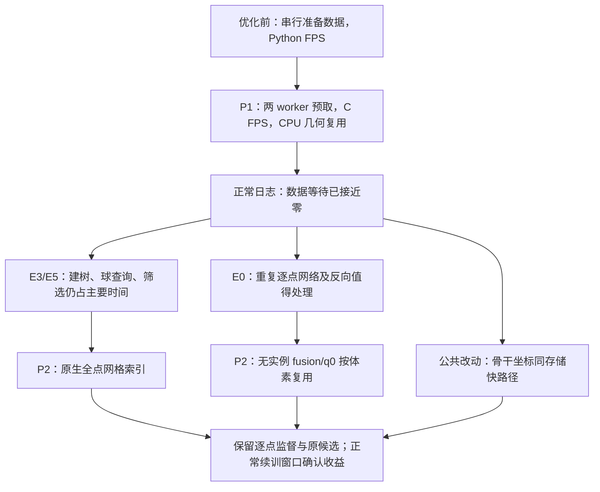
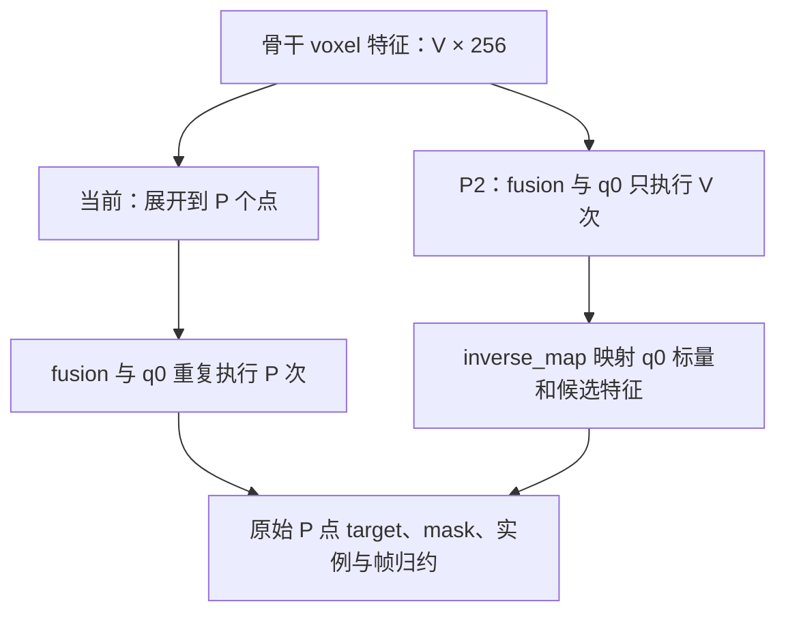

# CD-009 P2：基于 P1 实测的第二轮训练提速方案

**状态：方案与 CPU 原型已完成，产品实现和 H20/L20 部署待完成。** 本文审阅 `cd009/full-pretraining` 的 [`1e28a2f`](https://github.com/chichu-lv/suctionnet_modern_20mm/commit/1e28a2faa9991478d706e4d188081aa1a482ff9b)，日期为 **2026-11-12（北京时间）**。正式训练继续使用部署版本 `996421c`。本文中的合成 CPU 时间不代表正式训练速度，也没有改动正在运行的模型或配置。

**下一轮做三项具体改动：原生 CPU 空间网格查询、无实例分支的体素级 fusion/q0、骨干输出坐标的同存储快路径。** 继续使用 microbatch 1 × 梯度累积 4、8 个逻辑核、2 个数据 worker。P1 已解决的预取、编译 FPS 和数据搬运不再重复开发。

本文是 [P1 方案与完成记录](PERFORMANCE_OPTIMIZATION.md) 的后续。两者的当前状态不同：P1 已实施；本文列出的 P2 产品接口、配置和迁移修改是待实施规格。数据、模型和预训练的正式定义继续以 [CD-009 说明](CD009_PRETRAINING.md) 为准。

## 1. 现在真正需要解决什么

### 1.1 新报告已经排除的方向

| 已有证据 | 本轮决策 |
| --- | --- |
| L20 B2A2：E0 吞吐下降 41.76%，E3 下降 18.73%；E0 B4A1 预热 OOM | 保留 B1A4，不继续扩大 batch 搜索 |
| H20 E5 B2A2 仅增加 1.48%，B4A1 下降 0.20%，每配置只有三个计时块 | 没有稳定收益证据，保留 B1A4 |
| CPU8→16：E0/E3/E5 吞吐仅增加 1.01% / 0.16% / 0.31% | 增加 affinity 不会自动并行候选循环，保留 8 核 |
| 用户最新正常窗口汇总的数据等待约 1–2 ms/update，三组报告占比为 0.0092%–0.0240% | 两个 worker 已经够用，暂不增加 worker、存储转换或缓存工程；该汇总不是每一步等待的上界 |
| 增大 batch 后 L20 主要增加的是反向完成区间，前向没有相应增加 | 不把退化解释为 CPU 搬运不足，也不据此断言显存带宽瓶颈 |
| 逐候选共享查询比已测 batch64/w1、batch64/w4 更快 | 保留 scalar 调度；下一步替换索引及结果表示 |

11 个配置的原始聚合数据见 [P1_BATCH_CPU_RESULTS.json](performance/P1_BATCH_CPU_RESULTS.json)。数据准备每四帧自身仍需约 3.8–4.0 秒，但已经在后台完成；这部分不能再次从主线程 wall time 中减去。

### 1.2 正常训练基线与短测量分开使用

| 正式实验 | 50 次普通更新窗口 | 平均墙钟/更新 | 当时估计的剩余时间 |
| --- | --- | ---: | ---: |
| E0 / L20 | 1231–1280 | 4.238 s | 2.76 天 |
| E3 / L20 | 513–562 | 12.052 s | 7.96 天 |
| E5 / H20 | 579–628 | 11.016 s | 7.26 天 |

这是用户报告和公开 JSON 中的历史窗口，包含观察到的普通保存间隙；不是实时进度，不含尚未测得的完整验证、未来停机或六组全部完成的时间。P2 的最终效果也以这种正常日志窗口为准。

用于配置对照的 16 帧短测没有 AdamW 更新、正式保存或完整验证。其 GPU 利用率是离散采样均值；利用率更高不等于吞吐更高。不能以它替代完整训练 ETA。

### 1.3 已有细分足够决定几何主线

下面取 **P1 正常窗口的均值，单位为每个四帧成功 update 的秒数**：E5 为 381–410 共 30 次更新，E3 为 442–461 共 20 次更新。来源为 [P1_REAL_RESULTS.json](performance/P1_REAL_RESULTS.json)。这不是上一表的 50 步窗口。

| 已有字段 | H20 E5 | L20 E3 | 解释 |
| --- | ---: | ---: | --- |
| `tree_build_s` | 1.000 | 1.038 | CPU 空间树构建 |
| `ball_query_s` | 2.797 | 2.817 | 覆盖球准备、KD 查询、Python 结果转换、raw row 映射和排序 |
| `region_filter_s` | 2.017 | 1.871 | 局部坐标、区域选择、计数、lip 扇区和首点距离准备等 |
| `fps_s` | 1.345 | 1.449 | 首点选取、已编译 FPS、位置映射等 |
| `descriptor_pack_s` | 0.202 | 0.223 | 描述量整理 |
| `query_cpu_seconds` | 6.388 | 6.389 | 整段查询，不含建树；还含未单独分类的开销 |
| `pose_d2h_host_s` | 0.000770 | 0.000840 | 当前预测姿态的 CPU 转换区间 |

`tree_build_s` 与查询可相加；查询内部各小段不能再与 `query_cpu_seconds` 重复相加。这里的 host 计时也不是独立 CUDA kernel 时间。

E5 每更新约有 2,045 个有效候选、8,179 次逻辑球查询、**3,248 万条球内点访问记录**。这是重复访问量，不是每帧有 3,248 万个唯一点。当前 `cKDTree.query_ball_point` 将大量索引返回为 Python 列表，随后再转换、映射和排序，这是值得直接改掉的路径。

FPS 已经编译。即使让当前约 1.345 秒的整个 FPS 区间消失，按同一 E5 窗口总均值 11.359 秒计算，整体最多约 **1.13×**。只继续加速 FPS 不足以解决当前训练时长。

## 2. 方案怎样从上一轮修正到现在



| 原先考虑 | 当前证据与修正 |
| --- | --- |
| 批量 KD-tree 查询，增加 SciPy workers | P1 真正固定姿态测得 scalar/shared 为 1.728、1.850 s/frame；batch64/w1 为 2.034、2.037；batch64/w4 为 3.146、3.221。改为原生网格，不重复这组调参 |
| 把整候选查询放进 2–4 个线程 | 本轮同一 CPU 合成输入：1 线程 query 中位 1.521 s，2 线程 1.277 s，4 线程 1.276 s。2 线程只有约 1.19× 局部收益，作为备选 |
| 在 backbone 计算时提前建 KD-tree | 最多隐藏当前约 1 s/update；原生网格自身已大幅降低构建成本，降为备用，不与网格收益叠加 |
| 完整点云先展开，再跑全部 dense MLP | E0/E1/E3 的 fusion 输入在同 voxel 完全相同，MLP 又是逐行 LayerNorm，可直接在 voxel 上计算 fusion/q0 |
| 每帧重新匹配骨干输入输出坐标 | 固定骨干与 spconv 版本保留输入坐标的路径可直接识别，命中同存储时省去排序、同步和 identity gather |
| 再做一轮几何计时定位 | 现有细分已够用。直接实现上述改动，保留当前计时观察组合后的残余热点 |

上述 CPU 原型只使用一个正常合成场景，没有扩展场景、极端边界或配置矩阵。结果和环境见 [P2_CPU_PROTOTYPES.json](performance/P2_CPU_PROTOTYPES.json)。

## 3. 第一项：原生 CPU 网格替换 KD-tree

### 3.1 具体改变

新增 **20 mm cell 的 CPU 均匀空间索引**，按 CSR 形式保存每个 cell 内的全部 raw point id。CSR 在这里就是两个连续数组：每个 cell 的起止偏移，以及按 cell 分组的点行号。

**20 mm 是查询索引的格子大小；网络体素仍为 2 mm。** 一个格子里的点不会合并、求均值或截断；84 万点仍是 84 万点。球查询先找可能相交的格子，再逐点执行原来的半径条件，返回所有符合条件的原始点。

第一版只替换空间索引和球查询的实现，保留 `ContactGrouping.query` 中的局部坐标、区域筛选、随机 roll、FPS 与描述量。CPU 索引来自当前增强后的几何，每个 encoded scene 建一次并复用；不能跨增强样本或训练轮次缓存邻域。

### 3.2 本轮实际做过的原型

同一合成高度场：840,000 原始点、512 候选、2,048 个球，索引/Torch/BLAS 均为 1 线程，重复两次。后续 NumPy 几何与现有编译 FPS 未改。

| 局部工作 | KD-tree 两次 | 原生网格两次 | 中位数变化 |
| --- | --- | --- | --- |
| 建索引，含相同 CPU 几何准备 | 0.280 / 0.261 s | 0.040 / 0.012 s | 0.270 → 0.026 s |
| 独立执行 2,048 次球查询 | 0.820 / 0.704 s | 0.394 / 0.184 s | 0.762 → 0.289 s |
| 完整 `ContactGrouping.query` | 1.540 / 1.481 s | 0.971 / 0.911 s | **1.510 → 0.941 s，约 1.61×** |
| 建索引 + 完整 query | 1.820 / 1.742 s | 1.011 / 0.924 s | **1.781 → 0.967 s，约 1.84×** |

两个实现返回的 6,565,455 条球内 raw id、全部 2,048 个邻域、五区 `indices/mask/geometry/counts`、lip 扇区计数均相同；固定 roll 的查询体没有额外消耗 RNG。实际得到的局部时间减少为 45.7%，不是训练总时间减少 45.7%。

这个输入的点分布、遮挡和区域占用不等于真实堆叠帧；本机 NumPy/SciPy 版本也不同于部署机器。保留两次值，因为首次构建和独立查询有冷热差异。独立查询为核对邻域暂存全部结果，完整 query 则按候选释放；两种 query scope 的数字不可互换。

可移植研究复现入口见 [research/performance_p2](../research/performance_p2/README.md)。它不是训练后端，不能通过仅编译这个研究文件就声称产品已接入。

### 3.3 生产接口与数据所有权

建议修改范围：`models/contact_grouping.py`、新增 `models/spatial_index.py`、新增 `models/csrc/spatial_index_cpu.cpp`，并扩展现有本机 build 入口。

```python
class CpuGridIndex:
    # 当前增强帧；只读引用在 index 生命周期内保持有效。
    xyz64: np.ndarray             # [P, 3]，与 P1 同一 FP64 坐标来源
    frame_offsets: np.ndarray     # [B+1]，从 CpuGeometry.point_offsets 获得
    instance: np.ndarray          # 继续供现有 query 使用
    normals: np.ndarray
    normal_valid: np.ndarray

    @classmethod
    def from_cpu_geometry(cls, geometry, *, cell_size_m=0.02): ...

    def ball(self, frame: int, center64: np.ndarray,
             radius: float) -> np.ndarray:
        # np.int64；升序全局 raw row；不截断。
        ...
```

`SpatialIndex.from_cpu_geometry` 按性能配置选择旧 KD-tree 或新 grid；上层 `encoded['spatial_index']` 的场景内复用不变。`from_inputs` 的现有调用者也走相同 backend factory，不能让推理或配对工具意外仍用另一条实现。

当前 `ContactGrouping.query` 用 `index.trees[frame] is not None` 统计 `ball_api_calls`，应改为与后端无关的 `index.frame_has_points(frame)`。不要为了兼容计时而把 grid 对象伪装成 KD-tree。

### 3.4 构建算法

对每帧独立构建；直接使用现有连续 frame offsets，无需另做一次 point batch 排序。

1. 对各点计算整数 cell：`floor(xyz64 / 0.02)`；使用 `floor`，不能将负坐标直接截断成整数。
2. 得到本帧 cell 最小坐标 `lo[3]` 和尺寸 `dims[3]`。
3. 线性 cell key 为 `((cx-lo_x)*dy + cy-lo_y)*dz + cz-lo_z`。
4. `counts → prefix sum` 得到 `cell_offsets[C+1]`。
5. 按原点顺序把 raw row 填入 `raw_rows[P]`，XYZ 本体无需重排或复制到 Python 对象。

数据规模为 `O(P + C)`；数组采用 int64。面向当前正常工作空间实现这一种紧凑网格即可，不额外开发通用八叉树、自动索引选择器或异常尺度处理平台。空帧继续使用现有空结果语义。

### 3.5 精确球查询

输入球中心和半径仍由现有四球代码计算。查询步骤：

```text
R = radius + 1e-8
lo_cell = floor((center - R) / cell_size)
hi_cell = floor((center + R) / cell_size)
将 cell 范围裁到当前帧索引边界
枚举这些 cell 内的全部原始点
以 FP64 检查 (dx*dx + dy*dy) + dz*dz <= R*R
收集全局 raw row，升序排序，返回连续 int64 数组
```

保持现有边界扩张、完整集合和 raw id 排序；没有固定 K 上限、近似球查询或提前抽样。查询结果必须独立持有自己的数据：原型使用的 reusable scratch 在下一次球查询会被覆盖，产品绑定返回 ndarray 前要复制或转移所有权，否则同一候选四个球会互相覆盖。

原生层使用现有 CPython 扩展方式和 buffer protocol；释放 GIL 执行构建与查询，直接输出连续 int64 buffer，避免每个邻接创建一个 Python int。沿用 FP64、`-O3 -fno-fast-math -ffp-contract=off`，不引入 NumPy C ABI、OpenMP、CUDA 或新的算法依赖。Python 端保持 XYZ buffer 强引用直到索引释放。

**第一版单线程。** 不同时启用候选线程池；如果后续增加线程，只读 CSR/XYZ 可以共享，但每线程的 scratch、结果和计时必须独立。

### 3.6 保留哪些计数和后续操作

下列是算法本身的实现约定，不是新增测试清单：

| 项目 | P2 行为 |
| --- | --- |
| 接触 core/lip | 继续共享一个球及局部坐标；core `rho<=0.018`；lip `0.018<rho<=0.022`；高度均为 `abs(z)<=0.008`，并且同实例 |
| cup/mount/approach | 使用冻结的三段包络、原开闭边界与 self-ignore 条件 |
| counts / lip sectors | 都在 FPS 之前统计，不用抽样后数量代替 |
| FPS 首点 | 仍按现有轴向中点距离最小值；并列时服从升序 raw row 的第一项 |
| FPS 后续 | 继续调用 P1 编译实现、原 32/64/32/32/32 上限和并列规则 |
| 随机 roll | 主调用对全部输入姿态一次性抽取，位置和数量不变 |
| GPU 特征 | 保留现有 selected raw-point union 投影，局部特征的梯度路径不变 |

`tree_build_s` 对 grid 应迁移为明确的 `index_build_s` 并记录 backend；旧日志字段保留其历史含义。`spatial_index_seconds`、`query_cpu_seconds` 和其余细分沿用。不能把 grid 构建伪称为 KD-tree 建树，也不增加每段 CUDA synchronize。

## 4. 第二项：E0/E1/E3 的 fusion 与 q0 按 voxel 计算

### 4.1 为什么可以这样改

现有 `encode_scene` 先把骨干的 `F_voxel[V,256]` 用 `inverse_map` 展开到 `F_local[P,256]`，再对 P 个点执行 fusion 和 q0。

E0/E1/E3 没有实例融合，此时第 i 个点的 fusion 输入为：

`[F_voxel[inverse_map[i]], zeros(134), g_cam[frame(i)]]`。

同 voxel 的点属于同帧，上述输入完全相同。`models/heads.py:mlp` 使用 **Linear → LayerNorm → ReLU**，没有跨点 BatchNorm 或 Dropout，因此重复的输入没有必要重复执行这两个网络。骨干内部的 BatchNorm 仍按原来 B1 方式训练。



### 4.2 实施伪代码

修改 `models/suction20net.py` 中 `encode_scene`、`predict_dense`、`score_at_pose` 三处。在构造函数使用 `self.no_instance_voxel_heads = performance.get('no_instance_voxel_heads', False)`，兼容旧 v1 sidecar；不新增任何神经网络模块或改变参数初始化顺序。第一版保留现有 `F_local` 和 axis head，控制修改范围。

```python
local = voxel_features[batch_input['inverse_map']]  # 轴头及接触特征仍使用

if not self.use_instance_fusion and self.no_instance_voxel_heads:
    voxel_frame = batch_input['voxel_coords'][:, 0].long()
    voxel_gravity = batch_input['g_cam'][voxel_frame]

    def fuse_voxel(feature, gravity):
        return self.fusion(torch.cat((
            feature,
            feature.new_zeros((len(feature), 134)),
            gravity.to(feature),
        ), dim=-1))

    fused_voxel = self._chunks(fuse_voxel, voxel_features, voxel_gravity)
    # encoded 使用一个新且明确的 key，不能把 V 行张量伪装成原 P 行 F_fused。
    encoded['F_fused_voxel'] = fused_voxel

    # predict_dense
    q0_voxel = self._chunks(
        lambda f: self.q0_head(f).sigmoid(), fused_voxel
    ).squeeze(-1)
    q0_all = q0_voxel[encoded['inverse_map']]

    # score_at_pose：沿用现有 anchors/valid/safe 的处理
    pose_fused = fused_voxel[encoded['inverse_map'][safe_anchors]]
else:
    # 原 instance fusion 与逐点 q0 路径。
    ...
```

为 `score_at_pose` 提供一个小的 fused-feature gather helper，统一处理 voxel 分支和原逐点分支，沿用空输入行为。不要为了兼容接口立即重新生成完整 `F_fused[P,256]`，否则会失去显存和索引反向方面的主要收益。

### 4.3 损失与梯度必须怎样保留

`q0_all` 仍是全部原始点的 P 个分数。所有点的 target、质量有效 mask、实例权重、帧权重、seed sampling 都在原始点空间继续执行。

例如，同一 voxel 有两个点，target 分别为 0.1 和 0.9，原目标是两个原始点损失的归约；不能把 target 先平均为 0.5 再只计算一次 SmoothL1。参数共享前向后，autograd 会把这些原始点的梯度汇总到共享的 voxel 输出，这才对应原算法。

模型 module、Parameter 名称、形状及参数组不变，不需要转换模型或 Adam 张量。变化是计算位置和 gather 维度：q0 反向先在 P×1 上汇总，再回到 voxel 网络，避免重复运行逐点 fusion/q0 及其大特征反向。

### 4.4 适用范围和当前证据

| 实验 | 整个 fusion/q0 可按 voxel 复用？ | 原因 |
| --- | --- | --- |
| E0 / E1 / E3 | **可以** | 同 voxel 的 fusion 输入相同，逐行 MLP |
| E2 / E4 / E5 | **第一版不做** | 输入还有逐点相对坐标及实例信息；同 voxel 可能跨实例 |
| 所有组的 axis head | **不能整体 voxel 化** | 轴头使用逐点 `normal_obs` |

已做一个 CPU float64 数学/梯度原型：2,117 点、113 voxel、2 帧，包含不同逐点监督和 seed 特征路径。q0 最大差异 `1.67e-16`，seed fused feature 最大差异 `2.66e-15`，参数梯度最大差异 `7.63e-17`，参数名称和形状不变。该原型还一起检查了第 8 节的可选轴头首层分解；它不是正式模型完整损失检查，也没有 CUDA/AMP 或耗时结论。

实际收益取决于日志中已有的 P/V 和 GPU 时间构成。P/V 只代表可减少的重复行数，不能直接作为整步加速倍数。AMP 的算子批量和归约顺序变化可能带来小量浮点差异，使用第 7 节现有配对工具的原容差处理，不追求跨进程逐位一致。

## 5. 第三项：省掉骨干封装中重复的坐标重排

`models/backbones/spconv_resunet14.py:forward` 每帧无条件运行 `coordinate_rows(coords, output.indices)`。它拼接坐标，执行 `torch.unique(dim=0)`、额外 unique、GPU 标量同步，最后再对通常不需要重新排序的 `V×512` 特征做一次 gather。

核对固定上游源码后，当前网络末级 inverse convolution 恢复 `enc_p2` 的输入 indices，之后是 SubM 与最终 1×1 SubM。spconv 2.3.6 的两条 inverse 路径均复用保存的输入坐标；正常 SubM/1×1 路径继续保留这些坐标。见 [固定 backbone](https://github.com/SimonHanrath/graspness_modern/blob/dda1d7586d4a9aea53da1636ffe64ae2c362e861/models/backbone_resunet14.py)、[spconv conv.py](https://github.com/traveller59/spconv/blob/v2.3.6/spconv/pytorch/conv.py) 和 [ops.py](https://github.com/traveller59/spconv/blob/v2.3.6/spconv/pytorch/ops.py)。

在本项目 wrapper 添加以下快路径即可；由 `Suction20Net` 将 `backbone_coordinate_fastpath` 作为可选构造参数传入 wrapper，旧 P1 默认关闭：

```python
same_rows = output.indices is coords
if not same_rows:
    a, b = output.indices, coords
    same_rows = (
        a.device == b.device and a.dtype == b.dtype
        and a.shape == b.shape and a.stride() == b.stride()
        and a.data_ptr() == b.data_ptr()
    )

if same_rows:
    features = output.features
else:
    features = output.features[coordinate_rows(coords, output.indices)]
return self.projection(features)
```

比较 tensor 元数据不会读取 CUDA 张量内容。**不要改成每帧 `torch.equal`**，它会再次引入内容比较和同步；也不要无条件假设所有后端都保持顺序。原 mapper 直接作为未命中路径保留即可。

这项适用于全部 E0–E5，Parameter 和计算模型不变。收益来自省去坐标操作、同步及 identity gather 的反向；当前没有真实 kernel 时间，暂不给百分比。上游 `sparse_cat` 自身的检查仍存在，本项没有消除所有同步，也不要求修改或重新托管第三方源码。

## 6. 配置、文件和已有训练的接入

### 6.1 第一版的范围

| 文件 | 必须完成的改动 |
| --- | --- |
| 新 `models/spatial_index.py`、`models/csrc/spatial_index_cpu.cpp` | 全点 CSR 网格、FP64 精确球、int64 连续输出、buffer 生命周期 |
| `models/contact_grouping.py` | 索引 factory、后端无关的空帧/计时访问；其余几何算法先保留 |
| `models/suction20net.py` | 无实例 voxel fusion/q0、raw-point q0 输出、pose fused gather helper |
| `models/backbones/spconv_resunet14.py` | 坐标同存储快路径，保留原 mapper |
| `setup.py` 与现有 backend identity/build 工具 | 添加 grid 编译产物与源码/编译器/flags/ABI/二进制身份 |
| `suction20/performance.py` | 同时识别旧 v1 与新 v2 sidecar；新增性能开关不进入科学配置 |
| `scripts/benchmark_paired_pipeline.py` | baseline 也能显式使用 P1 sidecar/CPU context；覆盖 wrapper 快路径 |
| 现有迁移、receipt 验证及 supervisor/备份函数 | 支持当前 P1→P2，见 6.3 |

上述三项计算改动可以并行开发，合并成一个 P2 版本部署，减少正式训练暂停次数。保持 B1A4、CPU8、loader2；H20/L20 的 dense chunk、allocator 上限及六份硬件 profile 原始字节不变。

### 6.2 新性能 sidecar 规格

新增 `configs/performance/cd009-p2.json`，不要修改已绑定哈希的 P1 文件。建议内容如下；**当前 v1 parser 尚不接受这些新增字段，必须随实现一起修改后才能使用**。

```json
{
  "schema_version": "suction20.performance.v2",
  "fps_backend": "compiled",
  "spatial_index": {
    "backend": "uniform_grid_cpu",
    "cell_size_m": 0.02
  },
  "no_instance_voxel_heads": true,
  "backbone_coordinate_fastpath": true,
  "query_chunk_size": null,
  "query_workers": 1,
  "loader": {
    "num_workers": 2,
    "prefetch_factor": 2,
    "persistent_workers": true,
    "pin_memory": true,
    "multiprocessing_context": "spawn"
  },
  "detailed_cpu_timing": false
}
```

`no_instance_voxel_heads` 只在 `use_instance_fusion=False` 生效；有实例分支保持原实现。`query_workers` 仍是原 SciPy 调度字段，新 grid 第一版不使用它启动线程。旧 v1 schema 及 P1 解释保持不变，`performance_identity` 返回实际 schema，并在 `backend_builds` 中记录启用的 grid 原生实现。继续使用已有身份构建方式，不另建一套环境管理系统。

### 6.3 现有迁移工具有三处实际阻塞，不能直接照 P1 命令执行

这是代码中已经存在的限制，处理它们是保留已训练进度所必需的集成工作。

| 入口 | 当前为什么不能处理 P1→P2 | 最小修改 |
| --- | --- | --- |
| `scripts/migrate_performance_checkpoint.py:migrate` | 仅允许原始 `98862f4` / `d634…`，且拒绝已有 performance 或迁移记录 | 增加明确的当前 P1 来源分支，沿用同实验、已暂停 current checkpoint 与原有配置/进度比较 |
| `suction20/pretrain_runtime.py:verify_performance_migration` | 同样硬编码原始无 performance 来源 | 接受经现有 P1 receipt 证明的 P1 源身份，继续只允许 code/worktree/performance 身份变化 |
| `suction20/run_supervisor.py:verify_performance_transition` | assignment 已有 `performance_config_sha256` 时直接拒绝 | 支持旧 assignment 的 P1 sidecar hash → 新 P2 sidecar hash，保留现有 committed identity、migration/backup 状态关联 |

当前批准的 P1 来源是：

- code：`996421c664a5a0b84c308aa4ca47c31eaff4035b`；
- worktree：`23bde51eb6b8f091a15b2aeb336db8a7085b150f304076af44b3a1d83ba7ee20`；
- sidecar SHA256：`08d2247c5bd433d8fdc16325a9602821a8a5c8c52b0c6cf0148a4991e4f9d188`。

沿用显式来源匹配，不把普通 resume 改为忽略版本差异。保留原 `SOURCE_REVISION` / `SOURCE_WORKTREE_SHA256`，新增 P1 来源常量，不能直接覆盖旧常量导致旧 receipt 失效。源模型、Adam moments/step、AMP、RNG、已消费 sampler 游标、有效样本预算、LR、best/验证节点与日志前缀均保留，性能切换不重新 warmup，也不重置训练步数。

`inspect_worker()` 应保留 verifier 返回的 receipt，在 view 中增加 `performance_migration_source_config_sha256 = receipt.source_identity.performance.config_sha256`（原始无 performance 来源为 `None`）。`verify_performance_transition()` 用这个值与旧 `assignment.performance_config_sha256` 比较；目标 hash 仍与新配置比较。`performance_source_backup_verified` 仍对应最新迁移归档的、刚暂停的 P1 checkpoint，不改为最早的原始 checkpoint。

**旧迁移档案的保留可以复用现有 manifest，不新增 checkpoint 历史字段。** 新迁移已经会归档原始 `source-manifest.json`，其中 `current.analysis.performance_migration` 指向旧 P1 receipt。新 verifier 在 P1 来源分支沿这条已有引用验证旧 receipt，以新 receipt 的 `source_identity` 作为旧 receipt 的目标 identity。备份函数也沿同一引用收集旧 receipt 的源 checkpoint、source-manifest 和 sidecar 文件。

目前只 glob 全部 `receipt.json` 不够：后续 P2 保存会替换 predecessor，旧 P1 的三个归档文件可能不再从当前 manifest 的直接引用中被找到。扩展 `run_supervisor._backup_snapshot()` 的现有归档文件收集函数即可，复用已有 receipt 去重集合；不新增 receipt schema、checkpoint 历史字段或备份任务。

### 6.4 实际切换顺序

1. 在独立 checkout 完成 P2 实现、独立目录内的本机扩展构建和第 7 节一次配对，准备固定提交和 sidecar。
2. 同一主机上共用训练 checkout/venv 的正式 trainer 在正常保存边界暂停，各使用自己的 current checkpoint。
3. 切换 supervisor 实际执行的公共 `root/repo` 并安装对应扩展。supervisor 的 cwd、脚本路径和 Python 指向这套环境；独立目录构建完成不等于实际恢复环境已经切换。以实际安装后的代码、sidecar、扩展构建目标身份。
4. 通过扩展后的现有 migration 入口逐 run 更新性能身份与 receipt，再由原 supervisor 接续。每个 run 保留自己的学习状态。
5. 读取原预算内 20–30 个成功 update 的正常日志，确认实际收益；之后正常训练。

本轮没有连接或暂停训练机器；L20 GPU0 继续不动。正在运行的 checkout 不直接 `git pull` 文档 HEAD：项目身份包含 code revision/worktree，文档发布 SHA 也不能当作部署代码 SHA。E5/H20 与各 L20 实验仍是独立单卡任务。

## 7. 验收仍只保留三个正常路径

### 7.1 同一组四帧，复用现有配对工具

**当前 P1 是 baseline，P2 是 candidate。** 给 `benchmark_paired_pipeline.py` 增加 `--baseline-performance-config`，并让 baseline 同样使用自己的 P1 CPU geometry context。当前脚本只给 candidate 注入性能配置和 CPU context，不能原样用于 P1/P2 对比。

采用现有四个真实帧和既定增强种子。主配对使用 **E3 路径**，一次覆盖接触 grid、无实例 voxel heads 和公共坐标路径；保持一次共同真实 backbone 前向及两份 VJP 的已有方法。几何 raw rows、mask、计数及随机序列沿用现有精确比较；输出、loss、梯度沿用现有 `atol=2e-4, rtol=2e-3`，不扩大容差。

坐标快路径位于共同 backbone 的上游边界，不能声称原有 suffix 配对自然覆盖了它。当前脚本还要求整个 `models/backbones/spconv_resunet14.py` 文件 SHA 相同，P2 修改 wrapper 后会直接被拒绝，因此这处入口条件也必须调整：保留固定上游 sparse network、模型参数和未改动 `heads.py` 的对应关系，不再要求 wrapper 文件字节相同。在同一次真实 sparse network 的原始输出上、projection 之前，比较快路径与原 `coordinate_rows` 的坐标映射和特征结果；共同 backbone 及下游 VJP 继续复用。无需独立运行两次 sparse backbone，也不新增一次配对任务。

现有 CPU 代数原型提供设计依据，真实配对确认 AMP 路径。P1 已记录的独立进程 old/old 和 old/new 差异不再重复排障；共享骨干配对也不宣称跨进程 CUDA 逐位确定。

### 7.2 一次正常保存和恢复

每个切换的正式 run 走原有 pause → migrate → resume，复用原有连续性比较，确认下一批及训练预算继续。无需再设计 19 项新审计、随机故障、AMP 跳步注入、worker 崩溃或异常 checkpoint 矩阵。

### 7.3 原预算内 20–30 次普通更新

记录正常日志 wall time、现有查询分段、点/体素数及显存。详细几何计时仅短期开启，正常更新本身计入原样本预算；不增加新的完整验证节点。

固定四帧配对用于比较同输入，正常窗口用于说明实际训练 wall time。不同自然帧窗口只给观察到的变化，不包装为严格因果倍率。已达到足够验证后继续训练，不为排除所有极端情况延长上线流程。

## 8. 第一版之后，只有残余热点值得再动

### 8.1 几何仍慢：融合筛选、FPS 衔接和打包

这是 E3/E4/E5 的下一项明确工程方向，排在原生索引后。当前约 1.9–2.0 秒的 region 区间包含 NumPy 局部坐标运算和多次筛选复制，约 1.3–1.45 秒的 FPS 区间已经有 C 核心，不能都当成 Python 循环。

具体做法是保留 NumPy 现有 `d@u/v/n`、`hypot`、首点距离和 lip sector 数学路径；新增一个原生 selection 接口接收 raw rows、几何列、布尔 keep 与距离数组，在一次调用内完成：

- compact 有效 rows，保留原行顺序及 counts；
- 原首点选择和现有贪心 FPS；
- 同时返回 raw rows 与其在未压缩球数组中的位置，去掉 `np.searchsorted`；
- 描述量只 gather 最终 32/64 个位置，减少对全部候选点的 x/y/z/rho/same 过滤复制。

lip sectors 仍在全部有效 lip 点上计数；可以在相同输入上合并统计，但不把原 NumPy `atan2/floor` 偷换成近似扇区。该方向减少复制和 Python/C 往返，**没有证据证明能消掉整个 region 区间**。

若仍需要并行，把完整候选工作按约 64 个候选分块、用 2 个长期线程运行，roll 由主线程一次产生，结果按候选顺序写回。不要并发调用会写 `self.last_query_timings` 的当前 `query`；抽成返回局部计时的纯 worker 函数。并行的各线程 CPU 时间不能相加当作 wall time。

已有线程原型只是旧 KD-tree 路径的约 1.19× 局部收益，未测 grid+线程组合。只在上述正常窗口仍显示值得处理时接入，不先做线程数矩阵，也不将两个独立原型的倍率相乘。

### 8.2 E0 仍慢：观察一个正常 update，再选择 GPU 改动

固定 B1A4 下，E0 的反向完成区间约 3.598 / 4.240 = 84.9%。它包括 autograd、kernel 执行、launch 和同步，不是仅仅读取几个 loss 标量花了 3.6 秒。

在 voxel heads 和坐标快路径完成后，如果 E0 仍明显受限，使用 **一个正常 update 的短 CUDA trace**，标注 backbone、coordinate alignment、fusion/q0、axis、loss、backward 即可。它用于选下一项实现，不扩展为硬件、batch、chunk 的新矩阵，也不阻塞已经有证据的 CPU grid 改动。

可选的具体代码方向按 trace 选择：

| 残余热点 | 可实施改变 | 要保持的语义 |
| --- | --- | --- |
| axis 首层 Linear | `W_f F_voxel + b` 按 voxel 计算，再 gather 与逐点 `W_n normal_obs` 相加；之后原 LayerNorm/ReLU/输出/残差几何逐点执行 | 使用原 Parameter slice，不新增参数；不能将整个轴头按 voxel 复用 |
| 每 microbatch 的日志 scalar 回读 | GPU 上 detached 累计，update 末集中回读 | 原有限性判断与优化时序保留；不能把移动同步位置当成已消除反向计算 |
| loss 的逐实例小操作 | 若确实显著，按每项有效集合的原实例/帧权重合并 reduction | seed 项与 dense 项有效集合不同，不能改变实例→帧→batch 归约 |
| 稀疏卷积 kernel | 只针对 trace 中明确占时的固定层/算法研究 | 当前没有证据支持直接换 spconv 版本、扩大 TF32 范围或改骨干 |

轴头首层拆分在实数运算下成立，CPU float64 原型也支持；AMP 下拆开的 GEMM 舍入顺序不同，不能直接宣称逐位等价。它是后续候选，不是第一版上线条件。

E2/E4/E5 的实例融合可以进一步分解第一层 affine，但输入包含逐点相对位置，后续非线性仍需逐点；实例 pooling 的 mean 还按原始点数量加权。当前不将这项扩展到主线，避免把明确的三项改动变成长周期重写。

### 8.3 GPU 几何的启动条件

如果原生 CPU 索引和上述衔接融合之后，正常窗口仍显示几何占主要 wall time，再考虑完整 GPU 索引→区域筛选→FPS→打包。GPU 只做 FPS 的理想整体收益受第 1.3 节的 1.13× 上限约束，通常不值得先承担完整扩展成本。

GPU 版本仍须支持所有 raw points、完整半径集合、原区域边界和 FPS 并列规则；不使用固定 K 截断或体素代表点替代物理几何。第一版 CPU grid 不需要等 GPU 版本完成。

## 9. 能缩短到什么程度

收益先按正确的阶段占比估算，再由正常训练确认。下面全部使用同一个固定 4 帧 block 的短测，不与正常 50 步窗口拼接：

| 配置 | 原总时间 T | 建索引 + query G | G 占比 | 如果 G 减半，其余不变 |
| --- | ---: | ---: | ---: | ---: |
| H20 E5 B1A4 | 11.813 s | 8.284 s | 70.1% | 7.671 s，约 1.54× |
| L20 E3 B1A4 | 12.920 s | 8.300 s | 64.2% | 8.770 s，约 1.47× |

计算式为 `T_new = T - G + G/s`。本地 grid 的几何段 1.84× 不能直接作为整体倍率，更不能与两线程、异步建树或 voxel 复用的局部倍率相乘。

第一版 grid 主要减少建索引和球查询，筛选/FPS 仍保留。因此，如果希望从约 7 天进一步压缩很多，仅靠这个索引也不够，需要继续减少第 8 节中实际留下的主要部分。E0 的 voxel 计算与公共坐标快路径具有明确的代码依据，但尚无 GPU 实测，暂不填一个虚构倍数。

对约 57,000 次剩余更新而言，**每次实际减少 1 秒，约节省 15.8 小时**。实际剩余时间应使用切换后的成功步与正常 wall：

`剩余训练时间 ≈ (57600 - 当前成功步) × P2 正常每步墙钟 + 尚未计入的验证/停机时间`。

本次不削减 230,400 有效帧预算，不减少 512 候选，不增加网络体素，不冻结 BN，也不因性能切换重新训练或重新制作标签。后续少量自有场景微调继续复用这些预训练权重和原定协议。

## 10. 实施完成清单

- [x] 核对 `1e28a2f`、P1 发布/部署身份及新的 batch/CPU 测量。
- [x] 用既有正常计时定位当前热点，确认预取等待已基本消除。
- [x] 单一 CPU 合成输入原型：原生网格的邻域/分组一致且局部更快；记录线程备选结果。
- [x] 无实例 voxel heads 的代数/梯度原型，以及固定骨干坐标路径源码核对。
- [x] 完成产品接口、文件改动、P1→P2 接续方式和精简验收规格。
- [ ] 实现 CPU grid、无实例 voxel heads 和坐标快路径。
- [ ] 更新性能 sidecar、配对工具与已有迁移/备份入口。
- [ ] 同一组四帧配对、一次正常恢复及原预算内 20–30 update 观察。
- [ ] 用真实 wall time 更新结果，再决定是否需要筛选/FPS 衔接融合或一个 E0 trace。

这些 TODO 是第二轮提速工程，不代表预训练效果验收已完成；六组训练和既定开发验证继续按 README 总 TODO 执行。

## 11. 来源与代码定位

- 最新审阅快照：[`1e28a2faa9991478d706e4d188081aa1a482ff9b`](https://github.com/chichu-lv/suctionnet_modern_20mm/tree/1e28a2faa9991478d706e4d188081aa1a482ff9b)。
- P1 正常训练分段：[P1_REAL_RESULTS.json](performance/P1_REAL_RESULTS.json)；batch/CPU 对照与最新 wall：[P1_BATCH_CPU_RESULTS.json](performance/P1_BATCH_CPU_RESULTS.json)。
- 本次 CPU 原型环境、逐次结果及适用范围：[P2_CPU_PROTOTYPES.json](performance/P2_CPU_PROTOTYPES.json)；可移植研究代码：[research/performance_p2](../research/performance_p2/README.md)。
- 接触索引与查询：[contact_grouping.py](../models/contact_grouping.py)；CPU 原始几何：[cpu_geometry.py](../suction20/cpu_geometry.py)。
- voxel/逐点计算位置：[suction20net.py](../models/suction20net.py)；MLP/轴头：[heads.py](../models/heads.py)；实例条件：[instance_fusion.py](../models/instance_fusion.py)。
- 坐标映射：[spconv_resunet14.py](../models/backbones/spconv_resunet14.py)；固定第三方来源：[setup_backbone.py](../scripts/setup_backbone.py)。
- 当前性能配置与身份：[performance.py](../suction20/performance.py)；[P1 sidecar](../configs/performance/cd009-p1.json)。
- 接续与备份入口：[migrate_performance_checkpoint.py](../scripts/migrate_performance_checkpoint.py)、[pretrain_runtime.py](../suction20/pretrain_runtime.py)、[run_supervisor.py](../suction20/run_supervisor.py)。
- [现有共享真实骨干配对工具](../scripts/benchmark_paired_pipeline.py)；[batch/CPU 短测脚本](../scripts/benchmark_batch_cpu.py)。
- SciPy 1.11.4 的球查询参数、排序与返回值定义：[官方文档](https://docs.scipy.org/doc/scipy-1.11.4/reference/generated/scipy.spatial.cKDTree.query_ball_point.html)。
