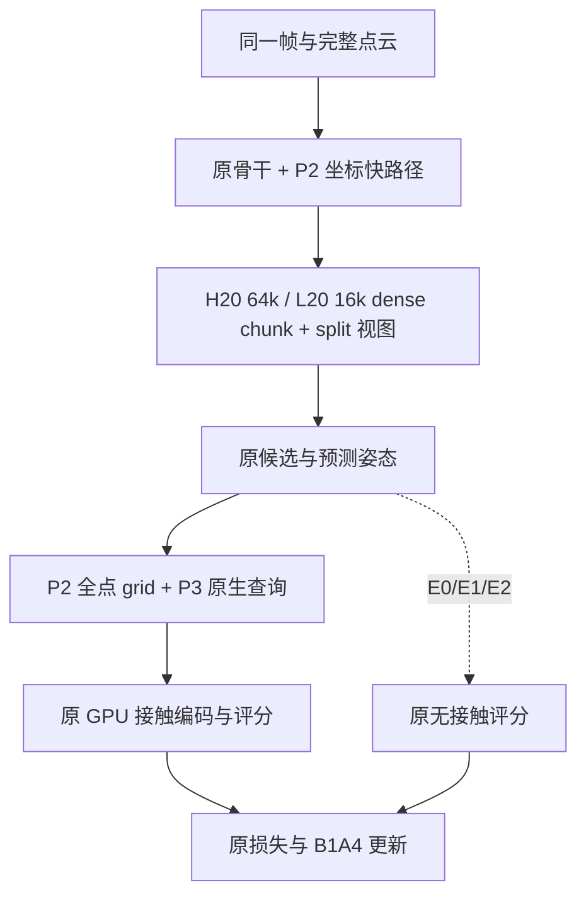

# CD-009 P3：整合优化与正常续训

2026-11-13 更新。依据 [H20 / E5 诊断](performance/H20_P2_BATCH_DIAGNOSIS.md)、[L20 / E5 诊断](performance/L20_P2_BATCH_DIAGNOSIS.md) 及随后完成的[真实 checkpoint 配对与续训结果](performance/P3_INTEGRATED_RESULTS.md)调整方案。**H20/E5 的 64k + split + native 与 L20/E3 的 16k + split + native 已通过四帧配对；H20/E5 及 L20/E0、E1、E3 均已完成迁移并取得首 25 次正常更新窗口。** L20 原 64k 组合未通过原梯度门槛，现予延后，原失败报告保留。

优化全过程、版本取舍和当前状态见 [性能优化全程总览](PERFORMANCE_HISTORY.md)。这些正常窗口的训练代码固定为 `f4f7f0d6de0bd3bd27107d8be09885fed700e48b`；后续 GitHub 发布与独立 `control_repo` 的 supervisor 身份不替换训练运行身份。

H20 保持 [cd009-p3-integrated.json](../configs/performance/cd009-p3-integrated.json) 的实际 dense chunk **65,536**；L20 采用 [cd009-p3-l20-16k.json](../configs/performance/cd009-p3-l20-16k.json) 的 **16,384**。两者均启用 **P2 全点 CPU grid 与坐标快路径、compiled FPS、P3 原生接触查询及 `torch.split` 输入分块**；E0/E1 不使用 contact grouping，不获得原生查询收益。两卡继续 B1A4，保持原硬件 profile、2 mm 网络体素、每帧 512 候选、完整观测和 230,400 有效帧 / 57,600 成功更新预算。`no_instance_voxel_heads` 继续为 `false`。

## 1. 当前状态与取舍

| 项目 | 已有证据 | 本轮处理 |
| --- | --- | --- |
| P2 全点 CPU grid、backbone 坐标快路径 | 本轮实际源 checkpoint 已使用 P2 | 保留在两种目标配置中 |
| P2 无实例 voxel heads | 既有真实 AMP 梯度比较未通过，见 [P2 记录](PERFORMANCE_PHASE2.md) | 保持关闭，不随其他 P2 改动启用 |
| P3 融合原生接触查询 | 修复正负零字节差异后，H20/E5 64k 与 L20/E3 16k 完整四帧配对通过 | 两组均已使用原生查询续训，并取得首 25 步窗口 |
| dense chunk 65,536 | H20 原配置已是 65,536；L20 原 64k 候选未通过严格梯度门槛 | H20 保持 64k；L20 保留 16k，64k 延后，不改冻结 profile |
| `chunk_input_mode=split` | H20 64k 与 L20 16k 组合均通过完整配对 | 保留；不从组合窗口推定 split 的独立收益 |
| H20 实例特征广播的 indexing backward | 已定位 fusion scope 内的主要 GPU 热点 | 下一候选，尚待实现；不阻塞本次已有组合 |
| B2A2 | H20 短测仅 +2.20%；L20 在 64k 下仍比 B1A4 慢 9.33% | 两卡保持 B1A4，不继续扩大 batch |

两份诊断及较早 [P2_REAL_RESULTS.json](performance/P2_REAL_RESULTS.json) 保留为当时记录。**本轮已从实际 committed checkpoint 确认配对与续训的源为 P2 `e73d62e`，不是仅凭测量身份推定部署。** 后续其他运行仍按各自 checkpoint 读取源代码、sidecar 和学习状态；迁移器保留批准的 original/P1/P2 直接接续能力。

原 [cd009-p3.json](../configs/performance/cd009-p3.json) 字节和 [P3_CPU_RESULTS.json](performance/P3_CPU_RESULTS.json) 保留，分别代表旧的 geometry-only 目标和其本地 CPU 测量；它们不包含本次 64k 覆盖与 split 的整合结果。

## 2. 两份新诊断如何决定优先级

### 2.1 H20：先缩短串行 query，再处理实例广播反向

H20/E5 的 B1A4 未插桩四帧块平均 **8.8660 s**，其中 CPU query **5.1443 s**，约占 58%；B2A2 为 **8.6752 s**，吞吐只提高 **2.20%**。query 与 backward 基本不变，allocated 峰值则从 **11.5317 GiB** 升至 **22.4130 GiB**。每组只有三个测量块，因此保留 B1A4。[来源](performance/H20_P2_BATCH_DIAGNOSIS.md#未开启-profiler-的吞吐)

独立 trace 的 query 区间为 **5.139426 s**，与 CUDA 工作重叠仅 **0.0000495 s**；区域筛选、FPS 及衔接、球查询、描述量打包分别约 **2.220 / 1.474 / 1.204 / 0.215 s**。四个最长 CUDA 空档对应逐帧 query。P3 将这些操作融合进原生调用并并行处理候选，方向与实测一致。增加 loader workers 或 Torch CPU threads 不会自动并行化原来的逐候选循环。[来源](performance/H20_P2_BATCH_DIAGNOSIS.md#一次独立-cpucuda-trace具体慢在哪里)

同一 trace 中 `indexing_backward_kernel<float, 4>` 约 **1.513 s**，占 GPU kernel 区间并集约 **64%**。54 个长调用通过 autograd 序列关联到 `encode_scene/fuse`；结合源码，具体表达式推断为 `stats['instance_features'][slots]` 的逐点广播及反向累加。报告没有 Python stack，因此保留这一表达式级推断边界。该热点不是四次 voxel-to-point gather，64% 也不是整步墙钟占比。

本次 split 针对输入切片的反向组织，**不会被写成已经解决上述实例广播热点**。等价的实例分组梯度归约保留为下一处 GPU 候选，不要求在本轮应用前一起完成。

### 2.2 L20：保留 16k 接续，64k 延后

L20/E5 原 16k chunk 下，B1A4 → B2A2 的四帧块墙钟从 **11.3407 s** 增至 **14.5683 s**，backward 与 loss 回读从 **4.8328 s** 增至 **8.1228 s**。配对 trace 中，`SliceBackward0` 相关清零和累加合计从 **3.180685 s** 增至 **6.364260 s**，而实例广播 indexing backward 约 **0.733 s** 不变。捕获块没有 allocator retry、OOM 或缓存段释放，现有证据不支持把这次退化归因于 36 GiB cap 触发反复清缓存。[来源](performance/L20_P2_BATCH_DIAGNOSIS.md)

后续只改变外部候选配置的 dense chunk，已有如下未插桩结果：

| L20/E5，B1A4 | chunk 16,384 | chunk 65,536 |
| --- | ---: | ---: |
| 帧/秒 | 0.352710 | 0.452896 |
| backward 与 loss 回读，秒/四帧块 | 4.8328 | 2.4779 |
| CPU query，秒/四帧块 | 5.4491 | 5.4176 |
| allocated 峰值，GiB | 11.4982 | 11.4843 |
| reserved 峰值，GiB | 16.4082 | 16.2676 |

B1 吞吐提高 **28.40%**，对应每块耗时约减少 **22.1%**；不能把二者写成同一个百分比。64k 下 B2 吞吐仍比 B1 低 **9.33%**。这次测试是相同 16 帧、4 帧预热加 12 帧测量、fresh seed42、零 optimizer 更新，没有修改正式 profile，也没有做完整梯度等价比较。[来源](performance/L20_P2_BATCH_DIAGNOSIS.md#定向复测dense-chunk-改为-65536)

原方案据此将 64k 作为 L20 目标，并执行了 **实际 baseline 16k → candidate 64k** 的四帧配对；该组合未通过原梯度门槛。随后保持原 16k、保留 split 与修复后的 native，在相同四帧及原门槛下通过。**用户已选择 L20 16k + split + native，64k 延后；原 64k 失败证据不被替换或重新判为通过。** 详见[失败分析与通过组合](performance/P3_INTEGRATED_RESULTS.md)。

上述 28.40% 仅为历史 L20/E5 零更新短测结果，不是获准的 16k 组合收益；H20 原本就是 64k，不能再计一次该收益。split 的独立 GPU 收益尚未测量，也不与 64k 或 P3 本地 CPU 倍率相乘预测整步速度。

## 3. 本轮整合的执行变化



### 3.1 原生接触查询

P3 将四球查询、五区筛选、首点/FPS 与描述量打包合成一次 C++ 调用。两个线程共享只读网格和观测，各自持有 scratch、写入不同候选行；计算期间释放 GIL，返回前完成 join。线程数固定为 `min(2, CPU affinity)`，不增加核数或 worker 搜索参数。

原生入口继续为 `native.contact_query(grids, inputs, outputs, workers, detailed)`，Python 入口仍是 `ContactGrouping.query()`。原 NumPy 路径留作参考。结果仍为五区 `indices/mask/geometry/counts` 和 `lip_sector_counts`；局部投影、区域 MLP、pooling 继续在原 GPU 路径执行。

20 mm grid cell 只用于索引**全部原始点**，不会把点合并成 20 mm 分辨率。网络仍使用 2 mm 体素，保留每帧 512 候选、四球覆盖、18–22 mm lip 环带、冻结碰撞包络、全部满足条件点的计数、原 FPS 首点和并列规则。几何计算保持 FP64、禁用 fast-math/FMA contraction；随机 roll 仍由 Python 一次生成，候选线程不消耗 RNG。

网格以当次噪声、丢点等增强后的全部观测点构建，接触区域按当次预测轴重新查询；线程只在本次调用内共享索引。现有已制训练数据直接使用，这轮性能调整全部发生在读取后的执行路径。

这部分直接影响启用接触分组的 E3/E4/E5。E0/E1/E2 的 chunk/坐标快路径可以使用同一 sidecar，但不获得原生接触查询收益。

### 3.2 dense 块大小与 split

`dense_chunk_size_override` 只覆盖模型执行时的 dense chunk；冻结 `model.dense_chunk_size`、硬件 profile 原字节及其 hash 保持。H20 sidecar 使用 65,536，L20 sidecar 使用 16,384，分别保留本轮实际 baseline 的块大小。pose chunk 仍为 32。

`chunk_input_mode=split` 在现有 `chunk_apply` 中对每个输入调用一次 `torch.split(tensor, chunk_size, dim=0)`，随后按原顺序执行各块的原回调与 `torch.cat`。它用同一多输出视图组织梯度，代替每次循环单独创建 `tensor[start:end]` 的切片反向路径；dense 与接触编码沿现有入口传递这一执行选项。

没有新增 MLP 层、改变参数名或初始化顺序，也没有改变稀疏骨干 BN 的训练模式、帧组批、损失权重、梯度累积或 activation checkpoint 选择。split 调整输入视图组织；浮点归约结果以真实 AMP 配对为准，不仅依据数学等价宣称通过。H20/E5 与 L20/E0、E1、E3 均已有组合的正常窗口结果，**split 的独立收益仍未分离测量**。

## 4. 配置与实现入口

整合配置使用 v3 的两个**顶层可选字段**，不是新的嵌套 `execution` 对象。以下为 H20 64k 示例；L20 配置仅将 `dense_chunk_size_override` 改为 16,384：

```json
{
  "schema_version": "suction20.performance.v3",
  "fps_backend": "compiled",
  "spatial_index": {
    "backend": "uniform_grid_cpu",
    "cell_size_m": 0.02
  },
  "contact_query_backend": "native_cpu",
  "dense_chunk_size_override": 65536,
  "chunk_input_mode": "split",
  "no_instance_voxel_heads": false,
  "backbone_coordinate_fastpath": true,
  "query_chunk_size": null,
  "query_workers": 1,
  "loader": {
    "num_workers": 2,
    "prefetch_factor": 2,
    "persistent_workers": true,
    "pin_memory": true,
    "multiprocessing_context": "spawn"
  },
  "detailed_cpu_timing": false
}
```

H20 入口为 [cd009-p3-integrated.json](../configs/performance/cd009-p3-integrated.json)，L20 入口为 [cd009-p3-l20-16k.json](../configs/performance/cd009-p3-l20-16k.json)。旧 v1/v2 配置解释不变；旧 v3 未提供覆盖值时继承 profile 的 dense chunk，未提供输入模式时使用 `slice`。旧 [cd009-p3.json](../configs/performance/cd009-p3.json) 不改写，其原始字节 SHA256 仍为 `551597d8ffb3e3995c284b2611d7ffe4a8220800641c65aa6334958aad8c3b2e`。

H20 64k sidecar 原始字节 SHA256 保持 `e896f4bcc49e635ce8e4cbdfcaa0e602e1ca63f8bcf8462eca58d7a7c05ef5c3`。L20 16k sidecar SHA256 为 `39c8422e1c817d1af14e8ff160299669d008d8ca9fc56b782d22368b7e5b1f24`，与通过配对的隔离配置逐字节一致（`json.dumps(indent=2)`，无末尾换行）；这两个身份与旧 geometry-only 配置分开保存。

原生接触路径仍要求 grid、compiled FPS、`query_chunk_size=null` 与 `query_workers=1`；这两个旧查询字段不控制 P3 的原生候选线程。模型 `execution_settings` 只报告实际 chunk 和模式，**不是 sidecar 的嵌套字段**。报告保留有效值，以区分 L20 原 16k→64k 失败比较与获准的 16k→16k 比较。

| 文件 | 本轮职责 |
| --- | --- |
| `models/csrc/spatial_index_cpu.cpp`、`models/contact_ops.py` | 原生查询、两个候选线程与 `CONTACT_ABI_VERSION=1` |
| `models/contact_grouping.py` | 原生/NumPy 分派，向原接触编码传递输入分块模式 |
| `models/heads.py` | `chunk_apply` 的 `slice` / `split` 两种输入视图组织 |
| `models/suction20net.py` | 从性能配置选择实际 dense chunk 与分块模式，报告有效执行设置 |
| `suction20/performance.py` | v3 可选字段、配置身份与原生扩展构建身份 |
| `scripts/migrate_performance_checkpoint.py`、`suction20/pretrain_runtime.py` | 批准的 original/P1/P2 直接接续到目标 v3，保留原学习状态与历史档案 |
| `scripts/benchmark_paired_pipeline.py`、`scripts/benchmark_batch_cpu.py` | 复用已有四帧数值比较和可选 B1 性能测量 |

## 5. 训练机只沿用三项正常验收

不重跑完整实验矩阵，也不要求把 grid、native、64k、split 分别做消融。H20/E5 的 64k→64k 与 L20/E3 的 16k→16k + split/native 配对已经通过；H20/E5 和 L20/E0、E1、E3 的迁移与首 25 步正常窗口也已完成。沿用这些既有证据，不重复安排已完成的验收，也不据此宣称其他实验都已独立测得收益。

以下保留本次采用的接续流程，供尚需切换的运行参考：按 5.2 的现有命令正常暂停并取得 current checkpoint → 复用或完成 5.1 配对 → 在同一次暂停内迁移和恢复 → 读取 5.3 正常窗口。已完成接续的运行继续原训练，不因文档更新再次暂停或迁移。

### 5.1 同四帧配对：判定数值是否可接续

从正常暂停后的 current checkpoint 取得源权重、采样器和 RNG，baseline 使用**该运行实际使用的代码和 sidecar**；candidate 使用整合版本。复用 [benchmark_paired_pipeline.py](../scripts/benchmark_paired_pipeline.py)，保持原 AMP 容差 `atol=2e-4, rtol=2e-3`，离散索引、mask、计数和扇区仍要求精确一致。

配对入口随本轮做一处必要适配：`heads.py` 包含发生变化的 `chunk_apply`，因此共享 backbone 的相同性检查锁定其实际依赖的、未改变的 `mlp` 函数 AST，不再要求整份 `heads.py` 字节相同。两条路径分别运行各自的 `chunk_apply`，报告保留各自 heads 文件 hash 与共同 mlp hash；原 pinned sparse 源码、权重、原始坐标对照及 VJP 比较仍保留。使用本轮更新后的脚本，旧的整文件检查入口不能直接比较 split 改动。

64k 还可能使轴 MLP 产生正常的浮点末位差异，进而改变浮点几何描述量。配对时，两条实际分支的描述量使用上述既有浮点容差；若 query 输入与 roll RNG 完全一致，全部几何结果仍直接逐位比较。若输入不同，则在同四帧内用 **baseline 姿态和入口 RNG、candidate 自己的空间索引** 重放一次 candidate query，与 baseline 全部几何结果精确比较，随后恢复实际 RNG。重放只检查相同输入下的算法，既不替换实际前向结果，也不参与梯度；实际离散索引不同仍判失败。这不新增模型前反向、额外帧或独立验收任务。

通过条件是报告 `passed=true`：相同四帧/增强，完整几何比较、输出/损失、逐帧及累积梯度通过原比较，采样器后态一致。当前获准报告的执行设置对应 H20 64k→64k、L20 16k→16k，以及 candidate `split`；这不是扩大 batch 的比较。原 L20 16k→64k 报告仍为失败，不通过放宽容差接受改动。

该工具共享一次真实 backbone 图后比较两条后续路径和 VJP，属于数值诊断。其 `seconds_including_evidence_and_checks` 包含两条路径、证据保存及检查，**不是 baseline/candidate 各自的性能墙钟**，不用于计算速度比。

命令在目标 checkout 中执行。以下变量均取自实际运行：`BASELINE_REPO` 为原实现快照，`PROFILE` 为原冻结 profile，`SOURCE_CHECKPOINT` 为当前 committed checkpoint；`BASELINE_PERFORMANCE_CONFIG` 为原 sidecar，original 无 sidecar 时留空。`TARGET_PERFORMANCE_CONFIG` 按主机选择上述实际 SHA 固定的 H20 64k 或 L20 16k sidecar。保持原训练环境、单卡与 CPU affinity。

```bash
python setup.py build_ext --inplace

BASELINE_FLAGS=()
if [ -n "${BASELINE_PERFORMANCE_CONFIG:-}" ]; then
  BASELINE_FLAGS=(--baseline-performance-config "$BASELINE_PERFORMANCE_CONFIG")
fi

python scripts/benchmark_paired_pipeline.py \
  --baseline-repo "$BASELINE_REPO" --candidate-repo "$TARGET_REPO" \
  --checkpoint "$SOURCE_CHECKPOINT" --config "$PROFILE" \
  "${BASELINE_FLAGS[@]}" \
  --performance-config "$TARGET_PERFORMANCE_CONFIG" \
  --source-root "$SOURCE_ROOT" --label-root "$LABEL_ROOT" \
  --backbone-root "$BACKBONE_ROOT" --device "$DEVICE" \
  --out-dir "$COMPARE_DIR"
```

L20 的 `PROFILE` 及获准 candidate 的实际执行值均保留原 16k；此前的 16k→64k 失败报告保留原身份，不改写成同块大小比较。可复用已有 `--frame-plan-report` 指定的四帧，无需增加样本。

**可选的性能比较：** 如果需要在切换前补充独立墙钟，用已有 [benchmark_batch_cpu.py](../scripts/benchmark_batch_cpu.py) 只跑实际 baseline 与 candidate 各一组 **B1A4、CPU8、workers2**；已有相同执行身份的可比测量可直接复用。它固定一块预热、三块测量，fresh seed42、零 optimizer 更新，不能代替后续真实训练窗口。无 sidecar 的 original 起点可省略该可选工具，直接观察原预算内窗口。

以下是单个候选的现有参数模板；`BENCH_REPO`、`BENCH_PERFORMANCE_CONFIG` 及两个源码身份变量必须描述本次实际运行的 checkout，输出目录在 checkout 和正式 run 外。`CPUSET` 使用原 8 个逻辑核，`GPU_LOCK` 使用 supervisor 对应 GPU UUID 的已有锁，测试使用正常暂停后释放的同卡。H20 cap 沿原 112 GiB，L20 沿原 36 GiB。

```bash
CUDA_VISIBLE_DEVICES="$GPU_UUID" \
OMP_NUM_THREADS=1 MKL_NUM_THREADS=1 OPENBLAS_NUM_THREADS=1 \
  taskset -c "$CPUSET" timeout --signal=TERM --kill-after=10s 1190s \
  python "$TARGET_REPO/scripts/benchmark_batch_cpu.py" \
  --repo-root "$BENCH_REPO" --config "$PROFILE" \
  --performance-config "$BENCH_PERFORMANCE_CONFIG" \
  --expected-code-revision "$BENCH_CODE_REVISION" \
  --expected-worktree-sha256 "$BENCH_WORKTREE_SHA256" \
  --gpu-uuid "$GPU_UUID" --gpu-lock "$GPU_LOCK" \
  --microbatch 1 --accumulation 4 --cpu-threads 8 --workers 2 \
  --sampler-epoch 0 --gpu-memory-limit-gib "$GPU_CAP_GIB" \
  --memory-fraction .85 --max-wall-seconds 1180 \
  --source-root "$SOURCE_ROOT" --label-root "$LABEL_ROOT" \
  --backbone-root "$BACKBONE_ROOT" --out "$BENCH_OUT"
```

### 5.2 一次正常保存、迁移与续训

沿用 supervisor 正常暂停，不新建恢复系统。同一主机共用 checkout / editable venv 的运行先一起到正常保存边界暂停，再统一切换公共代码和扩展；不在其他任务仍使用该目录时原地替换。原实现快照保留供配对读取。安装依赖沿已有训练环境，原生扩展使用该主机已有编译器构建。

正常暂停命令在原协调器上执行：

```bash
python -m suction20.run_supervisor --config "$SUPERVISOR_CONFIG" \
  pause "$EXPERIMENT" --reason "P3 integrated performance transition"
```

等待该次正常暂停、保存和既有备份完成。`SOURCE_CHECKPOINT_SHA256` 与 `PAUSED_ATTEMPT_DIR` 取自当前 manifest/attempt，**不是从诊断文档复制 `e73d62e` 或历史步数**。迁移允许批准的 original/P1/P2 直接到目标 v3，无需先正式启用 P2。原 P1/P2 档案沿现有 receipt 引用保留；直接从 P2 开始的 run 允许没有更早 receipt。

在拥有该 run 的主机、目标 checkout 中执行：

本轮实际执行代码固定在已验证的 `f4f7f0d6de0bd3bd27107d8be09885fed700e48b`。L20 将批准的 16k sidecar 独立放在运行根目录的 `performance/` 下，以其实际 SHA 选择；本次配置与文档入库不改变正在部署的代码身份。`TARGET_PERFORMANCE_CONFIG` 指向该独立固定文件。

```bash
python scripts/migrate_performance_checkpoint.py \
  --config "$PROFILE" \
  --performance-config "$TARGET_PERFORMANCE_CONFIG" \
  --run-dir "$RUN_DIR" --control-dir "$PAUSED_ATTEMPT_DIR" \
  --expected-source-sha256 "$SOURCE_CHECKPOINT_SHA256" \
  --source-root "$SOURCE_ROOT" --label-root "$LABEL_ROOT" \
  --backbone-root "$BACKBONE_ROOT"
```

在原 supervisor 配置的相应 host/experiment `performance_configs` 中选择整合 sidecar 的路径和实际 SHA256，再正常接续：

```bash
python -m suction20.run_supervisor --config "$SUPERVISOR_CONFIG" \
  resume "$EXPERIMENT"
```

现有迁移只切换批准的 code/worktree/performance 身份，保留模型、Adam moments/step、AMP scaler、RNG、已消费采样器游标、成功步、有效帧预算、LR、best、验证节点与日志前缀。源 checkpoint 硬链接、原 manifest 和历史 receipt 继续归档。冻结 profile/raw hash 和普通 resume 检查保持；不使用 `--init-checkpoint` 代替续训，也不重新 warmup。

通过条件是既有迁移和普通 resume 正常完成，下一批及成功步继续原进度。无需再独立建立状态 tensor 审计、故障注入或迁移矩阵。

### 5.3 读取原预算内 20–30 次正常更新

H20/E5 与 L20/E0、E1、E3 已各取得首 25 次成功更新、100 个物理帧及 100 个有效帧的窗口，首个慢步均保留；具体旧新窗口、计时范围与当时持久化进度见 [正常续训记录](performance/P3_INTEGRATED_RESULTS.md)。日志已观察到的末步不等于该步当时已保存为 checkpoint。

后续接续仍使用原预算内的正常更新日志确认效果，保持 Adam、AMP、采样和原验证计划。看完整观察窗口墙钟及逐步中位数，并结合 query、backward 和显存记录判断收益；保留首步启动成本，注明窗口内是否发生保存/验证。

训练日志的阶段时间仍是带必要同步的 host 区间；`elapsed_seconds` 不含日志、checkpoint 和 validation，不能只用它冒充全流程墙钟。query 已包含在 forward，producer 准备时间通常与消费重叠，不重复相加。P3 的 `native_*_worker_s` 是两线程累计工作量，也不能与 `native_query_wall_s` 相加或作为互斥占比。

既有迁移诊断窗口会临时记录内部几何计时，无需新增长期 profiler。正常更新完成、现有状态/预算检查通过且窗口无明显整步退化后继续原训练；只有尚未解释的实际退化才定向查看对应日志。H20/L20 分别报告真实收益，不预填预计加速倍数。

本轮不再安排 B2/B4、CPU 核数、loader workers 或显存 cap 扫描；不新增验证节点、训练预算、19 项审计或极端情况矩阵。

## 6. 本地检查与历史结果边界

### 6.1 整合版本发布前的本地检查（历史）

整合版本发布前的定向 CPU 测试 **7 passed**（几何整合 4 项、chunk 3 项），迁移相关测试 **13 passed**，配对工具测试 **5 passed**。当时本地既有套件为 **333 passed、1 skipped，14.94 s**；本地环境的 Unix socket 限制使 `tests/test_prefetch.py` 无法执行，沿用此前的明确排除，完整套件由该提交的 GitHub CI 执行。这些历史结果覆盖本地实现与正常接续路径；随后完成的正零修复、真实 AMP 配对与训练窗口另见 [P3 真实结果](performance/P3_INTEGRATED_RESULTS.md)，不将本地测试数改记为后续真机结果。

[split CPU 子图记录](performance/P3_SPLIT_CPU_RESULTS.json) 使用 2,049 点、9 块与原 fusion MLP。在只改输入视图组织时，SliceBackward 由 9 个变为 0 个，相关整输入梯度清零由 9 次变为 0 次、累加由 8 次变为 0 次；FP32/FP64 的输出与全部测量梯度相同。这里没有比较新旧 dense chunk，也没有 CUDA/AMP 吞吐结论。记录中的整次广播原型未接入本轮产品路径。

### 6.2 保留的旧 P3 geometry-only 记录

以下是整合前的历史结果，**不能替代上文另行记录的 H20 64k、L20 16k 组合真机结果**。

本地环境为 Python 3.12.14、PyTorch 2.5.1+cpu、NumPy 2.3.5、SciPy 1.17.0、GCC 14.2.0，affinity 可见 9 个逻辑核；Torch/BLAS 各 1 线程，P3 使用 2 个候选线程。使用 [既有固定场景](../research/performance_p2/fixture.py)，同一 84 万点、512 候选、grid、compiled FPS 和随机 roll 初态，两条路径各预热一次、再各测两次：

| 路径 | 第一次 query | 第二次 query | 中位数 |
| --- | ---: | ---: | ---: |
| P2 Python/NumPy | 0.887430 s | 0.916194 s | **0.901812 s** |
| 旧 P3 原生两线程 | 0.295848 s | 0.294315 s | **0.295082 s** |

完整 query 约 **3.056×**、耗时减少 **67.279%**。计时包括姿态准备，排除共享索引构建、输入生成、RNG 恢复和比较；融合与两个线程的收益在这次测量中未分离，不能直接换算成 H20/L20 整步倍率。

六次调用含预热的五区 `indices/mask/geometry/counts`、lip sectors 和 Torch RNG 后态均相同。每次球返回 6,565,455 个记录，FPS 调用 1,458 次、累计输入 2,954,462 个记录；这些计数含重复访问。原始时间、环境、源码和二进制身份保存在 [P3_CPU_RESULTS.json](performance/P3_CPU_RESULTS.json)。

旧几何/模型定向测试 **8 passed**，旧配置及两条正常迁移链测试 **3 passed**；CPU 小模型输出一致，梯度通过原容差。旧本地 CPU 套件排除 `tests/test_prefetch.py` 后为 **324 passed、1 skipped，12.93 s**；完整套件尝试被本地 tensor 跨进程共享所需 Unix socket 权限阻塞。保留这些实际范围，不将旧结果记作本次整合版本或真实 CUDA 验收。

需要复现旧 CPU query 时可继续使用：

```bash
OMP_NUM_THREADS=1 MKL_NUM_THREADS=1 OPENBLAS_NUM_THREADS=1 \
  python -m research.performance_p3.benchmark_contact \
  --output /absolute/path/p3-contact.json
```

这份记录供追溯，不是本轮应用前必须额外重跑的测试。
