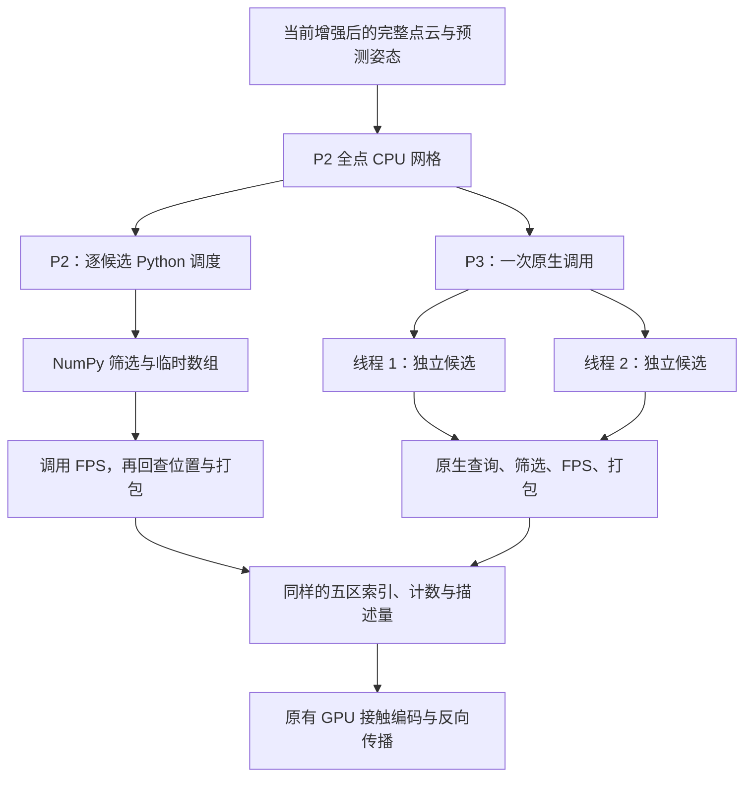

# CD-009 P3：融合 CPU 接触几何与候选并行

2026-11-13（北京时间）。基于 GitHub [`0bda78b`](https://github.com/chichu-lv/suctionnet_modern_20mm/tree/0bda78b5427400c3659bf66883f26a5ba2571548)。本轮直接实现 P2 后的几何优化，目标是减少 CPU 查询路径的执行时间；正式训练效果以训练机后续反馈为准。

**当前结果：** 原生路径已实现，普通场景几何与 CPU 小模型对照通过；同一 84 万点/512 候选合成输入的完整 query 中位时间为 **P2 0.902 s → P3 0.295 s，约 3.06×**。这是本地 CPU 查询测量，尚未在 H20/L20 训练机部署。

## 1. 本轮改什么

**将四球查询、五区筛选、首点/FPS 和描述量打包合成一次 C++ 调用，并由两个原生线程处理独立候选。** 原始点、区域边界、候选数、采样规则与网络保持现有定义。P2 的 Python/NumPy 路径保留为同构建参考；新的性能 sidecar 显式启用 P3。

现有 [P2 反馈](performance/P2_REAL_RESULTS.json) 中，每个四帧更新的阶段均值如下：

| 区间 | H20/E5 | L20/E3 |
| --- | ---: | ---: |
| grid 建立 | 0.173 s | 0.098 s |
| 整段 query | 4.719 s | 4.777 s |
| query 内球查询 | 1.104 s | 1.248 s |
| query 内区域筛选等 | 2.025 s | 1.829 s |
| query 内 FPS、首点和位置映射 | 1.350 s | 1.439 s |
| query 内描述量打包 | 0.213 s | 0.234 s |

query 内子项包含在 query 总计中。区域筛选、FPS 衔接和打包合计约占 E5 query 的 76%；FPS 贪心核心已经编译，本次继续减少其外围的数组复制、索引回查和 Python 调度。

新提交中的 [H20/E2 启动记录](performance/H20_E2_STARTUP.md) 不启用接触分组，不能用作本轮几何提速证据。P3 直接影响启用接触分组的 E3/E4/E5；E0/E1/E2 不因此获得该项收益。

## 2. 从 P2 到 P3 的执行变化



P2 对每个区域先压缩 rows、x、y、z、rho、same，FPS 封装再次收集 XYZ 并查找首点，返回 raw rows 后又通过 `searchsorted` 找回描述量位置。P3 将这些数据留在原生 scratch 中，直接写出最终的 32/64 个点和描述量，避免多轮 Python/NumPy 往返。

两线程共享只读网格和观测数组，分别写不同候选的输出行，每个线程持有自己的 scratch。计算期间释放 GIL；返回前完成 join，GPU 编码只读取完整结果。没有跨帧持久邻域缓存，也没有改变每次前向所依赖的增强点云和预测法向。

这与 [P2 前的 Python 候选线程原型](performance/P2_CPU_PROTOTYPES.json) 不同：原型仍在每个候选内执行 Python/NumPy 小操作；P3 并行的主体全部在 C++ 中。线程数固定为 2，CPU affinity 只有一核时收窄为 1，不新增线程数搜索矩阵。

## 3. 实现接口与文件

| 文件 | 改动 |
| --- | --- |
| `models/csrc/spatial_index_cpu.cpp` | 复用现有 Grid/query；新增 `contact_query`、候选并行、各线程 scratch 和 `CONTACT_ABI_VERSION=1` |
| `setup.py` | 沿用同一 C++ 扩展构建，增加线程编译/链接选项；记录真实编译选项 |
| `models/contact_ops.py` | 将观测与姿态数组一次交给原生函数；按 affinity 限定两线程 |
| `models/contact_grouping.py` | 在原有 `query()` 入口分派后端，返回接口不变；原 NumPy 路径继续可用 |
| `models/suction20net.py` | 将 sidecar 的接触查询后端传给 grouping |
| `suction20/performance.py` | 支持 performance v3、原生接触 ABI 记录和当前 P2 来源 |
| `scripts/migrate_performance_checkpoint.py`、`suction20/pretrain_runtime.py` | 沿用现有迁移工具，支持 P2→P3 以及直接从 P2 开始的 run |
| `configs/performance/cd009-p3.json` | 显式选择 `contact_query_backend=native_cpu` |
| `research/performance_p3/benchmark_contact.py` | 复用既有 84 万点/512 候选场景，只比较 P2 与 P3 的完整 query |

原生入口为：

```python
native.contact_query(grids, inputs, outputs, workers, detailed)
```

`grids` 是各帧现有网格；`inputs` 包含观测、预测姿态及物理参数；`outputs` 是已分配的五区 `indices/mask/geometry/counts` 和 `lip_sector_counts`。所有输出数组属于本次调用，不引用下一次会被覆盖的临时缓存。

`ContactGrouping.query()` 仍是统一入口，现有 `benchmark_paired_pipeline.py` 的完整几何捕获继续有效。神经网络局部投影、区域 MLP、pooling 与反向图没有移动到 CPU。

## 4. 算法定义保持哪些内容

| 项目 | P3 行为 |
| --- | --- |
| 空间点集 | 当前增强后的全部原始点；20 mm 是加速网格 cell，不是降采样体素 |
| 网络体素与候选 | 2 mm、每帧 512 个名额，沿原 profile |
| 覆盖球 | 沿用现有四球中心、半径及 `+1e-8` 查询余量，结果按 raw row 排序 |
| core/lip | 共用接触球与局部坐标；原 18–22 mm 环带定义不变 |
| 碰撞三个区域 | 原冻结包络、相邻区间开闭规则及同物体忽略高度不变 |
| 计数与 lip 扇区 | 对全部满足区域条件的点统计，发生在 FPS 之前 |
| 不超过采样限额 | 直接返回升序原始行，不用全量 FPS 改变顺序 |
| FPS 首点 | 使用区域局部坐标中距轴向中点最近的点，并列取最小 raw row |
| FPS 距离 | 原始 camera XYZ、FP64、原贪心顺序和并列规则 |
| 7 维描述量 | 原坐标归一化、观测法向点积、same/valid 字段，最终 float32 |
| 随机 roll | 仍由 Python 主调用对全部姿态一次性生成；线程不消耗 RNG |
| 参数更新 | 保持现有 B1A4、优化器、学习率与总样本预算 |

原生区域数学使用 FP64，继续禁用 fast-math 和 FMA contraction。实际输出一致性由正常场景对照记录；不把数学上等价直接写成所有硬件、所有输入逐位一致的承诺。

## 5. 配置和计时

P3 新增一个字段：

```json
{
  "schema_version": "suction20.performance.v3",
  "contact_query_backend": "native_cpu"
}
```

以上仅展示新增差异，实际运行使用完整 [cd009-p3.json](../configs/performance/cd009-p3.json)。它继承 P2 的 grid、坐标快路径、compiled FPS、两个数据 worker，并继续关闭 `no_instance_voxel_heads`。旧 v1/v2 sidecar 不改写，继续使用旧接触查询路径。

原生接触后端要求 `uniform_grid_cpu` 与 compiled FPS。原 `query_chunk_size=null`、`query_workers=1` 保留为 P2 参考路径设置；P3 的两个候选线程与 SciPy 查询 workers、DataLoader workers 是不同概念。

计时区分墙钟和线程累计工作：

- `query_cpu_seconds`：现有完整 query 墙钟，含姿态准备和原生调用。
- `native_query_wall_s`：原生几何计算区间的实际墙钟，包含线程启动与 join；buffer 接线开销由外层 `query_cpu_seconds` 覆盖。
- `pose_frame_setup_s`：详细计时开启时，Python 法向归一化与 roll 坐标系准备。
- `native_*_worker_s`：详细计时开启时，各线程相应阶段耗时的累计值；**不能与墙钟直接相加或用来计算互斥占比**。
- `ball_returned_points`、`fps_calls`、`fps_input_points`：沿用已有工作量计数。
- `ball_api_calls=0`、`native_contact_calls=1`：P3 不再逐球进入 Python API，而是一次进入完整原生查询；`ball_calls` 仍记录四球×有效候选的算法工作量。

不保留虚构的串行 `region_filter_s/fps_s` 数值。正式切换后，既有迁移诊断窗口会自动打开详细计时；不另外增加长期同步或 profiler。

## 6. 本地检查与性能记录

本地环境为 Python 3.12.14、PyTorch 2.5.1+cpu、NumPy 2.3.5、SciPy 1.17.0，原生扩展使用 GCC 14.2.0。进程 affinity 可见 9 个逻辑核，Torch/BLAS 各 1 线程，P3 使用 2 个候选线程。测试环境与训练机 CUDA 环境不同，合成 query 时间不直接换算为真实 H20/L20 每步速度。

使用 [既有固定场景](../research/performance_p2/fixture.py)，同一 grid、compiled FPS 和随机 roll 初态，两条路径各预热一次，再各测两次：

| 路径 | 第一次 query | 第二次 query | 中位数 |
| --- | ---: | ---: | ---: |
| P2 Python/NumPy | 0.887430 s | 0.916194 s | **0.901812 s** |
| P3 原生两线程 | 0.295848 s | 0.294315 s | **0.295082 s** |

完整 query **约 3.056×，耗时减少 67.279%**。计时包括姿态准备，排除共享索引构建、输入生成、RNG 恢复及结果比较；这测量的是融合与两线程共同带来的收益，没有声称单独某项的因果倍率。

六次调用（含预热）的五区 `indices/mask/geometry/counts`、lip sectors、Torch RNG 后态均完全相同。每次球返回记录数仍为 6,565,455，FPS 仍调用 1,458 次、累计输入 2,954,462 个点记录；重复访问计入上述数字，不将其当独立点数。原始计时、环境、源码与二进制身份见 [P3_CPU_RESULTS.json](performance/P3_CPU_RESULTS.json)。

主要新旧对照复用普通两帧堆叠场景，含倾斜候选轴、有效/无效观测法向和一条无效候选，完整比较五区结果、扇区计数及 RNG 后态；CPU 小模型继续比较输出与反向梯度。迁移使用现有正常保存/恢复测试，覆盖有历史迁移链和 P2 原生起点。

定向几何/模型测试 **8 passed、无 skip**；新增配置与两条正常迁移链测试 **3 passed**。前者的 CPU 小模型输出精确一致、参数梯度通过原有容差；后者使用 toy 模型和构建身份 stub，不替代真实原生数值检查。

本地既有 CPU 套件结果为 **324 passed、1 skipped，12.93 s**，命令只排除了 `tests/test_prefetch.py`。完整套件尝试在该既有 spawn-loader 测试阻塞；单独定位确认本地沙箱拒绝 tensor 跨进程共享所需的 Unix socket，报 `PermissionError: [Errno 1] Operation not permitted`。该测试、数据流水线和 CI 命令均保持原样，由 GitHub CI 运行完整套件。本地跳过的另一项仍是需要显式真实 release 路径的既有 opt-in 测试，不将环境阻塞或跳过写成通过。

CPU 性能复现：

```bash
python setup.py build_ext --inplace
OMP_NUM_THREADS=1 MKL_NUM_THREADS=1 OPENBLAS_NUM_THREADS=1 \
  python -m research.performance_p3.benchmark_contact --output /absolute/path/p3-contact.json
```

只测当前 P2 与实际 P3 两条路径，每条一次预热、两次相同场景计时，不测新的 batch/核数/worker 矩阵。

## 7. 在现有训练上接续

当前批准的 P2 来源为：

```text
code_revision: e73d62ed23aed6f23b9b01a8bfc09ec56d8fc859
worktree_sha256: 0c6501ac1b8e374fc37bbba4df3abc30dd4fbf4f726fa23b9c7092c537b3aed8
sidecar_sha256: 8a104de89df99ea327a759e5471bef357965ea20e7b57461081560ca87216928
```

使用独立的目标 checkout 编译 P3，保留原 P2 checkout 供现有配对脚本读取。已装好项目依赖的训练环境可直接执行 `python setup.py build_ext --inplace`；没有新的 CUDA、NumPy C ABI 或 JIT 依赖。

完整 P3 sidecar 原始字节 SHA256 为 `551597d8ffb3e3995c284b2611d7ffe4a8220800641c65aa6334958aad8c3b2e`；P1/P2 配置文件未改写。本地 Python 默认编译器名称指向缺失的 clang，实际使用 `CC=gcc CXX=g++ python setup.py build_ext --inplace` 完成构建；训练机按其已有编译器环境构建并记录自身二进制身份。

接续只复用现有流程：

1. 在正常保存边界暂停要切换的接触模型 run，取得当前 committed checkpoint。
2. 用现有 `benchmark_paired_pipeline.py` 对同四帧运行 P2/P3 配对，使用原来的输出/梯度容差和完整几何结果比较。
3. 通过现有 migration 入口把性能身份切换到 P3，由原 supervisor 继续训练；读取原预算内的正常窗口确认墙钟收益。

四帧配对命令模板（路径变量沿实际运行配置设置）：

```bash
python scripts/benchmark_paired_pipeline.py \
  --baseline-repo "$P2_REPO" --candidate-repo "$P3_REPO" \
  --checkpoint "$SOURCE_CHECKPOINT" --config "$PROFILE" \
  --baseline-performance-config "$P2_REPO/configs/performance/cd009-p2.json" \
  --performance-config "$P3_REPO/configs/performance/cd009-p3.json" \
  --source-root "$SOURCE_ROOT" --label-root "$LABEL_ROOT" \
  --backbone-root "$BACKBONE_ROOT" --device "$DEVICE" \
  --out-dir "$COMPARE_DIR"
```

迁移命令模板：

```bash
python scripts/migrate_performance_checkpoint.py \
  --config "$PROFILE" \
  --performance-config "$P3_REPO/configs/performance/cd009-p3.json" \
  --run-dir "$RUN_DIR" --control-dir "$PAUSED_ATTEMPT_DIR" \
  --expected-source-sha256 "$SOURCE_CHECKPOINT_SHA256" \
  --source-root "$SOURCE_ROOT" --label-root "$LABEL_ROOT" \
  --backbone-root "$BACKBONE_ROOT"
```

在 supervisor 的目标 checkout/性能配置中选择 P3，并沿已有 resume 方式接续。仍使用原硬件 profile，不直接编辑 checkpoint 身份，也不重新 warmup、重置 Adam/RNG/采样器或重算已消费帧。

当前 E5/E3 带有历史性能迁移链，工具继续沿原档案读取；直接从 P2 开始的 run 可以没有旧 receipt，现实现允许这种正常起点。E2 没有接触分组，本轮无需为了使用几何优化而迁移它。

本轮不要求重制训练数据，不减少候选或点数，也不新增故障注入、极端输入检查或完整消融重跑。
