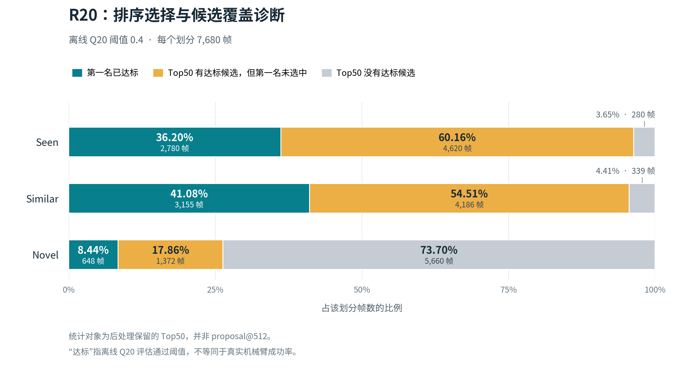

# SuctionNet 方法比较：官方结果、UISN 消融与候选排序诊断

更新日期：2026-11-18。本文记录 E5 pretrained best（step 2880）的完整 RealSense 测试结果，并与 SuctionNet / S1B、Diffusion-Suction、MultiGraspNet 和 UISN 的一手论文表格比较。目标域微调单独报告已有 step 1000 验证结果。

本文补充的是既有结果分析和 UISN 原文核对，没有重新训练模型、重新运行物理评价或复现其他方法。指标定义与实现约定见[评价指标计算规范](SUCTIONNET_COMPARISON_METRICS.md)；可机器读取的比较表和诊断数据分别见 [method_metrics.csv][D1]、[diagnostics.json][D2]。

## 1. 主要结论

**E5 的第一候选具有竞争力，候选列表的整体质量仍有明显差距。** 官方 R10 下，Seen / Similar / Novel 的 `AP (Top-1)` 为 **47.60% / 51.49% / 20.22%**，`AP (Top-50)` 为 **16.33% / 20.22% / 5.69%**。与两种 UISN 配置相比，E5 在 Similar、Novel 的三个 Top-1 指标上均更高，但 Seen 的六项指标以及三个划分的三个 Top-50 指标均更低。与 S1B、Diffusion-Suction 相比，也应分别讨论第一候选和候选列表，不能由局部优势推出全面领先。[比较数据][D1]

**深度输入的比较给出另一层信息。** UISN 的 Only Depth 评分网络在三组上的 Top-50 AP 为 14.37% / 15.75% / 4.13%，Top-1 AP 为 36.11% / 36.25% / 12.43%，均低于 E5 对应结果。它是输入模态更接近的参照；E5 同时使用观测法向、重力和 GT 实例，不能把差额全部归因于评分网络架构。UISN 的 RGB 消融对 Top-50 有明显收益，而不确定性消融的收益更小、且取决于划分。[UISN，Table III、V][P4]

**项目 R20 的主要问题可以进一步分解。** 在物理质量阈值 0.4 下，Seen / Similar 的保留 Top-50 分别覆盖 **96.35% / 95.59%** 的帧，实际第一名通过率为 **36.20% / 41.08%**，说明相对排序有明确改进空间。Novel 的覆盖率只有 **26.30%**，因此还需要改善保留候选的质量和覆盖。[诊断数据][D2]

目标域微调使同一批历史动作的 AUROC 从 **0.6215** 提高到 **0.7121**，分类 AP 从 **0.6234** 提高到 **0.7119**；这支持任务成败预测的适配效果。它与离线物理 AP、真实机器人执行成功率属于不同指标，本文分别报告。[诊断数据][D2]

## 2. 评价对象与比较口径

### 2.1 E5 的实际条件

| 项目 | 本文采用的设置 |
| --- | --- |
| 模型 | E5 pretrained best，step 2880 |
| Checkpoint SHA256 | `5bc2c14c014fbf23cbef48062a0dac523ea243b6c18e540bb5af022ff7d0ea3a` |
| 相机 | RealSense |
| 网络输入 | 观测深度、观测法向、重力、GT 实例掩码；RGB 用于展示 |
| 实例条件 | **oracle-instance**：提供真实实例分组 |
| 训练目标与划分 | **R20-trained；90 个训练场景 + 10 个开发验证场景** |
| 测试范围 | 官方 90 个测试场景 × 256 视角，共 **23,040 帧** |
| 测试划分 | Seen 0100–0129；Similar 0130–0159；Novel 0160–0189；每组 7,680 帧 |
| 原始候选 | 每帧 386–512 个有效 pre-NMS 候选，已剔除补齐位置 |
| 排序分数 | 预训练模型的 `q` |
| 官方评价器 | `graspnet/suctionnetAPI`，固定提交 `0dac9f7e5b2f7ea801cddf9655cb82a259681976` |

三组测试完整，六项汇总指标与已有 precision 数组重新聚合的结果一致；包装脚本调用固定官方 API 的 `eval_scene()`。E5 使用 GT 实例输入是其预测条件，官方评价器利用 GT 场景模型检查候选质量则是基准的评价条件，两者需要区分。[诊断数据][D2]、[官方评价代码][C1]

横向表统一了相机、测试划分和指标名称，但保留各方法原有输入与训练设置。尤其是 E5 的 oracle-instance、R20 训练目标和 90 场景训练，与 UISN 测试时使用 UOIS-Net / UOAIS-Net 的完整预测流水线不同。该表适合定位结果差距，不是控制所有变量后的架构因果比较。[UISN，§IV-A][P4]

### 2.2 六指标怎样读

所有物理 AP 都先按**模型分数**排序，再用评价器的**物理质量**判定候选是否通过。四个质量阈值为 `{0.2, 0.4, 0.6, 0.8}`。[指标规范](SUCTIONNET_COMPARISON_METRICS.md)、[官方评价代码][C1]

| 名称 | 含义 |
| --- | --- |
| `AP (Top-50)` | 对 Precision@1…50 求均值，再对四个物理阈值求均值 |
| `AP₀.₄ / AP₀.₈ (Top-50)` | 固定质量阈值 0.4 / 0.8，对 Precision@1…50 求均值 |
| `AP (Top-1)` | 每帧场景第一候选在四个物理阈值下的通过率均值 |
| `AP₀.₄ / AP₀.₈ (Top-1)` | 每帧场景第一候选在单个物理阈值下的通过率 |

候选不足某个前缀长度时，缺位不增加命中数，分母仍为该前缀长度。因此 Top-50 AP 不等于 Precision@50，也不同于分类任务的 precision–recall 平均精度。下文表格均以百分数表示物理 AP，差值使用百分点；`—` 表示原论文未报告，不表示零。

## 3. 官方 R10 六指标主表（RealSense）

E5 行来自本项目官方评价结果；其他行来自论文报告值。S1B 取原论文 Table IV；Diffusion-Suction 取 SuctionNet-1Billion 的 Table I；MultiGraspNet 取 v2 Table I 的 Vacuum 部分；UISN 取 Table I 的 RealSense 数值。单吸取与多任务版本、两种 UISN 分割配置均独立保留。[S1B][P1]、[Diffusion-Suction][P2]、[MultiGraspNet][P3]、[UISN][P4]、[比较数据][D1]

| 划分 | 方法 / 配置 | AP (Top-50) | AP₀.₄ (Top-50) | AP₀.₈ (Top-50) | AP (Top-1) | AP₀.₄ (Top-1) | AP₀.₈ (Top-1) |
| --- | --- | ---: | ---: | ---: | ---: | ---: | ---: |
| Seen | **E5（GT 实例；R20-trained）** | **16.33** | **21.13** | **2.90** | **47.60** | **60.44** | **15.36** |
| Seen | SuctionNet / S1B | 28.31 | 38.56 | 3.41 | 43.98 | 60.81 | 7.79 |
| Seen | Diffusion-Suction | 31.90 | 42.78 | 4.79 | 54.79 | 68.59 | 21.03 |
| Seen | MultiGraspNet-vac. | 28.26 | 36.39 | 3.60 | — | — | — |
| Seen | MultiGraspNet（联合版） | 28.07 | 35.81 | 3.62 | — | — | — |
| Seen | UOIS-Net + UISN | 37.98 | 49.83 | 9.99 | 63.88 | 76.64 | 31.72 |
| Seen | UOAIS-Net + UISN | 38.27 | 50.57 | 10.56 | 66.11 | 78.35 | 35.29 |
| Similar | **E5（GT 实例；R20-trained）** | **20.22** | **26.08** | **4.85** | **51.49** | **62.99** | **22.58** |
| Similar | SuctionNet / S1B | 26.64 | 35.34 | 3.42 | 36.59 | 49.30 | 6.54 |
| Similar | Diffusion-Suction | 31.59 | 41.38 | 4.27 | 47.00 | 59.36 | 16.08 |
| Similar | MultiGraspNet-vac. | 31.37 | 41.63 | 3.88 | — | — | — |
| Similar | MultiGraspNet（联合版） | 31.22 | 41.65 | 3.53 | — | — | — |
| Similar | UOIS-Net + UISN | 37.83 | 49.35 | 8.89 | 48.68 | 60.01 | 16.72 |
| Similar | UOAIS-Net + UISN | 36.54 | 47.77 | 8.74 | 49.20 | 61.45 | 17.20 |
| Novel | **E5（GT 实例；R20-trained）** | **5.69** | **7.16** | **0.57** | **20.22** | **26.11** | **3.76** |
| Novel | SuctionNet / S1B | 8.23 | 10.29 | 0.35 | 14.32 | 19.95 | 0.38 |
| Novel | Diffusion-Suction | 10.00 | 12.32 | 0.76 | 14.14 | 17.67 | 2.42 |
| Novel | MultiGraspNet-vac. | 8.07 | 10.03 | 0.48 | — | — | — |
| Novel | MultiGraspNet（联合版） | 7.38 | 8.92 | 0.46 | — | — | — |
| Novel | UOIS-Net + UISN | 9.47 | 12.63 | 1.17 | 11.83 | 15.47 | 2.76 |
| Novel | UOAIS-Net + UISN | 9.08 | 12.05 | 1.04 | 11.94 | 15.40 | 2.07 |

### 3.1 论文取数说明

**UISN 的相机顺序以表注为准。** 原文 PDF 第 6 页（刊页 4939）Table I 表注明确说明斜杠前后为 **Kinect / RealSense**，本表取斜杠后的数值。第 5 页（刊页 4938）§IV-B 的一处正文将其写成 RealSense / Kinect；该处与表注矛盾。原 SuctionNet 基线中的相机对应关系也支持表注顺序，因此没有沿用这处反写。[UISN，Table I 与 §IV-B][P4]、[S1B，Table IV][P1]

S1B 主表采用原论文值。UISN Table I 的 Cao et al. 基线有细小差别：Seen Top-50 AP 为 28.32、AP₀.₄ 为 38.55，Similar Top-50 AP₀.₄ 为 35.33；原 S1B 分别为 28.31、38.56、35.34。本文保留各自来源，不把 UISN 表中的基线数字静默改写为原论文值。[S1B][P1]、[UISN][P4]

MultiGraspNet 未报告 Vacuum 的 Top-1 三项指标。其论文使用 “seal coefficient” 描述 vacuum 质量阈值，聚合指标可作公开报告值参考；底层物理评价与固定官方 API 的全部细节尚未由公开实现逐项核实。UISN 的作者评价脚本则直接调用官方 API。[MultiGraspNet，§IV-A、Table I][P3]、[UISN 评价脚本][C3]

### 3.2 从主表得到的实际判断

对 S1B，E5 的 Top-1 AP 在三组分别高 **3.62 / 14.90 / 5.90** 个百分点，Top-50 AP 则低 **11.98 / 6.42 / 2.54** 个百分点。这里不能扩写为“全部 Top-1 指标均更高”：Seen 的 AP₀.₄ (Top-1) 为 60.44%，略低于 S1B 的 60.81%。

对 Diffusion-Suction，E5 在 Similar / Novel 的 Top-1 AP 高 **4.49 / 6.08** 个百分点，Seen 低 **7.19** 个百分点；三组 Top-50 AP 均落后。Similar 的严格阈值是一个有意义的局部优势：E5 的 AP₀.₈ (Top-1) 为 22.58%，高于 Diffusion-Suction 的 16.08%；AP₀.₈ (Top-50) 为 4.85%，也高于其 4.27%。[比较数据][D1]

与 UISN 的主要差额如下；正值表示 E5 更高，单位为百分点：

| 划分 | 对 UOIS + UISN：Top-50 AP | 对 UOIS + UISN：Top-1 AP | 对 UOAIS + UISN：Top-50 AP | 对 UOAIS + UISN：Top-1 AP |
| --- | ---: | ---: | ---: | ---: |
| Seen | -21.65 | -16.28 | -21.94 | -18.51 |
| Similar | -17.61 | +2.81 | -16.32 | +2.29 |
| Novel | -3.78 | +8.39 | -3.39 | +8.28 |

三组等权平均后，E5 / UOIS + UISN / UOAIS + UISN 的 Top-50 AP 为 **14.08% / 28.43% / 27.96%**，Top-1 AP 为 **39.77% / 41.46% / 42.42%**。E5 在 Similar、Novel 第一候选上的优势，与整体 Top-50 差距可以同时成立；两种 UISN 配置也不能按单项取最大值拼成一个实际不存在的系统。[诊断数据][D2]

## 4. UISN 的评分网络与消融证据

### 4.1 深度输入对照与 RGB 消融

UISN Table V 位于 PDF 第 7 页（刊页 4940）。Only Depth 保持评分网络架构不变，将体素量化前的初始特征设为全 1；RGB-D 则使用颜色信息。这里的消融对象是**评分网络输入**，并不能据此认定整个实例分割流水线都只使用深度。[UISN，§IV-C、Table V][P4]

Table V 本身没有标注相机。其 RGB-D 六个数值与 Table I 的 **RealSense、UOIS-Net + UISN** 行完全一致，因此本文将其作为该设置的消融参照；**这一相机关联是根据数值一致性作出的推断**，不是 Table V 明文声明。下文 Table II–IV 的完整模型数值也与这一行一致。

| 评分网络输入 / 方法 | Seen Top-50 AP | Similar Top-50 AP | Novel Top-50 AP | Seen Top-1 AP | Similar Top-1 AP | Novel Top-1 AP |
| --- | ---: | ---: | ---: | ---: | ---: | ---: |
| UISN Only Depth | 14.37 | 15.75 | 4.13 | 36.11 | 36.25 | 12.43 |
| UISN RGB-D | 37.98 | 37.83 | 9.47 | 63.88 | 48.68 | 11.83 |
| E5（深度、法向、重力、GT 实例） | 16.33 | 20.22 | 5.69 | 47.60 | 51.49 | 20.22 |

Only Depth 未报告 AP₀.₄、AP₀.₈，本文不补造这些分项。E5 相比 Only Depth 的 Top-50 AP 高 **1.96 / 4.47 / 1.56** 个百分点，Top-1 AP 高 **11.49 / 15.24 / 7.79** 个百分点。这个结果说明 E5 在当前深度几何输入路线下有实际竞争力，输入分组、额外几何信息、训练目标和后处理的差异仍由第 2 节的条件限定。[比较数据][D1]、[诊断数据][D2]

UISN 加入 RGB 后，Top-50 AP 提升 **23.61 / 22.08 / 5.34** 个百分点，Seen / Similar 的 Top-1 AP 提升 **27.77 / 12.43** 个百分点。**Novel Top-1 AP 则从 12.43% 降到 11.83%，减少 0.60 个百分点。** 因而 Table V 支持“RGB 明显改善候选列表表现”，但不支持正文所写的所有划分、两个指标都提高。[UISN，Table V][P4]

### 4.2 几何评分与学习评分

UISN 的 Table II（PDF 第 6 页，刊页 4939）比较完整的几何评分与网络评分。几何版本组合 Normal STD 和解析 Wrench 评分，以分割实例点的均值估计物体中心，并使用相机坐标系固定重力 `(0, 0, 1)`。[UISN，§IV-C、Table II][P4]

| 评分方式 | Seen Top-50 AP | Similar Top-50 AP | Novel Top-50 AP | Seen Top-1 AP | Similar Top-1 AP | Novel Top-1 AP |
| --- | ---: | ---: | ---: | ---: | ---: | ---: |
| 几何评分 | 22.63 | 29.47 | 6.50 | 30.97 | 40.68 | 8.73 |
| 网络评分 | 37.98 | 37.83 | 9.47 | 63.88 | 48.68 | 11.83 |
| 网络减几何（百分点） | +15.35 | +8.36 | +2.97 | +32.91 | +8.00 | +3.10 |

该表支持学习评分在 UISN 设置中优于这一几何启发式组合。它没有独立隔离“局部接触模块”的贡献：UISN 预测合成吸取分数，未分别消融 Seal / Wrench 评分分支；其 1.5 cm 邻域半径用于观测法向估计，也不是吸盘半径或局部接触评分模块的消融。[UISN，§III、§IV-A/C][P4]

### 4.3 不确定性带来的收益有多大

UISN Table III（PDF 第 6 页，刊页 4939）仅报告 Top-50 AP。Baseline 是单个 MLP 评分头；Aleatoric 增加方差预测，Epistemic 使用测试时 dropout，两者联合构成完整的不确定性设置。[UISN，Table III][P4]

| 不确定性设置 | Seen Top-50 AP | Similar Top-50 AP | Novel Top-50 AP |
| --- | ---: | ---: | ---: |
| Baseline：单 MLP | 38.85 | 36.23 | 8.35 |
| + Aleatoric | 37.05 | 37.02 | 8.89 |
| + Epistemic | 37.23 | 36.73 | 9.30 |
| + Aleatoric 与 Epistemic | 37.98 | 37.83 | 9.47 |
| 联合减 Baseline（百分点） | -0.87 | +1.60 | +1.12 |

两类不确定性联合后，对 Similar / Novel 有正向收益，Seen 有小幅下降；三组 Top-50 AP 等权平均增加约 **0.62 个百分点**。原表没有提供该消融的 Top-1 或单阈值结果，不能从这组数值推导相应增益。

结合 RGB 消融，UISN 的完整模型优势不能全部归因于 uncertainty。颜色输入、实例处理、评分网络和后处理都参与最终结果。对 E5 更直接的启发是：**让候选相关的可行性或不确定性信息改变相对排序**。在所有候选上施加同一个严格单调分数变换不会改变排名，因而不能单凭全局温度缩放提高 Top-1 或排序型物理 AP。

## 5. 项目 R20：覆盖与排序分别限制了什么

### 5.1 R20 六指标与官方 R10 的关系

| 划分 | AP (Top-50) | AP₀.₄ (Top-50) | AP₀.₈ (Top-50) | AP (Top-1) | AP₀.₄ (Top-1) | AP₀.₈ (Top-1) |
| --- | ---: | ---: | ---: | ---: | ---: | ---: |
| Seen | 11.35 | 14.37 | 2.17 | 28.50 | 36.20 | 8.49 |
| Similar | 12.49 | 15.96 | 2.83 | 32.54 | 41.08 | 11.59 |
| Novel | 2.18 | 2.41 | 0.25 | 7.31 | 8.44 | 0.98 |

两套评价来自同一 E5 checkpoint 的预测记录，但最终保留集合和物理评分流程不同：[诊断数据][D2]

| 环节 | 官方 R10 | 项目 R20 |
| --- | --- | --- |
| 候选后处理 | 官方 NMS、GT 物体关联、逐物体最多保留 10 个候选 | 项目实例内 NMS，再按场景保留 Top-50 |
| 物理质量 | 固定官方评价器重新计算 | 已保存的冻结版 `physical_Q20` |
| 背景处理 | 官方模型关联与评价规则 | 保留候选的 `instance_id <= 0` 时质量置零 |
| 排序 | 模型 `q`，对官方保留集合排序 | 模型 `q`，使用项目保存顺序 |

两者还涉及接触尺度、碰撞包络、物理公式和归一化差异，所以表间差值不能解释为“只改变吸盘半径”的效果。官方 R10 用于公共文献比较，项目 R20 用于当前 20 mm 接触目标分析。[指标规范](SUCTIONNET_COMPARISON_METRICS.md)、[官方物理实现][C2]

### 5.2 用已有 precision 数组恢复候选覆盖

设固定阈值下前 k 个候选的 precision 为 $P_k(t)$，则通过数为：

$$
H_k(t)=kP_k(t),\qquad C_{50}(t)=\Pr[H_{50}(t)>0].
$$

每帧据此分成三类：第一名通过；Top-50 有通过候选但第一名未通过；Top-50 没有通过候选。前两类之和就是保留 Top-50 的覆盖率。该分解只需要已有数组，不依赖重新推理。[诊断数据][D2]

| 划分 | 第一名通过：帧数 / 比例 | 有通过候选但第一名未通过 | 没有通过候选 | Top-50 至少一个通过 |
| --- | ---: | ---: | ---: | ---: |
| Seen | 2,780 / 36.20% | 4,620 / 60.16% | 280 / 3.65% | 96.35% |
| Similar | 3,155 / 41.08% | 4,186 / 54.51% | 339 / 4.41% | 95.59% |
| Novel | 648 / 8.44% | 1,372 / 17.86% | 5,660 / 73.70% | 26.30% |

每组分母均为 7,680 帧；百分比独立四舍五入。Seen / Similar 在普通质量阈值下已覆盖绝大多数帧，但第一名没有充分利用这些候选。在“已经存在通过候选”的帧中，第一名实际选中的比例只有 **37.57% / 42.98%**。这为改善相对排序提供了直接证据。

Novel 的对应选中比例为 32.08%，同时有 **73.70%** 的帧在保留 Top-50 中没有达标候选。固定这批候选不变，即便利用物理真值理想重排，第一名通过率上限也只有 **26.30%**。所以 Novel 的问题同时涉及候选质量、覆盖和选择，不能仅靠重排解决。[诊断数据][D2]

这里的覆盖对象是**后处理后保留的 Top-50**，不是原始 proposal@512。现有数组不能区分好候选从未生成，还是在评分筛选、NMS 或物体上限中被移除；理想重排上限也不是可直接部署的成功率预测。

### 5.3 高阈值覆盖仍然不足

R20 保留 Top-50 内至少有一个达标候选的帧比例：[诊断数据][D2]

| 划分 | 阈值 0.2 | 阈值 0.4 | 阈值 0.6 | 阈值 0.8 |
| --- | ---: | ---: | ---: | ---: |
| Seen | 99.39% | 96.35% | 81.91% | 31.99% |
| Similar | 98.95% | 95.59% | 84.14% | 41.47% |
| Novel | 49.61% | 26.30% | 12.60% | 5.00% |

Seen / Similar 在 0.4 下的覆盖接近饱和，但到 0.8 时仅为 31.99% / 41.47%，Novel 仅为 5.00%。因此，“普通质量动作通常存在”与“高质量接触已经充分”是不同判断，候选生成和几何质量仍然有改进价值。

作为对照，官方 R10 在 0.4 下的保留 Top-50 覆盖率为 **97.63% / 98.72% / 58.42%**，第一名通过率为 **60.44% / 62.99% / 26.11%**。两套协议都存在选择缺口；由于保留集合不同，不对这些差额作纯半径归因。[诊断数据][D2]

### 5.4 Top-50 低分还涉及候选数量与尾部质量

官方 R10、质量阈值 0.4 下，每帧前缀内平均通过候选数如下：[诊断数据][D2]

| 划分 | 前 10 个 | 前 20 个 | 前 50 个 | 第 21–50 位新增 |
| --- | ---: | ---: | ---: | ---: |
| Seen | 3.374 | 3.874 | 3.892 | 0.018 |
| Similar | 4.342 | 4.898 | 4.917 | 0.019 |
| Novel | 1.076 | 1.227 | 1.235 | 0.008 |

第 21–50 位几乎没有增加达标候选。但零命中增量既可能来自缺位，也可能来自已有候选质量不足，仅凭 precision 不能将两者区分。因此 Top-50 的差距应连同实际保留数量、空间多样性、NMS 和物体上限一起解释，不能全部称作尾部排序失败。

以 Seen 为例，AP₀.₄ (Top-50) 为 **21.13%**，而真正的 Precision@50(0.4) 为 **7.78%**，即平均约 3.892 个达标候选除以 50；两者的区别来自前缀平均的定义。R20 在第 21–50 位仍新增 **0.620 / 1.049 / 0.047** 个达标候选每帧，也反映出两套后处理保留集合的差异。[诊断数据][D2]

Novel 的低分分布在多数场景中：R20 场景 Top-50 AP 中位数为 **1.20%**，均值为 **2.18%**；最高的 `scene_0188`、`scene_0189` 约为 **11.37% / 12.83%**，两场贡献了 Novel 场景 AP 总和的 **37.05%**。这说明均值受到少数较好场景抬升，不是一个异常差场景单独拖低结果。[诊断数据][D2]

### 5.5 场景第一名与逐实例推荐

项目 R20 已有逐实例结果为：[诊断数据][D2]

| 划分 | 实例 Top-1 Q20≥0.4 | 实例 Top-1 碰撞率 | 实例无候选率 |
| --- | ---: | ---: | ---: |
| Seen | 12.28% | 56.02% | 0.038% |
| Similar | 20.53% | 52.76% | 0.013% |
| Novel | 2.41% | 56.01% | 0.022% |

场景 Top-1 可以选择整帧中较容易吸取的物体，实例 Top-1 则逐个实例提出推荐，两者分母不同。实例无候选率很低，说明推荐几乎遍及可见实例，但推荐动作的物理可行性仍不足。碰撞率是对已有推荐实例的**离线几何判定**，不是机械臂发生实际碰撞的概率。

Seen 与 Novel 的实例碰撞率都约为 56%，质量达标率却从 12.28% 降到 2.41%，因而 Novel 差距不能仅用这一项碰撞比例解释。现有汇总不含逐候选 Seal / Wrench / 法向误差分解，暂不对主导物理分支作进一步归因。

## 6. 目标域微调与真实机器人结果

### 6.1 E5 微调改善的是历史动作成败预测

目标域验证包含 **399 条历史规划动作**，其中 209 条成功、190 条失败，来自 3 个组。标签表示完成吸取并转运的结果；动作记录为规划命令，不是另行测量的真实接触位姿。下表使用同一批记录：[诊断数据][D2]

| 指标 | 预训练 `q` | 微调 `task_success_score` | 变化 |
| --- | ---: | ---: | ---: |
| AUROC | 0.6215 | 0.7121 | +0.0907 |
| 分类 AP | 0.6234 | 0.7119 | +0.0885 |
| BCE | — | 0.6330 | 越低越好 |
| Brier | — | 0.2209 | 越低越好 |

该集合的成功比例为 52.38%。始终输出这一常数概率时，BCE / Brier 为 0.6920 / 0.2494，均高于微调模型的对应损失，说明任务头包含成败预测信息。由于这批记录参与了 step 1000 checkpoint 的选择，结果属于开发验证；当前没有微调后新的策略上机成功率，也没有微调后完整 R10 / R20 评价。[诊断数据][D2]

因此可以陈述“历史动作区分能力提高”，不能把 0.6215 → 0.7121 写成“吸取成功率从 62.15% 提高到 71.21%”。分类 AP 也不进入第 3 节的物理 AP 列。

### 6.2 UISN 的实机成功率单独看

UISN Table VI 位于 PDF 第 7 页（刊页 4940）。其系统使用 Franka Panda、吸盘和 RealSense D415，每种难度评价 20 个杂乱场景；Easy 来自 8 个 Seen 物体，Hard 来自 8 个 Similar / Novel 物体，每场放置 5–6 个物体。论文将成功率定义为成功吸取数除以尝试次数，连续失败三次后移除该物体。[UISN，§IV-D、Table VI][P4]

| 方法（UISN 论文中的实机设置） | Easy 尝试数 | Easy 成功率 | Hard 尝试数 | Hard 成功率 |
| --- | ---: | ---: | ---: | ---: |
| Cao et al. 基线 | 138 | 79.72% | 171 | 63.16% |
| UISN（论文 Ours） | 129 | 86.82% | 150 | 72.67% |

它支持 UISN 在论文自身机器人设置中优于该基线。本文没有对应设置下的 E5 实机执行结果，故不与 E5 的物理 AP、AUROC 或历史数据成功比例计算“成功率差距”。三类指标分别回答候选物理质量、固定历史动作的成败预测和策略实际执行效果。

## 7. 推理代价与部署意义

### 7.1 UISN 的采样次数取舍

UISN Table IV（PDF 第 6 页，刊页 4939）给出 Seen 上的 MC 采样次数与评分推理时间，硬件为 Intel i7-10700 + GeForce RTX 2070。[UISN，Table IV][P4]

| MC 次数 T | Top-50 AP | Top-1 AP | 评分推理时间 / 场景（秒） |
| --- | ---: | ---: | ---: |
| 2 | 35.52 | 60.35 | 0.030 |
| 4 | 37.61 | 63.28 | 0.068 |
| 8 | 37.88 | 63.42 | 0.134 |
| 10 | 37.86 | 63.69 | 0.162 |
| 20（论文默认） | 37.98 | 63.88 | 0.331 |
| 50 | 37.89 | 63.81 | 0.782 |

从 T=10 到 T=20，Top-50 / Top-1 AP 只增加 **0.12 / 0.19** 个百分点，时间从 0.162 秒升到 0.331 秒；T=50 则没有继续提升这两个指标。这说明候选相关不确定性有可借鉴价值，同时要关注采样代价，不能只比较最终分数。

### 7.2 E5 的既有计时与轻量任务头

以下为 H20-3e、batch 1 的既有记录中位数，单位为毫秒：[诊断数据][D2]

| 深度来源 / 模型 | 记录数 | 输入准备 | 预测区间 | 记录内总阶段 |
| --- | ---: | ---: | ---: | ---: |
| 原深度 / 预训练 | 1,139 | 262.19 | 409.53 | 744.36 |
| 原深度 / 微调 | 1,139 | 261.42 | 409.75 | 762.69 |
| 双目深度 / 预训练 | 1,158 | 293.92 | 451.42 | 818.97 |
| 双目深度 / 微调 | 1,158 | 292.67 | 456.01 | 837.29 |

预测区间包含批整理、设备传输、模型及输出回 CPU；记录内总阶段还含 NMS 和二维叠图，不含相机采集、前置实例分割、双目深度生成及完整文件保存。这是记录内阶段耗时，不能直接转换为完整机器人系统 FPS；不同深度来源的样本数不同，也不是同帧速度消融。

原深度路径微调前后的预测中位数相差约 **0.22 ms**，参数量从 **15,645,319** 增至 **15,679,112**，增加 **33,793** 个参数，约 **0.216%**。现有证据支持任务头本身较轻、未显示明显增加主预测成本。它与 UISN 的硬件和计时边界不同，本文不据此换算跨论文加速比。[诊断数据][D2]

## 8. 对当前模型与后续方向的判断

当前结果支持继续以 E5 为基础推进。已有开发集记录中，E0 → E5 的 AP_R20 从 **7.42%** 提高到 **10.60%**，实例 Top-1 Q20≥0.4 从 **7.89%** 提高到 **13.12%**，碰撞率从 **64.45%** 降到 **51.16%**。这些是各自所选 checkpoint 的结果，不是完全相同训练条件下的逐模块净贡献，但足以说明已有路线取得了实际进展。[诊断数据][D2]

接下来最直接的优先级来自现有诊断：

1. **改善相对排序与可行性判断。** Seen / Similar 已有足够的普通质量候选覆盖，应让同帧候选之间的真实优劣更好地体现在 `q` 或最终排序分数中。UISN 的候选相关不确定性是一种参考，当前证据不要求照搬其 MC 采样机制。
2. **改善 Novel 的保留候选覆盖和几何质量。** 先从已有完整预测定位好候选是未生成还是被筛除，结合实际保留数量、候选归属、`q` 与物理质量，判断生成、NMS 与筛选各自的影响。提高 Top-50 覆盖与提高第一名选择率应分别观察。
3. **保留轻量任务头作为目标域适配路径。** 已有历史动作验证呈正向变化，且新增参数很少。继续将这一效果表述为任务成败预测改善，与公共物理基准和实际执行结果保持各自清晰的含义。

本文结果已经足以支持这些优先级，不以新增训练或新的实验矩阵为结论前提。公开表述应保留 E5 的 GT 实例输入、R20 训练目标和 90+10 场景划分，并同时报告有竞争力的 Top-1 与仍有差距的 Top-50。

## 9. 证据与数据索引

### 9.1 随文数据

| 文件 | 内容与用途 |
| --- | --- |
| [method_metrics.csv][D1] | E5 官方 R10 六指标、各论文报告值及缺失项；保留方法、变体、相机和来源。项目 R20 指标另存于 diagnostics.json |
| [diagnostics.json][D2] | 原始精度数组的重聚合诊断、覆盖与排序分解、UISN 消融、微调、效率与参数规模摘要 |
| [R20 覆盖与排序图](figures/r20-ranking-coverage.png) | 质量阈值 0.4 下的三类帧分解 |
| [评价指标计算规范](SUCTIONNET_COMPARISON_METRICS.md) | 公式、官方实现版本、输入格式以及 R10 / R20 的区别 |

本页表格保留两位小数，差值由未四舍五入的 E5 数值计算后再取两位小数。上述精简归档用于核对公开比较和分析结果；完整重跑物理评价仍需原预测和数据集资产。UISN 数值来自原论文逐表核对，本文链接正式论文和作者代码，不附原论文 PDF。

### 9.2 一手论文与固定版本代码

| 来源 | 本文核对位置 |
| --- | --- |
| [SuctionNet-1Billion: A Large-Scale Benchmark for Suction Grasping][P1] | §III-C 指标；Table IV 的 RealSense 结果 |
| [Diffusion Suction Grasping with Large-Scale Parcel Dataset，v2][P2] | Table I 的 SuctionNet-1Billion 结果，不取 Parcel-Suction Table II |
| [MultiGraspNet: A Multitask 3D Vision Model for Multi-gripper Robotic Grasping，v2][P3] | §IV-A；Table I 的 Vacuum 单任务与联合版本 |
| [Uncertainty-Aware Suction Grasping for Cluttered Scenes][P4] | DOI `10.1109/LRA.2024.3385609`；PDF 第 6 页 / 刊页 4939 的 Table I–IV；第 7 页 / 刊页 4940 的 Table V–VI |
| [官方 `suctionnet_eval.py`][C1]、[官方 `eval_utils.py`][C2] | 固定提交 `0dac9f7`；聚合、候选处理与物理质量实现 |
| [UISN `eval.py`][C3]、[UISN `inference.py`][C4] | 固定提交 `4ad50bf`；官方评价调用与候选分数输出 |

[D1]: experiments/COMPARISON-20261118/method_metrics.csv
[D2]: experiments/COMPARISON-20261118/diagnostics.json
[P1]: https://arxiv.org/pdf/2103.12311
[P2]: https://arxiv.org/html/2502.07238v2
[P3]: https://arxiv.org/html/2602.06504v2
[P4]: https://doi.org/10.1109/LRA.2024.3385609
[C1]: https://github.com/graspnet/suctionnetAPI/blob/0dac9f7e5b2f7ea801cddf9655cb82a259681976/suctionnetAPI/suctionnet_eval.py
[C2]: https://github.com/graspnet/suctionnetAPI/blob/0dac9f7e5b2f7ea801cddf9655cb82a259681976/suctionnetAPI/utils/eval_utils.py
[C3]: https://github.com/rcao-hk/UISN/blob/4ad50bfb4c29fc47f1e80eb8e4d95e666e8e48f2/eval.py
[C4]: https://github.com/rcao-hk/UISN/blob/4ad50bfb4c29fc47f1e80eb8e4d95e666e8e48f2/inference.py
