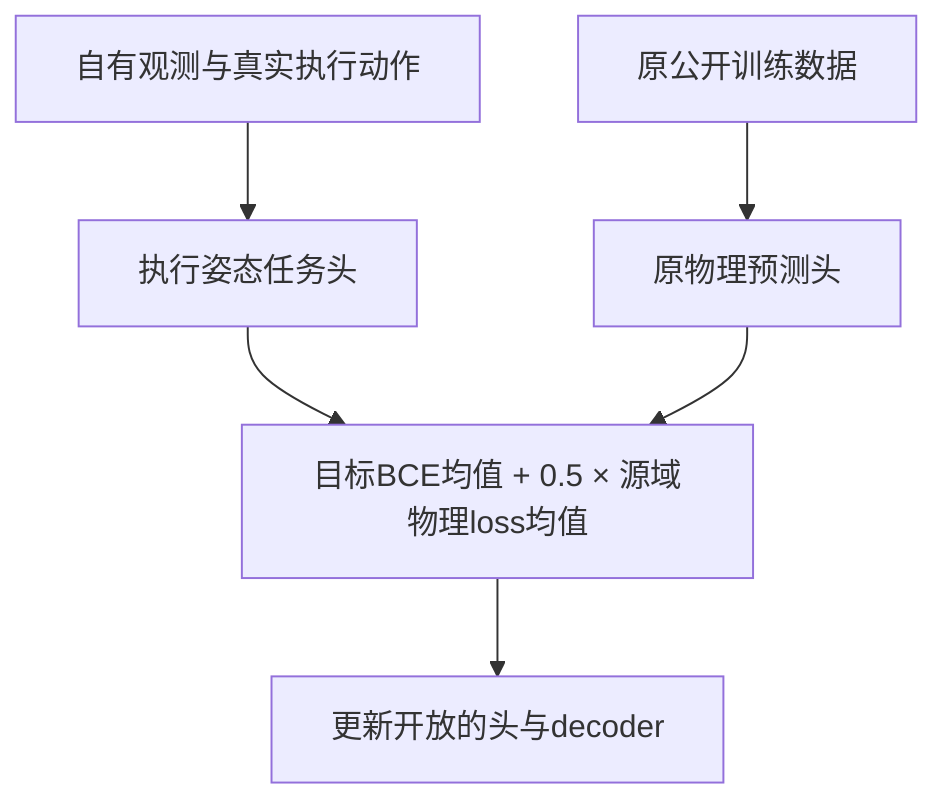

# 自有数据微调方案评估与准备规范

日期：2026-11-14（北京时间）。代码依据：`448be6aa69499aa8ee2c5a473eeee31a95ae002a`。

**结论：五类现有数据足以开展微调，首轮采用已经实现的 `attempt_success` + 源域 replay。** 不需要先补齐 CAD、物体6D姿态、稠密Seal/Wrench标签，也不需要重做公开预训练数据。原方案的多源数据对齐和真实执行监督方向可行，但部分字段、损失和几何评价能力与当前实现不同，不能按原NPZ清单直接批量生产。

本次为接口与方法评估，只新增准备说明，不修改训练代码，不启动微调或追加性能测试。现有规范见[微调实现规格](implementation/FINETUNING.md)。

## 1. 原提案与当前实现的对应关系

| 原提案 | 当前实现与判断 | 首轮采用方式 |
|---|---|---|
| RGB或IR复制三通道组成8维输入 | 8维输入不含RGB；颜色只可用于外部分割 | 保留RGB原图供分割，不构造伪RGB特征 |
| 框生成objectness标签，训练全图分类头 | 没有可学习objectness头；前景由输入实例ID派生 | 生成逐像素/逐点实例ID，0为背景 |
| 双目恢复深度是真实几何 | 双目也可能存在错配和反射伪影 | 选择与线上一致的深度作为观测，不自动当作物理真值 |
| 执行点强制插入512候选的第0位 | attempt路径直接评分执行姿态，不经过512候选采样 | 使用已有 `score_at_pose` |
| 把执行点移到最近表面点 | 最近点仅关联特征；查询中心仍是原执行点 | 保留真实接触中心与执行轴 |
| 单次结果扩散到附近小面片 | 尚未实现；附近动作不一定具有同样结果 | 一次执行只监督一次执行 |
| 成功意味着Seal=Wrench=1 | 成败与连续物理代理不是同一个目标 | 监督独立 `task_success_head` |
| 用几何判定失败根因后分流损失 | 当前没有根因分类器或对应分量监督接口 | 正常失败保留为任务负例，不伪造分量标签 |
| 全图低权重proxy与attempt一起训练 | 当前两个target模式互斥，不是自动混合入口 | 先用现成source replay防遗忘 |
| 保存全部字段到一个NPZ即可兼容 | 观测NPZ与JSONL中的执行记录分开读取 | 按第7节的真实接口打包 |

依据：[target Dataset](../suction20/target_dataset.py)、[体素整理](../suction20/batching.py)、[微调损失入口](../suction20/finetuning.py)、[模型](../models/suction20net.py)。

## 2. 前向输入：几何、实例与重力

当前每点的8维特征为：

```text
[(xyz - 当前帧点云均值) / 0.1]：3维
观测法向 normal_obs：3维
前景 instance_id > 0：1维
法向有效 normal_obs_valid：1维
```

随后对同一2mm体素内的点求均值。RGB、物体类别、物体CAD及执行结果都不进入这8维特征；实例融合和接触查询另外使用逐点坐标、实例身份及相机系重力。[实现](../suction20/batching.py)

因此，手头数据与模型输入不存在“信息量不足而无法运行”的障碍。需要转换的是实例身份、坐标和动作监督格式，无需复刻预训练离线标签生产的全部资产。

点数N随本帧有效观测变化，不必补成预训练示例中的84万点。一次真实动作的BCE可以更新共享网络参数，也不要求给每个点都生成标签。由于当前输入没有颜色、材质或真空压力，模型只能利用可见几何、实例上下文和动作与结果的相关性；几何相同但材质不同的对象，不应承诺仅靠本模型就能可靠区分。

## 3. 双深度源的分工

训练输入应与实际部署输入一致。若线上使用红外双目恢复深度，微调就以它生成点云与观测法向；若线上使用原始深度，则以原始深度生成输入。RGB、深度、框和动作应统一到选定相机坐标与对应观测时刻。

双目恢复深度可改善部分场景的有效表面覆盖，但不是天然几何真值。反光、低纹理或错误对应仍可能产生假深度，不能仅凭“比原始图更连续”判为正确。[RealSense官方说明](https://dev.realsenseai.com/docs/optical-filters-for-intel-realsense-depth-cameras-d400/)

首次只选择一个线上输入深度源。另一深度源保留为离线辅助，不要求现在实现特权几何训练或全图最近邻标签迁移。`|D_raw-D_stereo|`还混有配准、遮挡和重建误差，不直接当作已经标定的噪声分布。

已有有序深度时可以使用target Dataset的`rgbd`入口，自动反投影并计算观测法向。已有点云时使用`pointcloud_npz`，保存观测法向，或由现有PCA入口估计。**观测法向不能用执行吸取轴替代。**[预处理入口](../suction20/target_dataset.py)

当前首轮微调仅支持米制刚性增强，深度噪声和丢点设置为0；把双深度差引入增强属于后续代码改动，不是现成配置开关。

## 4. 从框得到实例输入，保留场景几何

2D框只能限定物体可能出现的区域。框内桌面、邻物和遮挡边缘需要与目标区分，否则会污染实例池化及接触几何。已有分割结果可直接复用；没有时，离线框提示分割是可选工具，固定工位也可结合已有台面/高度信息生成实例mask。

[SAM2官方图像预测接口](https://github.com/facebookresearch/sam2/blob/main/sam2/sam2_image_predictor.py)支持box prompt，但自动输出不等于零错误精确标注。无需把SAM2部署或完整滤波链规定为所有数据的必做步骤，选择能分清本工位实例的最简单流程。

输出约定：`instance_id=0`表示背景，`1..K`表示该帧不同物体；同一物体的身份与执行记录中的`attempt.instance_id`对应。这不是物体类别编码。

训练与部署的实例输入也应采用一致方法。离线用了精细mask而线上仍把整块矩形框当成同一物体，会产生额外输入差异；首轮优先复用准备部署的实例提纯方式。框外还可能有未标注或未作为目标的物体，不能一概声称这些点都有“不可吸”的真实标签。

**去台面的重点是从前景实例中去除台面身份，不是删除所有背景坐标。** 保留有效场景点，台面和邻物继续参与杯体、安装座与接近区域的几何上下文；仅将背景实例ID置0。普通无效深度和明确飞点可正常清理。[接触分组](../models/contact_grouping.py)

当前候选资格由`instance_id>0`及法向有效性控制，没有额外objectness训练任务。给背景附加零质量标签不会自动建立全图背景BCE；当前质量损失也只对有标签的前景实例生效。[掩码](../suction20/datasets.py) · [损失](../suction20/losses.py)

可见表面的点云均值或包围盒中心可以作为几何描述，但不是可靠的物理质量中心。首次不据此生成Wrench真值，也不要求补采质量或CAD。

## 5. 执行位姿：先统一工具与相机约定

JSONL中的动作应是**该次实际执行的吸盘接触中心与外向轴**，不是机械臂法兰原点、未经工具偏置修正的TCP位置，也不是网络当前预测动作。

若日志提供机器人基座系TCP位姿，可按已有标定转换：

$$
T_{C\leftarrow cup}=T_{C\leftarrow B}\,T_{B\leftarrow TCP}\,T_{TCP\leftarrow cup},
\qquad p_{exec}=T_{C\leftarrow cup}[0:3,3].
$$

执行外向轴为该变换的旋转作用于工具定义的外向单位轴。若原链路记录的是指向物体的接近方向，需要换为代码的外向轴；平移统一为米，重力方向也转到同一相机系。若手头仅记录规划动作，应如实保留其来源，不能把未知的真实接触偏差修正成“执行真值”。

已有精确原像素关联时，通过`source_index`取得同帧、同实例的观测特征。没有该关联时，模型在同一实例内找**5mm以内最近观测点作为特征anchor**。这里的5mm是当前实现的特征关联半径，不是判断“凌空吸取”或失败根因的物理阈值。

`score_at_pose`始终使用原`p_exec,n_exec`做接触分组。**附近观测点提供特征，不替换动作中心。** 关联失败时该条`pose_feature_valid=False`，成败监督跳过并计数，不自动生成负例或删除整帧。[关联与评分](../models/suction20net.py)

因此首轮无需新增圆柱搜索、候选0注入、3mm/8mm/15mm多套阈值，也不将一次结果扩散给未执行的邻近位置。真实动作点附近的形状相似，不代表平移后的吸盘边缘、接触压力和结果相同。

**R20在本仓库指半径20mm，即直径40mm。** 接触定义读取冻结配置`radius_m=0.020`；不要把“直径20mm吸盘”直接作为同一R20物理设定。[冻结几何检查](../models/contact_grouping.py)

## 6. 成败标签的语义与正常失败处理

`success=1`表示完成预先约定的任务，例如完成吸取并搬运；`success=0`表示该任务失败。成功不等于源域连续代理`Seal=1,Wrench=1`，失败也不能由表面几何自动归因到某一个辅助头。

例如，带有一定偏心力矩的动作仍可能成功，但它的连续力矩余量并非最大值1；表面看起来平整也不足以证明实际气密性已经成立。因此应保留任务结果本身，不把它改写成多个未观测的物理真值。

| 记录情况 | 当前处理 |
|---|---|
| 实际吸取并完成约定任务 | `success=1,label_valid=true` |
| 正常执行后未吸起、漏气或搬运中掉落 | `success=0,label_valid=true`，保留任务负例 |
| 日志明确表明未执行，或明确外部设备故障使结果无意义 | `label_valid=false`，不用于这次成败监督 |
| 无法关联观测特征 | 模型跳过该条监督；不把关联距离直接解释成失败原因 |

不要求先实现自动失败根因分类，也不要求新增真空、力矩或高速视频采集。已有明确故障标记可以利用；仅凭“看起来平整”“离估计质心较远”不能强行把失败归为Seal或Wrench。

目标loss只作用于独立`task_success_logit`。执行轴作为动作条件输入并detach；当前没有成功样本的法向模仿损失，也没有任务失败到Seal/Wrench的直接负梯度标签。[目标loss](../suction20/finetuning.py) · [BCE与有效掩码](../suction20/losses.py)

## 7. 可直接对接的数据文件

### 7.1 观测NPZ

| 字段 | 形状/类型 | 必需性 |
|---|---|---|
| `xyz` | `[N,3]` float32，有限值、米 | 必需 |
| `instance_id` | `[N]`非负整数 | 必需 |
| `normals_raw` | `[N,3]` float32，观测法向 | 有则保存，否则由现有PCA计算 |
| `normals_raw_valid` | `[N]` bool | 保存法向时建议同时提供 |
| `source_indices` | `[N]` int64，唯一非负原像素ID | 有可靠像素对应时提供 |

下面代码中的数组由现有深度/分割转换得到，顺序必须逐点一致：

```python
from pathlib import Path
import numpy as np

Path("observations").mkdir(exist_ok=True)
np.savez_compressed(
    "observations/frame_0001.npz",
    xyz=xyz_cam_m.astype(np.float32),
    instance_id=instance_id.astype(np.int32),
    normals_raw=normal_obs.astype(np.float32),
    normals_raw_valid=normal_obs_valid.astype(bool),
    source_indices=valid_pixel_indices.astype(np.int64),
)
```

如果没有可靠原像素身份，省略`source_indices`即可。不要把裁剪后的点云行号冒充原图像素ID；当前直接像素关联只用于显式携带原像素身份的观测。

`rgb`、`objectness_label`、`attempt_point_idx`、`proxy_seal`等原提案字段不是此adapter的输入。原图、框、原链路分数和failure_type可另存为追溯元信息，不影响最小训练记录。

### 7.2 JSONL：每行一个attempt

不是把所有attempt写入NPZ，也不是每行放一个`attempts`数组。下面示例用Python字典展示，再序列化成JSONL的一行：

```python
import json
from pathlib import Path

record = {
    "schema_version": "suction20.target.v1",
    "sample_id": "session01_frame0001_attempt01",
    "group_id": "session01_layout01",
    "split": "train",
    "label_kind": "attempt_success",
    "success_definition": "completed_pick_and_transfer",
    "observation": {
        "format": "pointcloud_npz",
        "path": "observations/frame_0001.npz",
        "g_cam": [0.0, 0.0, 1.0],
    },
    "attempt": {
        "point_cam_m": [0.01, -0.02, 0.45],
        "normal_out_cam": [0.0, 0.0, -1.0],
        "instance_id": 2,
        "source_index": 153620,
        "success": 1,
        "label_valid": True,
    },
}
Path("manifest_attempt_success.jsonl").write_text(
    json.dumps(record, ensure_ascii=False) + "\n", encoding="utf-8"
)
```

例中的重力、坐标、轴和像素ID仅说明格式，需替换为实际标定与记录。`source_index=153620`必须指向该观测中instance为2的真实对应像素；没有可靠对应时省略此键，使用现有5mm特征关联。

真实manifest保存全部记录，并包含按group划分的train/val；多条attempt可引用同一观测，Dataset会合并读取并在collate时展开。每条`sample_id`唯一，同一观测及同一group不跨split。文件相对路径以manifest所在目录为基准。

`success_definition`可由配置统一给出，或各行给出一致的值；示例配置已用`completed_pick_and_transfer`。不要混合“真空建立”与“完成搬运”两种成功口径。字段读取与类型约定见[target Dataset](../suction20/target_dataset.py)。

## 8. 首轮不生成稠密代理标签的原因

[`eval_r20.py`](../suction20/eval_r20.py)不是直接输入任意目标点云和2D框就能得到同义全图标签的转换器。现有scene context读取SuctionNet原物体稠密几何、物体位姿、场景障碍、冻结参数和中心；完整Q20同时依赖Seal、Wrench和碰撞。

底层`seal_at_pose`确实接受点集，但原算法用完整物体几何计算72个唇口扇区。单视角双目中的缺测或遮挡会使扇区缺失，不能直接当成真实漏气；可见表面中心也不等于原Wrench定义的物体中心。若以后开发可见几何启发分，应独立命名其语义。

当前`dense_proxy`要求`gt_valid`、标签实例映射，以及`gt_B`或实际存在的全部S/W/C分量，并校对源域冻结定义。仅有`proxy_seal/proxy_wrench`既不满足字段契约，也不满足同定义条件，不能靠改字段名解决。[标签读取](../suction20/target_dataset.py)

当前`attempt_success`与`dense_proxy`是不同target模式，不能通过在一个NPZ加两组字段自动混合。未来若确需“任务BCE+几何启发正则”，需明确新增目标语义、权重和loss接线；**不是本次微调的前置任务**。现成source replay已承担首轮防遗忘作用。

## 9. 首轮训练直接沿用现有协议



每次成功更新包含2帧target和2帧source，microbatch1。两帧target分别乘0.5，两帧source分别乘0.25；不要再整体除以梯度累积次数。[训练循环](../scripts/finetune.py)

| 阶段 | 可训练参数 | 学习率 |
|---|---|---|
| 更新0–199 | heads | heads `3e-4` |
| 更新200起，至现有最多1000更新预算 | heads + decoder | heads `1e-4`，decoder `1e-5` |

Encoder全程冻结，BN统计与affine全程冻结。decoder组包括稀疏decoder、fusion、pose_fusion、实例融合与接触分组中的可学习模块；不是按文件“随便冻结前半部分”。阶段切换保持heads优化器状态。[阶段控制](../suction20/finetuning.py) · [参数分组](../models/suction20net.py)

第一阶段中，目标成败loss训练任务头，源域loss训练原物理头；第二阶段才开放共享decoder与融合特征。目标BCE不直接训练q0和axis头，推理仍先按原q0/axis产生候选，再用任务头排序；不能把这一模式描述成已经同时学会新的目标域选点和最佳法向。

现有每100更新验证、保存step200与最佳target checkpoint即可；1000是上限，不是保证适合所有规模的样本遍历次数。只对选中的一个`gt_B`预训练模型微调，不把六组公开消融重新做一轮。

保留全部可用正常成功与失败，先沿用现有按group再按观测采样；不固定要求成功:失败=1:1，也不默认删除大部分成功记录。70%–80%成功率本身不足以证明必须重采样。若以后实际出现类别问题，再针对训练采样处理，val/test保持真实分布；现有BCE没有可配置正类权重接线。

## 10. 一组模型的前后评估与必要数据检查

按session/物理摆放划分group，同一摆放的相邻帧、同一帧的多次attempt及其raw/stereo版本放在同一集合。沿用约70%/15%/15%的组级划分即可；现有数据仅够train/val时如实报告，不为凑比例要求额外采集。[划分规范](implementation/FINETUNING.md)

用同一held-out组比较预训练模型的`q_at_executed_pose`与微调后的task score，报告现有AUROC、PR-AUC及有效尝试数。当前选择以AUROC为主，无法定义时用BCE；不要把源域q当作已校准成功概率。[验证实现](../suction20/target_validation.py)

这些日志来自旧策略选择的动作，所以固定日志上AUROC变好说明对已执行动作的区分更好，**不直接等于新策略上机吸取成功率提高**。实际效果在后续正常部署试用中观察，不把额外探索采集或完整线上实验列为本次数据准备前置项。

批量转换前只确认三件直接影响训练的事：坐标/单位/外向轴能对应原动作；实例ID和source_indices与观测对齐；成功定义及group划分一致。查看少量正常样本的叠加效果及转换汇总即可，不建设额外根因审计或多阈值验证矩阵。

## 11. 配置入口与实施备注

真实配置路径为[attempt示例](implementation/examples/finetune_attempt_success.yaml)与[dense示例](implementation/examples/finetune_dense_proxy.yaml)，脚本为[`scripts/finetune.py`](../scripts/finetune.py)。先复制attempt示例，填写manifest、source replay数据根目录和冻结配置路径；需要沿用无限额显存时显式设置`runtime.gpu_memory_limit_gib: null`。

```bash
PYTHONPATH="$PWD" python scripts/finetune.py \
  --config /absolute/path/finetune_attempt_success.yaml \
  --target-manifest /absolute/path/target/manifest_attempt_success.jsonl \
  --init-checkpoint /absolute/path/selected_public_gtB_best.pt \
  --run-dir /absolute/path/new_target_run \
  --device cuda:0
```

这里`--init-checkpoint`加载选定预训练权重，创建新的微调优化器和目标训练进度。此前“从头训练”的决定针对公开预训练；目标域微调仍应继承预训练模型，不随机初始化网络。

CD-010的性能sidecar不会由当前微调入口自动从source checkpoint继承；源域replay仍需运行完整模型，不能宣称已自动具备全部预训练加速。`make_model`可读取`runtime.performance`，后续实施时应明确接入适用的已选执行设置；预取、precision/fused optimizer和depth2训练循环接线需分别看入口实现，不只复制JSON。[模型构造](../suction20/runner.py) · [微调入口](../scripts/finetune.py)

当前微调协议固定有效batch4，不直接套用公开预训练的H20 E48/L20 E12；本次不再扩展硬件参数扫描。数据准备与上述接口对齐即可推进，性能接线作为实施事项处理。
