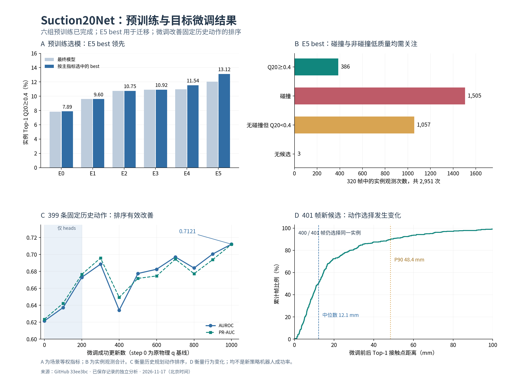

# CD-010 预训练与目标微调：独立结果分析及模型选择

分析日期：**2026-11-17（北京时间）**。数据版本：[33ee3bc](https://github.com/chichu-lv/suctionnet_modern_20mm/commit/33ee3bc18979772c1f4b3aa4385ecdcbf9a88ab1)，分支 `cd010/from-scratch-performance`。

本分析读取已经发布的数值记录、配置和指标代码，重新计算模块差异、验证轨迹、实例几何结果及401帧推理的配对变化。没有新增模型训练、推理或评估实验。

## 结论与当前选择

**预训练获得了可迁移的表示，真实成败微调也取得了明确的离线排序改善。当前应保留 E5 预训练 best step2880，并使用由它初始化的微调 best step1000 继续目标场景比较。** 两个选择均与已经执行的流程一致。

本轮最有价值的四个结论是：

1. **接触分组的结构收益最一致。** E3 对 E1 的实例Top-1增加1.32个百分点，碰撞率降低6.20个百分点，10个验证场景的碰撞率全部降低。
2. **完整E5配方在既定主指标上最好。** best step2880的Top-1为13.12%；最终step4800降至12.02%，应继续使用best。
3. **目标微调有效。** 相同399条历史规划动作上的AUROC从0.621456升至0.712113，PR-AUC从0.623443升至0.711920；前200步已经得到超过一半的总排序增量。
4. **精度工作的重点已经转向动作几何与评分的一致性。** E5 best的实例Top-1仍有51.16%触发几何碰撞判定，且无碰撞的候选也不都达到Q20阈值。性能记录显示数据/几何等待大部分已被隐藏。



图A采用场景等权主指标；图B为逐帧计数合计，两种归约口径分开呈现。图C的step0是原物理q基线，其余是任务头。图D统计全部401帧的累计比例，横轴展示0–100mm。所有图均由已保存数据生成。[SVG](overview.svg) · [完整计算结果](summary.json) · [分析与绘图脚本](analyze_results.py)

## 1. 先分清这三类实验回答的问题

| 数据 | 数量与划分 | 回答的问题 |
|---|---|---|
| 公开数据预训练开发验证 | 6组，每组10节点；反复使用固定320帧、10场景 | 不同配方能否对预测姿态给出较好的物理几何评分 |
| 目标域微调验证 | 399条带结果的历史规划动作，209成功/190失败，3个group | 任务评分能否更好区分这些历史动作的成败 |
| 目标观测推理 | 两模型各401帧、205312个候选 | 模型输出什么新动作、选择如何变化、推理耗时如何 |

预训练主指标是**每个可见实例**最高分动作的Q20≥0.4比例，包含没有已知优质接触面的实例；它不等于每帧只执行一个最佳动作的机器人成功率。AP_R20是4个质量阈值与precision@1…50的平均，也不是常规PR曲线面积。

微调的位姿来源实际为 `planned_pipeline_contact`，`actual_execution_verified=false`。因此本轮证明的是历史规划指令与人工成败的关联排序改善，未测量实际接触位置，也未给401帧新动作提供机器人结果。这个区别决定结论的使用范围，无需为本次分析重建采集流程。[指标合同](../pretraining/metric-contract.md) · [微调数据](../finetuning/data/summary.json) · [推理说明](../inference/README.md)

## 2. 六组预训练：选择E5 best，保留E3作为简化基线

### 2.1 完整预算与最终结果

每组均完成230400个有效训练样本。E0–E4的有效batch为12，各19200次成功更新；E5为48，共4800次。合计100800次成功更新、27次AMP非有限梯度跳步。每组覆盖23040张不同训练帧，平均约10次有效呈现/帧；40个预算轮次不表示整个原数据集重复40遍。

| 实验 | 关键设置 | 最终Top-1 | 最终AP_R20 | 最终碰撞率 | best步数 | best Top-1 |
|---|---|---:|---:|---:|---:|---:|
| E0 | gt_A，无实例/接触/辅助头 | 7.84% | 7.50% | 64.10% | 11520 | 7.89% |
| E1 | gt_B，无实例/接触/辅助头 | 9.60% | 7.95% | 63.35% | 19200 | 9.60% |
| E2 | gt_B + 实例融合 | 10.75% | 9.46% | 62.06% | 19200 | 10.75% |
| E3 | gt_B + 接触分组 | 10.92% | 9.46% | 57.15% | 19200 | 10.92% |
| E4 | gt_B + 实例融合 + 接触分组 | 10.97% | 10.54% | 57.70% | 1920 | 11.54% |
| E5 | E4 + 物理辅助头 | **12.02%** | 10.45% | **53.30%** | **2880** | **13.12%** |

best按 `(instance_Top1_Q20_at_0_4, AP_R20)` 字典序选择：Top-1优先，完全相等才用AP。E4最终AP比E5最终高0.0966个百分点，并不推翻这个预先确定的选模标准。E4的Top-1 best与AP最高节点也是不同权重，不能将两者最高值合并报告。[逐组原始汇总](../pretraining/run_summary.csv) · [60个验证节点](../pretraining/validation_results.csv)

### 2.2 模块贡献与成本

下表均为最终模型之间的比较，单位为百分点。

| 比较 | Top-1变化 | AP变化 | 碰撞率变化 | 判断 |
|---|---:|---:|---:|---|
| E1−E0：增加Wrench质量目标 | +1.764 | +0.448 | −0.746 | gt_B更符合当前完整物理评价目标 |
| E2−E1：实例融合配方 | +1.147 | +1.513 | −1.287 | 有改善，但同时改变训练精度 |
| E3−E1：接触分组 | **+1.315** | **+1.514** | **−6.203** | 最一致的结构收益 |
| E4−E3：增加实例融合 | +0.055 | +1.081 | +0.552 | 收益主要体现在场景候选排名，Top-1几乎不变 |
| E5−E4：完整辅助配方 | +1.053 | −0.097 | −4.403 | 主指标与碰撞更好，AP并未同步提高 |

E3相对E1在8/10场景提高Top-1、10/10场景降低碰撞。E4相对E3的总训练墙钟从约20.00小时增加到27.62小时（+38.12%），但Top-1只增加0.055个百分点。因此E3具有明确的简化价值；目前目标微调只做了E5，尚不能据此改选E3作为业务赢家。[最终场景结果](../pretraining/final_scene_metrics.csv)

E5是**已测实际配方**的赢家。E5除了增加辅助头，也改变了microbatch、有效batch、优化器更新次数与硬件；E2还采用BF16 dense / FP32 sparse。E0–E5都只有seed42一轮，结论应表述为本轮配方表现，不把差异全部归因于一个模块。无需为了修饰这次结论立刻补跑六组。

### 2.3 E5后期回落：保留best有充分依据

| 指标 | best step2880 | final step4800 |
|---|---:|---:|
| 有效样本数 | 138240 | 230400 |
| Top-1 | **13.1205%** | 12.0248% |
| AP_R20 | **10.6049%** | 10.4472% |
| 碰撞率 | **51.1618%** | 53.2952% |
| dense q0 MAE | 0.039867 | **0.037321** |
| seed q MAE | 0.099398 | **0.094773** |
| 高质量缓存标签的proposal覆盖率 | 74.9762% | **76.7693%** |

最后40%的训练样本预算继续改善回归误差与proposal覆盖，却没有改善实际姿态Top-1；Top-1在8/10场景下降，整体下降1.0956个百分点。这支持保留best，也说明继续降低平均loss不是当前选模依据。E1/E2/E3的best仍在最终节点，不能把这一现象推广为“六组都已过拟合”。

早期低分也有更具体的解释：E5第4→8轮Top-1由1.56%升至10.60%，proposal覆盖由13.44%升至67.68%，法向误差中位数却基本不变（12.72°→12.77°）。E2有类似现象，早期低指标更伴随提议覆盖不足，不能仅归因为轴预测失效。[节点与逐帧记录](../pretraining/validation_frames.csv)

## 3. 目前预训练模型的主要精度问题

### 3.1 碰撞是大问题，非碰撞低质量同样存在

按E5 best的320帧逐帧记录还原，有2951次可见实例观测：

| 几何判定 | 实例观测次数 |
|---|---:|
| Top-1达到Q20≥0.4 | 386 |
| Top-1触发碰撞 | 1505 |
| Top-1无碰撞，但Q20<0.4 | 1057 |
| 无候选 | 3 |

无候选极少，输出覆盖已经建立；1443个无碰撞Top-1中只有386个达到质量阈值，约26.75%。因此仅消除碰撞也不能解决全部质量问题，Seal×Wrench仍有不足。现有逐帧汇总可以支持这个二分结论，无法继续把1057项可靠拆成具体Seal或Wrench根因。

这是**合计计数**，主表则采用场景等权宏平均，两者不应混作相同百分比。计数也包含同一场景不同视角的重复物体观测，不是2951次独立机器人动作。[计算输入](../pretraining/validation_frames.csv) · [计算结果](summary.json)

### 3.2 回归误差与实际动作质量存在条件差异

代码显示，源域质量loss使用原缓存的 `targets[quality_target][seed]`；接触分组使用当前预测轴；验证再对当前预测点、轴重新计算物理Q20。**原缓存标签对应的姿态条件与当前预测动作并非始终相同。** 轴进入质量评分路径时detach，轴的直接监督主要来自原候选轴角度损失。

这个机制能够解释“原缓存分数拟合更准，但当前动作几何没有一起改善”，是后续精度改动应优先关注的位置。它不是现有聚合记录已经证明的唯一失败原因，也不要求立即重做全部标签。[质量loss](https://github.com/chichu-lv/suctionnet_modern_20mm/blob/33ee3bc18979772c1f4b3aa4385ecdcbf9a88ab1/suction20/losses.py) · [姿态评分](https://github.com/chichu-lv/suctionnet_modern_20mm/blob/33ee3bc18979772c1f4b3aa4385ecdcbf9a88ab1/models/suction20net.py) · [R20评价](https://github.com/chichu-lv/suctionnet_modern_20mm/blob/33ee3bc18979772c1f4b3aa4385ecdcbf9a88ab1/suction20/eval_r20.py)

还需按正确分母理解指标：q0 MAE仅覆盖约12.95%的有标签输入点；seed MAE覆盖约41%–45%的候选。proposal覆盖率的分母是有高质量缓存点的实例，每帧约4.17个；Top-1分母是全部可见实例，每帧约9.22个。不能用76.77%减12.02%算出所谓“排序损失64.75个百分点”。

## 4. 目标微调：收益明确，step1000值得保留

### 4.1 预训练表示能够迁移到任务评分

| 节点 | AUROC | PR-AUC | BCE | Brier |
|---|---:|---:|---:|---:|
| 原E5物理q，step0 | 0.621456 | 0.623443 | — | — |
| heads阶段结束，step200 | 0.672979 | 0.676477 | 0.655737 | 0.231548 |
| step400 | 0.634122 | 0.649234 | 0.669062 | 0.238262 |
| step700 | 0.697028 | 0.694429 | 0.663886 | 0.235883 |
| step900 | 0.700504 | 0.693832 | 0.647647 | 0.227708 |
| **best step1000** | **0.712113** | **0.711920** | **0.632951** | **0.220857** |

AUROC提高 **0.090657**，PR-AUC提高 **0.088477**。这分别可表述为9.07和8.85个指标百分点，不是机器人成功率提升9%。

前200步只训练heads，已得到56.83%的总AUROC增量；这说明预训练姿态表示中存在可被目标评分头利用的信息。200→1000又得到0.039134的AUROC增量。期间同时开放decoder/fusion/contact编码并继续训练，不能把全部增量纯归因为解冻，但现有两阶段路线的最终效果确实优于第一阶段终点。[完整11节点](../finetuning/validation_metrics.csv)

step1000同时是本轮AUROC、PR-AUC、BCE、Brier的最好节点。step400排名回落、step500的BCE/Brier变差，之后恢复；中间波动没有演变为持续退化。最佳点位于预算终点，不能据此宣称完全收敛，也没有必要因此立即延长训练。

原物理q与任务头的语义不同，因此基线不直接按成功概率计算BCE/Brier；在相同动作、标签上比较AUROC/PR-AUC则有意义。以验证成功比例209/399构造常数参照，BCE=0.692013、Brier=0.249433；最终Brier较该参照低约11.46%。这个结果补充支持评分有效，但任务分数仍未经过概率校准。

### 4.2 数据规模与训练过程

| 划分 | 总数 | 成功 | 失败 | 成功比例 |
|---|---:|---:|---:|---:|
| train | 1676 | 1051 | 625 | 62.71% |
| validation | 399 | 209 | 190 | 52.38% |
| 有标签test历史动作 | 87 | 65 | 22 | 74.71% |

接受2162条记录，排除629条。发布包只提供排除总数，无法据此声称某类失败占了主要比例。训练正负比例并不极端，当前没有数据依据要求强制改为1:1或删除大批成功记录。[划分汇总](../finetuning/data/summary.json)

1000次成功更新包含2000次target输入，日志中出现1056个不同观测ID；采用按group再按帧的有放回采样，不能把1000步当成遍历全体数据很多轮。唯一AMP跳步在尝试15，全部训练和验证的unmapped计数为0。末100步target BCE均值为0.650970，训练损失没有被压到接近0，验证也没有持续恶化，当前曲线不支持明显过拟合。

源域回放日志的 `loss_source` **已经乘了0.5**：首100步均值0.121906，末100步0.115924。它表明回放约束保持稳定；源域泛化能力是否变化需要源域验证才知道，不能拿训练loss替代，也没有现有证据表明灾难遗忘已发生。[逐步训练](../finetuning/training_updates.csv) · [训练入口](https://github.com/chichu-lv/suctionnet_modern_20mm/blob/33ee3bc18979772c1f4b3aa4385ecdcbf9a88ab1/scripts/finetune.py)

### 4.3 三个验证group的变化

| group | 记录数 | step200 BCE | step1000 BCE |
|---|---:|---:|---:|
| GROUP01 | 50 | 0.691427 | 0.648459 |
| GROUP02 | 151 | 0.632601 | 0.633251 |
| GROUP03 | 198 | 0.664368 | 0.628805 |

两个group改善，一个基本持平。总体改善并非只来自某个小group。最终 `attempt_BCE=0.632951` 与 `task_loss=0.636839` 的差异来自归约：前者对399条动作等权，后者对3个group等权。AUROC/PR-AUC也使用399条动作汇总计算。[逐帧验证](../finetuning/validation_frames.csv)

验证包含3个group，且历史日志没有保存逐动作分数向量，所以本报告不重建ROC曲线、不虚构分组AUC或置信区间。使用记录中已经定义的验证指标足以支持当前选模。

## 5. 401帧推理：选择变化、几何关系和耗时

### 5.1 微调改变了模型提出的动作

按相同匿名 `sample_id` 配对两模型Top-1：

| 项目 | 结果 |
|---|---:|
| 两模型都有输出 | 401/401帧 |
| 仍选同一实例 | 400/401帧 |
| 仍选同一源像素 | 2/401帧 |
| 接触点变化中位数 / P90 | **12.08 / 48.38 mm** |
| 吸取轴变化中位数 / P90 | **8.36° / 33.10°** |
| 接触点变化不超过20mm | 291/401帧，72.57% |
| 同时满足位置≤5mm、轴≤5° | 35/401帧，8.73% |

变化主要表现为同一物体上的接触位置和方向重新选择。模型参数、共享特征、q0提议及最终排序共同影响这个结果，不能把它全部解释为“相同512候选仅换了排序”。微调Top-1任务分数的中位数约0.721，不应读作72.1%的已测成功率。[逐帧原值](../inference/frame_metrics.csv)

### 5.2 与原规划的几何差异总体收缩，但不是准确率证明

381帧中有382个可比较的原规划点；两模型均在同实例内取最高排名候选进行比较。

| 与原规划的差异 | 预训练 | 微调后 |
|---|---:|---:|
| 距离均值 | 21.75 mm | 17.73 mm |
| 距离中位数 | 15.24 mm | 14.33 mm |
| 距离P90 | 47.92 mm | 33.14 mm |
| 轴角均值 | 14.45° | 11.66° |
| 轴角中位数 | 9.53° | 9.19° |
| 轴角P90 | 31.81° | 23.65° |

分布中的大偏移有所减少，但逐例只有180/382的位置更接近原规划，208/382的轴角更接近。不能把均值下降表述为“绝大多数动作都更接近”。原规划也有失败记录，因此几何接近本身不是优劣标签。[同实例比较原值](../inference/original_comparisons.jsonl)

### 5.3 任务头没有带来明显推理耗时负担

| 已记录区间 | 预训练均值 / 中位 | 微调均值 / 中位 |
|---|---:|---:|
| 推理区间 | 0.3926 / 0.3826 s | 0.3830 / 0.3754 s |
| 完整单帧记录流程 | 0.7333 / 0.7139 s | 0.7173 / 0.6993 s |

本轮两者均约0.38–0.39秒/帧推理，完整导出流程约0.72秒/帧；没有出现新增任务头造成的明显额外耗时。完整流程包含读取、渲染和输出，不能作为纯GPU kernel时间或完整机器人动作周期。两次离线执行的微小速度差不作为加速结论。

## 6. 性能优化的实际结果：已经达到阶段目标

| 实验 | 含验证总耗时 | 稳态样本/s | allocated最大 | reserved最大 |
|---|---:|---:|---:|---:|
| E0 | 15.73 h | 4.822 | 5.95 GiB | 12.62 GiB |
| E1 | 15.67 h | 4.824 | 5.95 GiB | 12.62 GiB |
| E2 | 29.48 h | 2.367 | 12.12 GiB | 33.15 GiB |
| E3 | 20.00 h | 3.711 | 12.22 GiB | 33.43 GiB |
| E4 | 27.62 h | 2.569 | 23.78 GiB | 43.72 GiB |
| E5 | 25.96 h | 2.762 | **91.22 GiB** | **138.49 GiB** |

六组并行完成的日历跨度约29小时28分，总单卡进程时长合计134.46 GPU·小时。H20/E5的显存已经充分用于当前训练配置；reserved包含缓存池，因此不能把138.49 GiB全部当成有效张量。

E5平均可见loader等待6.59ms/update、几何等待183.76ms/update，约占更新均值的0.04%和1.06%；E3几何等待约2.7%、E4约0.3%。数据预取和几何重叠在完整训练中保持了效果。当前记录支持结束这轮性能优化，把工作重心放在模型效果；继续扩大worker或CPU核数没有已测依据支撑显著收益。[运行摘要](../pretraining/run_summary.json)

## 7. 当前采用什么，下一步只补什么

### 确定采用的权重

| 用途 | 权重 | 身份 |
|---|---|---|
| 公开预训练基线 / 迁移初始化 | E5 best step2880 | SHA256 `5bc2c14c014fbf23cbef48062a0dac523ea243b6c18e540bb5af022ff7d0ea3a` |
| 当前目标任务评分 | 微调 best step1000 | SHA256 `d55f1c2cda980ad0b874d14a267f834047794bf05dbb17bad3215026cd6bed18` |

微调摘要的初始化SHA与E5 best一致；目标权重与已发布401帧推理身份一致。[微调摘要](../finetuning/summary.json) · [推理身份](../inference/finetuned/identity.json)

**最小后续工作是：用已经留出的87条带标签test历史动作，对这两个固定模型做一次同动作的离线比较。** 这能补齐开发验证之外的排序泛化结论，不需要重训六组、重做数据、增加微调矩阵或继续batch性能实验。比较AUROC/PR-AUC时同时保留65成功/22失败的构成，避免把该集合的PR-AUC直接当成与验证集同难度的绝对值。

401帧输出已足够展示新候选行为。是否提高实际业务成功率，接入原定正常工况吸取对比即可，历史原动作的结果不能移给新动作。

若后续业务表现仍不够，精度改进的首要方向已经清楚：**同一预测姿态上的质量监督与评价一致性，以及最终动作的碰撞和接触质量。** 当前记录没有要求新增失败分类器、全图目标物理伪标签或另一轮全面性能优化。

## 8. 分析复现

在包含本次发布数据的仓库中运行：

```bash
python docs/experiments/CD010-20261117/analysis/analyze_results.py
```

脚本只读CSV/JSONL，不加载权重、不访问训练数据、不运行模型。输出 `summary.json`、`overview.png`、`overview.svg`。依赖numpy、pandas、matplotlib；中文字体默认Noto Sans CJK，可通过 `--font` 指定路径。

计算来源是本目录已发布的表格：逐组/逐节点/逐帧预训练指标，微调逐步/逐帧/节点指标，以及推理Top-1和原规划同实例比较。所有新增解释均区分了原始记录、直接计算和机制推断。
