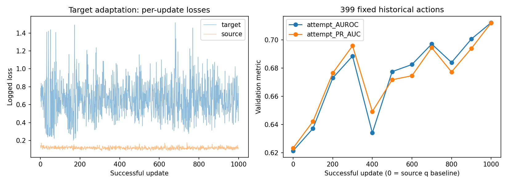

# E5 目标场景微调实验（已完成）

2026-11-16 17:23:55 +08:00 完成。1000 次成功更新、1001 次尝试（1 次 AMP 非有限梯度跳过）；最佳模型第1000步。

| 指标 | 微调前 E5 q | 微调 best 任务评分 |
|---|---:|---:|
| 验证 AUROC | 0.6214555530 | 0.7121128147 |
| 验证 PR-AUC | 0.6234430901 | 0.7119204346 |

验证固定399条历史动作记录（209成功/190失败），按验证 AUROC 选best。它们是规划指令与人工成败的关联，不是实测接触点，也不是新策略机器人成功率。原日志 `evaluation_scope` 的 “fixed executed poses” 是旧通用文案，实际证据必须按 `planned_pipeline_contact`、`actual_execution_verified=false` 解读。未用测试集选择模型。

## 文件

- [完整逐次更新日志](logs/updates.jsonl)、[训练 CSV](training_updates.csv)：保留跳过更新、阶段、损失、梯度与目标观测ID。
- [完整验证日志](logs/validation.jsonl)、[节点指标](validation_metrics.csv)、[逐帧验证](validation_frames.csv)：11节点，含训练前基线。
- [资源采样](logs/resources.jsonl)、[生命周期](logs/lifecycle.jsonl)。
- [实际配置](config/resolved_config.json)、[启动配置](config/launch_config.json)。
- [划分汇总](data/summary.json)、[数据处理说明](data/README.md)：发布汇总统计。原始2162条监督清单与629条排除明细不上传，保留数据服务器。
- [最终汇总与权重哈希](summary.json)。实际checkpoint见[数据位置说明](../DATA_LOCATIONS.md)。

## 训练设置

H20-3e 143771 MiB，CPU核0–15、Torch/几何各8线程。每次更新2目标帧+2源回放帧，microbatch1；目标BCE均值+0.5×源物理损失均值。前200次仅训练heads，LR3e-4；随后heads1e-4、decoder/fusion1e-5；encoder与BN冻结。训练FP16 AMP，验证FP32。最多1000次成功更新，每100步验证。

## 读取与可复现边界

CSV可直接用pandas读取，JSONL用逐行json.loads。源数据根路径已替换为 `${TARGET_RELEASE}` / `${SOURCE_RELEASE}`，运行位置为 `${FINETUNE_RUN}` / `${PRETRAIN_RUN}`；pid和主机名不参与分析，已移除。数字记录未平滑或重采样，图表使用保存日志生成；未重跑训练。运行脚本与数据准备代码见上级 `scripts/`。模型checkpoint未上传。

历史验证日志未保存逐动作预测分数向量；已保留原聚合AUROC/PR-AUC和逐帧损失，但无法仅靠这些旧日志重建精确ROC曲线。此次没有为补齐它们重跑验证。

发布版已将生产样本/观测/分组编号替换为匿名ID，去除原始输入哈希与溯源元数据；数值损失、指标和划分统计保持不变，匿名映射表不发布。

发布版已将生产样本/观测/分组编号替换为匿名ID，去除原始输入哈希与溯源元数据；数值损失、指标和划分统计保持不变，匿名映射表不发布。

发布版已将生产样本/观测/分组编号替换为匿名ID，去除原始输入哈希与溯源元数据；数值损失、指标和划分统计保持不变，匿名映射表不发布。
