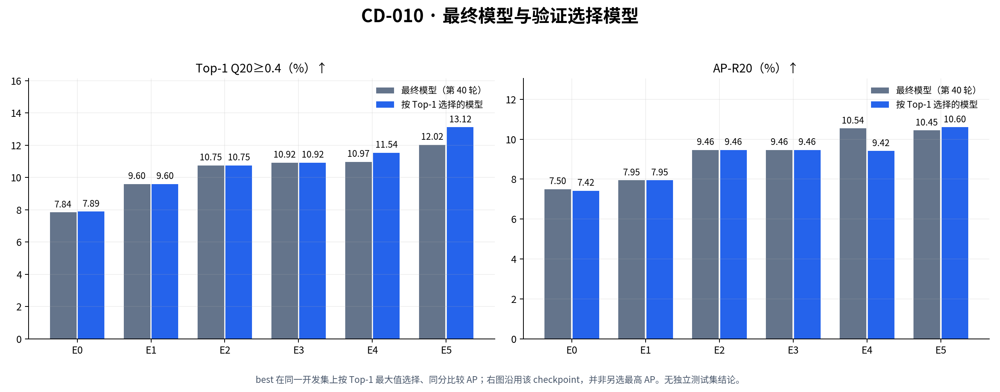
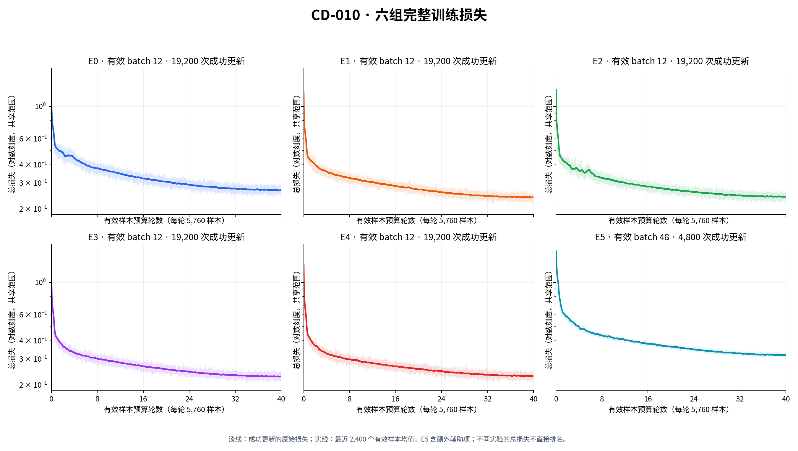
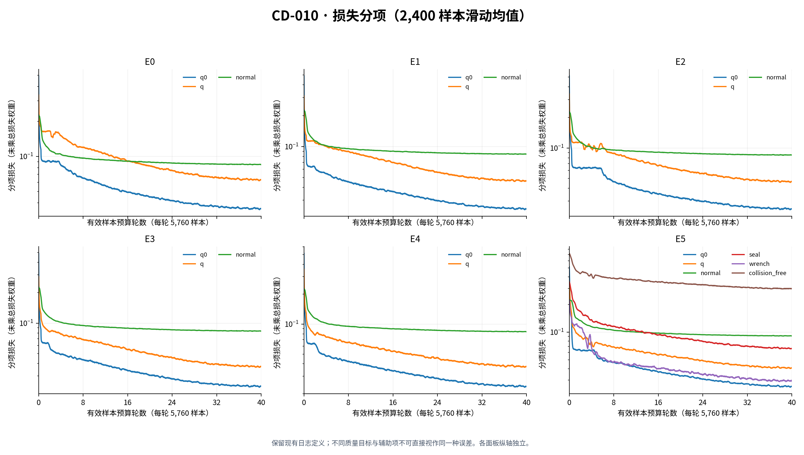
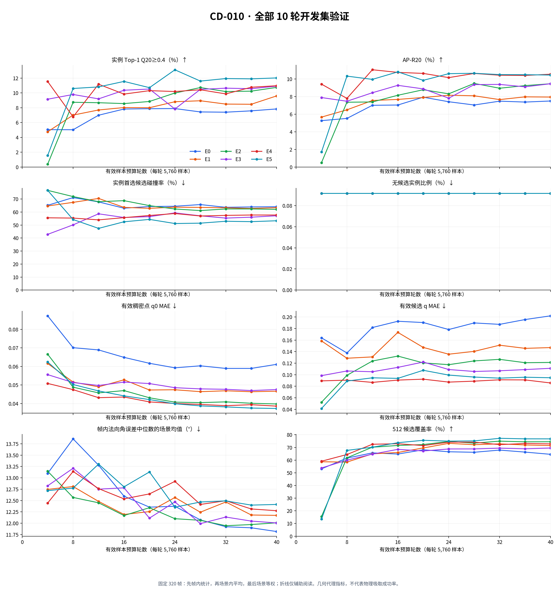
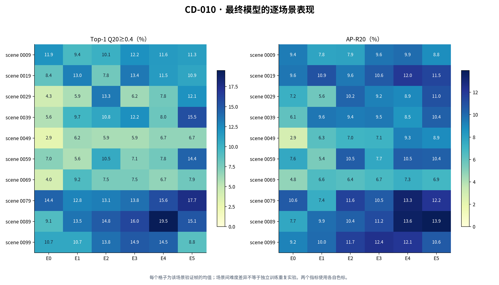
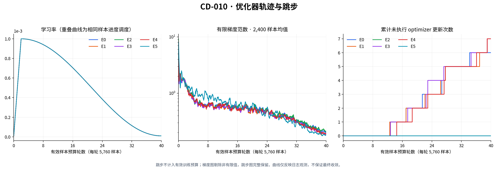
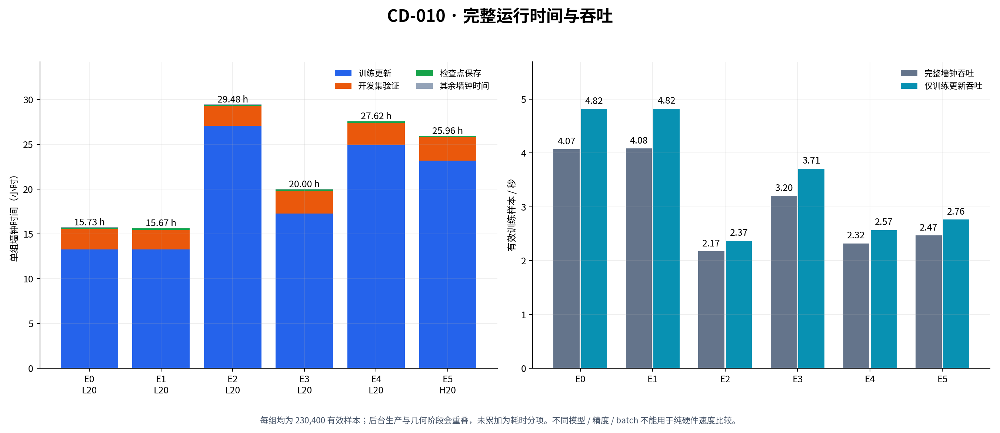
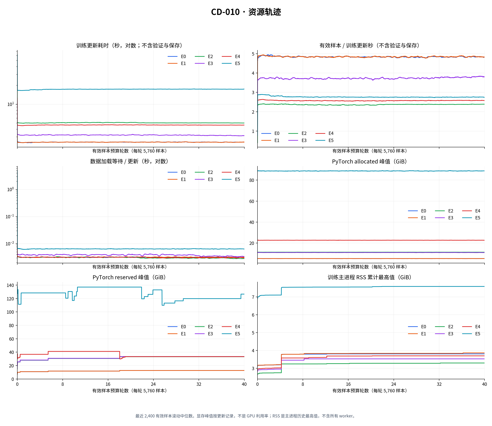

# CD-010 六组预训练最终分析与原始数据说明

分析日期：2026-11-16（北京时间）。数据来自 H20 / L20 的 `cd010-selected-training` 最终运行目录；本报告只读取已有训练记录，没有新增训练、推理、性能实验或官方测试集评估。

## 结果与结论

六组全部完成，每组累计 230,400 个有效训练样本；E0–E4 各 19,200 次成功更新，E5 为 4,800 次。每组均完成固定 320 帧、10 场景的 10 轮开发集验证。原始记录共 100,800 次成功更新、27 次 AMP 梯度非有限跳步、60 份验证结果和 19,200 条逐帧验证记录。19,200 是验证记录数，独立验证图像仍只有 320 张。

**按预先声明的主指标实例 Top-1 Q20≥0.4，当前六组配方中 E5 最好：最终 12.02%，验证选中的最佳模型 13.12%。按最终 AP-R20，E4 为 10.54%，E5 为 10.45%，两者差距仅 0.10 个百分点。** 两种指标的赢家并不完全一致，不能拼接不同轮次的最高值构造一个不存在的模型。

**最突出的问题是高分候选的几何有效性。** 最终各组实例最高分候选碰撞率仍为 53.30%–64.10%，而无候选率仅约 0.0915%。有候选不代表有好候选，分数回归误差下降也不代表预测位置和方向的几何质量同步改善。训练后半程损失继续下降，验证主指标则以平台和波动为主。

本轮只有每组 seed42 一个随机种子，E5 的 batch/更新次数/硬件与其他组不同，E2 的训练精度也不同。下文的模块对比描述的是本次实际配方的结果，不能据此宣称模块的严格因果增益或统计显著性。所有分数都是开发集几何指标，不是真实吸取成功率。

## 最终检查点与验证选中模型

| 实验 | 最终步数 | 最终 Top-1 ↑ | 最终 AP-R20 ↑ | 最终碰撞率 ↓ | 最佳步数／计入轮次 | 最佳 Top-1 ↑ | 该最佳模型 AP-R20 |
| --- | --- | --- | --- | --- | --- | --- | --- |
| E0 | 19,200 | 7.84% | 7.50% | 64.10% | 11,520 / 24轮 | 7.89% | 7.42% |
| E1 | 19,200 | 9.60% | 7.95% | 63.35% | 19,200 / 40轮 | 9.60% | 7.95% |
| E2 | 19,200 | 10.75% | 9.46% | 62.06% | 19,200 / 40轮 | 10.75% | 9.46% |
| E3 | 19,200 | 10.92% | 9.46% | 57.15% | 19,200 / 40轮 | 10.92% | 9.46% |
| E4 | 19,200 | 10.97% | 10.54% | 57.70% | 1,920 / 4轮 | 11.54% | 9.42% |
| E5 | 4,800 | 12.02% | 10.45% | 53.30% | 2,880 / 24轮 | 13.12% | 10.60% |

最佳模型由 `(instance_Top1_Q20_at_0_4, AP_R20)` 按字典序选取：Top-1 优先，只有 Top-1 完全相等时才比较 AP；完全相同则保留较早模型。E0 的 best 在第 24 轮，E4 在第 4 轮，E5 在第 24 轮；E1/E2/E3 的 best 就是最终模型。这里的“轮”是 5,760 个有效样本的预算轮次。

因此，若沿用既定选模标准，后续推理应优先使用 E5 `best.pt`（第 2,880 步）。如果目的是展示每组完整预算后的行为，则使用各组 `last.pt`。本次已同时下载两种文件，保留真实步骤和 SHA256。E4 的 best 并不是 AP 最好的模型：其 AP 最高出现在第 5,760 步（11.05%），而 best 按 Top-1 选在第 1,920 步（AP 9.42%）。

最终模型与实际选中的最佳模型；最佳按 Top-1 选取，AP 随同该模型展示。本发布包含PNG版本。

## 损失、验证轨迹与收敛程度

| 实验 | 最初 2,400 样本平均总损失 | 最后 2,400 样本平均总损失 | 组内下降幅度 |
| --- | --- | --- | --- |
| E0 | 0.6624 | 0.2690 | 59.4% |
| E1 | 0.5872 | 0.2400 | 59.1% |
| E2 | 0.5956 | 0.2424 | 59.3% |
| E3 | 0.5783 | 0.2281 | 60.5% |
| E4 | 0.5909 | 0.2296 | 61.1% |
| E5 | 0.9717 | 0.3188 | 67.2% |

损失图只对成功更新绘制平滑曲线，窗口统一为 2,400 个有效样本；原始 CSV 同时保留跳步记录。E0 使用 gt_A，其他组使用 gt_B；E5 还有辅助损失，因此总损失的绝对值不能跨组直接排名。加权总损失为 q0 + q + 2×normal；E5 额外加 0.5×seal + 0.25×wrench + 0.1×collision_free。

六组总损失的原始波动与统一样本窗口平滑结果。本发布包含PNG版本。

各损失分项；展示加权总损失之外的单项变化。本发布包含PNG版本。

E0 的 Top-1 在第 16–40 轮大致停留于 7.4%–7.9%；继续训练未明显提高主指标。E1、E2、E3 的 Top-1 最优都出现在最终轮，但最后几次验证的增量有限且并非单调。E2 第 4 轮 Top-1 只有 0.38%，第 8 轮恢复至 8.74%；E5 也从第 4 轮 1.56% 到第 8 轮 10.60%。这些是实际早期验证现象；日志没有给出足以将其唯一归因于某个组件的证据。

E3 第 24 轮出现 Top-1 从 10.53% 降到 7.83% 的回落，随后恢复，最终达到 10.92%。E4 第 4 轮就取得最高 Top-1 11.54%，但该轮 AP 较低；后续 Top-1 波动而 AP 总体改善，不能仅凭“最佳模型较早”就断言全面过拟合。E5 第 24 轮达到 13.12% 后，最后四次 Top-1 为 11.60%、11.94%、11.90%、12.02%；最终较最佳下降 1.10 个百分点。

整体支持“后半程主指标边际收益减少”，不支持所有组已严格收敛或已确定过拟合的结论。验证 seed-q MAE 的取样点随模型变化，不能与训练总损失直接构造泛化差距；dense-q0 MAE 的固定标签点更适合观察同一目标的回归变化，但仍不能代替实际位姿 Q20。

全部 10 个验证节点；横轴按有效训练样本统一。本发布包含PNG版本。

## 本次配方的增益与代价

| 比较 | 配方区别 | Top-1 Δ百分点 | AP Δ百分点 | 碰撞率 Δ百分点 | Top-1 改善场景 |
| --- | --- | --- | --- | --- | --- |
| E1 − E0 | 把质量目标从 S×C 改为 S×W×C | +1.76 | +0.45 | -0.75 | 7/10 |
| E2 − E1 | 增加实例特征融合；同时采用 BF16 dense / FP32 sparse | +1.15 | +1.51 | -1.29 | 7/10 |
| E3 − E1 | 增加接触几何分组 | +1.32 | +1.51 | -6.20 | 8/10 |
| E4 − E3 | 在接触分组基础上增加实例融合 | +0.06 | +1.08 | +0.55 | 5/10 |
| E5 − E4 | 增加辅助物理头；同时 batch、更新次数和硬件改变 | +1.05 | -0.10 | -4.40 | 6/10 |

E3 相对 E1 的变化较一致：Top-1 增加 1.32 个百分点、AP 增加 1.51 个百分点、碰撞率降低 6.20 个百分点；10 个场景的碰撞率都降低，8 个场景 Top-1 改善。这与接触几何有助于筛选位置的预期一致，但仍是单次配方对比。E3 与 E2 的最终 AP 几乎相同（9.462% 对 9.461%），E3 碰撞率更低，总耗时约 20.00 小时，E2 为 29.48 小时。E2 的精度差异使耗时不能全归因于实例融合。

E4 相对 E3：AP 提高 1.08 个百分点，但 Top-1 只提高 0.055 个百分点、碰撞率反而上升 0.55 个百分点，耗时由约 20.00 小时增加至 27.62 小时。说明增加模块并未在所有目标上得到一致收益。E5 相对 E4：最终 Top-1 提高 1.05 个百分点、碰撞率降低 4.40 个百分点，最终 AP 则低 0.10 个百分点。不能将全部差异归于辅助头，因为有效 batch 从 12 变成 48，更新次数降为四分之一。

## 场景差异与质量问题

最终模型在 10 个开发场景上的 Top-1 和 AP；各场景 32 帧。本发布包含PNG版本。

难场景不是完全相同的排名：最终 E5 在场景 79 的 Top-1 为 17.66%，场景 49 只有 6.70%；E4 在场景 89 达到 19.51%。E5 相对 E4 在 6/10 场景的 Top-1 更好，却只在 3/10 场景的 AP 更好。平均值会掩盖场景分布，场景级结果已保存为 `final_scene_metrics.csv`。

| 实验 | 无候选率 ↓ | 高质量候选覆盖率 ↑ | dense-q0 MAE ↓ | seed-q MAE ↓ | 平均逐帧法向中位误差 ↓ | 平均逐帧法向 P90 ↓ |
| --- | --- | --- | --- | --- | --- | --- |
| E0 | 0.0915% | 64.58% | 0.0611 | 0.2021 | 11.82° | 23.91° |
| E1 | 0.0915% | 71.51% | 0.0467 | 0.1471 | 12.17° | 24.33° |
| E2 | 0.0915% | 74.49% | 0.0398 | 0.1213 | 12.01° | 24.21° |
| E3 | 0.0915% | 69.53% | 0.0475 | 0.1111 | 12.01° | 24.39° |
| E4 | 0.0915% | 72.81% | 0.0386 | 0.0857 | 12.27° | 25.44° |
| E5 | 0.0915% | 76.77% | 0.0373 | 0.0948 | 12.41° | 24.77° |

无候选率低，说明大多数可见实例都有输出；高质量候选覆盖率为 64.58%–76.77%，说明部分实例在 proposal 阶段仍未命中已有高质量标签点。与此同时，超过一半的实例最高分候选存在碰撞，反映候选覆盖、预测方向和最终排序之间仍有明显损失。法向误差约 12°、P90 约 24°–25°；20 mm 接触尺度下，姿态与局部边缘误差值得关注，但本报告不把碰撞唯一归因于法向。

此前 4 帧可视化中已出现“高分但碰撞或密封差”的候选，本次 320 帧开发集统计与这一现象一致。原始逐帧验证 JSON 只保存汇总指标，没有保存每个预测位姿的 Seal/Wrench/碰撞分解，因此不能从已有日志精确分解所有失败的成因。个别帧推理案例的原始 NPZ 仍在之前的案例目录中。

## 训练稳定性与预算

| 实验 | 成功更新 | AMP 跳步 | 额外消耗样本 | 非有限损失记录 | 训练尝试次数 |
| --- | --- | --- | --- | --- | --- |
| E0 | 19200 | 6 | 72 | 0 | 1 |
| E1 | 19200 | 7 | 84 | 0 | 1 |
| E2 | 19200 | 0 | 0 | 0 | 1 |
| E3 | 19200 | 7 | 84 | 0 | 1 |
| E4 | 19200 | 7 | 84 | 0 | 1 |
| E5 | 4800 | 0 | 0 | 0 | 1 |

27 次跳步占 100,827 次优化尝试的约 0.0268%，原因均记录为 nonfinite_gradients；跳过的样本不计入 230,400 的有效预算。六组最终都达到完整预算，损失未记录 NaN/Inf，均为一次训练尝试完成。该结论不等于训练从未发生数值异常：少量 AMP 溢出已明确保留在日志中。

所有成功更新的预裁剪梯度范数都未超过配置阈值 10。稳态成功更新的梯度范数中位数约 0.44–0.49，P95 约 1.11–1.40。日志中的跳步梯度范数可能为 Inf，应与 successful update 区分后再统计。

学习率、梯度和 AMP 跳步；跳步不增加有效样本预算。本发布包含PNG版本。

数据分割：训练使用 0–99 中末位不为 9 的 90 个场景，每轮每场景抽取 64/256 帧，共 5,760 帧；验证使用 9、19、…、99 的 10 个场景，每场景固定 0:256:8 的 32 帧。40 个预算轮次是 230,400 次有效呈现，不是把整个 48,640 帧数据集重复 40 遍。逐帧 UID 统计表明，每组最终都覆盖 23,040 张训练帧，平均约 10 次有效呈现／帧；增强随机种子和采样前后状态保存在原始逐步日志中。

## 真实耗时与资源使用

| 实验 | 开始（北京时间） | 完成（北京时间） | 总耗时 | 稳态单步中位／P95 | 稳态样本/s | 含验证总吞吐 样本/s |
| --- | --- | --- | --- | --- | --- | --- |
| E0 | 11-13 23:46:20 | 11-14 15:30:24 | 15小时44分 | 2.481 / 2.588 s | 4.822 | 4.067 |
| E1 | 11-13 23:46:20 | 11-14 15:26:43 | 15小时40分 | 2.479 / 2.590 s | 4.824 | 4.083 |
| E2 | 11-13 23:46:19 | 11-15 05:14:58 | 29小时28分 | 5.057 / 5.223 s | 2.367 | 2.171 |
| E3 | 11-13 23:46:20 | 11-14 19:46:04 | 19小时59分 | 3.213 / 3.428 s | 3.711 | 3.201 |
| E4 | 11-13 23:46:19 | 11-15 03:23:26 | 27小时37分 | 4.658 / 4.818 s | 2.569 | 2.317 |
| E5 | 11-13 23:46:25 | 11-15 01:44:00 | 25小时57分 | 17.394 / 17.760 s | 2.762 | 2.465 |

六组从 11 月 13 日 23:46 左右启动，最后一组 E2 于 11 月 15 日 05:14:58 完成，总日历跨度约 29小时28分。六组单卡进程运行时间合计 134.46 GPU·小时；这是运行时长之和，不是按实际 GPU 利用率积分的有效计算量。

稳态统计剔除最初 2,400 个有效样本，只使用成功更新；单步 elapsed_seconds 不包含日志、检查点和验证开销。总吞吐使用全部预算除以从 attempt_started 到 completed 的墙钟时间，已包含这些开销。

完整训练墙钟时间分解：更新、验证、保存和其他开销。本发布包含PNG版本。

| 实验 | 更新耗时 h | 验证耗时 h | 检查点耗时 min | 验证占总耗时 | 其他耗时 min |
| --- | --- | --- | --- | --- | --- |
| E0 | 13.28 | 2.25 | 9.21 | 14.3% | 3.03 |
| E1 | 13.27 | 2.20 | 9.22 | 14.0% | 3.00 |
| E2 | 27.04 | 2.23 | 9.24 | 7.6% | 2.99 |
| E3 | 17.26 | 2.51 | 10.70 | 12.5% | 3.16 |
| E4 | 24.92 | 2.47 | 10.48 | 8.9% | 3.06 |
| E5 | 23.17 | 2.67 | 6.27 | 10.3% | 0.79 |

验证约占总耗时 7.6%–14.3%；保存检查点仅约 0.4%–1.0%。这轮耗时主要在训练更新，单纯减少保存频率不会带来明显加速。

| 实验 | batch × 累积 | CPU 亲和范围（逻辑核） | 数据 worker | 训练精度 | 几何流水深度 |
| --- | --- | --- | --- | --- | --- |
| E0 | 1 × 12 = 12 | 8-15 | 6 | FP16 | 1 |
| E1 | 1 × 12 = 12 | 0-7 | 6 | FP16 | 1 |
| E2 | 1 × 12 = 12 | 56-63 | 4 | BF16 dense / FP32 sparse | 1 |
| E3 | 1 × 12 = 12 | 24-39 | 4 | FP16 | 2 |
| E4 | 1 × 12 = 12 | 40-55 | 4 | FP16 | 2 |
| E5 | 4 × 12 = 48 | 0-15 | 4 | FP16 | 2 |

L20 设备清单（11 月 16 日只读采集）：INTEL(R) XEON(R) GOLD 6530，128 个逻辑 CPU，主机可见内存 755.48 GiB；GPU：0, NVIDIA L20, 46068 MiB, 570.133.20。内存数字是主机可见总量，不等于本任务可用或已使用额度。

H20 设备清单（11 月 16 日只读采集）：INTEL(R) XEON(R) PLATINUM 8558P，192 个逻辑 CPU，主机可见内存 2015.47 GiB；GPU：0, NVIDIA H20-3e, 143771 MiB, 580.159.03。内存数字是主机可见总量，不等于本任务可用或已使用额度。

训练分配：E0=L20 GPU1，E1=L20 GPU0，E2=L20 GPU5，E3=L20 GPU3，E4=L20 GPU4，E5=H20 GPU0。实际启动按 GPU UUID 绑定，具体UUID与原始启动命令保留在私有原始归档，本发布不包含。

| 实验 | 逐步 allocated 峰值中位 GiB | allocated 最大 GiB | reserved 最大 GiB | trainer RSS 高水位 GiB |
| --- | --- | --- | --- | --- |
| E0 | 5.30 | 5.95 | 12.62 | 3.81 |
| E1 | 5.30 | 5.95 | 12.62 | 3.87 |
| E2 | 11.37 | 12.12 | 33.15 | 3.30 |
| E3 | 11.01 | 12.22 | 33.43 | 3.53 |
| E4 | 22.75 | 23.78 | 43.72 | 3.70 |
| E5 | 88.70 | 91.22 | 138.49 | 7.58 |

allocated 是 PyTorch 活跃张量分配，reserved 包含缓存池，二者都不是 GPU 利用率。RSS 是 trainer 进程的历史高水位，不包括所有 DataLoader 子进程总内存。日志没有连续 nvidia-smi GPU 利用率、功耗、温度或全进程 CPU 利用率曲线，不能从显存或主机时序补造这些数据。

训练吞吐、等待时间和内存轨迹；背景处理时间可与训练重叠。本发布包含PNG版本。

| 实验 | 平均 loader 等待 ms/步 | 平均 geometry 等待 ms/步 | 后台 geometry 工作 s/步 | producer 累计工作 s/步 |
| --- | --- | --- | --- | --- |
| E0 | 9.08 | 0.00 | 0.000 | 12.036 |
| E1 | 9.30 | 0.00 | 0.000 | 12.145 |
| E2 | 7.73 | 0.00 | 0.000 | 11.112 |
| E3 | 17.63 | 88.54 | 2.246 | 11.385 |
| E4 | 7.88 | 14.68 | 3.086 | 11.238 |
| E5 | 6.59 | 183.76 | 11.227 | 43.756 |

可见 loader 等待均低于单步时长约 0.6%；E3/E4/E5 的几何等待约占单步 2.7%、0.3%、1.1%。这表明数据预取和几何重叠大部分已隐藏，现有日志不支持“再多分 CPU/worker 就会大幅提速”的判断。producer_total_s 和 geometry_job_wall_s 是多个工作项的累计主机时间，与训练重叠，绝不能与 forward/backward 直接相加推导瓶颈占比。这轮没有 GPU kernel profiler，因此具体 GPU 内核瓶颈仍未由这些日志定位。

## GitHub 分析文件与未上传资产

本目录是既有分析快照的可审阅版本，没有新增训练或重算模型指标。
完整保留100,827条优化尝试的44列标量字段（包括27次跳步），按实验分为六个无损gzip CSV；
全部60轮聚合验证、19,200条逐帧验证和事件记录均保留。

| 文件 | 内容 |
| --- | --- |
| [E0](training_updates/E0.csv.gz)、[E1](training_updates/E1.csv.gz)、[E2](training_updates/E2.csv.gz)、[E3](training_updates/E3.csv.gz)、[E4](training_updates/E4.csv.gz)、[E5](training_updates/E5.csv.gz) | 每次优化尝试的全部标量列，未经降采样 |
| [validation_results.csv](validation_results.csv) | 60轮聚合验证 |
| [validation_frames.csv](validation_frames.csv) | 19,200条逐帧验证记录 |
| [final_scene_metrics.csv](final_scene_metrics.csv) | 60条最终场景结果 |
| [events.csv](events.csv) | 开始、完成、保存、验证事件 |
| [run_summary.csv](run_summary.csv) | 六组概要及最终/最佳指标 |
| [run_summary.json](run_summary.json) | 完整数值摘要、语义配置和性能设置；移除机器路径、启动命令、PID和GPU UUID |
| [integrity.json](integrity.json) | 原快照完整性记录及12个best/last检查点哈希；模型文件不在GitHub |
| [metric-contract.md](metric-contract.md) | 指标公式与冻结代码依据 |
| [DATA_DICTIONARY.md](DATA_DICTIONARY.md) | 字段、单位、缺失值与统计口径 |
| [EXPORT_MANIFEST.json](EXPORT_MANIFEST.json) | 导出来源哈希、行数及逐字段一致性检查 |

原始JSONL大日志、模型checkpoint、源码/模型/日志压缩包、案例RGB/点云、PDF以及原始输入数据不上传。
这些资产仍保留在原分析归档；本目录不提供无效的压缩包或模型下载链接。
图表只保留八张小型PNG。CSV用于分析，不包含原始JSONL中的逐帧增强种子、采样器状态、完整逐候选输出或恢复训练张量。
JSON中形如`${RUN_ROOT}`、`${SOURCE_RELEASE}`、`${EXTERNAL_PATH}`的是去除本机路径后的占位符，不是可直接启动的配置。
源文件身份保留在导出清单；检查点大小和哈希保留用于识别未随包上传的模型。

## 复现身份与解释边界

两机当前冻结源码均为 Git commit `a96808c475637bbd237bedad32f1ef39772dc07c`，tree `1d4cc490b78999a43dca8863ab043b7e9a1b7d42`，工作树干净。该快照 tree 与已发布训练修复版本对应；commit 因远端独立快照历史而不同。训练记录依赖版本：PyTorch 2.5.1、spconv-cu120 2.3.6、cumm-cu120 0.4.11、NumPy 1.26.4、SciPy 1.11.4。设备驱动版本来自本次 11 月 16 日设备清单，不冒充训练期逐时记录。

输入数据冻结 manifest SHA256：`37c4336b839b9621fa8317ec6f701846b9e8c073a494c8fa7a66b13cb62ae6a8`。物理定义保持 20 mm 半径、2 mm 网络体素、512 候选；实例掩码为 GT 输入，RGB 不进入网络。

AP-R20 是项目约定的平均 precision@k：对阈值 0.2/0.4/0.6/0.8 和 k=1…50 共200项求平均，缺失候选补失败；它不是常规 PR 曲线面积。实例 Top-1 以全部可见 GT 实例为分母，缺候选算失败；碰撞率只以有候选实例的 Top-1 为分母。指标先在场景内部平均帧，再对场景等权平均。聚合 count 字段多为每帧均值，不应误当总计。

正常角误差是“逐帧中位数/P90 的场景均值”，不是把所有点混合后的全局中位数/P90。proposal coverage 的分母是有高质量缓存标签点的实例，与 Top-1 的全部可见实例分母不同。种子 q MAE 只对约 41%–45% 有有效标签的种子计算，不代表所有候选。

开发集既用于观察也用于选模，因此 best 分数包含选择偏差；官方 test_seen/test_similar/test_novel 与实物抓取尚未在本报告评估。本报告没有追加复跑，没有修改已结束实验，也没有自动归档 CD-010 或将结论合并到主任务。
