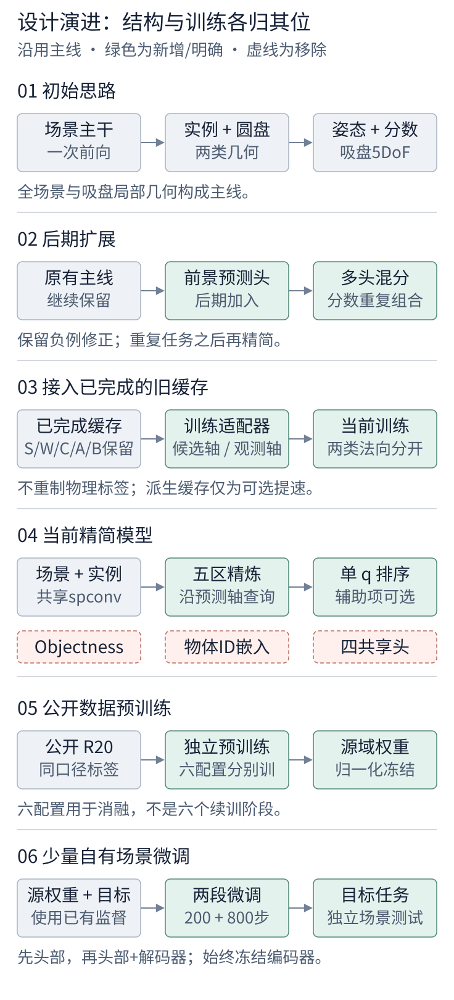

# 设计如何演进：原始想法、修正依据与最终取舍

本文回答“之前是什么设计、为什么改、每一步留下了什么”。依据是用户提供的 41 页《20mm 吸盘抓取网络设计方案》对话、原数据提交 `dc4ad6b00535`、当前仓库 `b2680fb47fe6` 和核对过的原论文/源码。它是设计决策记录；没有用尚未获得的训练成绩替设计背书。

## 1. 起点：最初的主线有价值

原对话第 1–3 页的核心组合是：全场景稀疏主干、前置分割、实例全局信息、20 mm 接触环局部几何、连续质量及法向输出。这个组合对应三个不同尺度的信息：局部表面决定气密性，实例整体形状帮助判断抗力矩，邻物与桌面决定可接近性。

**保留：** 单场景共享计算、5DoF `(p,n)`、实例池化、实例均衡候选、吸盘专用局部精炼、连续物理质量。

**具体化：** 当前参考实现的主干是 spconv `SPconvUNet14D`，默认 512 维输出；本项目投影到 256 维。2 mm 网络体素与已有标签生成体素独立。已有前置实例分割供池化与采样，不重新训练前景判断。

初始说明中有需要纠正的来源解读：SuctionNet 上游 Seal 不是把 8 个网络扇区直接当标注；这里实际使用 72 扇区。MultiGraspNet 的吸盘 refiner 在原方法中不以独立训练损失优化；不能据此推断本项目的法向监督已经有对应 GT。BCE 本身可接收软标签，不能只根据损失名字推断标签必然是硬二值。[来源](REFERENCES.md#主干与相关方法)

## 2. 后续对话中哪些改动应留下

第 16–20 页关于负样本与映射的修正是必要的。早期“先筛高 Seal、无碰撞候选，再邻域取最高分，无匹配置零”会同时丢掉有效低分，并把没有评估到的点误作失败。旧 `dc4ad6b` 数据已经采用同实例、距离与法向门控下的最近几何候选，并独立保存 `gt_valid`。

**保留这个改正，不倒退回初稿：**

- 已评估正分、已评估零分、未匹配未知点三者分开。
- 候选匹配依据几何，不选择邻域最高分来抬高标签。
- 已有 GT-A 与 GT-B 同时保存，支持检验 Wrench 的价值。
- 实际冻结 Seal 归一化随标签保存，训练和评价一致使用。

相对地，第 34–41 页又引入了新的 Objectness 头、多个共享均值/方差头、复合排序公式、固定 S/C 门限、四组消融与四阶段训练的混合描述。这些并未自动补强最初的主线：每增加一个模块，都需要标签含义、前向接口及实验归因来支撑。

## 3. 第一轮修正：先让质量和姿态说同一件事

### 3.1 发现的实际问题

旧 `dc4ad6b` 在生成质量时使用物体 Seal 候选原始轴；extras 存在时，逐帧 `gt_normal` 却可被 PCA 方向替换。这让质量与姿态目标可能对应两个不同吸取动作。当前新仓库 producer 已把两种法向分开，但用户已制作完的旧 NPZ 不会因此自动更新。

### 3.2 现在的处理

**已有 S/W/C/A/B 不变。** DataLoader 用 `instance_id → 场景物体行`、`candidate_row → 原候选数组行` 和原物体/相机姿态恢复 `normal_label`。旧文件没有输入观测法向，则由原 RGB-D 重建 `normal_obs` 并按 `source_indices` 对齐。可选 sidecar 只缓存派生结果。

这是一项索引与坐标适配，不是重新计算物理标签。旧、新两版的标量质量公式和归一化方法已核对一致；旧数据本来就使用 L2 力矩。详细字段表和算法见 [LEGACY_DATA_ADJUSTMENT.md](LEGACY_DATA_ADJUSTMENT.md)。

同时，训练不用旧 `normal_valid` 代表“有没有法向”：它原来含 PCA/高质量/无碰撞条件。新的 `axis_valid` 由有效匹配轴和有效观测法向独立推导，保留低质量候选的几何监督。

## 4. 第二轮修正：把模型缩回可解释的主结构

### 4.1 从窄 ROI 改为完整工作空间一次主干

初稿只在目标周围留 25 mm 上下文，而现有 Collision 标签已检查到轴向 150 mm。局部输入不足以观察这些标签依赖的正常邻物障碍。因此保留完整工作空间观测，一次稀疏主干共享所有实例。不是每个实例单独重复运行整网。

### 4.2 从物体 ID 先验改为可见几何

具体 `class_id` 是物体模型身份，不等于材质、质量和质心。直接用它做 embedding 容易把熟悉物体身份当成质量线索，也不自然覆盖 Novel。改为 mean/max 实例池化、点到可见中心的相对位置、可见尺寸和相机系重力。业务分类仍可决定“抓哪个实例”，不进入物理质量网络当质量真值。

### 4.3 从宽环与全局 KNN 改为按物理区查询

原先 10–20 mm 的“唇边环”较宽，后版实现先取全局 KNN 再切区，还可能在普通平面上被近处点占满。现在先分别查询 core、18–22 mm lip、杯体、安装座、接近段，再区内限制点数。比如近似 2 mm 平面网格中，128 个最近点覆盖半径约 `sqrt(128*4/pi)≈12.8 mm`，通常还到不了 20 mm 唇边；这是正常采样几何，不是罕见异常情形。

区域计数来自抽样前，空扇区只提供“未观测到”的特征，不自动判气密失败。分区用预测轴，训练和推理一致；详细边界、维度和聚合见 [MODEL.md](MODEL.md#6-沿预测轴读取五个物理区域)。

### 4.4 从混合乘分改为一个最终 q

主 q 学习 `S*W*C`，S/W/C 仅提供辅助监督。不再先平均 q 和 S×W、再乘 C、再叠加多个惩罚。这样训练目标和排序含义一致，辅助分支是否有收益也能由 E4/E5 直接判断。

## 5. 第三轮修正：训练和实验分开定义

原对话把“不同监督/不同模块的对照”写成“四阶段课程训练”，还在测试集上比较和选择方案。这会混淆架构变化、初始化历史和优化预算。

现在明确分为：

| 概念 | 当前定义 | 目的 |
|---|---|---|
| 六组源域实验 | E0–E5 独立训练 | 判断 A/B 目标、实例融合、物理分区和辅助监督 |
| 源域 warmup | 同一模型前 2 epoch，覆盖监督点并升学习率 | 稳定开始训练；不是一个消融模型 |
| 开发验证 | 官方训练池内固定 90/10 场景划分 | 选择 checkpoint 和模型 |
| 官方测试 | 锁定设计后 Seen/Similar/Novel 报告 | 衡量源域泛化 |
| 目标微调两阶段 | 同一预训练模型，先头、再头+decoder | 适配少量自有场景 |

预训练统一 57,600 次 optimizer updates。损失先实例内平均、再帧和 batch 平均。候选高低分采样统一按 GT-A，不因主目标 A/B 而偷偷变化。模型选取依据实际预测姿态的项目 R20 评价，不能查最近缓存分数替代。

## 6. 第四轮修正：当前目标是预训练，再迁移

用户明确了公开数据训练的用途：得到能在少量自有场景继续学习的权重。因此交付不仅是公开测试成绩，还包括 `encode_scene`、`score_at_pose`、新任务头接口、冻结策略、源域回放和 checkpoint 定义。

目标数据已有哪种监督，就用对应模式：

| 目标已有内容 | 处理 | 保持的边界 |
|---|---|---|
| 同 R20 语义的物理标签 | `dense_proxy` 微调原 q_B；已有分量/轴才参加对应损失 | 沿用源归一化，不要求补齐不存在的分量 |
| 实际执行点、轴和成功/失败 | `attempt_success` 新成功头，用真实执行姿态分组 | 不把二值结果冒充物理 q_B；未执行点不是失败 |
| 只有 RGB-D | 先 zero-shot 使用预训练模型 | 不虚称已经可以有监督微调 |

首轮微调 1,000 updates：200 步头部适配，随后 800 步头部+低学习率 decoder；encoder 和 BatchNorm 统计冻结。每次更新目标/源帧 1:1，目标与源损失分别归一化后按 `L_target+.5*L_source` 合并。使用独立目标场景选择，不把同一录像的相邻帧拆开制造测试收益。

对于成功标签，评价必须在实际记录的 `(p_exec,n_exec)` 上完成；当前预测法向不能替换当时执行轴后仍复用原成功标签。这是模型接口此次特别增加 `score_at_pose` 的原因。

## 7. 不确定性放在什么位置

保留“高分也可能判断不稳”的思路，但本轮不把共享四个头的差异直接命名为已验证的认知不确定性。UISN 官方实现的 MC-dropout 计算路径也不能被概括成“几个共享头就等价实现”。[来源](REFERENCES.md#主干与相关方法)

当前默认先完成 q 模型；之后可冻结它，仅拟合一个残差尺度头，验证 `q-lambda*sigma` 是否改善**同一候选集合**的排序。没有收益则 lambda=0。误差剔除曲线下降只表示排序有帮助，不足以证明概率校准；源域物理残差也不能直接作为目标成功概率的不确定性。

这是可选的小实验，不是预训练、微调和旧数据使用的前置工作。

## 8. 决策总表：改了什么，改到哪里

| 原设计/后续新增项 | 当前结论 | 实现位置 |
|---|---|---|
| 单场景主干+实例整体+接触局部 | 保留并明确张量尺寸 | MODEL §§2–7 |
| 先筛高分候选再匹配、无匹配置零 | 采用旧数据已完成的最近几何匹配与gt_valid | DATA_ADAPTER §§3–4 |
| PCA 轴与原质量混用 | 旧缓存 adapter 恢复原候选轴；新 producer 已修复 | LEGACY_DATA_ADJUSTMENT §§3–5 |
| 把 normal_valid 当全部轴几何有效性 | 新推导 axis_valid | MODEL §4 |
| 25 mm ROI | 完整工作空间一次主干；分组复用现有150mm包络 | MODEL §§3、6 |
| 新 Objectness 头、物体 ID embedding | 本轮不采用 | MODEL §§2–3 |
| 全局 KNN 后切环带 | 区域先查后限额 | MODEL §6 |
| q 与辅助分支重复乘分 | 一个 q 排序，辅助联合监督 | MODEL §7 |
| 四共享头即认知不确定性 | 可选预测残差尺度，不作同等解释 | MODEL §10 |
| 消融作为顺序课程 | 六独立公开实验；目标两阶段另定义 | TRAINING / EXPERIMENTS |
| 公开训练就是最终交付 | 公开预训练→少量目标微调→独立目标验证 | FINETUNING |
| 旧数据必须重制以适应新producer | 质量缓存保留，按需派生两类法向 | LEGACY_DATA_ADJUSTMENT |

## 9. 本轮范围

实现重点是现有数据能正确进模型、模型能按明确预算预训练、已有少量目标监督能通过明确接口微调、结果能按同一姿态规则比较。真实标签尚未测量的质量/质心、特殊材质、大范围深度空洞、时序跟踪、多模型集成和额外 200 mm 扫掠模块不成为本轮的强制前置。正常业务中的已有执行检查继续使用即可。

原 PDF 的页码是历史依据，不要求将私人对话原文件复制到 GitHub。代码与论文链接、哪些是事实哪些是建议，见 [REFERENCES.md](REFERENCES.md)。
