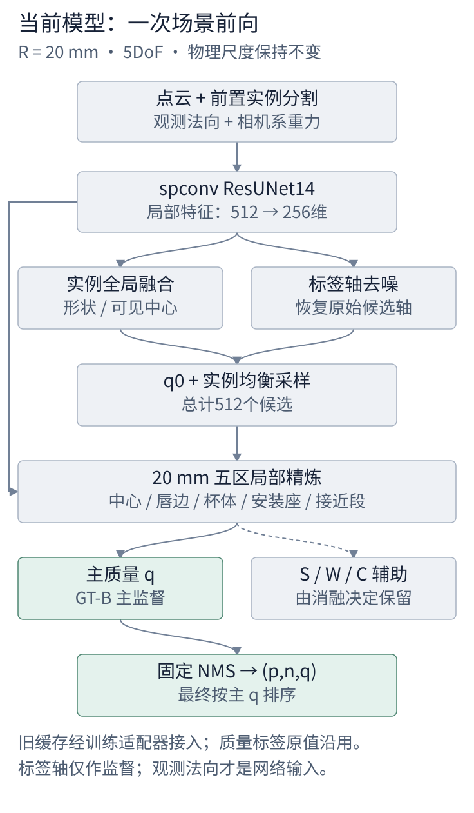

# 模型实现规格

> 状态：待实现的模型接口与首轮配置，不是已完成训练的结果。数据基线为用户已用 `codex-profile@dc4ad6b00535` 制作的缓存；当前仓库 producer 已有的字段修正不代表这些缓存已被更新。先读 [旧数据调整](LEGACY_DATA_ADJUSTMENT.md) 和 [数据适配](DATA_ADAPTER.md)。本文所有长度均为米，20 mm 指**吸盘半径**。

## 1. 本模型实际学习什么

输入单帧深度观测、已有前置实例分割和相机系重力方向；整幅场景只运行一次稀疏主干。输出每个候选的 `(point_cam, normal_out_cam, q)`。接触点直接取观测表面点，法向指向物体外侧；圆形吸盘绕自身轴的转角交给执行端，因此是 5DoF 表达。

公开数据预训练学习两件事：从单视角几何恢复既有标注候选的轴，以及预测固定 R20 物理代理质量。随后用少量自有场景适配，详见 [微调规格](FINETUNING.md)。`q=0.8` 不是实机成功率 80%；有实际成功/失败标签时启用独立 `task_success_head`。

主结构借鉴关系和源码出处见 [参考来源](REFERENCES.md)。下面的宽度、分组、采样及损失是本项目首轮设计，不声称已通过实验验证，也不声称完整复现 MultiGraspNet 或 UISN。



## 2. 输入与输出契约

### 2.1 Dataset 交给模型的输入

`P` 是当前 packed batch 的原始观测点总数，`V` 是唯一体素数，`B` 是场景帧数。点顺序由 Dataset 统一管理。

| 名称 | 形状/类型 | 语义 |
|---|---|---|
| `xyz_cam_m` | `[P,3] float32` | 原始/增强后的观测坐标；局部分组仍使用这些点 |
| `normal_obs` | `[P,3] float32` | 观测法向，单位向量，朝相机；无效时为零 |
| `normal_obs_valid` | `[P] bool` | 观测法向有效性 |
| `instance_id_input` | `[P] int64` | 控制实验用 GT mask，实际管线用前置预测 mask；0 为背景 |
| `batch_index` | `[P] int64` | 帧索引；实例聚合键为 `(batch_index, instance_id_input)` |
| `g_cam` | `[B,3] float32` | 相机坐标系单位重力方向 |
| `voxel_coords` | `[V,4] int32` | spconv 的 `(batch,z,y,x)` 非负体素坐标 |
| `voxel_features` | `[V,8] float32` | 下述八维特征的体素均值 |
| `inverse_map` | `[P] int64` | 原始点映射到该 batch 的体素行号 |
| `source_indices` | `[P] int64` | 原始图像展平像素，用于结果追踪；不是输入特征 |

监督放在独立 `targets` 字典，不传给 `encode_scene`：`instance_id_gt`、`gt_A`、`gt_B`、`seal_target`、`wrench_target`、`collision_free_target`、`quality_valid`、`normal_label`、`axis_valid`，可保留 `gt_valid` 供诊断。其中后三个分量目标分别对应S/W/C，文件字段映射见DATA_ADAPTER。训练采样器可以读取 GT，但推理采样器不能读取。

八维输入为：

```python
x = concat(
    (xyz_cam_m - frame_observed_centroid) / 0.1,  # 3
    normal_obs,                                  # 3
    (instance_id_input > 0).float()[:, None],      # 1
    normal_obs_valid.float()[:, None],            # 1
)                                                # 8
```

固定的 `0.1 m` 只调数值量级，不把每件物体缩放到单位球。背景和邻物作为场景上下文保留，实例 ID 和具体 `class_id` 不做数值特征或物体身份 embedding。RGB 暂不作为输入；不增加 Objectness 预测头。

### 2.2 前向输出

| 名称 | 形状 | 用途 |
|---|---|---|
| `q0_all` | `[P]` | 全观测点粗分；只有满足采样条件的点才可成为候选 |
| `normal_out_all` | `[P,3]` | 预测外法向 |
| `seed_point_index` | `[B,512]` | packed 点下标；padding 可存 0，但必须配 `seed_valid` |
| `seed_valid` | `[B,512] bool` | 区分真实候选与 padding |
| `point_cam_m` / `normal_out_cam` | `[B,512,3]` | 最终候选姿态 |
| `pose_features` | `[B,512,256]` | 局部精炼后的共享特征 |
| `q` | `[B,512]` | 最终物理代理质量，用于默认排序 |
| `seal_aux` / `wrench_aux` | `[B,512]` | 启用辅助监督时输出 S、W |
| `collision_free_logit` | `[B,512]` | C 的 logit；推理展示时再 sigmoid |
| `task_success_logit` | `[B,512]` | 仅实际成功标签微调时启用 |

背景点可能有粗分数值，但不会因此作为候选。未匹配标签的前景点仍可在推理中成为候选，不能用 `gt_valid` 删掉它们。

## 3. 稀疏主干与实例特征

### 3.1 主干

采用 [graspness_modern 固定版本](REFERENCES.md#主干与相关方法) 的 spconv `ResUNet14`，保留其残差层配置，只把输入通道设为 8。原实现输出 512 维，经过 `Linear(512,256) + LayerNorm + ReLU` 得到体素特征，再用 `inverse_map` 取回原始点特征 `F_local[P,256]`。

网络体素边长为 **0.002 m**。数据制作配置中的 `voxel_m=0.005` 服务于原来的数据几何处理；两者不是同一个参数。网络使用 2 mm 不要求重制现有标签。体素坐标原点可按帧平移到非负，但不可把这个平移混入原始物理坐标。稀疏卷积输出坐标若重新排序，应按坐标建立 output-to-input 映射，不能盲目假定行号不变。

只平均输入连续特征；不平均 `instance_id`、`source_indices`、GT 分数或法向标签。边界处不同实例可以共享一个体素特征，但标签仍逐原始点监督，局部分组仍用原始点。

### 3.2 实例融合

对每个可观测前景实例，计算：

```python
g_j = MLP_512_256_128(concat(mean(F_local[j]), max(F_local[j])))
center_j = mean(xyz_cam_m[j])
extent_j = max(xyz_cam_m[j]) - min(xyz_cam_m[j])
relative_i = (xyz_cam_m[i] - center_j) / 0.1
extent_i = extent_j / 0.1
F_fused[i] = MLP_393_256_256(concat(
    F_local[i], g_j, relative_i, extent_i, g_cam[batch_index[i]]
))  # 256 + 128 + 3 + 3 + 3 = 393
```

所有中间 MLP 默认每个隐藏层为 `Linear + LayerNorm + ReLU`；最后的 256/128 维特征层仍保留该激活。回归/logit 输出层只 Linear，不加归一化。背景的实例特征、relative、extent 置零。

可见中心和包围盒描述观测形状，不是实际质心、质量或完整物体尺寸。训练增强/点丢弃后重新计算。关闭实例融合的消融中，将 `g_j/relative/extent` 三块置零，保留同一 393 维接口与重力输入；实例模块本身不计算。这样同样的后续头可复用。

## 4. 粗质量头与轴头

### 4.1 粗质量

`q0 = sigmoid(MLP_256_128_1(F_fused))`。E0 监督 `gt_A`；E1–E5 监督 `gt_B`。粗分用于高分覆盖采样，最终分数由独立 `q` 头给出。

### 4.2 有界切平面残差

轴头从 `concat(F_local, normal_obs)` 的 259 维输入，经 `259→128→2` 输出 `(a,b)`。最后一层权重和偏置置零，使初始 `n_hat=n_obs`。

给定有效单位观测法向 `n0`，选三个坐标轴中与 `n0` 的绝对内积最小者 `e`，固定并列时选 x、再 y、再 z，构造：

```python
u = normalize(cross(e, n0))
v = cross(n0, u)
ab = raw_ab * min(1, tan(radians(30)) / max(norm(raw_ab), 1e-8))
n_hat = normalize(n0 + ab[0] * u + ab[1] * v)
```

仅对 `normal_obs_valid=True` 的行构造正交基和单位化；`normal_out_all` 的其他行直接置零，避免普通深度边界的零法向参与归一化。

这是主标注轴的去噪估计，不是从一个标注轴学习所有可吸取姿态。30° 是首轮残差范围，与现有匹配角门控一致；经过轻度噪声增强后它不是标签误差的严格上界。无有效观测法向的点仅作上下文，不作为候选，也不进入轴损失。

`normal_label` 必须是质量评分使用的原始候选法向。当前 producer 的 `gt_normal` 已满足；旧 producer 可能把 PCA 法向写到同名字段，需由 adapter 根据 `candidate_row` 和场景姿态恢复。不能把旧 `gt_normal` 当输入或未经判断当主目标。

```python
quality_valid = gt_valid & (instance_id_gt > 0)
axis_valid = (quality_valid & normal_obs_valid
              & finite_nonzero(normal_label) & finite_nonzero(normal_obs))
L_normal_point = 1 - dot(n_hat, normalize(normal_label))
```

`normal_valid` 在当前 producer 中仍带有 `~collision & S>0.2` 的高质量筛选，不等于几何法向是否存在。本方案另外推导 `axis_valid`，碰撞或低 Seal 的有效匹配点也可提供轴监督。不得对余弦取绝对值；正反方向对执行不同。

## 5. 512 个候选如何选

每帧固定槽位 512，按 `instance_id_input>0` 且至少有一个有效观测法向点的实例均分。对实例按 ID 排序，商作为基础名额，余数依次分配。全局不足 512 个独立点则 padding，不复制一个点来制造额外监督。

推理时，实例内先取粗分最高的 `min(N_j,4*M_j)` 个有效法向点，再做 FPS 选 `M_j` 个。FPS 距离为原始米制坐标；第一个点固定为粗分最高者，分数/距离并列用原始点下标破局。达到可用点总数就停止。

训练时使用与所有实验共享的采样规则：

| 阶段 | 当前模型推理提议 | 有效 `gt_A>=0.2` | 有效 `gt_A<0.2` |
|---|---:|---:|---:|
| 第 1–2 epoch | 0% | 50% | 50% |
| 第 3–40 epoch | 50% | 25% | 25% |

监督两组均要求输入实例内前景、有效观测法向和 `quality_valid`，按无放回随机抽取。比例换算为整数后，将余数分给提议组；warmup 分给高 A 组。不足从同实例尚未使用的对应合法池补齐：先另外一个有标签池，再当前提议池，最后全部有效观测法向点。最终只根据实际点的标签掩码计算损失。

采样遵循“先每组独立取额度、并集去重、再补齐”的确定顺序；同一点不可重复计损失。提议组不以 `gt_valid` 筛点。E0–E5 的高低分划分一律使用 A，避免 A/B 对比额外混入不同采样分布。监督采样的 GT 仅在训练出现。

## 6. 沿预测轴读取五个物理区域

### 6.1 坐标与查询

对候选中心 `c`，取 `n = n_hat.detach()`。按确定性方式生成切平面 `u,v`，训练时再围绕 `n` 随机旋转切平面；验证/推理固定不随机旋转。此随机 roll 仅用于分组坐标和周向计数，不用于轴头的二维残差参数化。

对场景点 `p`，计算 `d=p-c`、`x=d·u`、`y=d·v`、`z=d·n`、`rho=sqrt(x²+y²)`。同实例由**输入 mask**判断，不读取 GT 标签身份。

| 区域 | 查询条件 | 点数上限 | 径向/轴向特征尺度 |
|---|---|---:|---|
| core | `rho<=0.018`，`abs(z)<=0.008`，同实例 | 32 | `r=0.022, h=0.008` |
| lip | `0.018<rho<=0.022`，`abs(z)<=0.008`，同实例 | 64 | `r=0.022, h=0.008` |
| cup | `rho<=r_cup`，`z_min<=z<=z_max`，异实例或 `z>self_ignore` | 32 | `r=r_cup, h=max(abs(z_min),abs(z_max))` |
| mount | `rho<=r_mount`，`z_min<z<=z_max`，异实例或 `z>self_ignore` | 32 | 同上 |
| approach | `rho<=r_approach`，`z_min<z<=z_max`，异实例或 `z>self_ignore` | 32 | 同上 |

后三段从**该批已有标签实际冻结配置**读取。默认 cup 为 `(r=.022,z=[-.002,.025])`，mount 为 `(.028,(.025,.070])`，approach 为 `(.028,(.070,.150])`，同实例接触忽略高度 `.004`。网络区间边界避免重复分入相邻碰撞段；评分仍调用原 producer 条件，不改既有标签。背景属于异实例障碍上下文。

±8 mm 是网络观察带，不替换 Seal 的 18–22 mm 环带和 72 扇区计算。core/lip 与 cup 在空间上允许有功能性重叠：前两者看接触表面，cup 看外侧障碍。

**先查区域，再限额。** 每个圆柱可先以 `c+((z_min+z_max)/2)*n` 为中心、`sqrt(r²+((z_max-z_min)/2)²)` 为半径做覆盖球查询，再过滤精确条件；core/lip 用 `sqrt(.022²+.008²)` 覆盖球。空间索引可在 CPU/GPU 构建一次并供所有种子复用。不能先全局最近邻 128 再分区，通常会漏掉 20 mm 唇边及高处障碍。

区域超过额度时，区内 FPS 选点，首点选距离区域几何中点最近者；并列按原始点下标。少于额度时 padding 并带点掩码。空区不复制中心点。

### 6.2 每区编码和精炼特征

先将 `F_local` 投影 `256→64`。每个区域点的输入为：

```python
concat(F_local64, x/r, y/r, z/h, rho/r,
       dot(normal_obs, n), same_instance, normal_obs_valid)  # 71维
```

无效点法向的点积置零，保留 validity。五区共享 `71→64→64` 点 MLP；每区分别 masked max 与 masked mean，再拼 `log1p(区域过滤后、限额前点数)` 和 `has_points`，共 130 维。使用各区独立 `130→64` 区域投影，空区最终直接置零。计数来自实际观测，不是补齐后的槽位数。

lip 另外在抽样前按 `atan2(y,x)` 均分 8 个扇区，提供 8 维 `log1p(count)`。某扇区没有观测点不能硬判 Seal=0；网络可结合遮挡上下文学习。8 扇区是低维输入特征，不是把原标注的 72 扇区改成 8。

```python
h = MLP_590_256_256(concat(
    F_fused_seed,                  # 256
    core64, lip64, cup64, mount64, approach64,  # 320
    lip_sector_log_counts,         # 8
    n, g_cam,                      # 3 + 3
))
```

关闭局部精炼时不查五区，把 320+8 维置零，保留相同融合层和最终 q 头。将 `n_hat` 在传给质量分支的所有位置 detach，包括 zone 特征的轴和最终拼接；因此质量梯度不通过轴特征改变轴头，轴头由有向法向损失训练。共享主干仍收到各项正常梯度。

## 7. 评分头、辅助头和损失

| 头 | 输入 | MLP | 输出/监督 |
|---|---|---|---|
| 主 q | `h` | `256→128→1` | sigmoid；GT-B，E0 为 GT-A |
| Seal S | core64 + lip64 + 扇区8 | `136→128→1` | sigmoid；`gt_seal_norm` |
| Wrench W | h256 + 实例128 + relative3 + extent3 + n3 + g3 | `396→128→1` | sigmoid；`gt_wrench_eval` |
| 无碰撞 C | cup64 + mount64 + approach64 + seed 的 F_local256 + n3 | `451→128→1` | logit；`1-collision_flag` |

S/W/C 仅 E5 启用；其他实验不实例化这些辅助头。默认最终分数就是 q，不再乘 C、S、W，也不手工混合 `0.5*q+0.5*S*W`。q 已经学乘积标签，重复乘分会改变目标。分别预测条件均值再相乘，也不一般等于预测乘积的条件均值。

```python
L = L_q + L_q0 + 2.0*L_normal + 0.50*L_S + 0.25*L_W + 0.10*L_C
```

| 损失 | 点集合 | 逐点函数 |
|---|---|---|
| `L_q0` | 所有 `quality_valid` 观测点 | `smooth_l1(q0,y,beta=.05)` |
| `L_q` | `seed_valid & quality_valid[seed]` | `smooth_l1(q,y,beta=.05)` |
| `L_S/L_W` | 同 q | `smooth_l1(pred,target,beta=.05)` |
| `L_C` | 同 q | `binary_cross_entropy_with_logits(logit,1-collision_flag)` |
| `L_normal` | 所有 `axis_valid` 观测点 | `1-dot(n_hat,normal_label)` |

每项先按 `(batch_index, instance_id_gt)` 在实例内取均值，再在帧内对有监督的实例取均值，最后对有监督的帧取均值。某项没有有效点时返回与计算图连接的零，例如 `pred.sum()*0`；不能把 padding 或未知标签纳入分母。不使用大批量隐式零来压低损失。

GT-B 的姿态是原候选轴，而细分组使用接近该轴的预测轴；这是去噪训练中的近似，不是“每个训练预测轴都有准确物理评分”。零残差初始化和独立轴监督控制这个偏差，本轮不在线为全部预测姿态重算 Seal。最终实验必须评价实际 `(p,n_hat)`，并报告法向角误差，不能用缓存分数假装验证了新姿态。若要学习大角度自由姿态搜索，需另一个多姿态标注任务，不在首轮范围。

## 8. 预训练与微调共用的 API

```python
class Suction20Net(nn.Module):
    def encode_scene(self, batch_input) -> EncodedScene:
        # 仅观测输入：一次主干，返回raw点、F_local/F_fused、实例统计、g_cam、空间索引。
        ...

    def score_at_pose(self, encoded, point_cam_m, normal_out_cam,
                      instance_id, proposal_q0=None, feature_point_index=None,
                      pose_batch_index=None):
        # 实际传入的中心和外法向决定分组。
        # feature_point_index只是取seed特征，不将point替换为邻近观测点。
        # 输出h、q、可选S/W/C、可选task_success_logit。
        ...

    def forward(self, batch_input, *, sampler_mode="inference", targets=None):
        encoded = self.encode_scene(batch_input)
        q0_all, normal_out_all = self.predict_dense(encoded)
        seeds = self.sample(encoded, q0_all, sampler_mode, targets)
        valid_index = seeds.index[seeds.valid]  # 展平为Q个真实候选，不评分padding
        pose = self.score_at_pose(
            encoded,
            encoded.xyz_cam_m[valid_index],
            normal_out_all[valid_index].detach(),
            encoded.instance_id_input[valid_index],
            proposal_q0=q0_all[valid_index],
            feature_point_index=valid_index,
            pose_batch_index=encoded.batch_index[valid_index],
        )
        pose = scatter_to_seed_slots(pose, seeds.valid)  # 恢复[B,512,...]及seed_valid
        return merge_dense_and_pose_outputs(...)
```

`score_at_pose` 统一接收展平的 `point_cam_m/normal_out_cam[Q,3]`、`instance_id[Q]`，返回 `h[Q,256]`、各分数 `[Q]` 和 `pose_feature_valid[Q]`。`pose_batch_index[Q]` 指向所属场景，空间查询和实例聚合必须同时使用它；单帧encoded可以省略并默认为0，多帧调用必须提供。`feature_point_index[Q]` 是packed原点下标，不是像素索引。查询只包含真实姿态，padding在外层scatter时补齐。目标数据collate同样输出每个attempt的 `batch_index`。

`score_at_pose` 的 normal 必须先单位化，方向保持为外法向。对目标域已有执行记录，使用**实际执行的** `p_exec,n_exec` 计算 pose features，不能悄悄用当前网络法向替换记录中的执行法向，再监督同一个成功标签。优先使用记录像素/点索引关联 seed feature；否则在同一帧、同实例内找 5 mm 以内最近观测点作为特征锚点。锚点只决定特征取值，物理分组中心仍为 `p_exec`。无法关联的记录只跳过该记录，不当作失败。

实际成功微调头为：

```python
task_success_logit = MLP_260_128_1(concat(
    h, n_exec, dot(n_exec, g_cam)[:, None]
))
```

它与物理 q 头分开，不把实际二值成功标签覆盖 `q_B` 的含义。公开预训练后该头尚未训练；其初始化、损失、源域回放和冻结规则见 [FINETUNING.md](FINETUNING.md)。`proposal_q0` 是可选追踪信息，当前 590 维 pose 特征不拼接它，调用时缺省不会改变分数含义。

## 9. 推理、去重和执行

推理按第 5 节产生 512 候选，逐实例按最终分数排序。两候选**同时**满足中心距离 `<.010 m` 且有向法向夹角 `<15°` 时视为重复，保留高分者。每个输入实例最多 10 个，研究评价再合并取全场景 Top-50；实际业务可返回每目标实例 Top-3。q 相同用粗分，再用原点下标破局。

默认不加未经验证的 `Seal>.35`、`C>.85` 门限。现有执行系统若已有 IK/常规碰撞检查，所有比较方法保持相同；离线 AP 不根据 GT 筛选。

```text
z_tool = -normal_out_cam
p_pre = point_cam_m + d_pre * normal_out_cam
p_press = point_cam_m - d_press * normal_out_cam
```

`d_pre/d_press`、TCP 偏置、真空控制沿用用户已有正常动作参数，不由网络文档虚构标定结果。对接 SuctionNet API 数组时采用其实际代码的顺序 `[score,nx,ny,nz,px,py,pz]`，不是把位置与法向反过来。

## 10. 可选残差尺度头

完成主模型选择后才考虑；它不是主训练、微调或交付的前提。冻结主模型，对自然推理候选的 `h` 接 `256→64→1` 输出 `a`：

```python
v = 1e-4 + softplus(a)
sigma = sqrt(v)
L_var = 0.5 * ((y - q.detach())**2 / v + log(v))
score = q - lambda_ * sigma
```

末层 bias 约 `-4.60`，初始 sigma 约 `.1`，不加硬上限。仅训练该头 3 个 epoch，沿用90场景×每轮64视角、有效batch4，共4320次更新；AdamW固定LR `1e-3`、weight decay `1e-4`，不另调度。主模型保持eval、残差头train，候选不再做高低 A 过采样，均值、轴、提议和主干冻结。使用有效物理质量标签，仍按实例归一化。验证 `lambda∈{0,.25,.5}`，包含关闭选项。

它估计当前 q 的经验预测残差尺度，可能混合噪声、模型误差、遮挡、映射误差；不是已证明的认知不确定性或失败概率。比较固定候选/姿态，只改变排序。微调改变了特征或 q 后，旧 sigma 默认关闭；不将公开物理质量的残差尺度直接用于目标成功概率头。

## 11. 代码拆分与实现中必须保留的区别

| 待实现模块 | 职责 |
|---|---|
| `models/backbones/spconv_resunet14.py` | 固定参考版本主干包装、输出映射与投影 |
| `models/instance_fusion.py` | packed 实例池化、可见几何、融合 |
| `models/candidate_sampler.py` | 训练/推理候选采样、唯一点和 padding |
| `models/contact_grouping.py` | 五区查询、区域掩码、计数、局部编码 |
| `models/heads.py` | q0、轴、q、辅助、task_success、可选 residual |
| `models/suction20net.py` | encode/score_at_pose/forward 与组合开关 |
| `suction20/losses.py` | 监督掩码、实例/帧归一化、目标域损失 |

实现优先级：先用数据适配器跑 E1 的完整输入→姿态→R20 评估，再加入 I/R 模块，最后接少样本微调入口。这里只规定必要接口，不要求第一天实现时序跟踪、模型集成、全物体质量测量或极端传感器扰动。

| 容易误写的地方 | 必须采用的规则 |
|---|---|
| 当前 producer 修好法向就认为旧数据已更新 | 根据来源/schema处理每份缓存，见旧数据调整文档 |
| `candidate_id` 当数组行号 | 使用 `candidate_row` |
| `gt_valid=False` 当质量 0 | 不参加监督，仍保留作输入/提议 |
| 保存的 `normal_valid` 直接控制全部轴训练 | 按本设计单独计算 `axis_valid` |
| 预测 mask 覆盖实例 GT | 输入实例与监督实例分开保存 |
| 2 mm 网络体素触发重制 5 mm 数据 | 分离两个配置来源 |
| 先全场景 KNN 再找吸盘环带 | 先区域查询再限额 |
| 训练用 GT 轴分组、推理用预测轴 | 两阶段均用预测轴；执行记录用其真实轴 |
| 质量梯度经轴特征偷偷更新轴头 | 传往质量分支的轴整体 detach |
| q 再乘 S/W/C | q 单独排序，辅助头用于监督/诊断 |
| 直接用邻近缓存 gt_B 评价新轴 | 实际 `(p,n)` 重新评价 |

