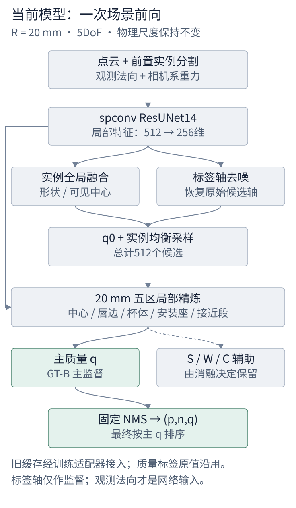

# 20 mm 吸盘模型：预训练、少量场景微调与实验规格

**先复用已经制作完成的数据，训练公开场景预训练模型，再用少量自有场景微调。** 这是本组文档的实施目标。模型采用完整场景一次稀疏主干、实例整体信息和20mm接触局部精炼，输出接触点、外法向及一个最终分数。

## 状态与优先级

本组文档基于用户已使用的 `codex-profile@dc4ad6b00535` 数据方法，并核对了本仓库 `b2680fb47fe6` 的实际代码。**用户已完成的旧缓存是本次训练的起点；当前producer的更新不会自动改变旧文件。** 旧、新版本S/W/C/A/B公式相同，可直接保留这些分数；两类法向与掩码在训练适配层处理。

当前仓库已有数据生成代码；这次新增的是可实施的模型/训练/评价规格、配置示例和结构图。`datasets.py`、模型、预训练/微调脚本、任意姿态评价器及可选sidecar转换脚本仍待按文档实现。示例CLI明确是未来接口，不宣称现在就能启动训练。

参数冲突时按职责取值：已有标签的物理含义和归一化以**该批数据实际冻结配置**为准；模型结构以 MODEL 为准；源域预算以 TRAINING 为准；目标微调以 FINETUNING 为准；评价定义以 EXPERIMENTS 为准。原PDF和上一轮报告是历史设计记录，本目录是结合现有数据与预训练用途整理后的实施版本。

## 阅读入口

| 文档 | 解决的问题 | 实现者应得到的内容 |
|---|---|---|
| [LEGACY_DATA_ADJUSTMENT.md](LEGACY_DATA_ADJUSTMENT.md) | 已完成的旧数据怎么用 | 逐字段保留/派生决策、候选轴恢复、观测法向重建、只读adapter与可选sidecar |
| [DESIGN_EVOLUTION.md](DESIGN_EVOLUTION.md) | 为什么从原设计改成这样 | 六步演进、保留/修改/延后原因、历史设计与当前源码的区别 |
| [DATA_ADAPTER.md](DATA_ADAPTER.md) | 数据如何进入网络 | 来源识别、坐标、像素/候选索引、掩码、packed batch和inverse map |
| [MODEL.md](MODEL.md) | 网络如何写 | 张量维度、轴残差、种子采样、五区查询、每个头、损失与score_at_pose |
| [TRAINING.md](TRAINING.md) | 公开预训练如何跑 | 固定90/10划分、40轮/57600步、优化器、增强、验证、checkpoint |
| [FINETUNING.md](FINETUNING.md) | 少量自有场景如何用 | 两种现有监督接口、200+800步、冻结规则、回放和目标验证 |
| [EXPERIMENTS.md](EXPERIMENTS.md) | 如何判断设计是否有用 | 六组独立消融、任意姿态R20评价、目标数据指标、后续正常工况执行比较 |
| [REFERENCES.md](REFERENCES.md) | 每项事实来自哪里 | 固定源码版本、原论文链接、原PDF页码、建议与已知事实的边界 |

## 首轮固定决策

| 项目 | 规格 |
|---|---|
| 吸盘 | 半径0.020m，直径40mm；沿用已有标签参数 |
| 数据 | 旧缓存只读复用，缺的观测/标签轴在adapter派生 |
| 输入 | 完整工作空间观测、前置实例mask、观测法向、相机系重力 |
| 主干 | spconv ResUNet14，一次场景前向；512→256维 |
| 网络体素 | 0.002m；不修改数据生成5mm采样 |
| 实例 | 可见形状池化128维；不使用物体ID embedding |
| 姿态 | 接触点取观测点，预测相对观测法向的有界二维残差 |
| 候选/分组 | 每帧512；按实例均衡；core/lip/cup/mount/approach先查询再限额 |
| 质量 | q0/q主监督GT-B；辅助S/W/C不重复乘进最终q |
| 公开预训练 | 90训练/10验证场景，64视角/场景/轮，40轮，57600 optimizer updates |
| 目标微调 | 优先用已有监督；头200步，头+decoder800步，encoder与BN统计冻结 |
| 回放 | 每次更新2目标帧+2源帧；`L_target+.5*L_source` |
| 实验 | E0–E5是6个独立预训练；目标只对选中架构做zero-shot/微调比较 |
| 选模 | 每实例Top-1 Q20@.4；AP-R20并列参考 |

以上数值是明确的初始配置，不是已完成实验后的最优结论。首轮不把不确定性、真实质量/质心标定、时序跟踪或极端工况专项作为前置。

## 已制作数据的两种使用路径

**推荐路径：训练时适配。** 读原NPZ的S/W/C/A/B，按原候选索引恢复 `normal_label`，从原RGB-D得到 `normal_obs`，得到统一接口后开始训练。原数据目录不动。

**可选路径：先做sidecar。** 若重复计算观测法向明显拖慢加载，将上述派生数组一次写入独立的adapter缓存；只增加派生内容，不复制/重算物理标签。训练优先读sidecar，缺失时按同一算法在线派生。字段、算法、路径和未来命令均在旧数据调整文档中。

不要因训练缺新字段而重跑 `run-all`，不要用新 `configs/suction20.json` 覆盖旧 `config_frozen.json`，不要把旧 `normal_valid=False` 解读成该点没有合法候选轴。旧配置的历史键应普通JSON读取，不送入新producer的严格未知键校验。

## 实现顺序和文件职责

| 顺序 | 待实现文件 | 可交付行为 |
|---:|---|---|
| 1 | `suction20/datasets.py` | 旧/新缓存→同一batch；输入/监督隔离；真实数据可加载 |
| 2 | `models/backbones/spconv_resunet14.py`、`models/heads.py`、`models/candidate_sampler.py`、`models/suction20net.py` | E1输出可追踪的(p,n,q)，单场景主干、正确采样和掩码 |
| 3 | `suction20/losses.py`、`suction20/eval_r20.py`、`scripts/train_pretrain.py`、`scripts/evaluate.py` | E1可训练，实际姿态可评价，checkpoint可选取/续训 |
| 4 | `models/instance_fusion.py`、`models/contact_grouping.py` | I/R模块与E0–E5开关完整，跑同预算对比 |
| 5 | `suction20/target_dataset.py`、`scripts/finetune.py`、成功头 | 已有少量目标监督进入微调，源域回放，独立目标验证 |

没有I/R时用零块保持共享融合/评分接口，不能改变输出头数量让对照不公平。第一阶段无需完成所有可选模块；先得到一个端到端E1，再扩展。

配置示例：

- [pretrain_e5.yaml](examples/pretrain_e5.yaml)：完整源域主方案；E0–E4只切换明示开关与目标。
- [finetune_dense_proxy.yaml](examples/finetune_dense_proxy.yaml)：已有同语义物理标签。
- [finetune_attempt_success.yaml](examples/finetune_attempt_success.yaml)：已有真实执行成功/失败。

## 当前检查与后续实现验收

本次文档整理已对照旧、新数据代码；仓库现有测试 `python -m pytest -q` 通过24项。它们验证现有数据代码的合成测试路径，不是模型训练结果，也不是用户数据盘的逐帧运行报告。

后续代码实现只需优先覆盖正常路径上的关键一致性：候选行号与物体变换、未知/零分掩码、点/像素同步选择、batch实例不串号、inverse map不平均标签、分组实际覆盖唇边、实际姿态评价能复现少量原候选。这些是使训练含义正确的实现检查，不另扩一套防御性工程。

实现完成后更新本页“待实现”状态及真实运行结果，避免后来使用者把设计文档中的命令误当现成脚本。
