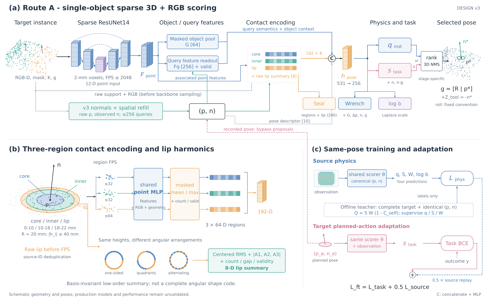

# 路线 A：单物体稀疏 3D + RGB 方法架构图

更新：2026-11-18（北京时间）。本图依据 [v3 设计提交 `c23f4b8`](https://github.com/chichu-lv/suctionnet_modern_20mm/commit/c23f4b81b88d6646e40e49248d2df0b30026d70b) 中的[路线 A](ROUTE_A.md)、[共同数据与标签](DATA_AND_LABELS.md)和[训练评价规范](TRAIN_EVAL_REPRODUCE.md)绘制。图内使用英文，正文提供中文说明及中英图注。

**这是待实现的 v3 方法设计图。** 已有 NumPy 参考验证的是几何与数据合同；本图不表示 A 的生产网络、实例 teacher、训练器或部署已经完成，也不提供新模型精度或速度实测。物理质量合同仍为 `gt_INST20_pose_v2`。



图中只展示观测编码、姿态条件评分、关键接触几何和监督关系。点云、环带和输出姿态均为确定性生成的结构示意，不是实验输入或模型预测截图。几何绘制比例用于说明结构，不作为尺寸测量依据。

## 下载与编辑

| 文件 | 用途 |
|---|---|
| [矢量 SVG](../figures/instance-route-a-architecture.svg) | 编辑文字、模块、点云和连线；画布 220 × 135 mm |
| [矢量 PDF](../figures/instance-route-a-architecture.pdf) | 论文排版与打印；220 × 135 mm |
| [高清 PNG](../figures/instance-route-a-architecture.png) | 4400 × 2700；汇报和文档预览 |
| [共同绘图源代码](../figures/render_instance_route_architectures.py) | 确定性生成 A/B 图及导出文件 |

蓝色表示共享观测编码，橙色表示姿态条件接触编码，青色表示几何摘要，粉色表示历史规划动作及任务监督。实线表达模型信息流，训练监督关系在训练面板中单独表达。融合操作表示特征拼接后经过 MLP，不表示逐元素相加。

## 1. 三个子图

### (a) 共享实例编码与姿态条件评分

目标实例的原始 RGB-D、实例掩码、相机内参及重力构成共同输入。法向采用同实例带掩码 3×3 平滑与 ±3 像素差分；平滑只影响法向估计，原始接触点与精细支撑保留。

2 mm 体素代表点与最多 2048 点 FPS 控制主干预算，12 维点输入进入新的 SpConv ResUNet14 封装，生成逐点特征。全物体池化得到上下文 `G`；特征关联得到查询中心 `Fq` 和原始支撑上的局部特征。原始 RGB、几何和有效性还有独立旁路，即使某处缺少主干特征，也不把已有观测一并删除。

共同候选由原图实例像素的 16×16 分层、位反转 Morton 顺序与无重复回填生成。每个候选使用原始像素接触点和对应的观测法向。**主干点、候选和原始接触支撑是三个不同集合**：候选不必来自 2048 个主干点，接触细节也不限于主干采样。

对于指定 `(p,n)`，三区域接触描述、唇口摘要、`Fq`、`G` 与姿态条件共同形成 `h_pose`。物理质量、Seal、Wrench、Laplace log-scale 和任务成败由五个独立头输出。图中 `h_pose` 是学习到的融合特征，`h_i` 则表示局部点沿查询轴的几何高度。

**Seal 头直接读取三区域特征和 lip 摘要；它不只读取 `h_pose`。** Wrench 头另读取 `G`、相对接触位置、轴和重力，任务头另读取轴及轴与重力的点积。精确连接见第 3 节。

源域或未完成任务微调时按 `q_inst` 排序；完成目标任务微调后默认按任务概率排序。随后执行真实 3D 位置与有向轴 NMS，并把被选中的同一 `(p,n)` 转为相机系接触姿态。图中没有学习轴头、初始 `q0` 或旧 `instance_fusion` 模块。

### (b) 三区域接触几何与唇口谐波

每个查询以接触点 `p` 为原点、外向轴 `n` 为轴向，使用同实例、同组件的原始支撑计算径向距离 `rho` 与几何高度 `h_i`。core、inner 和 lip 三个区域分别进行逐点编码和掩码池化，输出三个区域特征。原始 RGB 与不依赖人工切向坐标基的几何标量一起进入点编码器。

青色支路来自**区域 FPS 前、source ID 去重后的原始 lip 支撑**。它提取中心化高度 RMS、前三阶圆谐波幅值，以及点数、最大循环角间隙和有效标记。原始高度仍进入逐点编码；中心化摘要只补充圆周起伏分布，不取代绝对接触高度。

图中不同高度排列说明：即使高度多重集相同，半圈台阶、四象限交替和高频交替也可能具有不同的低阶幅值。前三阶幅值对切平面基的整体旋转不变，但不保留相位、高阶结构或完整表面形状，也不意味着整个相机系网络严格旋转不变。缺测和采样密度仍影响摘要，必须同时保留支持信息。[v3 边界核验](BOUNDARY_REVIEW.md)

### (c) 物理预训练与历史规划动作适配

源域网络只读取实例观测；完整目标几何仅用于离线 teacher，在**同一个精确 `(p,n)`** 上计算 Seal、Wrench 和目标自碰，生成实例物理质量标签。teacher 输出通过损失监督网络，不作为推理输入。

目标适配读取历史 `planned_pipeline_contact`。粉色路径绕过候选选择，直接把记录的中心和有向轴送入同一个姿态评分器；它仍然使用共享实例编码与接触特征。几何锚点只用于关联支持，不替换记录的接触中心或轴。

每条历史动作的结果只监督该动作的一次任务 BCE。源域回放继续训练物理分支，默认目标为 `L_task + 0.5 L_source`。前 200 次更新仅训练输出头，随后 800 次更新有限解冻 decoder、接触和融合相关模块；encoder 与 BatchNorm 参数及统计保持冻结。具体参数组和归约以[共同训练规范](TRAIN_EVAL_REPRODUCE.md)为准。

## 2. 推荐图注

### 中文图注

**路线 A：单物体稀疏 3D 与 RGB 吸取评分架构。** (a) 目标实例的 RGB-D 观测经稀疏几何主干生成点级特征和全物体上下文。共同图像分层采样提供接触点与观测轴；原始支撑上的三区域接触特征、唇口摘要及逐查询语义共同形成姿态条件表示，并输出物理质量、Seal、Wrench、残差尺度和任务成功分数。记录的历史规划姿态绕过候选选择，复用同一个评分器。(b) 在查询姿态下对 core、inner 和 lip 编码，并从区域采样前的原始 lip 提取中心化高度 RMS、前三阶圆谐波幅值和支持摘要，以补充环向结构。(c) 完整目标几何仅供离线同姿态物理监督，质量目标保留目标自碰；历史动作结果监督任务头，源域回放保留物理目标。点云、接触区域和姿态均为结构示意；本图对应 v3 设计，不表示模型已完成训练或部署。

### English caption

**Route A: single-object sparse 3D and RGB suction scoring.** (a) A sparse geometric backbone encodes the observed target instance into point features and object context. Shared image-stratified proposals provide contact points and observed axes. Raw-support contact descriptors, a lip summary and query-specific features condition separate physical and task outputs. Recorded planned poses bypass proposal selection and reuse the same pose scorer. (b) Core, inner and lip regions are encoded relative to each query. Centered height RMS, the first three circular-harmonic magnitudes and support statistics are computed from raw lip observations before regional sampling, retaining low-order angular structure without fixed tangent-coordinate inputs. (c) Complete target geometry is used only by the offline same-pose teacher, whose instance-quality target retains target-self collision. Recorded outcomes supervise the task head, with source replay preserving physical objectives. All geometric illustrations are schematic; the figure specifies the v3 design rather than a trained or deployed model.

## 3. 关键维度与分支连接

| 模块 | 输入与输出 | 说明 |
|---|---|---|
| 主干输入 | 12 维 | 相对位置 3 + RGB 3 + 观测法向 3 + 相机系重力 3；RGB/法向有效性为旁路掩码 |
| 稀疏主干 | ResUNet14，512→256 | 每个真实主干点得到 256 维特征 |
| 全物体上下文 `G` | mean/max：512→128→64 | 对真实主干点做掩码池化；不是完整物体物理质心 |
| 局部特征投影 | 256→64 | 同组件特征关联；缺失时保留原始 RGB/几何旁路 |
| 单点接触编码 | 64 + 3 + 8 = 75→64→64 | 局部特征、RGB、无任意切向坐标输入的几何量与有效性 |
| 单区域描述 | mean/max + count/nonempty：130→64 | 三个区域各输出 64 维，共 192 维 |
| 原始 lip 摘要 | 8 维 | count、最大循环角间隙、nonempty、RMS、A1/A2/A3、harmonic_valid |
| Query 融合 | 256 + 64 + 192 + 8 + 10 + 1 = **531→256→256** | Fq、G、三区域、lip 摘要、姿态描述、query_feature_valid；输出 `h_pose` |
| `q_inst` 头 | `h_pose`：256→128→1，sigmoid | 独立预测实例物理质量 |
| Seal 头 | 区域 192 + lip 摘要 8 = **200→128→1**，sigmoid | 直接读取接触特征旁路 |
| Wrench 头 | `h_pose` 256 + G 64 + Δp 3 + n 3 + g 3 = **329→128→1**，sigmoid | Δp 按 0.1 m 归一化 |
| `ell` 头 | `h_pose`：256→128→1 | Laplace 残差尺度的对数，不是 log-variance |
| Task 头 | `h_pose` 256 + n 3 + n·g 1 = **260→128→1** | 输出 task logit；sigmoid 后为任务概率 |

10 维姿态描述为 `(p−mu_vis)/0.1`、`n`、`g_cam` 和 `n·g_cam`。`mu_vis` 是完整可见支持的几何均值，只用于平移归一化，不替代 teacher 的完整对象质量模型。

上述连接以 [A 设计 JSON](reference/route_a.json) 和[路线 A 规格](ROUTE_A.md)为准。现有 E5 的 8 通道 wrapper 与预测头不能仅靠修改配置字段变成这张图中的模型。

## 4. 姿态来源、标签与推理边界

### Canonical 候选与历史动作

canonical 候选的中心来自原始有效深度像素，轴来自共同 v3 观测法向。先形成最多 256 个唯一候选的完整序列，再取默认训练前 128 个；可选 64 个也为同一序列前缀。候选不足时保留实际数量，不复制观测凑预算。

历史动作直接输入记录的 `(p_plan,n_plan)`，不需要落在候选池中，也不进行候选注入。当前目标数据的 `actual_execution_verified=false`，因此监督含义是给定观测及规划命令的成败，不能把粉色路径标成已核验的实际执行轨迹。支持锚点不移动姿态；缺失 `Fq` 与缺失合法几何支持也须区分处理。[共同查询合同](DATA_AND_LABELS.md)

### 含目标自碰的物理质量

$$
C_{\mathrm{self}}=C_{\mathrm{seal,self}}\lor C_{\mathrm{target,envelope}},
\qquad
Q_{\mathrm{inst20}}=S_{20}W_{20}(1-C_{\mathrm{self}}).
$$

碰撞标记为 true 表示发生目标自碰。外部物体和桌面不进入该实例标签；Seal 与 Wrench 的辅助真值不因自碰导致 `Q_inst=0` 而被强行改成零。模型没有独立碰撞分类头，`q_inst` 也不是两个预测辅助头的乘积。

完整目标几何仅用于离线 teacher。图中局部接触窗口、原始 RGB 与全物体可见上下文不能证明隐藏部位或完整接近路径无碰撞。新质量是学习代理，不是机器人可达性或轨迹安全证明。[目标自碰合同](DATA_AND_LABELS.md)

### 评分与接触姿态输出

源域阶段按 `q_inst` 排名，目标适配后默认按 `sigmoid(task_logit)` 排名；可选分数组合属于另行验证的配置，不是本图默认路径。输出接触点和轴与被评分的姿态一致，选中后不再使用深度中位数移动接触点。

工具接近轴满足 `tool +Z = −n_out`。给定接触点和轴后，roll 由明确的输出约定补全；这不表示网络另外学习了 roll，也不保证跨帧运动连续。contact→TCP 与相机→机器人变换来自标定，图示只表示相机系接触姿态。

## 5. 重新生成图

在仓库根目录执行共同脚本。只生成可编辑 SVG：

```bash
python docs/figures/render_instance_route_architectures.py --route a
```

生成 SVG，并同时导出 PNG 与 PDF：

```bash
python docs/figures/render_instance_route_architectures.py --route a --export
```

输出文件为 `docs/figures/instance-route-a-architecture.svg`、`.png` 和 `.pdf`。渲染依赖及导出工具以[共同绘图脚本](../figures/render_instance_route_architectures.py)的说明为准；不需要真实训练数据、模型权重或 GPU。结构示意由固定规则生成，图的再生成不运行物理 teacher、神经模型或机器人。

相关入口：[路线总览](README.md) · [路线 A 详细规格](ROUTE_A.md) · [路线 B 架构图](METHOD_ARCHITECTURE_B.md) · [共同数据与标签](DATA_AND_LABELS.md) · [v3 边界核验](BOUNDARY_REVIEW.md) · [旧 E5 方法架构图](../METHOD_ARCHITECTURE.md)
