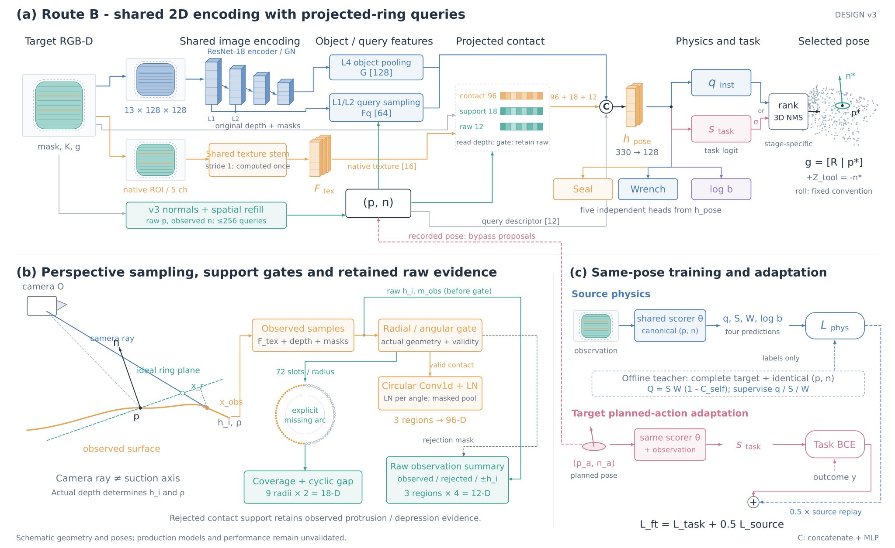

# 路线 B：共享二维编码与投影环带方法架构图

更新：2026-11-18（北京时间）。本图依据 [v3 设计提交 c23f4b8](https://github.com/chichu-lv/suctionnet_modern_20mm/commit/c23f4b81b88d6646e40e49248d2df0b30026d70b)，展示 **B 的共享图像编码、姿态条件投影环，以及同姿态物理监督和历史规划动作适配**。物理质量合同仍为 `gt_INST20_pose_v2`。

**当前为工程设计架构图。** 新 B 模型、实例 teacher 接线、训练器和部署引擎尚待实现；图中的输入、环带与输出姿态是结构示意，不是实验样本或实际模型预测。网络和数据定义以 [路线 B 规格](ROUTE_B.md)、[共同数据与标签](DATA_AND_LABELS.md)及 [v3 边界复核](BOUNDARY_REVIEW.md)为准。



图内采用英文标注，蓝色表示共享编码，橙色表示接触几何与环向编码，青色表示支持/原始观测摘要，粉色表示历史规划动作和任务监督。圆圈 **C** 表示拼接后经 MLP 融合，不表示逐元素相加。完整物体编码每实例运行一次，给定不同查询时读取共享特征并重建对应接触描述。

## 下载与编辑

| 文件 | 用途 |
|---|---|
| [矢量 PDF](../figures/instance-route-b-architecture.pdf) | 论文排版与打印；220 × 135 mm |
| [矢量 SVG](../figures/instance-route-b-architecture.svg) | 可编辑文字、模块、几何与连线 |
| [高清 PNG](../figures/instance-route-b-architecture.png) | 4400 × 2700；文档和汇报预览 |
| [共同绘图源代码](../figures/render_instance_route_architectures.py) | 确定性生成 A/B 架构图及导出文件 |

## 1. 三个子图与推荐图注

### (a) 共享编码与姿态条件评分

目标物体的 RGB-D、实例掩码与相机内参形成两条共享图像路径。完整物体上下文经 ResNet-18 encoder 提取中层语义和全局表示；原生像素 ROI 经 stride-1 纹理 stem 保留细节。前者同时产生按查询中心投影位置读取的 `Fq` 和全物体池化的 `G`，后者产生可供所有查询读取的 `Ftex`。

普通候选的中心来自原始深度，轴来自共同 v3 观测法向；指定的 `(p,n)` 生成米制理想环，并投影到原图与纹理 ROI。读回真实深度后，接触支持门控决定哪些槽位进入环向网络。三区域环特征、显式支持摘要、门控前原始观测摘要，与 `Fq`、`G` 和查询描述共同融合为 `h_pose`。

五个独立预测头均从 `h_pose[128]` 读取：实例物理质量、Seal、Wrench、Laplace 残差 log-scale 与任务 logit。源域模型按实例质量排序；完成目标适配后默认按任务概率排序，再执行米制 NMS 和姿态补全。没有 U-Net、逐查询二维栅格 CNN，或将整图池化替代 `Fq` 的路径。

### (b) 投影支持与原始高度旁路

理想环只规定接触平面上的取样位置。相机射线打到真实表面后，实际半径 `rho`、相对高度 `h` 与角槽偏移可能改变；必须读取真实深度再判断支持，不能把理想环的 `h=0` 当作观测结果。

图中的 **原始观测在接触门控之前分叉**。有效接触 token 进入 circular Conv1d；接触 mask 生成逐半径覆盖率和最大循环缺口。另一条路径保留门控前 `m_obs` 与实际高度，同时接收门控拒绝标记，形成原始观测与正/负高度摘要。因视差或分区不一致被拒绝的凸起/凹陷不会随接触 token 清零而丢失。

环分支在每个角度内跨通道执行 LayerNorm，沿原角度支持做 masked mean/max；原 mask 不扩张、不压紧。显式缺口摘要区分相同覆盖率下的连续缺测和交替缺测。三个区域使用同构但权重独立的环编码器，角向卷积权重在各自区域的角位置共享。几何阈值、中心槽例外和数值精度以 [B 接触支持合同](ROUTE_B.md)及 [边界复核](BOUNDARY_REVIEW.md)为准。

### (c) 同姿态预训练与任务适配

源域离线 teacher 使用完整目标几何和实际参与监督的同一 `(p,n)` 生成 Seal、Wrench 与目标自碰分量，形成 `Q_inst=S*W*(1-C_self)`。这些标签监督网络的物理分支；完整目标几何不进入图像编码器。质量是独立预测头的输出，不是在前向中把预测 Seal 与 Wrench 相乘得到。

目标域的历史**规划**动作直接提供 `(p_plan,n_plan)`，通过粉色条件连线进入同一个姿态评分接口。它绕过普通候选选择和默认观测轴替换，但仍执行按该姿态的 `Fq` 读取、投影采样、支持门控与融合。一次记录的结果只监督该动作的任务 BCE；源域回放保留物理目标。历史动作不需要插入普通候选池，特征锚点也不移动记录中的中心。

### 中文图注

**路线 B：共享二维编码与可靠投影环带查询。** (a) 完整实例上下文与原生分辨率纹理分别编码一次。逐查询语义特征、物体上下文和由指定接触点及轴向驱动的投影环特征，共同生成物理质量、密封、力矩、残差尺度与任务成败输出。(b) 理想环用于选择相机射线；读回真实深度后执行径向和角槽一致性门控。环向编码保留有效接触证据，同时显式汇总覆盖率、最大循环缺口，以及门控前的原始高度，避免缺测和被拒绝凸起的信息丢失。(c) 源域采用同姿态物理监督；历史规划动作直接条件化同一评分器，其结果监督任务头，并保留源域回放。圆圈 C 表示拼接后经 MLP 融合。几何和输出姿态均为结构示意，方案尚待生产实现与实测。

### English caption

**Route B: shared 2D encoding with supported projected-ring queries.** (a) Full-object context and native-resolution texture are encoded once per instance. Query-local semantics, object context, and contact evidence conditioned on the specified point and axis are fused to predict instance quality, seal, wrench, residual scale, and task outcome. (b) Ideal rings select camera rays; observed depth determines the actual contact geometry and radial/angular support gates. Circular encoding is accompanied by explicit coverage, cyclic-gap, and pre-gate height summaries, preserving missing-support and rejected-obstacle evidence. (c) Same-pose physics supervision trains the source model. Recorded planned actions directly condition the same pose scorer; their outcomes supervise the task head with source replay. Circled C denotes concatenation followed by an MLP. Geometry and output poses are schematic; production implementation and performance evaluation remain pending.

## 2. 关键维度与规格对应

### 2.1 共享图像编码与接触读取

| 模块 | 输入与输出 | 说明 |
|---|---|---|
| 完整物体上下文 | `13×128×128` | RGB3、相对 XYZ3、观测法向3、重力3、有效实例 mask1；完整对象 letterbox，不是固定毫米比例 |
| 语义骨干 | ResNet-18 encoder，GN8 | L1/L2/L3/L4 为 64/128/256/512 通道；没有 decoder |
| 查询语义 `Fq` | L1/L2 各投影为32通道，按 query 位置采样，合为64维 | 两级特征分别为 stride4/8；位置读取遵循半像素与 `align_corners=False` 合同 |
| 对象上下文 `G` | L4 masked mean/max：`1024→128` | 每实例共享；不替代 query-local 语义 |
| 原生纹理输入 | `5×H×W` | RGB3、相对深度1、有效实例 mask1；保留原图像素分辨率 |
| 纹理 stem | `5→16`、depthwise `16→16`、pointwise `16→16` | 全部 stride1；GN8；只对实例 ROI 编码一次 |
| 理想环模板 | 9半径×72角度 | core `[0,5,9]`、inner `[10,14,17]`、lip `[18,20,22]` mm；中心只读取一次并广播 |
| 单槽 token | 纹理16＋几何/有效性9＝25维 | 几何来自真实观测；无效接触槽整体清零 |
| 单区域环编码 | 3半径×25＝75通道；`75→16→16→16` | kernel1/3/3，stride1，circular padding；逐角度 `LayerNorm(16)` |
| 单区域池化 | masked mean16＋max16＝32维 | 使用原角支持；全空返回零 |
| 三区域接触特征 | `3×32=96` | 各区域结构相同、权重独立 |
| 支持摘要 | `9×2=18` | 每半径的接触覆盖率与最大循环无效间隙 |
| 原始观测摘要 | `3×4=12` | 观测比例、接触拒绝比例、最大正高度、最大负高度绝对值 |

9×72是648个逻辑槽，r=0优化后每 query 最多577个不同模板位置；实际命中的原图像素可能重复。离散槽覆盖率不等于真实物理面积覆盖率，中心广播也不能冒充72个独立圆周观测。

### 2.2 330维融合与五个独立输出头

| 融合输入 | 维数 |
|---|---:|
| 对象上下文 `G` | 128 |
| 查询语义 `Fq` | 64 |
| core/inner/lip 环特征 | 96 |
| 逐半径支持摘要 | 18 |
| 逐区域原始观测摘要 | 12 |
| 查询描述：相对位置、轴、重力、实例三轴尺寸 | 12 |
| **合计** | **330** |

融合 MLP 为 `330→128→128`，输出 `h_pose[128]`。五个头的隐藏层均使用 ReLU，不使用 dropout。

| 输出头 | 输入与层宽 | 输出语义与监督 |
|---|---|---|
| `q_inst` | `h_pose`，`128→64→1`，sigmoid | 独立预测含目标自碰的 `Q_inst`；由同姿态物理质量监督 |
| `seal` | `h_pose`，`128→64→1`，sigmoid | 连续 `S20` 辅助监督 |
| `wrench` | `h_pose`，`128→64→1`，sigmoid | 连续 `W20` 辅助监督 |
| `ell` | `h_pose`，`128→64→1` | Laplace 残差尺度 `log b`；与质量残差共同进入 NLL，不存在独立 ell 真值 |
| `task_logit` | `h_pose`，`128→64→1` | 历史规划动作结果的 BCEWithLogits；推理时 sigmoid 得到任务概率 |

这里没有独立 `C_self` 预测头，也没有 `q_sw` 输出头。`q_sw=S*W` 保留为离线标签和诊断项。精确结构、归一化、输入字段和导出边界见 [路线 B](ROUTE_B.md)与 [设计 JSON](reference/route_b.json)；该 JSON 是规格快照，不是现有 E5 训练入口可直接加载的配置。

## 3. 两种姿态来源与共同评分接口

### 普通候选

共同法向使用同实例3×3 XYZ平滑加±3像素差分，但候选中心仍来自原始有效深度。候选采用位反转 Morton 的16×16图像分层，并逐轮进行格内二维 FPS 回填；先形成最多256个唯一候选，再取源训练默认128项前缀。验证/推理最多256项，支持不足时记录实际数量，不复制点凑预算。[共同法向与采样](DATA_AND_LABELS.md)

### 历史规划动作

目标记录直接走 `encode_instance(observation)` 与 `score_at_pose(encoded,p_plan,n_plan,...)`。`actual_execution_verified=false` 表示当前数据未核验真实末端执行轨迹，因此图中使用 `Recorded planned action`。记录轴不被观测法向替换，也不因坐标图切换而翻转符号。中心的几何支持锚点只用于验证和特征读取，不修改原始规划点。

两种查询共用网络参数和图像编码；查询的中心与有向轴决定本次接触采样。最终输出所选 query 的原始 p/n，随后按工具 `+Z=-n` 补全旋转；roll、相机到基座和 contact到TCP 由共同输出合同处理。图中的6-DoF输出不意味着网络另外学习了任意 roll，也不等于已经验证机器人可达或完整接近轨迹。[训练与位姿输出](TRAIN_EVAL_REPRODUCE.md)

## 4. Teacher、任务目标与几何边界

离线质量定义为：

$$
Q_{\mathrm{inst20}}=S_{20}W_{20}(1-C_{\mathrm{self}}).
$$

`C_self` 保留冻结协议中的目标密封腔自碰和目标工具包络自碰，不包含邻物或台面。完整对象几何仅供离线 teacher 使用；模型仅观察目标的可见 RGB-D。网络投影环并不穷尽隐藏表面或完整接近体积，支持门控也不证明无自碰。外部碰撞继续属于下游规划器边界。

源预训练对同一 p/n 使用质量 NLL 与 S/W 辅助回归；目标适配采用：

$$
L_{\mathrm{ft}}=L_{\mathrm{task}}+0.5L_{\mathrm{source}}.
$$

源域的 `ell=log b` 表示残差尺度，不是 MC Dropout 不确定性或直接成功概率。目标结果不反推 S/W 标签，也不把一次动作的成功向20mm圆盘扩散。B 微调前200步更新输出头，后800步开放既定融合、投影、纹理和环模块；ResNet encoder保持冻结，GN/LN affine按模块冻结规则处理。[完整训练配方](TRAIN_EVAL_REPRODUCE.md)

图示保留以下范围：

- 同一实例的语义和纹理每次编码一次，查询批次可分块，但分块不改变评分定义。
- 投影坐标必须读回真实深度；相机射线不等同沿吸盘轴投射。
- 接触拒绝不是 Seal失败标签；原始有限高度仍进入独立摘要。
- 循环卷积与池化不证明任意连续旋转下严格不变，也不完整恢复缺测环带。
- 首版几何正确性基线从原始数据以float64构造和判定；网络特征为FP32。部署精度与边界一致性需单独核验。
- 图中不标尚未测量的毫秒时延、准确率、收敛速度或真实吸取成功率。

## 5. 重新生成图

在仓库根目录运行共同绘图脚本。只生成可编辑 SVG：

```bash
python docs/figures/render_instance_route_architectures.py --route b
```

一次生成 SVG、PNG 和 PDF：

```bash
python docs/figures/render_instance_route_architectures.py --route b --export
```

输出位于 `docs/figures/instance-route-b-architecture.*`。SVG/PDF画布为220×135mm，PNG为4400×2700。绘图源代码定义确定性的几何与版式；它不读取训练数据、不加载模型权重、不运行模型推理。共同脚本也用于 [路线 A 方法图](METHOD_ARCHITECTURE_A.md)。既有 E5 的论文式方法图继续见 [METHOD_ARCHITECTURE.md](../METHOD_ARCHITECTURE.md)，其中的场景编码与五区结构不替代本页的单物体 B v3 设计。
