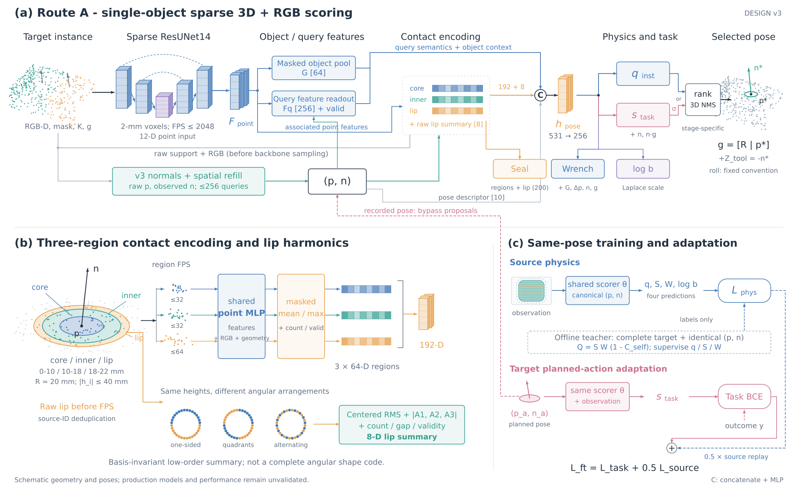

# 路线 A 实施卷宗：单物体稀疏 3D + RGB

本目录是 `route-a-3d-rgb` 分支的开发入口，按数据到实验的顺序整理 `InstanceSuction3D`。共同设计基线为 [a9f4a84](https://github.com/chichu-lv/suctionnet_modern_20mm/commit/a9f4a8451c6bc42cfd8867dd96c051398644ad71)，其中已包含 v3 几何修订和方法架构图。A新模型、共同实例builder/teacher、训练器和原生推理评价已实现。13项CPU几何/模型测试使用显式注入的测试backbone，真实SpConv/GPU、真实完整训练和时延尚未验证；不会自动以CPU替代骨干生成A结果。



图示说明、双语图注及 SVG/PDF 下载见[路线 A 方法架构图](../METHOD_ARCHITECTURE_A.md)。

本轮从头直接使用source scene 0–99全部100场景训练，完整source test 100–189选best；结果明确为 **test_selected，非独立测试估计**，保留预算终点last。目标1676/399/87不变，399 val选微调best。公开半径-only评价协议deferred，不作为开训门槛。

比较入口：[本方法逐一对照现有方法](EXPERIMENT_PLAN.md) · [公开协议状态](../PUBLIC_METHOD_COMPARISON.md) · [论文数值与来源](../reference/paper_baselines.json)。论文数值已填，A公开结果待测，当前实例test指标不替代全景AP。

## 1. 阅读顺序与交付物

| 顺序 | 文档 | 实施后应交付 |
|---|---|---|
| 1 | [数据准备](DATA_PREPARATION.md) | 固定实例/动作清单、资产与标定身份、同姿态 S/W/self/INST 标签 |
| 2 | [预处理](PREPROCESSING.md) | 原始支持、v3 法向、嵌套候选、主干点及关联诊断 |
| 3 | [模型设计](MODEL_DESIGN.md) | 12 通道稀疏编码、三区域与原始 lip 摘要、531 维姿态评分接口 |
| 4 | [后处理](POSTPROCESSING.md) | 分阶段排序、米制 NMS、稳定输出与相机系/工具系变换 |
| 5 | [训练方案](TRAINING_PLAN.md) | 8750 次预训练成功更新、200+800 次微调及可恢复记录 |
| 6 | [实验方案](EXPERIMENT_PLAN.md) | 几何/真实 teacher/短链路验收、正式比较、耗时与失败归因 |

六篇分别固定操作顺序、输入输出和完成条件。共同事实仍以[数据与标签合同](../DATA_AND_LABELS.md)、[训练评价合同](../TRAIN_EVAL_REPRODUCE.md)和 [A 设计 JSON](../reference/route_a.json)为准；本目录对 A 做实施展开。若未来变更共同物理或观测定义，应同步合同、版本及缓存身份后再进入两个路线分支，不能靠本地措辞修改默认值。

## 2. 本路线固定的设计

| 项目 | A 默认合同 |
|---|---|
| 设计身份 | `suction20.instance_routes.design.v3`；JSON 为 `design_spec` |
| 物理质量 | `gt_INST20_pose_v2`；`Q_inst=S20*W20*(1-C_self)` |
| 标签 schema | `suction20.instance_inst20.v2`，true 表示目标自碰 |
| 观测法向 | `organized_masked3x3_span3_v3`，只改变法向估计输入 |
| 候选 | `image_stratified_morton_refill_v3`；完整池最多 256，训练/回放默认前 128 |
| 主干 | 2 mm 体素代表点后 FPS 最多 2048，12 维输入，输出 F256 |
| 姿态评分 | Fq256 + G64 + 三区域192 + lip8 + pose10 + valid1 = 531 |
| 输出头 | q_inst、Seal、Wrench、Laplace log-scale、task logit |
| 历史动作 | 原记录 p/n 直接评分，几何锚点不移动姿态 |
| 输出 | 选中的原 p/n；工具 +Z 为 −n，roll 按固定约定补全 |

原始支持 `P_support`、稀疏主干点与共同 query 是三个集合。主干抽样控制网络成本；原始支持保留唇口细节；query 为 A/B 提供共同评测条件。`mu_vis` 是可见支持的几何均值，不是 teacher 的完整对象质量中心。[A 完整规格](../ROUTE_A.md)

## 3. 实现位置与运行入口

| 模块 | 实际文件 | 验证与剩余工作 |
|---|---|---|
| 数据与查询 | `suction20/instance_geometry.py`、`suction20/instance_data.py`、`scripts/build_instance_dataset.py` | 合成资产接线已验证，真实完整缓存待构建 |
| 同姿态teacher | `suction20/instance_teacher.py` | S/W与目标self接线已实现，真实完整dense一致性/成本待测 |
| A模型/几何 | `models/instance_route_a.py`、`models/instance_route_a_geometry.py` | 13项CPU测试；网络使用注入测试backbone，真实SpConv未运行 |
| 稀疏wrapper | `models/backbones/spconv_resunet14.py` | 可选in_channels，默认8保持旧E5，A显式12；外部源码blob校验保留 |
| 训练 | `suction20/instance_training.py`、`scripts/train_instance.py`、`configs/instance_a.yaml` | 成功步预算、阶段冻结、严格恢复已实现；正式GPU训练待跑 |
| 原生推理评价 | `suction20/instance_inference.py`、`scripts/infer_instance.py`、`scripts/evaluate_instance.py` | 原p/n、稳定NMS、实例/动作评价；不包括公开半径评价器 |

模型默认 `singleton_bn_policy=running_stats`，只处理训练时某BN每通道≤1值的退化输入；正常源训练仍走普通BN。微调期全部BN统计和affine冻结。策略进入checkpoint身份，不新增伪造活动点。

执行顺序为[共同数据构建](DATA_PREPARATION.md#7-可执行的源数据构建) → [骨干准备与100场景训练](TRAINING_PLAN.md#7-可执行命令与运行产物) → [原生推理评价](POSTPROCESSING.md)。训练CLI需提供真实 `--backbone-root`，不存在自动CPU骨干回退。A/B网络与旧8通道E5权重不能互换或无身份迁移。

## 4. 当前可以直接运行什么

已安装PyTorch/pytest/SciPy的CPU环境，在仓库根目录运行：

```bash
python -m pytest -q tests/test_instance_route_a.py
```

当前13项通过，覆盖体素/FPS、邻居/组件、谐波、各头维度、A接触/头部反向、异轴/chunk、缺Fq、空输入与singleton BN。前后向通过显式注入测试backbone；wrapper测试mock外部加载检查8/12通道，不是实际SpConv成功运行。已有Python/NumPy数学参考继续可运行：

```bash
python docs/instance_routes/reference/geometry_contract.py selftest
python docs/instance_routes/reference/revision_contract.py selftest
python docs/instance_routes/reference/sampling_contract.py selftest
python docs/instance_routes/reference/contact_boundary_contract.py self-test
```

继承的四组检查共 29+26+26+48=129 项，记录见 [VALIDATION.json](../reference/VALIDATION.json)。它们覆盖数学与文件关系；真实资产、同姿态teacher、真实SpConv前后向及GPU时间需依照本卷宗继续验收。参考环境安装和演示命令见[共同复现说明](../TRAIN_EVAL_REPRODUCE.md)。

大体积 RGB-D、完整对象几何、标签缓存和 checkpoint 保存在外部数据/运行目录。分支提交源码、配置、必要汇总与可复核的运行身份；未来实验中的成功率和时延只填写实际完成的结果。

`reference/route_a.json` 保持design_spec身份，真正运行配置是 `configs/instance_a.yaml`；CLI显式校验完整train/test范围、模型与数据身份、公开评价deferred状态。
