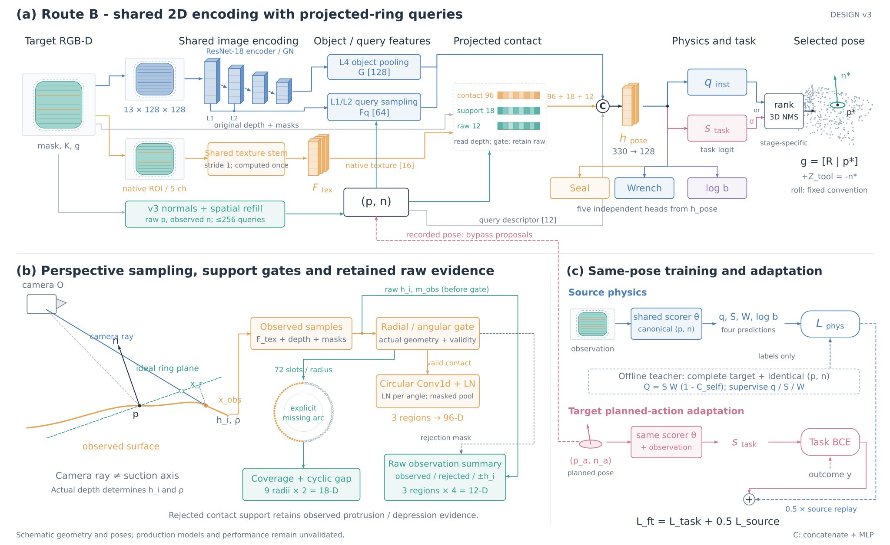

# 路线 B 实施卷宗：共享二维编码与投影环带

本目录是 **`route-b-2d-projected-rings`** 分支的开发入口，将 B 的数据准备、预处理、模型设计、后处理、训练和实验拆为六份可逐项落实的说明。共同起点为 [a9f4a84](https://github.com/chichu-lv/suctionnet_modern_20mm/commit/a9f4a8451c6bc42cfd8867dd96c051398644ad71)，其中已包含 v3 方案和 A/B 方法架构图。

**当前交付状态：B生产模型、共同RGB-D实例builder/teacher、新训练器与本地推理评价代码已实现。** B真实网络CPU前向/反向与12项边界测试已通过，完整真实数据重算、正式训练、GPU性能和部署引擎尚未运行；验收范围与未完成证据分别列出。新路线仍使用物理质量 `gt_INST20_pose_v2`，观测法向、候选和模型设计为 v3。[原始 B 规格](../ROUTE_B.md)与[设计 JSON](../reference/route_b.json)是本卷宗的参数依据。



完整[架构图说明、双语图注和维度表](../METHOD_ARCHITECTURE_B.md)；下载 [SVG](../../figures/instance-route-b-architecture.svg)、[PDF](../../figures/instance-route-b-architecture.pdf)、[PNG](../../figures/instance-route-b-architecture.png)。

本轮直接使用source scene 0–99全部100场景训练，完整source test 100–189选best，结果明确为 **test_selected，非独立测试估计**；保留固定预算last。目标1676/399/87不变。公开评价“只参数化吸盘半径”暂定为deferred，不作为开训门槛。

公开比较入口：[本方法逐一对照现有方法](EXPERIMENT_PLAN.md) · [公开协议状态](../PUBLIC_METHOD_COMPARISON.md) · [论文数值与来源](../reference/paper_baselines.json)。论文数值保留，B公开结果待测，现有实例test指标不替代全景AP。

## 1. 六部分阅读顺序

| 顺序 | 文档 | 实施者应得到的结果 |
|---|---|---|
| 1 | [数据准备](DATA_PREPARATION.md) | 可核验的源/目标清单、共同 query 清单、同姿态 S/W/self/INST 标签及缓存身份 |
| 2 | [预处理](PREPROCESSING.md) | organized 几何与法向、候选回填、13 通道上下文图、5 通道原生纹理 ROI、坐标变换 |
| 3 | [模型设计](MODEL_DESIGN.md) | 共享编码器、Fq/G、投影读取、支持门控、96+18+12 接触描述、330 维融合和五头接口 |
| 4 | [后处理](POSTPROCESSING.md) | 稳定排序、米制 NMS、精确 query 位姿、输出字段与部署数值边界 |
| 5 | [训练方案](TRAINING_PLAN.md) | 唯一首轮配方、正确损失归约、参数冻结、预算、恢复与选模规则 |
| 6 | [实验方案](EXPERIMENT_PLAN.md) | 最小实验集合、统一分母/指标、边界与真实 teacher 检查、计时和结果记录 |

共同事实继续引用[数据与标签合同](../DATA_AND_LABELS.md)、[训练评价合同](../TRAIN_EVAL_REPRODUCE.md)和[v3 边界复核](../BOUNDARY_REVIEW.md)。本目录按实施环节重组这些规定，不建立第二套默认 teacher、采样器或损失参数。若实现发现合同缺口，应先记录问题并修订相应版本，不能在某个模块中隐式放宽门控或复用旧身份。

共同数据、teacher、采样及评价合同发生变更时，必须同步到 A/B 两个分支并记录相同版本，防止后续比较的输入和指标口径漂移。

## 2. 本分支固定设计

| 项目 | B v3 默认 |
|---|---|
| 全局图像 | 完整实例 letterbox，`13×128×128`，不宣称恒定毫米比例 |
| 原生纹理 | RGB3 + 相对深度1 + valid1；不 resize；stride1 stem 输出16通道 |
| 共享语义 | ResNet-18 encoder / GN8；L1/L2 各32通道查询采样得到 Fq64；L4 池化得到 G128 |
| 查询姿态 | 原始 p 与共同观测 n；历史动作直接保留 p_plan/n_plan |
| 接触读取 | 9半径×72角；r=0读取一次并广播；query chunk=64 |
| 接触编码 | 三个独立权重的 circular Conv1d / 每角 LayerNorm 分支，共96维 |
| 支持旁路 | 18维覆盖/最大循环缺口 + 12维门控前原始观测/高度 |
| 融合与输出 | 330→128→128；q、Seal、Wrench、ell、task 五个独立头 |
| 标签 | `Q_inst=S20*W20*(1-C_self)`；保留两个 self 分项和纯 SW 诊断 |
| 默认排序 | 源模型 q_inst；任务微调后 sigmoid(task_logit) |

B 的工程目标是共享二维编码和向量化查询。相机投影、深度反投影和姿态几何仍是必要计算；不恢复逐 query 的局部二维栅格/CNN，也不恢复全量三维球邻域 PCA。有限投影环不能证明隐藏部位或完整工具接近体积无碰撞。[结构与边界依据](../ROUTE_B.md)

## 3. 实现位置和证据边界

| 模块 | 实际实现 | 已验证与待完成 |
|---|---|---|
| 共用实例资产 | `suction20/instance_geometry.py`、`suction20/instance_data.py`、`scripts/build_instance_dataset.py` | 合成RGB-D/资产格式接线；真实完整缓存尚待构建 |
| 同姿态标签 | `suction20/instance_teacher.py` | 冻结Seal/Wrench/target-self接线与合成检查；真实完整dense数据一致性/成本待测 |
| B模型 | `models/instance_route_b.py`，`InstanceSuction2DFastV3` | 12项CPU模型/几何测试通过；真实学习效果和GPU性能待测 |
| 训练 | `suction20/instance_training.py`、`scripts/train_instance.py`、`configs/instance_b.yaml` | 支持源训练、目标微调、成功步预算与严格恢复；完整正式训练未运行 |
| 原生推理评价 | `suction20/instance_inference.py`、`scripts/infer_instance.py`、`scripts/evaluate_instance.py` | 同姿态输出和实例/动作评价；不包含公开半径评价器 |
| 部署导出 | `scripts/export_instance_b.py` 尚未实现 | ONNX/TensorRT、动态ROI、精度对齐和端到端计时待完成 |

最短运行顺序为[构建train/test缓存](DATA_PREPARATION.md#7-可执行的源数据构建) → [直接100场景训练](TRAINING_PLAN.md#7-可执行命令与运行产物) → [同姿态推理和实例评价](POSTPROCESSING.md)。数据不足时使用显式分片/partial身份检查链路，不把它记录成正式全test结果。A/B网络不能因为都输出五个头而互换checkpoint。

## 4. 现在即可运行的检查

在仓库根目录、已安装PyTorch和pytest的环境，先运行B实际模型测试：

```bash
python -m pytest -q tests/test_instance_route_b.py
```

当前12项通过，覆盖网络前后向、query位置梯度、掩码环编码、视差/缺口、chunk和相位、无支持/非有限输入。共同prepare_instance到B网络已做合成RGB-D接线；不是实物吸取成功验证。NumPy数学参考仍可独立运行：

```bash
python docs/instance_routes/reference/geometry_contract.py selftest
python docs/instance_routes/reference/revision_contract.py selftest
python docs/instance_routes/reference/sampling_contract.py selftest
python docs/instance_routes/reference/contact_boundary_contract.py self-test
```

它们分别覆盖29、26、26、48项，共129项合成合同检查。旧栅格和旧法向检查保留作历史数学回归，不是 B v3 默认实现。参考环境为 Python 3.12.14 / NumPy 2.3.5，完整环境、demo 与结果边界见[复现说明](../TRAIN_EVAL_REPRODUCE.md)和[既有验证记录](../reference/VALIDATION.json)。

`reference/route_b.json` 的 `artifact_kind=design_spec`；真正运行配置是 `configs/instance_b.yaml`，由新实例CLI校验本地资产与版本，不能直接交给旧E5脚本。真实数据、完整标签与 checkpoint 存放在外部数据/运行目录，仓库保留配置、实现、清单身份和必要汇总。
